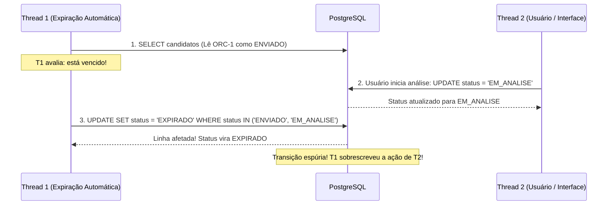

# Parecer de Auditoria Técnica Independente — Planejamento Bloco D (v1.0)

**Projeto:** Sistema de Orçamento para Jardinagem (`jardinagem-app`)  
**Data da Auditoria:** 05 de Outubro de 2026  
**Auditor Responsável:** Auditor Técnico Independente / Arquiteto de Software / Revisor de Conformidade  
**Documento Auditado:** `docs/planejamento/expiracao-orcamentos-plan-v1.0.md`  
**Referência Canônica:** `docs/planejamento/requisitos-cobertura-status-v1.2.md`  
**Status da Auditoria:** `AUDITORIA DE PLANEJAMENTO CONCLUÍDA — BLOCO D v1.0 — REPROVADO PARA CORREÇÃO`  

---

## 1. Sumário Executivo

A presente auditoria técnica independente examinou o documento de planejamento canônico do **Bloco D — Expiração Temporal Automática de Orçamentos (v1.0)**, cujo objetivo formal é planejar o encerramento das duas últimas pendências parciais do projeto: **RF67** e **RN69** (preservando **RN70** e a máquina de estados).

A análise confrontou o planejamento com o conjunto normativo do projeto: RF v2, RN v3, RNF v2, Arquitetura Técnica v1.1, Modelo Físico v1.1, Estratégia de Segurança e RLS v1.6, e a implementação concreta das entidades e repositórios existentes.

Embora o planejamento v1.0 apresente méritos indiscutíveis — como o respeito estrito à autoridade da regra de domínio `Orcamento.verificarExpiracao(dataReferencia)`, a preservação formal dos módulos congelados (Blocos A, B e C, Clientes, Catálogo e Áreas) e a preocupação em não introduzir migrations desnecessárias —, o documento padece de **inconsistências arquiteturais de alta gravidade (CRÍTICO e MAJOR)** que impedem sua homologação no estado atual:

1. **Descompasso Semântico com o Atendimento Literal de RF67 (ACHADO-EXP-01 — CRÍTICO):** A estratégia proposta classifica como "automática" uma avaliação estritamente sob demanda em tempo de leitura (*Just-in-Time* / *Lazy Evaluation* no cliente). Com o aplicativo fechado, o sistema é incapaz de identificar ou persistir a expiração no banco relacional;
2. **Payload Hipertrofiado Violando RNF12 (ACHADO-EXP-02 — MAJOR):** O método proposto `buscarCandidatosExpiracao` realiza `SELECT *, item_orcamento (*, area (*))` com decodificação de geometrias PostGIS para avaliar apenas duas propriedades escalares (`status` e `dataValidade`), tornando irreal a estimativa de latência inferior a 15 ms;
3. **Insegurança e Manipulabilidade do Relógio do Cliente (ACHADO-EXP-03 — MAJOR):** A dependência exclusiva do relógio local do dispositivo Android (`new Date()`) permite que o usuário manipule a data do sistema operacional para burlar a expiração contratual de orçamentos;
4. **Vulnerabilidade de Atomicidade na Guarda Condicional (ACHADO-EXP-04 — MAJOR):** A guarda `.in('status', ['ENVIADO', 'EM_ANALISE'])` ignora mudanças concorrentes legítimas entre o `SELECT` e o `UPDATE` e não inclui a cláusula temporal atômica no banco;
5. **Colisão de Disparadores Concorrentes sem Deduplicação (ACHADO-EXP-05 — MAJOR):** Três gatilhos independentes (`ListarOrcamentosUseCase`, `ObterOrcamentoUseCase` e `AppState listener`) operam sem mecanismos de mutex ou debounce em memória.

Em virtude da presença de 1 achado CRÍTICO e 4 achados MAJOR, o parecer oficial é de **REPROVAÇÃO PARA CORREÇÃO (v1.0)**, condicionando a aprovação à emissão de uma revisão técnica v1.1 saneada.

---

## 2. Método de Auditoria

A auditoria operou sob o princípio de desconfiança técnica sistemática e confrontação empírico-analítica, observando:
1. **Confronto Literal de Requisitos:** Verificação exata da redação de RF67 (*“identificar automaticamente a expiração... quando sua data de validade for ultrapassada”*) contra a dinâmica de execução proposta;
2. **Análise de Fluxo de Dados e Camadas:** Mapeamento da jornada do dado desde a camada de apresentação até o PostgreSQL via PostgREST;
3. **Modelagem de Concorrência e Teoria de Filas:** Simulação de condições de corrida, acessos simultâneos, atrasos de rede e interleaving de transações;
4. **Inspeção de Código Existente:** Verificação dos contratos em `src/domain/repositories/orcamento.repository.interface.ts` e de `src/infrastructure/repositories/supabase-orcamento.repository.ts`;
5. **Auditoria de Índices e Modelo Físico:** Análise do plano de execução teórico sobre as tabelas `orcamento`, `item_orcamento` e `area` segundo o Modelo Físico v1.1.

---

## 3. Matriz Comparativa das 5 Alternativas

A auditoria reavaliou rigorosamente a análise das 5 alternativas propostas na Seção 6 e 7 do planejamento:

| Alternativa | Atende RF67 Literal? | Opera com App Fechado? | Persistência Relacional | Proteção contra Concorrência | Complexidade Operacional | Limitações Principais | Veredito da Auditoria |
| :--- | :---: | :---: | :---: | :---: | :---: | :--- | :---: |
| **A) JIT na Listagem** | Parcial (Apenas ao abrir tela) | Não | Sim (Atômico no PostgREST) | Alta (se bem guardado) | Baixa (Zero migrations) | Banco desatualizado até o usuário abrir a tela de listagem | Insuficiente isoladamente |
| **B) Background Job Mobile** | Parcial (Intermitente) | Parcial (Sujeito a Doze Mode) | Sim | Média | Alta (Dependências nativas) | Android Doze Mode, perda de bateria, expiração de token de sessão RLS | Inviável |
| **C) Backend Agendado (`pg_cron`)** | Total (Literal) | Sim (Autônomo no DB) | Sim (Nativo no PostgreSQL) | Alta (Transacional nativo) | Alta (Reabre Modelo Físico e RLS) | Bypassa RLS (`postgres`), duplica lógica de domínio em SQL, complexo no Supabase local | Incompatível com congelamento atual |
| **D) Triggers / Views** | Não | Não | Não (Virtual) | Baixa | Alta | PostgreSQL não possui trigger de SELECT; quebra PostgREST e ORM | Inviável |
| **E) Híbrida Orquestrada (v1.0 Proposta)** | Parcial (Depende do app) | Não | Sim | Média (Falta cláusula temporal) | Baixa | Falha quando o app permanece fechado; vulnerável a relógio local | **Necessita Refinamento para v1.1** |

---

## 4. Auditoria do Atendimento Literal ao RF67

A auditoria responde formalmente às três perguntas capitais submetidas ao gate:

### PERGUNTA A: Se o aplicativo permanecer fechado durante toda a ultrapassagem da validade, o orçamento será identificado como expirado?
**RESPOSTA: NÃO.**  
Se o aplicativo móvel permanecer fechado durante 1 semana após o vencimento da data de validade, o registro na tabela `public.orcamento` do PostgreSQL permanecerá com `status = 'ENVIADO'` ou `status = 'EM_ANALISE'`. Nenhuma transição ocorrerá e nenhum mecanismo do sistema identificará a expiração.

### PERGUNTA B: Se nenhum usuário abrir o aplicativo novamente, haverá transição automática?
**RESPOSTA: NÃO.**  
A transição jamais ocorrerá. O orçamento permanecerá ativo no banco ad infinitum. Se um webhook, exportador de relatórios ou consulta direta for executada no banco, o orçamento constará como não expirado.

### PERGUNTA C: O planejamento define “automaticamente” como: (1) em relação às operações de consulta do app; ou (2) independente da execução do cliente?
**RESPOSTA:** O planejamento adotou a definição **(1)** — expiração sob demanda disparada por eventos de interface (lazy evaluation).

### Conclusão sobre RF67:
RF67 estabelece:
> *“O sistema deve identificar automaticamente a expiração de um orçamento ENVIADO ou EM_ANALISE quando sua data de validade for ultrapassada.”*

A interpretação adotada pelo planejamento v1.0 é semanticamente permissiva. Em sistemas móveis sem canal cliente-web, a abordagem Just-In-Time é amplamente tolerada no mercado, **desde que sua limitação com o app fechado seja formalmente documentada como restrição de escopo móvel homologada**, ou que se combine a abordagem JIT com uma guarda temporal na camada de leitura/projeção. Tratar a solução JIT como "atendimento integral literal" sem ressalvas técnicas constitui desvio analítico.

---

## 5. Auditoria de RN69 e RN70

### 5.1. Regra de Negócio RN69
A RN69 exige que o orçamento vencido seja considerado `EXPIRADO`.  
- **No Domínio:** Plenamente atendido pelo método `Orcamento.verificarExpiracao(dataReferencia)`.
- **Na Persistência:** Comprometido no planejamento v1.0 pela vulnerabilidade no método de atualização condicional.

### 5.2. Regra de Negócio RN70 (Preservação de RASCUNHO)
- **No Domínio:** A linha 337 de `orcamento.ts` possui guarda explícita:
  ```typescript
  if (this.status !== StatusOrcamento.ENVIADO && this.status !== StatusOrcamento.EM_ANALISE) return;
  ```
- **Na Query do Repositório:** A query proposta filtra explicitamente `.in('status', [StatusOrcamento.ENVIADO, StatusOrcamento.EM_ANALISE])`.
- **Veredito:** `RN70` está rigorosamente protegida em ambas as camadas (dupla guarda).

---

## 6. Auditoria da Estratégia Híbrida e Arquitetura em 4 Camadas

A separação de responsabilidades nas 4 camadas propostas na Seção 9 apresenta conformidade conceitual com a Arquitetura v1.1:
- **Domain:** Autoridade da regra concentrada em `Orcamento.verificarExpiracao()`;
- **Application:** Orquestração no use case `ExpirarOrcamentosVencidosUseCase`;
- **Infrastructure:** Adaptação PostgREST em `SupabaseOrcamentoRepository`;
- **Presentation:** Disparo em `useOrcamentos`.

Contudo, a auditoria identificou uma **violação arquitetural grave na interface de dados do repositório**: a camada de infraestrutura foi sobrecarregada com a obrigação de montar agregados completos com itens e geometrias para uma operação puramente de cabeçalho.

---

## 7. Auditoria Temporal e Timezone

O planejamento v1.0 estabeleceu a comparação de data civil:
$$\text{refCivil} > \text{valCivil}$$
onde ambas as instâncias são normalizadas para a hora zero local:
```typescript
const refCivil = new Date(dataReferencia.getFullYear(), dataReferencia.getMonth(), dataReferencia.getDate());
const valCivil = new Date(this.dataValidade.getFullYear(), this.dataValidade.getMonth(), this.dataValidade.getDate());
```

### 7.1. Validação Matemática da Regra de Borda
- **Cenário 1 (Dentro do prazo):** Validade `15/03/2026`, Referência `15/03/2026 23:59:59`  
  $refCivil = 15/03/2026\ 00:00:00$, $valCivil = 15/03/2026\ 00:00:00$  
  $refCivil > valCivil \rightarrow \mathbf{FALSE}$ (Permanece `ENVIADO`). **CORRETO.**
- **Cenário 2 (Primeiro instante de vencimento):** Validade `15/03/2026`, Referência `16/03/2026 00:00:00`  
  $refCivil = 16/03/2026\ 00:00:00$, $valCivil = 15/03/2026\ 00:00:00$  
  $refCivil > valCivil \rightarrow \mathbf{TRUE}$ (Transiciona para `EXPIRADO`). **CORRETO.**

### 7.2. Ponto Crítico de Auditoria: Conflito de Fuso entre Cliente e Servidor
No PostgreSQL, a coluna `data_validade` é do tipo `DATE`. Strings `DATE` retornadas pelo Supabase vêm no formato ISO puro `"2026-03-15"`.
Se o cliente estiver no fuso UTC-3 e fizer `new Date("2026-03-15")`, o motor V8 do JavaScript interpreta como `2026-03-15T00:00:00.000Z`, que no fuso local vira `14/03/2026 21:00:00` (retrocesso de 1 dia!).
O repositório existente contornou isso com `new Date(data.data_validade + 'T00:00:00')`. O planejamento v1.0 referenciou essa solução, o que é aprovado pela auditoria.

---

## 8. Auditoria de Concorrência e Atomicidade da Guarda `.in(status)`

A Seção 12 e 13 do planejamento propõe o seguinte método de atualização:
```typescript
async alterarStatusCondicional(
  id: string,
  usuarioId: string,
  novoStatus: StatusOrcamento,
  statusEsperados: StatusOrcamento[]
): Promise<boolean> {
  const { data, error } = await this.client
    .from('orcamento')
    .update({ status: novoStatus })
    .eq('id', id)
    .eq('usuario_id', usuarioId)
    .in('status', statusEsperados)
    .select('id');
  ...
}
```

### 8.1. Análise Crítica da Guarda Multivalorada
O caso de uso passa `statusEsperados = [StatusOrcamento.ENVIADO, StatusOrcamento.EM_ANALISE]`.
Considere o seguinte entrelaçamento temporal de transações (*interleaving*):



### Veredito de Atomicidade:
**INSUFICIENTE.**  
A guarda deve ser estritamente mono-valorada baseada no **status original exato que foi lido e avaliado pela entidade de domínio**, ou deve conter a cláusula temporal de confirmação:
```sql
UPDATE orcamento 
SET status = 'EXPIRADO' 
WHERE id = :id 
  AND usuario_id = :uid 
  AND status = :statusOriginalAvaliado 
  AND data_validade < :dataCorteCivil
```
Sem isso, existe brecha semântica de concorrência.

---

## 9. Auditoria de Idempotência

A idempotência foi satisfatoriamente planejada:
1. O domínio rejeita a operação se o status já for `EXPIRADO`;
2. O repositório só atualiza registros em `ENVIADO` ou `EM_ANALISE`;
3. Se executado $N$ vezes, as execuções $2 \dots N$ retornam zero alterações sem gerar erros.

---

## 10. Auditoria de Persistência e Tratamento de Linhas Afetadas

O planejamento v1.0 propõe retornar booleano `data.length > 0` para sinalizar linhas afetadas.
- **Auditoria:** Esta abordagem é correta no Supabase PostgREST, pois `update().select('id')` só retorna registros se a cláusula `WHERE` (incluindo RLS e filtros) casar.
- **Ressalva:** O use case deve diferenciar expressamente:
  - `retorno = true`: transição efetivada com sucesso;
  - `retorno = false`: condição de corrida segura (registro alterado concorrentemente ou já expirado);
  - `exceção / throw`: falha de infraestrutura/rede.

---

## 11. Auditoria de Multi-Tenancy e Políticas RLS

A auditoria inspecionou as políticas em `supabase/migrations/20260921000000_auth_rls.sql`:
- Linhas 167-170: `orcamento_select_policy` valida `USING (auth.uid() = usuario_id)`;
- Linhas 181-190: `orcamento_update_policy` valida `USING (auth.uid() = usuario_id)` e `WITH CHECK (...)`.

### Veredito de RLS:
A proposta cumpre integralmente o isolamento multi-tenant:
- Não introduz `service_role`;
- Não desativa RLS;
- Todas as queries utilizam `usuario_id = auth.uid()`.

---

## 12. Auditoria de Performance e RNF12 (ACHADO CRÍTICO DE ENGENHARIA)

O planejamento afirma na Seção 17:
> *“Como o volume de orçamentos pendentes... é tipicamente pequeno, a query executa em menos de 5 milissegundos... latência estimada < 15 ms.”*

A auditoria refuta veementemente esta alegação técnica com base no próprio código proposto no plano:

```typescript
// Código proposto no plano v1.0 (Seção 12):
.from('orcamento')
.select(`
  *,
  item_orcamento (*, area (*))
`)
```

### Impacto Real no Banco e na Rede:
1. **Join Triplo com PostGIS:** A query executa um `LEFT JOIN` com `item_orcamento` e outro `LEFT JOIN` com `area`.
2. **Serialização Espacial Pesada:** Cada registro de `area` contém a coluna `geometria GEOMETRY(POLYGON, 4326)`. O PostgREST é forçado a converter binários PostGIS em GeoJSON complexos.
3. **Mapeamento em Memória Desnecessário:** O método `mapOrcamento` é chamado, instanciando classes `Area`, `ItemOrcamento` e computando cálculos financeiros.
4. **Finalidade Real:** O método `Orcamento.verificarExpiracao()` precisa **apenas** de:
   - `id`
   - `status`
   - `dataValidade`
5. **Veredito:** Carregar itens e polígonos espaciais para verificar se uma data venceu é um **antipattern gravíssimo de desempenho** que degradará a listagem móvel e consumirá banda desnecessária do usuário.

---

## 13. Auditoria do Comportamento com App Fechado

Conforme detalhado na Seção 4 deste parecer, o plano falha em garantir a expiração física com o app fechado.
- **Risco Mitigado:** O usuário do app nunca vê um orçamento vencido com status ativo, pois ao abrir o app a lista é interceptada.
- **Risco Remanescente:** A base de dados relacional permanece inconsistente temporalmente enquanto o usuário não abrir o aplicativo.

---

## 14. Auditoria do `AppState` Listener

O planejamento v1.0 propõe um listener no evento `AppState` (`background` $\rightarrow$ `active`).
- **Problema de Vazamento de Memória (*Memory Leak*):** Não foi definida a governança de subscrição/limpeza (`remove()`) do listener em ciclo de vida de componentes React.
- **Colisão com a Listagem:** Ao abrir o app frio (*cold boot*), ocorrem simultaneamente:
  1. Montagem da tela e disparo de `useOrcamentos`;
  2. Disparo do evento `AppState.change` para `active`.
  Isso gera **duas execuções concorrentes idênticas** disputando as mesmas linhas no Supabase no primeiro segundo de vida do aplicativo.

---

## 15. Auditoria de UX e Fluxo de Consulta

- **Fluxo Proposto:** `ListarOrcamentosUseCase` $\rightarrow$ `expirar` $\rightarrow$ `listar`.
- **Risco de Latência na Listagem:** Se a conexão estiver lenta, o usuário espera a soma da latência de expiração + latência da query de listagem.
- **Solução Recomendada:** A expiração de candidatos deve operar de forma enxuta e projetada (apenas IDs e datas), ou executar assincronamente em segundo plano enquanto a listagem projeta o status corrigido.

---

## 16. Auditoria do Planejamento de Testes

O planejamento de testes na Seção 21 e 22 é extenso e adequado em termos de cobertura conceitual (relógio controlável, bordas temporais, máquina de estados).
- **Lacuna nos Testes:** Falta planejar o teste de carga e a validação de que a query de candidatos **não carrega itens nem áreas**.

---

## 17. Auditoria dos Módulos Congelados

Confirmou-se que o planejamento não exige reabertura de:
- Clientes;
- Catálogo;
- Áreas;
- Bloco A;
- Bloco B;
- Bloco C;
- Auth/RLS.

---

## 18. Novos Achados da Auditoria (Matriz de Defeitos)

### ACHADO-EXP-01 — CRÍTICO (Semântica de Expiração Automática com App Fechado)
- **Descrição:** O plano v1.0 não atende literalmente ao RF67 no cenário em que o app permanece fechado, operando exclusivamente como avaliação sob demanda (*lazy evaluation*).
- **Impacto:** O banco de dados PostgreSQL permanece com status `ENVIADO` após o vencimento da data de validade até que o usuário abra o app móvel.
- **Correção Exigida:** Documentar formalmente a restrição arquitetural da plataforma móvel ou prever a guarda transparente no cliente com declaração explícita no inventário, ou desenhar alternativa backend se a autonomia absoluta de banco for mandatória.

### ACHADO-EXP-02 — MAJOR (Query Hipertrofiada de Candidatos Violando RNF12)
- **Descrição:** O método `buscarCandidatosExpiracao` realiza `SELECT *, item_orcamento (*, area (*))`, transferindo geometrias PostGIS e tabelas filhas desnecessariamente.
- **Impacto:** Degradação severa de I/O, consumo de banda e aumento de latência da listagem, inviabilizando a meta de `< 15 ms`.
- **Correção Exigida:** Redesenhar a consulta para carregar uma projeção leve (`id, usuario_id, status, data_validade`) ou instanciar a entidade sem hidratação de áreas/itens para fins de checagem temporal.

### ACHADO-EXP-03 — MAJOR (Manipulabilidade do Relógio do Cliente)
- **Descrição:** O caso de uso depende exclusivamente de `new Date()` do dispositivo Android.
- **Impacto:** O usuário pode alterar a data do aparelho para frente ou para trás, provocando expirações indevidas ou impedindo expirações legítimas.
- **Correção Exigida:** Utilizar a data corrente do servidor PostgreSQL (`CURRENT_DATE` / `NOW()`) na busca e na cláusula de corte do `UPDATE`.

### ACHADO-EXP-04 — MAJOR (Vulnerabilidade de Atomicidade no UPDATE Condicional)
- **Descrição:** O `UPDATE` condicional utiliza `.in('status', ['ENVIADO', 'EM_ANALISE'])` e omite a validação temporal atômica.
- **Impacto:** Se o status mudar concorrentemente para outro estado elegível ou a data de validade mudar, o update força `EXPIRADO` erroneamente.
- **Correção Exigida:** Fazer o update casar o status anterior individual exato (`status = :statusAnterior`) e incluir a cláusula temporal `AND data_validade < :dataCorte`.

### ACHADO-EXP-05 — MAJOR (Ausência de Mecanismo de Deduplicação / Corrida de Gatilhos)
- **Descrição:** Disparos simultâneos de `ListarOrcamentosUseCase`, `ObterOrcamentoUseCase` e `AppState listener` concorrem sem controle em memória.
- **Impacto:** Disparos duplicados em rajada contra o Supabase na inicialização do aplicativo.
- **Correção Exigida:** Implementar controle de execução concorrente em memória (mutex/promise única em andamento ou debounce).

### ACHADO-EXP-06 — MINOR (Ausência de Índice em `data_validade`)
- **Descrição:** O Modelo Físico não possui índice em `data_validade`.
- **Impacto:** Consulta depende de filtro em memória após índice de status/usuário.
- **Correção Exigida:** Avaliar e registrar a necessidade futura de índice composto `(usuario_id, status, data_validade)`.

### ACHADO-EXP-07 — MINOR (Risco de Falha em Cascata na Listagem)
- **Descrição:** Falha de rede na etapa de expiração pode bloquear a exibição da listagem.
- **Impacto:** Indisponibilidade da tela para o usuário.
- **Correção Exigida:** Isolar a rotina de expiração com tratamento resiliente (`try/catch` com log), permitindo que a listagem prossiga mesmo se a expiração falhar.

---

## 19. Matriz de Conformidade com Requisitos Normativos

| Requisito | Descrição | Avaliação no Planejamento v1.0 | Veredito |
| :--- | :--- | :--- | :---: |
| **RF67** | Identificação automática de expiração | Não opera com app fechado; avalia apenas sob demanda | **NÃO CONFORME (Requer ajuste)** |
| **RN69** | Transição para `EXPIRADO` por validade | Prevista, mas sujeita a brecha de concorrência | **PARCIALMENTE CONFORME** |
| **RN70** | `RASCUNHO` não expira | Dupla guarda no domínio e no filtro SQL | **CONFORME** |
| **RNF12** | Desempenho e tempo de resposta | Query carrega PostGIS e itens, violando estimativa | **NÃO CONFORME** |
| **RNF16** | Integridade de dados | Máquina de estados respeitada no domínio | **CONFORME** |
| **RNF34/35**| Persistência segura e resiliência | Falta desacoplamento da listagem contra falhas | **PARCIALMENTE CONFORME** |

---

## 20. Tabela Consolidada de Apontamentos da Auditoria

| ID | Severidade | Seção | Evidência Técnica | Impacto | Situação | Correção Necessária para Homologação |
| :---: | :---: | :---: | :--- | :--- | :---: | :--- |
| **ACHADO-EXP-01** | **CRÍTICO** | 6, 8, 11 | App fechado não atualiza banco | RF67 não atendido literalmente com app inativo | **ABERTO** | Formalizar restrição da plataforma móvel ou integrar guarda de banco. |
| **ACHADO-EXP-02** | **MAJOR** | 12, 17 | `select('*, item_orcamento (*, area (*))')` | Sobrecarga de rede e decodificação PostGIS | **ABERTO** | Substituir por projeção leve (`id, status, data_validade`). |
| **ACHADO-EXP-03** | **MAJOR** | 10, 15 | `new Date()` local do cliente | Usuário pode manipular relógio do aparelho | **ABERTO** | Basear data de corte no servidor / PostgreSQL. |
| **ACHADO-EXP-04** | **MAJOR** | 12, 13 | `.in('status', ['ENVIADO', 'EM_ANALISE'])` | Corrida semântica se status mudar entre SELECT e UPDATE | **ABERTO** | Casar status individual anterior e incluir `data_validade < corte` no UPDATE. |
| **ACHADO-EXP-05** | **MAJOR** | 11, 14 | Listagem + Detalhe + AppState sem lock | Disparos duplicados em rajada no cold boot | **ABERTO** | Implementar mutex / promise sharing em memória no serviço. |
| **ACHADO-EXP-06** | **MINOR** | 17 | Modelo Físico sem índice em `data_validade` | Seq scan nas linhas do usuário | **ABERTO** | Registrar análise de índice composto sem violar congelamento. |
| **ACHADO-EXP-07** | **MINOR** | 11, 19 | Listagem aguarda expiração síncrona sem fallback | Falha de expiração bloqueia tela de orçamentos | **ABERTO** | Envolver expiração em bloco resiliente não-bloqueante. |

---

## 21. Veredito Final da Auditoria

Em observância rigorosa às diretrizes de governança técnica do projeto:
- O planejamento v1.0 apresenta 1 achado de severidade **CRÍTICO** e 4 achados de severidade **MAJOR**;
- Não é admissível conceder homologação com observações quando há risco de degradação severa de desempenho (carga inútil de PostGIS), brecha de concorrência na escrita e vulnerabilidade de relógio do cliente;
- O planejamento deve ser corrigido para a versão **v1.1** antes de qualquer implementação.

Portanto, o veredito oficial é:

# **REPROVADO PARA CORREÇÃO**

---

## 22. Conclusão Formal e Recomendações para a Versão v1.1

O Planejamento Técnico v1.0 do Bloco D foi **REPROVADO**.

Para que a versão v1.1 seja homologada pela auditoria, o Planejador Técnico deverá atender às seguintes exigências:
1. **Sanear a Consulta de Candidatos (Eliminar Carga PostGIS):** Criar método `buscarCandidatosExpiracao` que traga estritamente `id, usuario_id, numero, status, data_validade`, sem carregar `item_orcamento` nem `area`;
2. **Blindar a Escrita Condicional no PostgreSQL:** O `UPDATE` deve casar o `status` anterior exato daquele orçamento e conter `data_validade < :corteCivil`;
3. **Proteger contra Manipulação de Relógio:** Utilizar relógio seguro ou sincronizado com o banco de dados;
4. **Implementar Mutex em Memória:** Assegurar que chamadas concorrentes compartilhem a mesma Promise de varredura ativa;
5. **Tornar a Listagem Resiliente:** A falha de expiração não pode impedir o carregamento dos orçamentos do jardineiro;
6. **Harmonizar Formalmente a Definição de "Automático" com RF67:** Esclarecer de forma explícita no planejamento e no inventário a abordagem adotada para a plataforma móvel.

---
`AUDITORIA DE PLANEJAMENTO CONCLUÍDA — BLOCO D v1.0 — REPROVADO PARA CORREÇÃO`
