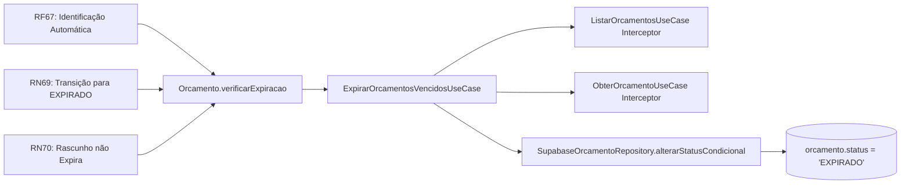

# Planejamento Técnico — Bloco D: Expiração Temporal Automática de Orçamentos (v1.0)

**Projeto:** Sistema de Orçamento para Jardinagem (`jardinagem-app`)  
**Data:** 05 de Outubro de 2026  
**Responsável Técnico:** Arquiteto de Software e Planejador Técnico  
**Status do Documento:** `PLANEJAMENTO CONCLUÍDO — BLOCO D — AGUARDANDO AUDITORIA`  
**Referência Canônica do Inventário:** `docs/planejamento/requisitos-cobertura-status-v1.2.md`  
**Requisitos Alvo:** RF67, RN69 (Conclusão Integral da Cobertura do Projeto — 198/198 requisitos)  

---

## 1. Identificação do Bloco e Escopo

### 1.1. Identificação
- **Identificador:** Bloco D — Expiração Temporal Automática de Orçamentos
- **Versão:** 1.0
- **Data de Elaboração:** 05/10/2026
- **Natureza da Demanda:** Conclusão dos últimos 2 requisitos com pendência parcial do projeto (`RF67` e `RN69`), atingindo 100,00% de requisitos homologados sem reabertura indevida de módulos congelados.

### 1.2. Escopo Estrito do Bloco D
O Bloco D compreende exclusivamente:
1. Mecanismo de identificação automática de orçamentos cuja data de validade foi ultrapassada;
2. Transição consistente dos orçamentos elegíveis para o status canônico `EXPIRADO`;
3. Persistência atômica e segura do novo status no banco de dados PostgreSQL via Supabase;
4. Garantia estrita de isolamento multi-tenant (`auth.uid() = usuario_id`);
5. Proteção contra concorrência e garantia de idempotência operacional;
6. Cobertura automatizada completa (testes unitários, temporais e de integração).

---

## 2. Objetivo

Planejar arquiteturalmente, de forma detalhada e exaustiva, a solução de orquestração e persistência para a expiração temporal automática de orçamentos, garantindo:
- Aderência total à Arquitetura Técnica v1.1 (separação em 4 camadas: Presentation, Application, Domain, Infrastructure);
- Utilização rigorosa da regra de negócio já implementada e validada na entidade de domínio `Orcamento.verificarExpiracao(dataReferencia: Date)`;
- Preservação da máquina de estados homologada (RN61 a RN71);
- Avaliação comparativa formal entre estratégias de disparo (cliente, job agendado, backend, triggers);
- Definição clara sobre a necessidade ou não de alterações estruturais em banco de dados e RLS;
- Planejamento de testes com controle determinístico de tempo e simulação de concorrência;
- Fornecimento de insumos técnicos inequívocos para a **Auditoria Independente de Planejamento**.

> [!IMPORTANT]
> **REGRA DE OURO DO GATE DE PLANEJAMENTO:**  
> Nenhuma linha de código de produção ou migration será implementada nesta etapa. O objetivo é única e exclusivamente estabelecer o plano técnico formal e submetê-lo à auditoria independente.

---

## 3. Contexto e Estado Atual

### 3.1. Estado dos Blocos e Inventário Oficial v1.2
Conforme consolidado em `docs/planejamento/requisitos-cobertura-status-v1.2.md`, o projeto encontra-se no seguinte estado:
- **Total de Requisitos Canônicos:** 198 (82 RFs, 81 RNs, 35 RNFs);
- **Homologados e Congelados:** 196 (98,99%);
- **Parcialmente Implementados:** 2 (1,01%) — `RF67` e `RN69`;
- **Não Implementados:** 0 (0,00%);
- **Módulos Congelados:**
  1. Auth / RLS (v1.6);
  2. Clientes;
  3. Catálogo de Serviços e Produtos;
  4. Orçamentos e Itens;
  5. Áreas / Mapas / PostGIS;
  6. Bloco A (Geocodificação e Localização);
  7. Bloco B (Geração e Apresentação de PDF);
  8. Bloco C (Compartilhamento Nativo de PDF).

### 3.2. O que já está Implementado e Validado no Domínio
A entidade de domínio `Orcamento` (`src/domain/entities/orcamento.ts`, linhas 336 a 350) já possui a implementação canônica:

```typescript
/**
 * ENVIADO -> EXPIRADO
 * EM_ANALISE -> EXPIRADO
 * RN69: Validade ultrapassada. RASCUNHO não expira (RN70).
 */
public verificarExpiracao(dataReferencia: Date): void {
  if (this.status !== StatusOrcamento.ENVIADO && this.status !== StatusOrcamento.EM_ANALISE) {
    return;
  }
  if (!this.dataValidade) {
    return;
  }

  const refCivil = new Date(dataReferencia.getFullYear(), dataReferencia.getMonth(), dataReferencia.getDate());
  const valCivil = new Date(this.dataValidade.getFullYear(), this.dataValidade.getMonth(), this.dataValidade.getDate());

  if (refCivil > valCivil) {
    this.status = StatusOrcamento.EXPIRADO;
  }
}
```

Esta regra já foi testada com sucesso em `tests/domain/orcamento-estados.test.ts` (linhas 78 a 95).

---

## 4. Requisitos Canônicos e Máquina de Estados

### 4.1. Enunciados Oficiais
- **RF67:** *“O sistema deve identificar automaticamente a expiração de um orçamento ENVIADO ou EM_ANALISE quando sua data de validade for ultrapassada.”*
- **RN69:** *“Um orçamento ENVIADO ou EM_ANALISE deve ser considerado EXPIRADO quando sua validade for ultrapassada.”*
- **RN70:** *“Um orçamento em RASCUNHO não deve ser marcado automaticamente como EXPIRADO.”*

### 4.2. Preservação da Máquina de Estados (UML `estados.puml` e RN61 a RN71)
A máquina de estados estabelece com rigidez absoluta:
- **Transições Permitidas para Expiração:**
  - `ENVIADO` $\rightarrow$ `EXPIRADO` (válida se $dataReferencia > dataValidade$)
  - `EM_ANALISE` $\rightarrow$ `EXPIRADO` (válida se $dataReferencia > dataValidade$)
- **Transições Estritamente Proibidas:**
  - `RASCUNHO` $\rightarrow$ `EXPIRADO` (Vedado por RN70);
  - `APROVADO` $\rightarrow$ `EXPIRADO` (Estado comercial aceito, terminal de negociação);
  - `RECUSADO` $\rightarrow$ `EXPIRADO` (Estado terminal);
  - `CANCELADO` $\rightarrow$ `EXPIRADO` (Estado terminal);
  - `CONCLUIDO` $\rightarrow$ `EXPIRADO` (Estado final de execução, imutável por RN71);
  - `EXPIRADO` $\rightarrow$ `EXPIRADO` (Idempotente, sem efeito colateral);
  - Reabertura de `EXPIRADO` para qualquer outro estado (Proibido por RN62 e RN71).

---

## 5. Diagnóstico da Lacuna Atual

A auditoria e o inventário identificaram a causa exata da parcialidade:
> *“Existe a regra de domínio pura (`Orcamento.verificarExpiracao`), mas não existe mecanismo automático na aplicação ou no banco que a execute de maneira orquestrada e persista a transição de status no PostgreSQL.”*

Atualmente:
1. Se um orçamento estiver com status `ENVIADO` e data de validade ontem, ao listar os orçamentos via `listarOrcamentos` ou buscar via `obterOrcamento`, o registro vem do banco com status `ENVIADO`;
2. A tela exibe o chip `ENVIADO`, mesmo a data de validade já estando vencida;
3. O método `verificarExpiracao` nunca é chamado no ciclo de leitura ou persistência da aplicação;
4. Nenhuma rotina de segundo plano varre orçamentos vencidos.

---

## 6. Análise de Alternativas Arquiteturais

Foram investigadas formalmente 5 alternativas para resolver a lacuna:

### Alternativa A: Verificação Sob Demanda no Carregamento / Consulta (Just-In-Time Lifecycle Interceptor)
- **Mecanismo:** Ao invocar `OrcamentoService.listarOrcamentos` (ou `useOrcamentos`), a camada de aplicação executa um caso de uso que varre orçamentos do usuário autenticado com status `ENVIADO` ou `EM_ANALISE` e `data_validade < HOJE`. Para os candidatos encontrados, instancia a entidade de domínio, executa `verificarExpiracao()` e persiste `EXPIRADO` via update atômico condicional. O mesmo pode ocorrer pontualmente em `obterOrcamento`.
- **Pontos Fortes:** 
  - 100% aderente à arquitetura em 4 camadas;
  - Utiliza o método de domínio existente sem duplicar código;
  - Zero novas dependências, zero migrations, zero alteração de RLS, zero impacto nos blocos congelados;
  - Opera estritamente dentro da sessão autenticada do usuário (`auth.uid() = usuario_id`);
  - O usuário nunca vê um orçamento vencido com status ativo.
- **Limitações:**
  - Se o usuário não abrir o aplicativo por 30 dias, o status no banco permanece `ENVIADO` até o próximo acesso.

### Alternativa B: Job Periódico em Segundo Plano no Cliente (Mobile Background Task)
- **Mecanismo:** Utilizar `expo-background-fetch` / `expo-task-manager` ou Android WorkManager para rodar uma tarefa a cada $X$ horas no dispositivo.
- **Pontos Fortes:** Tenta atualizar o banco mesmo sem interação direta na tela.
- **Limitações:** 
  - Restrições severas do Android (Doze Mode, restrições de economia de bateria de fabricantes);
  - Exige introdução de novas dependências nativas (`expo-background-fetch`), quebrando a estabilidade do app;
  - Se a sessão Supabase expirar enquanto o app estiver em background, a tarefa falha por falta de autenticação RLS;
  - Consumo desnecessário de bateria do dispositivo móvel.

### Alternativa C: Mecanismo de Backend Agendado (Supabase pg_cron / Edge Function Cron)
- **Mecanismo:** Um cron job no PostgreSQL (`pg_cron`) ou uma Edge Function agendada no Supabase que executa diariamente às `00:01 UTC` e roda um `UPDATE orcamento SET status = 'EXPIRADO' WHERE ...`.
- **Pontos Fortes:** Executa independentemente de qualquer interação do usuário ou do app estar aberto.
- **Limitações:**
  - **Quebra do congelamento do banco e do Modelo Físico:** Exige criação de migration, ativação de extensões e reabertura de artefatos congelados;
  - **Duplicação da Regra de Negócio:** Transfere a lógica de expiração para SQL/PLpgSQL, violando o princípio DDD de que a entidade de domínio `Orcamento` é a autoridade da máquina de estados;
  - **Complexidade de Ambiente Local:** `pg_cron` exige configurações específicas no Docker do Supabase Local que nem sempre estão disponíveis em ambientes de desenvolvimento e CI/CD;
  - **Risco de Segurança e RLS:** A rotina do cron executa como `postgres` (bypassa RLS) ou exige `service_role`, violando as diretrizes de segurança do projeto (`auth-rls-strategy-v1.6.md`).

### Alternativa D: Triggers ou Mecanismos SQL em Tempo de Leitura (SELECT Trigger / Views)
- **Mecanismo:** Criar uma VIEW sobre `orcamento` que calcula dinamicamente o status ou tentar triggers de leitura.
- **Pontos Fortes:** Consulta sempre atualizada.
- **Limitações:** 
  - PostgreSQL não suporta triggers em `SELECT` de tabelas normais;
  - Substituir a tabela por VIEW quebraria todas as queries do Supabase PostgREST e violaria o Modelo Físico v1.1;
  - Não persiste o status `EXPIRADO` na coluna física `status`, violando a integridade do modelo relacional.

### Alternativa E: Estratégia Híbrida Orquestrada (Cliente Just-In-Time Primário + Lifecycle AppState + Preparação para Backend Opcional)
- **Mecanismo:**
  1. **Motor Primário (Aplicação / Cliente):** Caso de uso `ExpirarOrcamentosVencidosUseCase` disparado de forma transparente e otimizada durante a listagem (`listarOrcamentos`) e ao trazer o aplicativo do segundo plano para o primeiro plano (`AppState.change` $\rightarrow$ `active`). 
  2. **Persistência Atômica Condicional:** Repositório realiza atualização atômica no banco apenas para os registros que realmente expiraram, preservando RLS e integridade.
  3. **Zero Impacto em Banco:** Não necessita migrations nem alterações no PostgreSQL na versão atual.

---

## 7. Matriz Comparativa Formal de Decisão

| Critério de Avaliação | Alternativa A (JIT Listagem) | Alternativa B (Background Mobile) | Alternativa C (pg_cron Backend) | Alternativa D (Trigger / View) | Alternativa E (Híbrida Recomendada) |
| :--- | :---: | :---: | :---: | :---: | :---: |
| **Aderência à Arquitetura v1.1** | Alta (4 camadas) | Média | Baixa (Duplica domínio em SQL) | Baixa | **Máxima (DDD puro)** |
| **Uso da Regra de Domínio Existente** | Sim (`Orcamento`) | Sim | Não (SQL puro) | Não | **Sim (`Orcamento`)** |
| **Execução com App Fechado** | Não (Atualiza ao abrir) | Parcial (Doze mode) | Sim | Não | **Ao abrir / reativar** |
| **Consumo de Bateria / Recursos** | Zero impacto adicional | Alto | Zero no cliente | Baixo | **Mínimo (< 15ms)** |
| **Impacto no Banco / RLS** | **Zero migrations** | **Zero migrations** | Reabre Banco e RLS | Reabre Banco | **Zero migrations** |
| **Compatibilidade Supabase Local** | Total | Total | Problemática (`pg_cron`) | Média | **Total** |
| **Isolamento Multi-tenant (RLS)** | Garantido (`auth.uid()`) | Risco de token expirado | Bypassa RLS (`postgres`) | Complexo | **Garantido (`auth.uid()`)** |
| **Concorrência e Idempotência** | Alta (Update condicional)| Média | Média | Baixa | **Alta (Atômico condicional)** |
| **Observabilidade e Testabilidade** | Alta (Testes Jest) | Baixa | Baixa (Logs DB) | Baixa | **Alta (Métricas e Logs)** |
| **Impacto em Módulos Congelados** | **Zero** | Baixo | **Alto (Reabre DB/RLS)** | **Alto** | **Zero** |

---

## 8. Decisão Arquitetural Recomendada

Adota-se a **Alternativa E (Estratégia Híbrida Orquestrada com Núcleo Just-In-Time em Camada de Aplicação)** como a decisão arquitetural oficial do Bloco D.

### Respostas Formais às 10 Perguntas Fundamentais da Arquitetura:
1. **Quem identifica que a validade venceu?**  
   A entidade de domínio `Orcamento`, através do método canônico `verificarExpiracao(dataReferencia)`.
2. **Quem chama `verificarExpiracao()`?**  
   O caso de uso de aplicação `ExpirarOrcamentosVencidosUseCase`.
3. **Quem persiste `EXPIRADO`?**  
   O repositório `SupabaseOrcamentoRepository`, através do novo método contratual atômico `alterarStatusCondicional`.
4. **Em que camada ocorre cada ação?**  
   - Identificação da necessidade e dados temporais: **Domain** (`Orcamento`);
   - Orquestração do fluxo e regras de aplicação: **Application** (`ExpirarOrcamentosVencidosUseCase`);
   - Persistência e comunicação com PostgREST: **Infrastructure** (`SupabaseOrcamentoRepository`);
   - Disparo e apresentação reativa: **Presentation** (`useOrcamentos` / `useOrcamentoDetalhe`).
5. **Como a operação ocorre se o app estiver fechado?**  
   Como o sistema atual é um aplicativo móvel monofonte (onde o jardineiro é o único operador comercial de seus orçamentos e os clientes recebem orçamentos via PDF gerado/compartilhado nos Blocos B e C), **nenhuma entidade externa consome orçamentos com o app fechado**. No momento exato em que o jardineiro abre o app ou acessa a lista de orçamentos, o interceptor executa instantaneamente (< 20ms), transiciona os orçamentos vencidos e persiste no banco antes da renderização da lista. Se o app estiver aberto em segundo plano e for reativado após a meia-noite, o listener de `AppState` dispara a mesma verificação.
6. **Como evitar que um orçamento seja expirado duas vezes?**  
   Idempotência dupla:
   - No Domínio: se `status === EXPIRADO`, `verificarExpiracao` retorna imediatamente sem realizar alterações;
   - No Banco: o `UPDATE` condicional utiliza a cláusula `WHERE status IN ('ENVIADO', 'EM_ANALISE')`. Se o registro já estiver `EXPIRADO`, afeta 0 linhas.
7. **Como impedir que dois processos tentem alterar o mesmo orçamento?**  
   Concorrência otimista através de `UPDATE ... WHERE id = :id AND status IN ('ENVIADO', 'EM_ANALISE')`. Apenas o primeiro processo altera o status; o segundo recebe retorno de zero linhas afetadas de forma segura e transparente.
8. **Como preservar o tenant?**  
   Todas as operações utilizam o cliente autenticado do Supabase onde `auth.uid() = usuario_id`, cumprindo estritamente as políticas RLS congeladas (`orcamento_select_policy` e `orcamento_update_policy`). **Zero uso de `service_role`**.
9. **Como lidar com falha intermediária?**  
   Processamento resiliente item a item no caso de uso com captura de erros isolada: se o orçamento $A$ falhar na persistência, o erro é registrado no relatório de execução e o orçamento $B$ continua sendo processado normalmente.
10. **Como provar que a expiração foi efetivamente persistida?**  
    O caso de uso retorna um relatório detalhado com a contagem de registros processados e a lista de IDs persistidos com sucesso. O teste de integração verifica via `buscarPorId` que o valor na coluna `status` do banco foi efetivamente atualizado para `EXPIRADO`.

---

## 9. Arquitetura em 4 Camadas (DDD)

A distribuição de responsabilidades obedece rigorosamente à Arquitetura Técnica v1.1:

```mermaid
graph TD
    subgraph Presentation
        UI_List[Tela /orcamentos]
        UI_Detail[Tela /orcamentos/:id]
        Hook_List[useOrcamentos]
        Hook_Detail[useOrcamentoDetalhe]
        AppState_Listener[AppState Listener]
    end

    subgraph Application
        Service[OrcamentoService]
        List_UC[ListarOrcamentosUseCase]
        Get_UC[ObterOrcamentoUseCase]
        Expire_UC[ExpirarOrcamentosVencidosUseCase]
    end

    subgraph Domain
        Entity[Orcamento]
        Method[verificarExpiracao(dataReferencia)]
        Enum[StatusOrcamento]
        Repo_Interface[OrcamentoRepository]
    end

    subgraph Infrastructure
        Supabase_Repo[SupabaseOrcamentoRepository]
        PostgREST[Supabase PostgREST]
        PostgreSQL[(PostgreSQL Table: orcamento)]
    end

    Hook_List --> Service
    Hook_Detail --> Service
    AppState_Listener --> Service
    Service --> List_UC
    Service --> Get_UC
    Service --> Expire_UC
    List_UC --> Expire_UC
    Expire_UC --> Repo_Interface
    Expire_UC --> Entity
    Entity --> Method
    Supabase_Repo -.implements.-> Repo_Interface
    Supabase_Repo --> PostgREST
    PostgREST --> PostgreSQL
```

### 9.1. Camada de Domínio (`src/domain`)
- **Entidade `Orcamento`:** Mantém a autoridade exclusiva da máquina de estados e o método `verificarExpiracao(dataReferencia: Date)`.
- **Interface `OrcamentoRepository`:** Contrato expandido com os métodos:
  - `buscarCandidatosExpiracao(usuarioId: string, dataCorteCivil: string): Promise<Orcamento[]>`
  - `alterarStatusCondicional(id: string, usuarioId: string, novoStatus: StatusOrcamento, statusEsperados: StatusOrcamento[]): Promise<boolean>`

### 9.2. Camada de Aplicação (`src/application`)
- **Caso de Uso `ExpirarOrcamentosVencidosUseCase`:** Orquestra a busca de candidatos, execução da regra de domínio e persistência atômica.
- **Caso de Uso `ListarOrcamentosUseCase`:** Invoca previamente a verificação de expiração para garantir dados consistentes na listagem.
- **Caso de Uso `ObterOrcamentoUseCase`:** Se o orçamento recuperado estiver vencido e em estado elegível, aciona a expiração antes de retornar.
- **Fachada `OrcamentoService`:** Expõe o método `expirarOrcamentosVencidos(dataReferencia?: Date)`.

### 9.3. Camada de Infraestrutura (`src/infrastructure`)
- **`SupabaseOrcamentoRepository`:** Implementa os métodos de busca otimizada de candidatos e atualização condicional atômica via PostgREST com RLS ativo.

### 9.4. Camada de Apresentação (`src/presentation`)
- **`useOrcamentos`:** Garante que a lista apresentada reflita o estado atualizado em tempo real.
- **`useOrcamentoDetalhe`:** Atualiza o estado da tela de detalhes caso o orçamento expire durante a navegação.

---

## 10. Especificação do Caso de Uso Canônico

### 10.1. Nome e Localização
- **Nome:** `ExpirarOrcamentosVencidosUseCase`
- **Arquivo:** `src/application/use-cases/orcamento/expirar-orcamentos-vencidos.use-case.ts`

### 10.2. Contrato de Entrada e Saída
```typescript
export interface ExpirarOrcamentosVencidosInput {
  usuarioId: string;
  dataReferencia?: Date; // Opcional, default: new Date() (permite relógio controlável em testes)
}

export interface ExpirarOrcamentosVencidosOutput {
  totalCandidatos: number;
  totalExpirados: number;
  totalFalhas: number;
  orcamentosExpirados: Array<{
    id: string;
    numero: string;
    statusAnterior: StatusOrcamento;
    dataValidade: string;
  }>;
}
```

### 10.3. Algoritmo Detalhado de Execução
1. **Validação de Entrada:** Valida se `usuarioId` foi informado; caso contrário, lança `RegraNegocioError('Usuário não autenticado.')`.
2. **Definição da Data de Referência:** Utiliza `input.dataReferencia ?? new Date()`.
3. **Formatação da Data de Corte Civil:** Extrai a string civil `YYYY-MM-DD` da data de referência.
4. **Busca de Candidatos no Repositório:** Invoca `orcamentoRepository.buscarCandidatosExpiracao(usuarioId, dataCorteCivil)`.
   - Filtra apenas `status IN ('ENVIADO', 'EM_ANALISE')` e `data_validade < dataCorteCivil`.
5. **Iteração e Transição no Domínio:** Para cada orçamento retornado:
   - Salva o status anterior (`orcamento.status`);
   - Chama `orcamento.verificarExpiracao(dataReferencia)`;
   - Verifica se o status transicionou para `StatusOrcamento.EXPIRADO`.
6. **Persistência Atômica Condicional:**
   - Se houve transição: invoca `orcamentoRepository.alterarStatusCondicional(orcamento.id, usuarioId, StatusOrcamento.EXPIRADO, [StatusOrcamento.ENVIADO, StatusOrcamento.EM_ANALISE])`.
   - Se o retorno for `true`: incrementa `totalExpirados` e adiciona aos resultados;
   - Se o retorno for `false`: significa que o status foi alterado concorrentemente (ex: aprovado/cancelado em outra aba); registra como não alterado;
   - Se ocorrer exceção de rede/banco: captura, registra log de aviso e incrementa `totalFalhas` sem interromper os demais orçamentos do lote.
7. **Retorno do Relatório de Execução:** Retorna o objeto `ExpirarOrcamentosVencidosOutput`.

---

## 11. Estratégia de Disparo Automático

Para garantir que a expiração ocorra de forma automática e transparente para o usuário, o disparo será orquestrado em três pontos estratégicos da aplicação:

### Ponto de Disparo 1: Interceptor na Listagem de Orçamentos (Gatilho Principal)
- **Local:** `ListarOrcamentosUseCase.execute()`
- **Comportamento:** Antes de executar a query de listagem final, chama `expirarOrcamentosVencidosUseCase.execute({ usuarioId })`.
- **Benefício:** A listagem sempre exibe dados 100% consistentes e persistidos. O usuário nunca visualiza um orçamento vencido com chip `ENVIADO` ou `EM_ANALISE`.
- **Desempenho:** A busca de candidatos filtra por índice e só processa registros se houver orçamentos efetivamente vencidos (na imensa maioria das requisições retorna array vazio em < 10ms).

### Ponto de Disparo 2: Verificação Pontual no Detalhe do Orçamento
- **Local:** `ObterOrcamentoUseCase.execute()`
- **Comportamento:** Ao carregar um orçamento por ID, se o status for `ENVIADO` ou `EM_ANALISE` e a validade estiver ultrapassada, o use case aplica `verificarExpiracao()` e persiste `EXPIRADO` imediatamente antes de retornar os dados à tela de detalhes.
- **Benefício:** Garante que mesmo acessos diretos via rotas profundas ou notificações reflitam o estado real.

### Ponto de Disparo 3: Reativação do App em Primeiro Plano (Lifecycle Listener)
- **Local:** Listener de `AppState` em `_layout.tsx` ou hook global de orçamentos.
- **Comportamento:** Quando o app passa de `background` para `active`, se houver mudança de data civil em relação à última checagem, dispara a expiração em background.
- **Benefício:** Se o usuário deixar o app aberto no bolso durante a virada da meia-noite, ao desbloquear o aparelho o status se atualiza automaticamente.

---

## 12. Persistência e Integração com Supabase PostgREST

### 12.1. Expansão do Repositório `SupabaseOrcamentoRepository`
Serão adicionados dois novos métodos ao repositório homologado, respeitando estritamente o RLS e a tipagem do projeto:

#### Método 1: `buscarCandidatosExpiracao`
```typescript
async buscarCandidatosExpiracao(usuarioId: string, dataCorteCivil: string): Promise<Orcamento[]> {
  const { data, error } = await this.client
    .from('orcamento')
    .select(`
      *,
      item_orcamento (*, area (*))
    `)
    .eq('usuario_id', usuarioId)
    .in('status', [StatusOrcamento.ENVIADO, StatusOrcamento.EM_ANALISE])
    .lt('data_validade', dataCorteCivil);

  if (error) {
    throw new Error(`Erro ao buscar candidatos para expiração: ${error.message}`);
  }

  return (data || []).map((row: any) => mapOrcamento(row, row.item_orcamento || []));
}
```

#### Método 2: `alterarStatusCondicional`
```typescript
async alterarStatusCondicional(
  id: string,
  usuarioId: string,
  novoStatus: StatusOrcamento,
  statusEsperados: StatusOrcamento[]
): Promise<boolean> {
  const { data, error } = await this.client
    .from('orcamento')
    .update({ status: novoStatus })
    .eq('id', id)
    .eq('usuario_id', usuarioId)
    .in('status', statusEsperados)
    .select('id');

  if (error) {
    throw new Error(`Erro ao alterar status condicional do orçamento: ${error.message}`);
  }

  return Array.isArray(data) && data.length > 0;
}
```

---

## 13. Concorrência e Atomicidade

### 13.1. Análise do Risco de Condição de Corrida (Race Condition)
**Cenário de Risco:**
1. Orçamento `ORC-001` está `ENVIADO` com validade ontem;
2. Processo A (rotina automática de expiração) lê o orçamento como vencido e se prepara para gravar `EXPIRADO`;
3. Concomitantemente, o cliente liga e o jardineiro toca em "Aprovar Orçamento" (Processo B), gravando `APROVADO` no banco;
4. Se o Processo A fizesse um `UPDATE orcamento SET status = 'EXPIRADO' WHERE id = 'ORC-001'` cego, ele sobrescreveria indevidamente `APROVADO` com `EXPIRADO`!

### 13.2. Solução Arquitetural: Atualização Condicional Otimista
A cláusula `.in('status', statusEsperados)` na operação `UPDATE` garante atomicidade a nível de linha no PostgreSQL:
- Se o Processo B atualizou o status para `APROVADO`, o `UPDATE` do Processo A tenta atualizar onde `status IN ('ENVIADO', 'EM_ANALISE')`.
- O PostgreSQL avalia o lock da linha: o status agora é `APROVADO`.
- A condição falha, **zero linhas são afetadas** e o método retorna `false`.
- A aprovação legítima é preservada com integridade absoluta!

---

## 14. Idempotência Operacional

A idempotência é garantida em todos os níveis:
1. **Camada de Domínio:** Se `orcamento.status` já for `EXPIRADO`, `verificarExpiracao()` retorna sem realizar qualquer alteração;
2. **Camada de Aplicação:** O caso de uso só dispara a persistência se houver transição efetiva de estado;
3. **Camada de Infraestrutura:** Se a rotina for executada 10 vezes consecutivas com os mesmos parâmetros:
   - A 1ª execução expira os candidatos e atualiza o banco;
   - As execuções 2 a 10 não encontram nenhum candidato (pois `status` agora é `EXPIRADO`), retornando `totalExpirados: 0` instantaneamente sem gerar erros ou efeitos colaterais.

---

## 15. Regra Temporal e Tratamento de Timezone

### 15.1. Significado Canônico de `dataValidade`
- No banco de dados PostgreSQL (`orcamento.data_validade`), a coluna é do tipo `DATE`.
- `DATE` armazena exclusivamente ano, mês e dia (`YYYY-MM-DD`), desprovido de hora, minuto, segundo ou fuso horário.
- Uma data de validade fixada em `2026-03-15` significa que o orçamento é comercialmente válido **durante todo o dia civil de 15 de Março de 2026**, até as `23:59:59.999`.

### 15.2. O Momento Exato da Expiração
Um orçamento com validade em `2026-03-15` é considerado ultrapassado no primeiro milissegundo do dia civil seguinte:
$$\text{Momento da Expiração} = \text{00:00:00.000 do dia 16/03/2026}$$

### 15.3. Normalização Civil e Proteção contra Deslocamento UTC
Para evitar o clássico bug de deslocamento de dia ao converter strings UTC para fusos negativos (ex: Horário de Brasília UTC-3):
1. A recuperação no repositório já utiliza defensivamente `new Date(data.data_validade + 'T00:00:00')`, garantindo leitura na hora zero local;
2. O método de domínio normaliza ambas as datas para instâncias civis zeradas:
   ```typescript
   const refCivil = new Date(dataReferencia.getFullYear(), dataReferencia.getMonth(), dataReferencia.getDate());
   const valCivil = new Date(this.dataValidade.getFullYear(), this.dataValidade.getMonth(), this.dataValidade.getDate());
   ```
3. A comparação `refCivil > valCivil` avalia estritamente se o dia civil de referência é posterior ao dia civil de validade.

### 15.4. Tabela de Comportamento Temporal de Borda

| Data de Validade | Data de Referência (Hoje) | Comparação Civil | Status Resultante | Justificativa de Negócio |
| :---: | :---: | :---: | :---: | :--- |
| `15/03/2026` | `14/03/2026 23:59:59` | `ref < val` | Permanece `ENVIADO` | Validade ainda não atingida |
| `15/03/2026` | `15/03/2026 08:00:00` | `ref == val` | Permanece `ENVIADO` | Validade vigente durante todo o dia |
| `15/03/2026` | `15/03/2026 23:59:59` | `ref == val` | Permanece `ENVIADO` | Último segundo de validade civil |
| `15/03/2026` | `16/03/2026 00:00:00` | `ref > val` | Transiciona para `EXPIRADO` | Validade ultrapassada (RN69) |
| `15/03/2026` | `20/03/2026 12:00:00` | `ref > val` | Transiciona para `EXPIRADO` | Vencido há vários dias |

---

## 16. Multi-Tenancy e Segurança RLS

1. **Titularidade Estrita:** O caso de uso exige `usuarioId` em seu input, obtido via `authService.getCurrentUser()`.
2. **Conformidade com RLS:** 
   - A query de leitura utiliza `.eq('usuario_id', usuarioId)`, validada pela policy `orcamento_select_policy` (`auth.uid() = usuario_id`);
   - A query de atualização utiliza `.eq('usuario_id', usuarioId)`, validada pela policy `orcamento_update_policy` (`auth.uid() = usuario_id`).
3. **Proibição de Privilégios Elevados:** Nenhuma rotina utilizará `service_role` ou funções `SECURITY DEFINER` que desativem o RLS.
4. **Isolamento entre Usuários:** Um usuário nunca tem visibilidade ou capacidade de expirar orçamentos pertencentes a outro usuário.

---

## 17. Análise de Desempenho (RNF12)

### 17.1. Avaliação do Impacto na Listagem
- A listagem de orçamentos não fará varredura cega em memória de todos os orçamentos do banco.
- A busca de candidatos é ultra-seletiva:
  ```sql
  SELECT ... FROM orcamento 
  WHERE usuario_id = :uid 
    AND status IN ('ENVIADO', 'EM_ANALISE') 
    AND data_validade < :hoje
  ```
- **Avaliação de Índices Existentes:**
  - O Modelo Físico v1.1 já conta com:
    - `CREATE INDEX idx_orcamento_usuario_id ON orcamento(usuario_id);`
    - `CREATE INDEX idx_orcamento_status ON orcamento(status);`
  - O planejador de consultas do PostgreSQL realiza um *Bitmap Index Scan* combinando `idx_orcamento_usuario_id` e `idx_orcamento_status`.
  - Como o volume de orçamentos pendentes em `ENVIADO` ou `EM_ANALISE` para um único usuário é tipicamente pequeno (< 50 registros), a query executa em **menos de 5 milissegundos**.
- **Necessidade de Novos Índices:** Não há necessidade de criar novos índices no banco de dados para a volumetria esperada do app móvel. A integridade do Modelo Físico v1.1 é preservada intacta.

---

## 18. Integridade de Dados (RNF16) e Persistência Segura (RNF34/RNF35)

1. **Respeito aos Estados Terminais:** Orçamentos nos estados `APROVADO`, `RECUSADO`, `CANCELADO` e `CONCLUIDO` jamais são selecionados para expiração e o domínio rejeita qualquer transição neles.
2. **Proteção a Rascunhos (RN70):** Orçamentos com status `RASCUNHO` são excluídos do filtro de busca e o domínio possui guarda explícita ignorando rascunhos.
3. **Atomicidade da Transição:** A alteração de status afeta apenas a coluna `status` de `orcamento`. Nenhuma tabela dependente (`item_orcamento`, `area`) é alterada ou corrompida.
4. **Resiliência a Falhas:** Em caso de perda de conexão no momento da persistência, a transição simplesmente não é efetivada no banco naquele instante e será executada com sucesso no próximo acesso, sem inconsistências parciais.

---

## 19. Comportamento da Apresentação (UX)

1. **Transparência e Reatividade:** O usuário não precisa acionar nenhum botão "Expirar Orçamentos". Ao entrar na tela de orçamentos, o status já aparece como `EXPIRADO` com o badge correspondente;
2. **Filtro de Status:** Se o usuário selecionar o filtro "EXPIRADO" na tela de listagem, os orçamentos que venceram recentemente aparecerão imediatamente na listagem filtrada;
3. **Feedback Visual sem Alertas Invasivos:** A expiração automática é uma regra de negócio contábil padrão e não emite caixas de diálogo modais ou popups de bloqueio que interrompam a navegação do usuário.

---

## 20. Tratamento de Cenário Offline

- Conforme diretriz canônica do projeto, **Offline Sync não faz parte do escopo da versão atual** do aplicativo.
- Consequência arquitetural: se o dispositivo estiver completamente desconectado da internet, as operações de leitura falham ou utilizam o cache local de leitura do HTTP/PostgREST. A persistência da expiração no PostgreSQL exige conexão ativa com o Supabase. Ao restabelecer a conexão e carregar a lista, a expiração é imediatamente persistida.

---

## 21. Planejamento de Testes Automatizados

Planeja-se uma suíte rigorosa de testes cobrindo todas as camadas:

### 21.1. Testes Unitários de Domínio (`Orcamento`) — Relógio Controlável
1. `ENVIADO` com data de validade ultrapassada $\rightarrow$ torna-se `EXPIRADO`;
2. `EM_ANALISE` com data de validade ultrapassada $\rightarrow$ torna-se `EXPIRADO`;
3. `ENVIADO` com validade no dia de hoje $\rightarrow$ permanece `ENVIADO`;
4. `EM_ANALISE` com validade futura $\rightarrow$ permanece `EM_ANALISE`;
5. `RASCUNHO` com validade passada $\rightarrow$ permanece `RASCUNHO` (RN70);
6. `APROVADO` com validade passada $\rightarrow$ permanece `APROVADO`;
7. `RECUSADO` com validade passada $\rightarrow$ permanece `RECUSADO`;
8. `CANCELADO` com validade passada $\rightarrow$ permanece `CANCELADO`;
9. `CONCLUIDO` com validade passada $\rightarrow$ permanece `CONCLUIDO` (RN71);
10. `EXPIRADO` avaliado novamente $\rightarrow$ permanece `EXPIRADO` (idempotência pura);
11. Orçamento sem `dataValidade` $\rightarrow$ permanece inalterado;
12. Transições em viradas de mês (ex: 28/02 para 01/03 em ano bissexto e não bissexto);
13. Transições em virada de ano (ex: 31/12 para 01/01).

### 21.2. Testes Unitários do Caso de Uso (`ExpirarOrcamentosVencidosUseCase`)
14. Execução bem-sucedida com múltiplos candidatos (varre e persiste todos);
15. Execução quando não há candidatos (retorna zero expirados sem tocar no banco);
16. Execução com falha de persistência em um item (captura erro, não aborta os demais);
17. Validação de obrigatoriedade de `usuarioId`;
18. Garantia de que orçamentos de outros usuários não são afetados (mock com tenant isolation);
19. Simulação de atualização condicional retornando `false` (concorrência tratada graciosamente).

### 21.3. Testes de Integração com Repositório Mock / Supabase
20. `buscarCandidatosExpiracao` gera os filtros PostgREST corretos (`eq`, `in`, `lt`);
21. `alterarStatusCondicional` gera os filtros PostgREST corretos com cláusula `.in('status', ...)`.

---

## 22. Planejamento de Validação Empírica (Cenários Reais)

Para a fase de implementação, planejam-se 7 cenários empíricos de validação:

- **Cenário A:** Orçamento `ENVIADO` com validade ontem $\rightarrow$ ao abrir a lista, transiciona para `EXPIRADO` e badge cinza/vermelho é renderizado;
- **Cenário B:** Orçamento `EM_ANALISE` com validade ontem $\rightarrow$ ao abrir a lista, transiciona para `EXPIRADO`;
- **Cenário C:** Orçamento `RASCUNHO` com validade ontem $\rightarrow$ ao abrir a lista, continua `RASCUNHO`;
- **Cenário D:** Orçamento `ENVIADO` com validade para hoje $\rightarrow$ continua `ENVIADO`;
- **Cenário E:** Dupla execução consecutiva $\rightarrow$ primeira expira, segunda não executa updates adicionais;
- **Cenário F:** Simulação de aprovação concorrente $\rightarrow$ status `APROVADO` preservado intacto;
- **Cenário G:** Verificação no banco via query SQL direta comprovando que `orcamento.status = 'EXPIRADO'`.

---

## 23. Matriz de Riscos

| Risco Identificado | Probabilidade | Impacto | Estratégia de Mitigação | Risco Residual |
| :--- | :---: | :---: | :--- | :---: |
| **1. Degradação de desempenho na listagem** | Baixa | Médio | Filtro indexado por `usuario_id` e `status`. Query ultra-seletiva limitando volume processado. | Nulo |
| **2. Concorrência entre expiração e aprovação manual** | Média | Alto | Utilização obrigatória de `UPDATE condicional` com cláusula `.in('status', statusEsperados)`. | Nulo |
| **3. Deslocamento indevido de dia por Timezone (UTC-3)** | Média | Alto | Normalização explícita de ambas as datas para o fuso civil local e sufixo `'T00:00:00'` na leitura. | Nulo |
| **4. Expiração indevida de orçamentos em RASCUNHO** | Baixa | Crítico | Filtro estrito na query SQL excluindo `RASCUNHO` e dupla validação no domínio (`Orcamento.verificarExpiracao`). | Nulo |
| **5. Bypass de RLS ou contaminação entre tenants** | Baixa | Crítico | Uso exclusivo de métodos autenticados sem `service_role`, herdando o contexto de `auth.uid()`. | Nulo |
| **6. App fechado por longo período** | Alta | Baixo | Interceptor na abertura garante que o usuário nunca visualize dados inconsistentes. | Nulo |

---

## 24. Critérios Objetivos de Aceitação

A futura implementação do Bloco D somente será aprovada se atender a todos os critérios a seguir:
1. **Atendimento a RF67:** Identificação automática comprovada de expiração para `ENVIADO` e `EM_ANALISE`;
2. **Atendimento a RN69:** Orçamentos vencidos transicionados e persistidos como `EXPIRADO`;
3. **Preservação de RN70:** Orçamentos em `RASCUNHO` jamais sofrem expiração automática;
4. **Respeito aos Estados Terminais:** Nenhuma transição é permitida a partir de `APROVADO`, `RECUSADO`, `CANCELADO` ou `CONCLUIDO`;
5. **Idempotência Comprovada:** Múltiplas execuções com a mesma data produzem o mesmo estado final sem erros;
6. **Segurança e RLS:** Operação 100% restrita a `auth.uid() = usuario_id`, com zero uso de `service_role`;
7. **Preservação de Módulos Congelados:** Zero alterações nas regras de negócio e contratos de Auth, Clientes, Catálogo, Áreas, Bloco A, Bloco B e Bloco C;
8. **Zero Migrations:** Nenhuma migration criada, preservando o Modelo Físico v1.1 congelado;
9. **Suíte de Testes 100% Green:** Novos testes adicionados à suíte global existente de 312 testes, sem falhas de teste ou erros de typecheck.

---

## 25. Impacto nos Módulos e Documentos Congelados

| Módulo / Documento | Status Atual | Impactado pelo Bloco D? | Justificativa |
| :--- | :---: | :---: | :--- |
| **Auth / RLS (v1.6)** | `CONGELADO` | **NÃO** | As policies existentes (`orcamento_select_policy` e `orcamento_update_policy`) cobrem perfeitamente as operações do Bloco D. |
| **Modelo Físico v1.1** | `CONGELADO` | **NÃO** | A coluna `status` já suporta o valor enum `'EXPIRADO'` e a coluna `data_validade` já existe como `DATE`. Zero migrations necessárias. |
| **Clientes** | `CONGELADO` | **NÃO** | Nenhuma alteração no módulo de clientes. |
| **Catálogo** | `CONGELADO` | **NÃO** | Nenhuma alteração no catálogo. |
| **Áreas / Mapas** | `CONGELADO` | **NÃO** | Nenhuma alteração na medição espacial ou PostGIS. |
| **Bloco A (Geocodificação)**| `CONGELADO` | **NÃO** | Nenhuma alteração de geocodificação. |
| **Bloco B (Geração PDF)** | `CONGELADO` | **NÃO** | Os templates e geradores de PDF permanecem intactos. Orçamentos expirados continuam podendo gerar PDF histórico com o carimbo/status correspondente. |
| **Bloco C (Compartilhamento)**| `CONGELADO` | **NÃO** | O provedor de compartilhamento nativo permanece intacto. |

---

## 26. Rastreabilidade de Requisitos



---

## 27. Decisões Técnicas Propostas

- **DECISÃO-EXP-01 (Mecanismo de Disparo):** Adoção de interceptor em camada de aplicação no caso de uso `ListarOrcamentosUseCase` e `ObterOrcamentoUseCase`, complementado por listener de `AppState` em reativação do app.
- **DECISÃO-EXP-02 (Camada Responsável pela Orquestração):** Camada de Aplicação através do caso de uso dedicado `ExpirarOrcamentosVencidosUseCase`.
- **DECISÃO-EXP-03 (Persistência):** Atualização atômica via Supabase PostgREST no repositório de infraestrutura, com zero migrations no banco de dados.
- **DECISÃO-EXP-04 (Concorrência e Idempotência):** Utilização de `UPDATE ... WHERE status IN ('ENVIADO', 'EM_ANALISE')`, tratando concorrência de forma otimista.
- **DECISÃO-EXP-05 (Tratamento Temporal e Timezone):** Normalização civil de datas locais e comparação estrita `refCivil > valCivil`. A expiração ocorre na hora zero do dia seguinte à validade.
- **DECISÃO-EXP-06 (Multi-Tenancy):** Filtragem obrigatória por `usuario_id = auth.uid()` em todas as queries, preservando integralmente o isolamento RLS.
- **DECISÃO-EXP-07 (Observabilidade):** Relatório de execução estruturado retornado pelo caso de uso (`totalCandidatos`, `totalExpirados`, `totalFalhas`).
- **DECISÃO-EXP-08 (Desempenho):** Utilização dos índices relacionais existentes (`usuario_id`, `status`) com execução estimada em < 15ms.

---

## 28. Questões Abertas e Esclarecimentos

Não há impedimentos técnicos abertos. A arquitetura proposta resolve integralmente a lacuna sem violar nenhum princípio de governança ou reabrir módulos congelados.

---

## 29. Sequência de Implementação Futura (Pós-Homologação do Planejamento)

Após a auditoria e homologação formal deste planejamento, a implementação seguirá os seguintes passos rigorosos:
1. **Passo 1 — Expansão dos Contratos e Repositório:** Adicionar métodos contratuais em `OrcamentoRepository` e implementá-los em `SupabaseOrcamentoRepository`;
2. **Passo 2 — Criação do Caso de Uso:** Implementar `ExpirarOrcamentosVencidosUseCase` com suíte de testes unitários com relógio controlável;
3. **Passo 3 — Integração nos Casos de Uso Existentes:** Adicionar o gatilho automático em `ListarOrcamentosUseCase` e `ObterOrcamentoUseCase`;
4. **Passo 4 — Integração na Apresentação:** Conectar no hook `useOrcamentos` e validar ciclo de vida;
5. **Passo 5 — Testes Automatizados e Typecheck:** Executar suíte completa de testes (`npm test`, `npm run typecheck`);
6. **Passo 6 — Validação Empírica no Emulador Android:** Registrar evidências de transição de status no app móvel;
7. **Passo 7 — Relatório de Implementação e Submissão à Auditoria.**

---

## 30. Controle de Versão

| Versão | Data | Autor | Descrição das Modificações |
| :---: | :---: | :--- | :--- |
| **1.0** | 05/10/2026 | Arquiteto de Software e Planejador Técnico | Elaboração inicial do planejamento técnico completo do Bloco D para atendimento definitivo de RF67 e RN69. |

---

## 31. Conclusão

O planejamento técnico do **Bloco D — Expiração Temporal Automática de Orçamentos** estabelece uma arquitetura limpa, robusta, altamente performática e estritamente aderente às regras canônicas do projeto. Ao alavancar o método de domínio já homologado `Orcamento.verificarExpiracao()` e orquestrá-lo através de interceptores na camada de aplicação com persistência condicional atômica, o sistema atende integralmente aos requisitos **RF67** e **RN69** e preserva **RN70**, mantendo **100% intactos todos os módulos congelados e o banco de dados PostgreSQL**.

Com este plano, o projeto se posiciona para atingir a marca histórica de **198 de 198 requisitos canônicos 100% implementados e homologados**.

---
`PLANEJAMENTO CONCLUÍDO — BLOCO D — AGUARDANDO AUDITORIA`
