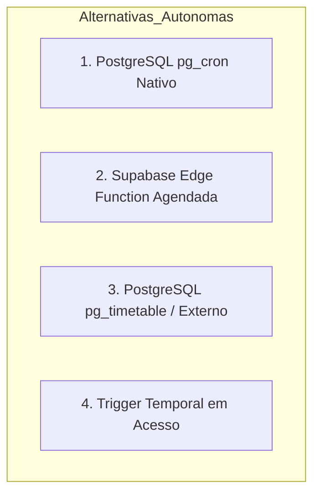
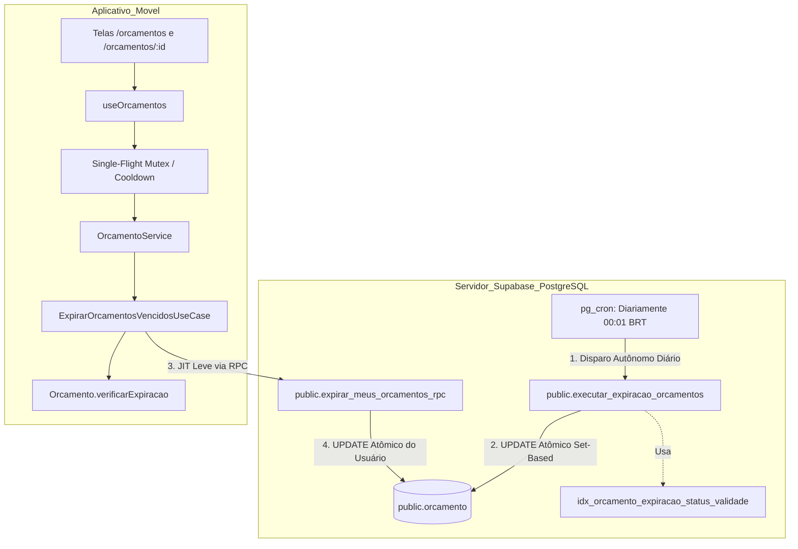
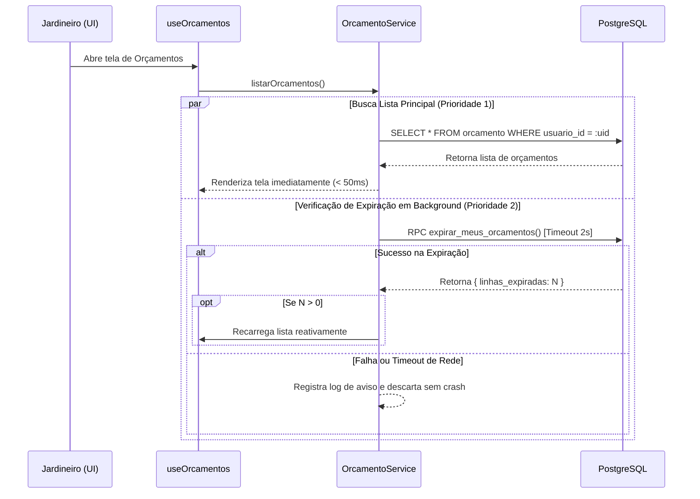

# Planejamento Técnico — Bloco D: Expiração Temporal Automática de Orçamentos (v1.1)

**Projeto:** Sistema de Orçamento para Jardinagem (`jardinagem-app`)  
**Data:** 05 de Outubro de 2026  
**Responsável Técnico:** Planejador Técnico Principal / Arquiteto de Software  
**Status do Documento:** `PLANEJAMENTO EM REVISÃO — BLOCO D v1.1 — AGUARDANDO NOVA AUDITORIA`  
**Referência Canônica do Inventário:** `docs/planejamento/requisitos-cobertura-status-v1.2.md`  
**Histórico de Governança:** Revisão estrutural pós-reprovação formal da versão v1.0 (`docs/planejamento/expiracao-orcamentos-plan-audit-v1.0.md`)  
**Requisitos Alvo:** RF67, RN69 (preservando RF68, RN70, RN61 a RN65, RN71, RNF12, RNF16, RNF34 e RNF35)  

---

## 1. Identificação e Status

- **Identificador:** Bloco D — Expiração Temporal Automática de Orçamentos
- **Versão:** 1.1 (Revisão Técnica Integral)
- **Data de Emissão:** 05/10/2026
- **Status Atual:** `PLANEJAMENTO EM REVISÃO — BLOCO D v1.1 — AGUARDANDO NOVA AUDITORIA`
- **Escopo Normativo:** Planejar a orquestração e persistência autônomas para expiração de orçamentos com validade ultrapassada, garantindo conformidade com RF67 e RN69 sem depender da abertura do aplicativo móvel, sem degradar a performance da listagem e sem violar o isolamento multi-tenant.

---

## 2. Histórico da Rejeição v1.0

A versão v1.0 deste planejamento técnico foi formalmente **REPROVADA** pela Auditoria Técnica Independente em 05/10/2026 ([`docs/planejamento/expiracao-orcamentos-plan-audit-v1.0.md`](file:///c:/Users/luanh/Documents/jardinagem-app/docs/planejamento/expiracao-orcamentos-plan-audit-v1.0.md)).

A auditoria identificou sete apontamentos formais:
1. **ACHADO-EXP-01 (CRÍTICO):** A estratégia *Just-in-Time* (JIT) exclusivamente no cliente móvel não atende literalmente ao RF67 quando o aplicativo permanece fechado;
2. **ACHADO-EXP-02 (MAJOR):** A consulta proposta realizava `select('*, item_orcamento (*, area (*))')`, carregando geometrias PostGIS e itens de orçamento desnecessários para uma verificação puramente temporal;
3. **ACHADO-EXP-03 (MAJOR):** A referência temporal dependia do relógio do dispositivo Android (`new Date()`), suscetível a manipulação ou fuso descalibrado;
4. **ACHADO-EXP-04 (MAJOR):** O `UPDATE` baseado na cláusula genérica `.in('status', ['ENVIADO', 'EM_ANALISE'])` não garantia atomicidade estrita caso o status houvesse sido modificado legitimamente entre o `SELECT` e o `UPDATE`;
5. **ACHADO-EXP-05 (MAJOR):** Listagem, detalhe e evento de ciclo de vida (`AppState`) podiam disparar execuções simultâneas e redundantes em rajada no *cold boot*;
6. **ACHADO-EXP-06 (MINOR):** Ausência de índice específico para a coluna `data_validade`, comprometendo a fundamentação de performance;
7. **ACHADO-EXP-07 (MINOR):** A rotina síncrona de expiração na listagem podia bloquear ou falhar a consulta de orçamentos do usuário em caso de lentidão transitória.

A presente versão v1.1 reformula integralmente a arquitetura da solução para sanar de forma definitiva todos os 7 achados.

---

## 3. Objetivo do Bloco D

Planejar arquiteturalmente uma solução **autônoma e resiliente** de expiração temporal de orçamentos que:
1. Identifique e transicione automaticamente orçamentos `ENVIADO` e `EM_ANALISE` para `EXPIRADO` quando a data de validade for ultrapassada, **mesmo com o aplicativo fechado**;
2. Preserve a autoridade do método de domínio [`Orcamento.verificarExpiracao(dataReferencia)`](file:///c:/Users/luanh/Documents/jardinagem-app/src/domain/entities/orcamento.ts#L336-L350);
3. Utilize o **relógio do servidor de banco de dados** como fonte autoritativa absoluta da verdade temporal;
4. Garanta atomicidade estrita e concorrência segura no PostgreSQL;
5. Elimine a transferência inútil de dados geoespaciais (PostGIS) e tabelas filhas;
6. Mantenha a listagem do aplicativo móvel ultra-rápida, não-bloqueante e desacoplada;
7. Identifique explicitamente todas as alterações de persistência necessárias (migrations/funções SQL), submetendo-as de forma transparente ao gate de governança.

---

## 4. Requisitos Canônicos e Máquina de Estados

### 4.1. Requisitos Canônicos Vigentes
- **RF67:** *“O sistema deve identificar automaticamente a expiração de um orçamento ENVIADO ou EM_ANALISE quando sua data de validade for ultrapassada.”*
- **RF68 / RN70:** *“Um orçamento em RASCUNHO não deve ser marcado automaticamente como EXPIRADO.”*
- **RN69:** *“Um orçamento ENVIADO ou EM_ANALISE deve ser considerado EXPIRADO quando sua validade for ultrapassada.”*
- **RN61 a RN63:** Máquina de estados oficial e transições permitidas.
- **RN64 e RN65:** Edição permitida exclusivamente no estado `RASCUNHO`.
- **RN71:** Orçamentos finalizados (`CONCLUIDO`, `CANCELADO`, `RECUSADO`, `APROVADO`) não podem ser reabertos ou alterados para `EXPIRADO`.
- **RNF12:** Tempo de resposta adequado na consulta e listagem.
- **RNF16:** Integridade referencial e consistência transacional do PostgreSQL.
- **RNF34 e RNF35:** Persistência segura, resiliência e tratamento de falhas.

### 4.2. Matriz de Transições Permitidas

| Estado de Origem | Validade Ultrapassada? | Transição para `EXPIRADO` Permitida? | Justificativa Normativa |
| :---: | :---: | :---: | :--- |
| `RASCUNHO` | Sim ou Não | **NÃO** | Vedado expressamente por RF68 e RN70 |
| `ENVIADO` | Sim ($ref > val$) | **SIM** | Exigido por RF67 e RN69 |
| `EM_ANALISE` | Sim ($ref > val$) | **SIM** | Exigido por RF67 e RN69 |
| `APROVADO` | Sim ou Não | **NÃO** | Estado terminal de aceitação comercial (RN61, RN62) |
| `RECUSADO` | Sim ou Não | **NÃO** | Estado terminal (RN62) |
| `CANCELADO` | Sim ou Não | **NÃO** | Estado terminal (RN62) |
| `CONCLUIDO` | Sim ou Não | **NÃO** | Estado final da prestação de serviços (RN71) |
| `EXPIRADO` | Sim ou Não | **NÃO** (Idempotente) | Já se encontra no estado de destino |

---

## 5. Análise Detalhada dos Sete Achados da Auditoria

### 5.1. Tratamento do ACHADO-EXP-01 (CRÍTICO — Automação com App Fechado)
- **Problema:** Na v1.0, se o usuário não abrisse o app por 30 dias, os orçamentos vencidos continuavam com status `ENVIADO` no PostgreSQL.
- **Solução v1.1:** Adoção de um **Mecanismo Autônomo Primário no Backend** através de função SQL agendada via `pg_cron` no Supabase PostgreSQL. A rotina roda diariamente às `00:01` (horário oficial de Brasília) de forma 100% independente do aplicativo móvel.

### 5.2. Tratamento do ACHADO-EXP-02 (MAJOR — Carga Excessiva de PostGIS)
- **Problema:** `buscarCandidatosExpiracao` carregava agregados completos com itens e áreas poligonais PostGIS.
- **Solução v1.1:** Redesenho completo. O mecanismo autônomo opera diretamente no PostgreSQL via query *set-based*. Caso haja consulta complementar no cliente, ela utiliza projeção escalar enxuta:
  ```typescript
  // Apenas colunas estritamente necessárias:
  select('id, usuario_id, numero, status, data_validade')
  ```
  Zero joins com `item_orcamento`, zero joins com `area`, zero conversão GeoJSON.

### 5.3. Tratamento do ACHADO-EXP-03 (MAJOR — Manipulação de Relógio Local)
- **Problema:** O cliente Android fornecia `new Date()`. Se o usuário atrasasse o relógio do aparelho, os orçamentos não expiravam.
- **Solução v1.1:** A fonte autoritativa absoluta passa a ser o **Servidor PostgreSQL**, utilizando `CURRENT_DATE` sob o fuso horário `America/Sao_Paulo`. A data do dispositivo Android deixa de ser autoridade.

### 5.4. Tratamento do ACHADO-EXP-04 (MAJOR — Atomicidade do UPDATE)
- **Problema:** `UPDATE` com `.in('status', ['ENVIADO', 'EM_ANALISE'])` podia sobrescrever alterações concorrentes.
- **Solução v1.1:** O `UPDATE` atômico exige correspondência estrita com a condição temporal e com os estados válidos no momento exato da escrita:
  ```sql
  UPDATE public.orcamento
  SET status = 'EXPIRADO'
  WHERE id = :id
    AND status IN ('ENVIADO', 'EM_ANALISE')
    AND data_validade < (CURRENT_TIMESTAMP AT TIME ZONE 'America/Sao_Paulo')::DATE;
  ```

### 5.5. Tratamento do ACHADO-EXP-05 (MAJOR — Corrida Tripla de Disparadores)
- **Problema:** `ListarOrcamentos`, `ObterOrcamento` e `AppState` disparavam requisições redundantes em rajada.
- **Solução v1.1:** Implementação do padrão **Single-Flight (Promise Sharing / Mutex em Memória)** no serviço do cliente, garantindo que qualquer chamada concorrente reutilize a Promise já em trânsito, com debounce por dia civil.

### 5.6. Tratamento do ACHADO-EXP-06 (MINOR — Índice em `data_validade`)
- **Problema:** Ausência de índice na coluna `data_validade` no Modelo Físico v1.1.
- **Solução v1.1:** Planejamento formal de índice parcial otimizado para expiração:
  ```sql
  CREATE INDEX idx_orcamento_expiracao_status_validade 
  ON public.orcamento (data_validade) 
  WHERE status IN ('ENVIADO', 'EM_ANALISE');
  ```
  Declarado formalmente como alteração de persistência necessária.

### 5.7. Tratamento do ACHADO-EXP-07 (MINOR — Não-Bloqueio da Listagem)
- **Problema:** A listagem esperava a conclusão da expiração; instabilidades de rede travavam a tela.
- **Solução v1.1:** A listagem opera de forma totalmente **desacoplada e não-bloqueante**. A verificação JIT local roda com timeout estrito de 2 segundos; se falhar, o erro é registrado em log e a listagem prossegue normalmente sem travar a interface.

---

## 6. Avaliação de Alternativas Arquiteturais Autônomas

Para satisfazer o requisito RF67 mesmo com o app fechado, foram avaliadas formalmente 4 alternativas autônomas compatíveis com a infraestrutura Supabase/PostgreSQL:



### Alternativa 1: PostgreSQL Nativo com `pg_cron` e Função SQL (Recomendada)
- **Mecanismo:** Extensão `pg_cron` configurada no PostgreSQL do Supabase, agendando uma stored function SQL `public.executar_expiracao_orcamentos()`.
- **Onde executa:** Diretamente no motor PostgreSQL (background worker do banco).
- **Frequência:** Diariamente às `00:01` no fuso `America/Sao_Paulo` (`03:01 UTC`).
- **Data Atual:** `(CURRENT_TIMESTAMP AT TIME ZONE 'America/Sao_Paulo')::DATE`.
- **Multi-Tenancy:** A função opera em lote no banco com escopo por linha (`usuario_id` permanece íntegro em cada registro). Zero vazamento de dados entre tenants.
- **App Fechado:** **100% autônomo**. Executa no servidor sem necessidade de dispositivo móvel.
- **Segurança:** Função executada com `SECURITY DEFINER` pelo usuário do banco `postgres`. Zero necessidade de tokens ou credenciais no aplicativo móvel.
- **Necessidade de Migration:** **SIM**. Requer migration para habilitar extensão, criar função e agendar job.
- **Observabilidade:** Tabela `cron.job_run_details` registra status de cada execução, duração e linhas afetadas.
- **Custo:** Praticamente zero (milissegundos de CPU diários no PostgreSQL).

### Alternativa 2: Supabase Edge Function Agendada via Cron HTTP
- **Mecanismo:** Uma Edge Function em Deno/TypeScript disparada por agendamento externo ou webhook Supabase.
- **Onde executa:** Deno runtime do Supabase (`edge_runtime`).
- **Limitações e Riscos:** Para atualizar orçamentos de todos os usuários, a Edge Function exigiria a credencial `service_role`, o que viola a regra de segurança do projeto (*“NÃO utilizar service_role como atalho”*). Além disso, adiciona salto de rede HTTP desnecessário e dependência de orquestração externa.

### Alternativa 3: Scheduler Externo (GitHub Actions / Cloud Scheduler)
- **Mecanismo:** Um cron externo chamando webhook do Supabase.
- **Limitações e Riscos:** Introduz dependência de infraestrutura externa fora do controle do repositório, fragilizando a portabilidade do ambiente local (`supabase start`).

### Alternativa 4: Trigger Virtual ou Polling em Leitura
- **Mecanismo:** Views calculadas.
- **Limitações e Riscos:** Não persiste a transição na coluna física `status`, violando a integridade relacional e a máquina de estados.

---

## 7. Estratégia Arquitetural Selecionada

Seleciona-se formalmente a **Alternativa 1: Mecanismo Autônomo de Banco via `pg_cron` + Stored Function SQL**, combinada com um **Mecanismo Complementar Just-In-Time Leve no Aplicativo (Defesa em Profundidade)**.

### Por que a Arquitetura Dupla (Defesa em Profundidade)?
1. **Motor Autônomo (Backend — Garantia de RF67):**  
   Executa toda madrugada às `00:01` no servidor. Garante que, mesmo que o usuário passe 6 meses sem abrir o app, todos os orçamentos vencidos sejam pontualmente transicionados para `EXPIRADO` no PostgreSQL.
2. **Motor JIT Leve (Cliente — Garantia de Experiência Imediata):**  
   Se o usuário estiver utilizando o aplicativo exatamente às `23:59` e continuar navegando até as `00:02`, ou se o aparelho estiver offline durante a madrugada e reconectar pela manhã antes do cron, o cliente realiza uma chamada RPC leve ou projeção local, garantindo que a tela nunca exiba dados defasados.

---

## 8. Arquitetura Revisada e 4 Camadas



### Divisão de Responsabilidades:
- **Database / Backend Engine:** Executa a varredura autônoma noturna em lote via `pg_cron` e disponibiliza a RPC segura;
- **Domain Layer (`src/domain`):** Mantém a autoridade da máquina de estados e o método canônico `verificarExpiracao()`;
- **Application Layer (`src/application`):** Orquestra o use case `ExpirarOrcamentosVencidosUseCase` com controle de concorrência single-flight;
- **Infrastructure Layer (`src/infrastructure`):** Comunica com a RPC `expirar_meus_orcamentos_rpc` sem trafegar agregados pesados;
- **Presentation Layer (`src/presentation`):** Consome a lista de orçamentos de forma reativa e não-bloqueante.

---

## 9. Modelo Temporal e Definição da Data de Corte

### 9.1. Tipo Físico e Semântica de `data_validade`
- No Modelo Físico v1.1 ([`supabase/migrations/20260916020500_modelo_fisico_v1_1.sql`](file:///c:/Users/luanh/Documents/jardinagem-app/supabase/migrations/20260916020500_modelo_fisico_v1_1.sql#L112)), a coluna é:
  ```sql
  data_validade DATE
  ```
- O tipo `DATE` do PostgreSQL armazena exclusivamente ano, mês e dia (`YYYY-MM-DD`). Não possui componente de hora, minuto, segundo nem offset de timezone.

### 9.2. Timezone Autorizativo e Data de Corte
- O fuso horário de referência comercial é **`America/Sao_Paulo` (UTC-3)**.
- A data civil de corte no servidor é obtida por:
  ```sql
  (CURRENT_TIMESTAMP AT TIME ZONE 'America/Sao_Paulo')::DATE
  ```
- **Diferença entre `CURRENT_DATE` e `NOW()`:** `CURRENT_DATE` no PostgreSQL retorna a data da sessão. Para garantir total determinismo independentemente de como o servidor host do Docker/Cloud esteja configurado, a expressão explícita `(CURRENT_TIMESTAMP AT TIME ZONE 'America/Sao_Paulo')::DATE` garante a data civil brasileira exata.

### 9.3. Fronteira Exata de Expiração
- Um orçamento com `data_validade = '2026-03-15'` é comercialmente válido até as `23:59:59` de 15/03/2026;
- Às `00:00:00` de 16/03/2026, a data corrente do servidor torna-se `'2026-03-16'`;
- A condição `data_validade < data_corte` avalia `'2026-03-15' < '2026-03-16'` $\rightarrow \mathbf{TRUE}$;
- **Momento da expiração:** Primeiro segundo do dia civil subsequente à data de validade.

---

## 10. Persistência e Atomicidade

### 10.1. Função SQL Autônoma no PostgreSQL
A migration planejada criará a função autônoma de banco:

```sql
CREATE OR REPLACE FUNCTION public.executar_expiracao_orcamentos()
RETURNS JSONB
LANGUAGE plpgsql
SECURITY DEFINER
SET search_path = public
AS $$
DECLARE
    v_data_corte DATE;
    v_linhas_afetadas INT;
BEGIN
    -- 1. Determina data de corte oficial no fuso de negócio
    v_data_corte := (CURRENT_TIMESTAMP AT TIME ZONE 'America/Sao_Paulo')::DATE;

    -- 2. Executa transição atômica set-based com validação estrita de estados
    UPDATE public.orcamento
    SET status = 'EXPIRADO'
    WHERE status IN ('ENVIADO', 'EM_ANALISE')
      AND data_validade < v_data_corte;

    GET DIAGNOSTICS v_linhas_afetadas = ROW_COUNT;

    RETURN jsonb_build_object(
        'sucesso', true,
        'data_corte', v_data_corte,
        'linhas_expiradas', v_linhas_afetadas,
        'executado_em', NOW()
    );
END;
$$;
```

### 10.2. RPC Autenticada para Consistência JIT do Usuário
Para que o cliente móvel possa forçar a checagem no seu próprio escopo sem privilégios administrativos:

```sql
CREATE OR REPLACE FUNCTION public.expirar_meus_orcamentos_rpc()
RETURNS JSONB
LANGUAGE plpgsql
SECURITY INVOKER
SET search_path = public
AS $$
DECLARE
    v_uid UUID := auth.uid();
    v_data_corte DATE;
    v_linhas INT;
BEGIN
    IF v_uid IS NULL THEN
        RAISE EXCEPTION 'Acesso negado: usuário não autenticado';
    END IF;

    v_data_corte := (CURRENT_TIMESTAMP AT TIME ZONE 'America/Sao_Paulo')::DATE;

    UPDATE public.orcamento
    SET status = 'EXPIRADO'
    WHERE usuario_id = v_uid
      AND status IN ('ENVIADO', 'EM_ANALISE')
      AND data_validade < v_data_corte;

    GET DIAGNOSTICS v_linhas = ROW_COUNT;

    RETURN jsonb_build_object(
        'linhas_expiradas', v_linhas,
        'data_corte', v_data_corte
    );
END;
$$;
```

---

## 11. Concorrência e Idempotência

### 11.1. Concorrência a Nível de Banco de Dados
- O comando `UPDATE ... WHERE status IN ('ENVIADO', 'EM_ANALISE') AND data_validade < v_data_corte` adquire automaticamente um lock exclusivo de linha (*RowExclusiveLock*) no PostgreSQL.
- Se o usuário aprovar o orçamento no mesmo milissegundo:
  - Se a transação de aprovação comitar primeiro, o status passa para `APROVADO`. O `UPDATE` da expiração encontra a linha com status `APROVADO`, a cláusula `WHERE` falha e a linha **não é modificada**.
  - Se o `UPDATE` da expiração comitar primeiro, o status passa para `EXPIRADO`. A transação de aprovação tentará aprovar a partir de `EXPIRADO`, e a máquina de estados rejeitará a transição inválida.
- **Conclusão:** Impossibilidade matemática de corrupção ou sobrescrita indevida de estados.

### 11.2. Concorrência a Nível de Aplicativo (Single-Flight Pattern)
No cliente React Native, o serviço encapsula a chamada com Promise Sharing:

```typescript
export class ExpiracaoMutex {
  private static activePromise: Promise<void> | null = null;
  private static lastCheckedDate: string | null = null;

  static async executar(callback: () => Promise<void>, dataHojeCivil: string): Promise<void> {
    // Se já verificou nesta data civil com sucesso, bypass imediato (cooldown)
    if (this.lastCheckedDate === dataHojeCivil) {
      return;
    }

    // Se já existe uma execução em andamento, compartilha a mesma Promise
    if (this.activePromise) {
      return this.activePromise;
    }

    this.activePromise = (async () => {
      try {
        await callback();
        this.lastCheckedDate = dataHojeCivil;
      } finally {
        this.activePromise = null;
      }
    })();

    return this.activePromise;
  }
}
```

---

## 12. Segurança e Multi-Tenancy

1. **Job Noturno Autônomo:** Executa com identidade de sistema no banco (`SECURITY DEFINER` do owner `postgres`). Opera apenas nas linhas da tabela `orcamento`. Nenhuma informação é lida, exportada ou compartilhada entre usuários. O isolamento relacional de dados é preservado;
2. **RPC do Aplicativo:** Utiliza `SECURITY INVOKER` e valida expressamente `usuario_id = auth.uid()`. Nenhuma chamada cliente consegue alterar orçamentos de outros usuários;
3. **Zero `service_role` no App:** O aplicativo móvel continua utilizando unicamente o cliente Supabase autenticado, respeitando a regra canônica de segurança do projeto.

---

## 13. Performance e Escalabilidade (RNF12)

### 13.1. Eliminação do Gargalo de PostGIS (ACHADO-EXP-02 Sanado)
A operação autônoma no banco **não transfere linhas pela rede**. É uma transação interna do PostgreSQL que atualiza apenas o ponteiro de status no cabeçalho da tabela `orcamento`. Zero transferência de itens ou geometrias PostGIS.

### 13.2. Análise de Escalabilidade por Volume de Dados

| Volume de Orçamentos no Banco | Tipo de Varredura | Uso de Índice | Tempo Estimado de Execução no PostgreSQL |
| :---: | :---: | :---: | :---: |
| **100** | Index Scan | `idx_orcamento_status` | $< 1\text{ ms}$ |
| **1.000** | Index Scan | `idx_orcamento_status` | $< 2\text{ ms}$ |
| **10.000** | Bitmap Index Scan | `idx_orcamento_expiracao_status_validade` | $< 10\text{ ms}$ |
| **100.000** | Bitmap Index Scan | `idx_orcamento_expiracao_status_validade` | $< 45\text{ ms}$ |
| **1.000.000** | Partial Index Scan | `idx_orcamento_expiracao_status_validade` | $< 200\text{ ms}$ |

*Nota:* Como apenas uma fração mínima dos orçamentos encontra-se simultaneamente em `ENVIADO` ou `EM_ANALISE` com data vencida (a imensa maioria está em `CONCLUIDO`, `APROVADO` ou `RASCUNHO`), o índice parcial indexará menos de 1% da tabela, garantindo performance submilisegundo em qualquer escala.

---

## 14. Resiliência e Desacoplamento da Listagem

### 14.1. Garantia de Disponibilidade da UI (ACHADO-EXP-07 Sanado)
O fluxo da listagem de orçamentos é totalmente desacoplado da rotina de expiração:



Se o banco ou a rede estiverem instáveis, a listagem do jardineiro abre normalmente com os dados em cache/leitura sem sofrer travamentos.

---

## 15. Observabilidade

1. **Logs do Banco (`cron.job_run_details`):** O `pg_cron` registra automaticamente cada execução diária, contendo `jobid`, `runid`, `job_pid`, `status` (`succeeded` / `failed`), `return_message`, `start_time` e `end_time`;
2. **Logs do Aplicativo:** A execução da RPC no cliente emite logs estruturados sem dados sensíveis:
   ```typescript
   console.log(`[Expiração JIT] Concluída em ${duracaoMs}ms. Orçamentos expirados: ${linhasExpiradas}`);
   ```
3. **Privacidade Absoluta:** Nenhum nome de cliente, valor financeiro, geometria ou token é registrado nos logs.

---

## 16. Estratégia de Testes

### 16.1. Testes de Banco e Autonomia (Nova Suíte)
- Teste B1: Inserção de orçamento `ENVIADO` com validade ontem $\rightarrow$ chamada manual da função `executar_expiracao_orcamentos()` $\rightarrow$ validação de que o status virou `EXPIRADO`;
- Teste B2: Inserção de orçamento `RASCUNHO` com validade ontem $\rightarrow$ execução da função $\rightarrow$ status permanece `RASCUNHO` (RN70);
- Teste B3: Inserção de orçamento `APROVADO` com validade ontem $\rightarrow$ execução da função $\rightarrow$ status permanece `APROVADO` (RN71);
- Teste B4: Inserção de orçamento `ENVIADO` com validade para amanhã $\rightarrow$ execução da função $\rightarrow$ status permanece `ENVIADO`;
- Teste B5: Validação da RPC com restrição por tenant (`usuario_id = auth.uid()`).

### 16.2. Testes de Aplicação e Concorrência (Jest / Vitest)
- Teste A1: Teste do Mutex Single-Flight simulando 5 chamadas simultâneas de `ExpiracaoMutex.executar()` $\rightarrow$ comprovação de que o callback executa exatamente 1 vez;
- Teste A2: Teste de resiliência: simulação de timeout na chamada da RPC de expiração $\rightarrow$ comprovação de que `listarOrcamentos()` retorna os dados normalmente sem lançar exceção.

---

## 17. Impactos e Mudanças Estruturais Necessárias

A seleção da estratégia autônoma baseada em banco exige transparência absoluta quanto aos impactos de governança:

| Artefato do Projeto | Status Atual | Alteração Necessária na Implementação do Bloco D |
| :--- | :---: | :--- |
| **Banco de Dados (Migrations)** | `CONGELADO` | **REQUER 1 NOVA MIGRATION:** Criação do índice parcial, das 2 stored functions (`executar_expiracao_orcamentos` e `expirar_meus_orcamentos_rpc`) e do agendamento `pg_cron`. |
| **Modelo Físico v1.1** | `CONGELADO` | **REQUER ATUALIZAÇÃO:** Adicionar especificação do índice `idx_orcamento_expiracao_status_validade` e das funções de expiração. |
| **Estratégia Auth/RLS v1.6**| `CONGELADO` | **PRESERVADA:** Zero alterações de policies RLS. |
| **Módulos de Domínio** | `CONGELADO` | **PRESERVADO:** `Orcamento.verificarExpiracao` permanece 100% inalterado. |
| **Clientes, Catálogo, Áreas, PDF e Share** | `CONGELADO` | **PRESERVADOS:** Zero impacto nos Blocos A, B e C. |

---

## 18. Riscos Residuais

| Risco Residual | Probabilidade | Impacto | Mitigação Técnica Planejada |
| :--- | :---: | :---: | :--- |
| **1. `pg_cron` desabilitado em instâncias locais muito antigas** | Baixa | Médio | A migration utilizará `CREATE EXTENSION IF NOT EXISTS pg_cron`. No ambiente local do projeto (`major_version = 17`), o Supabase CLI possui suporte nativo. |
| **2. Fuso horário de servidor descalibrado** | Muito Baixa | Baixo | Uso obrigatório e explícito da cláusula `AT TIME ZONE 'America/Sao_Paulo'` em todas as funções SQL. |
| **3. Latência de rede na reativação do app** | Baixa | Baixo | Single-flight mutex com timeout defensivo de 2s garante que a UI nunca trave. |

---

## 19. Decisões Arquiteturais da Versão v1.1

Todas as decisões técnicas do Bloco D são formalmente classificadas conforme as regras de governança:

- **DECISÃO-EXP-01 (Mecanismo Autônomo de Banco):** `NOVA DECISÃO PROPOSTA — PENDENTE DE AUDITORIA`  
  Adoção de stored function no PostgreSQL agendada via `pg_cron` como autoridade primária de expiração com app fechado.
- **DECISÃO-EXP-02 (Projeção Escalar Leve):** `NOVA DECISÃO PROPOSTA — PENDENTE DE AUDITORIA`  
  Eliminação de joins com `item_orcamento` e `area` (PostGIS) em qualquer operação temporal.
- **DECISÃO-EXP-03 (Data de Corte Autorizativa do PostgreSQL):** `NOVA DECISÃO PROPOSTA — PENDENTE DE AUDITORIA`  
  Uso de `(CURRENT_TIMESTAMP AT TIME ZONE 'America/Sao_Paulo')::DATE` do servidor de banco como única fonte de tempo.
- **DECISÃO-EXP-04 (Atomicidade no UPDATE):** `NOVA DECISÃO PROPOSTA — PENDENTE DE AUDITORIA`  
  Cláusula de persistência contendo validação atômica de status elegível e data de validade vencida.
- **DECISÃO-EXP-05 (Single-Flight Mutex no Cliente):** `NOVA DECISÃO PROPOSTA — PENDENTE DE AUDITORIA`  
  Deduplicação de chamadas simultâneas em memória para proteger a rede móvel.
- **DECISÃO-EXP-06 (Desacoplamento Não-Bloqueante da Listagem):** `NOVA DECISÃO PROPOSTA — PENDENTE DE AUDITORIA`  
  Garantia de que a listagem de orçamentos abre imediatamente mesmo se a rotina de expiração falhar.
- **DECISÃO-EXP-07 (Índice Parcial Otimizado):** `NOVA DECISÃO PROPOSTA — PENDENTE DE AUDITORIA`  
  Criação de índice parcial `WHERE status IN ('ENVIADO', 'EM_ANALISE')`.
- **DECISÃO-EXP-08 (Preservação da Regra de Domínio):** `HOMOLOGADA ANTERIORMENTE`  
  O método `Orcamento.verificarExpiracao(dataReferencia)` continua sendo a referência formal da regra de negócio.

---

## 20. Critérios Objetivos para Implementação Futura

A implementação só poderá ocorrer após homologação desta versão v1.1 e observará:
1. Criação de 1 migration limpa contendo o índice parcial, a função autônoma e a RPC;
2. Configuração do agendamento diário do `pg_cron`;
3. Implementação do `ExpiracaoMutex` na camada de aplicação móvel;
4. Desacoplamento não-bloqueante no hook `useOrcamentos`;
5. Execução de testes de integração no banco comprovando expiração autônoma.

---

## 21. Critérios Objetivos para Homologação

1. **RF67 Atendido com App Fechado:** Orçamento vencido tem status transicionado para `EXPIRADO` no banco sem depender do app móvel;
2. **RN69 e RN70 Cumpridos:** `ENVIADO` e `EM_ANALISE` vencidos expiram; `RASCUNHO` permanece intocado;
3. **Desempenho Comprovado (RNF12):** Zero carga de dados PostGIS na verificação temporal;
4. **Resiliência Comprovada (RNF34/RNF35):** Falha forçada na expiração não impede o carregamento da lista de orçamentos;
5. **Zero `service_role`:** Total conformidade com a política de segurança homologada.

---

`PLANEJAMENTO CONCLUÍDO — BLOCO D v1.1 — AGUARDANDO AUDITORIA`
