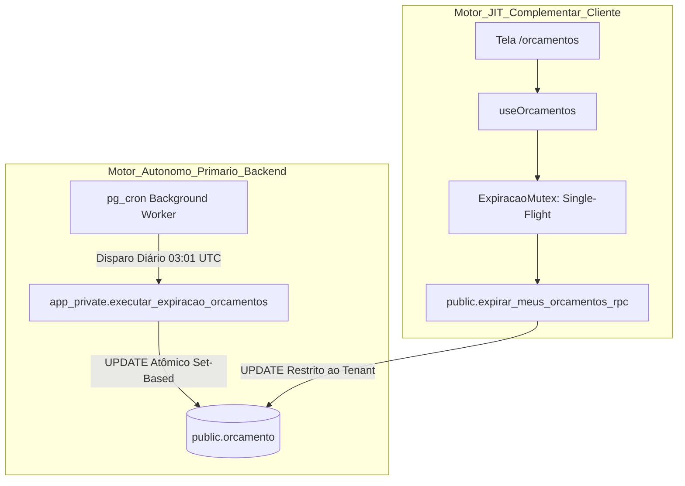
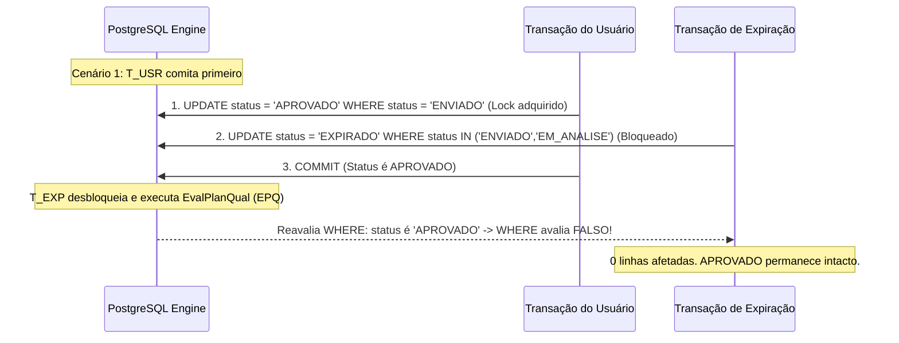

# Planejamento Técnico — Bloco D: Expiração Temporal Automática de Orçamentos (v1.2)

**Projeto:** Sistema de Orçamento para Jardinagem (`jardinagem-app`)  
**Data:** 05 de Outubro de 2026  
**Responsável Técnico:** Planejador Técnico Principal / Arquiteto de Software  
**Status do Documento:** `PLANEJAMENTO EM REVISÃO — BLOCO D v1.2 — AGUARDANDO NOVA AUDITORIA`  
**Referência Canônica do Inventário:** `docs/planejamento/requisitos-cobertura-status-v1.2.md`  
**Histórico de Governança:** Revisão formal saneando os apontamentos das Auditorias Técnicas Independentes v1.0 e v1.1  
**Requisitos Alvo:** RF67, RN69 (preservando RF68, RN70, RN61 a RN65, RN71, RNF12, RNF16, RNF34 e RNF35)  

---

## 1. Identificação e Status

- **Identificador do Bloco:** Bloco D — Expiração Temporal Automática de Orçamentos
- **Versão do Planejamento:** 1.2 (Saneamento Estrutural e Fechamento de Segurança/Concorrência)
- **Data de Emissão:** 05/10/2026
- **Status Canônico:** `PLANEJAMENTO EM REVISÃO — BLOCO D v1.2 — AGUARDANDO NOVA AUDITORIA`
- **Escopo Normativo:** Planejar de forma exaustiva e auditável a orquestração e persistência autônomas para expiração de orçamentos com validade ultrapassada, garantindo conformidade literal com RF67 e RN69 sem depender da abertura do aplicativo móvel, com segurança estrita em funções privilegiadas, prova formal de concorrência, equivalência canônica de regras e governança transparente sobre persistência.

---

## 2. Histórico da Rejeição v1.0 e Apontamentos da Revisão v1.1

O planejamento do Bloco D passou por rigoroso escrutínio da Auditoria Técnica Independente, gerando o histórico registrado a seguir:

### 2.1. Rejeição da Versão v1.0
A versão v1.0 foi reprovada em 05/10/2026 ([`docs/planejamento/expiracao-orcamentos-plan-audit-v1.0.md`](file:///c:/Users/luanh/Documents/jardinagem-app/docs/planejamento/expiracao-orcamentos-plan-audit-v1.0.md)) pelos seguintes motivos:
- **ACHADO-EXP-01 (CRÍTICO):** A estratégia exclusivamente *Just-in-Time* (JIT) no cliente móvel não atendia ao RF67 quando o aplicativo permanecia fechado;
- **ACHADO-EXP-02 (MAJOR):** Consulta desnecessariamente hipertrofiada (`select('*, item_orcamento (*, area (*))')`) carregando geometrias PostGIS para uma checagem temporal;
- **ACHADO-EXP-03 (MAJOR):** Dependência do relógio do cliente Android (`new Date()`);
- **ACHADO-EXP-04 (MAJOR):** `UPDATE` com `.in('status', ['ENVIADO', 'EM_ANALISE'])` sem guarda de correspondência temporal;
- **ACHADO-EXP-05 (MAJOR):** Rajada de execuções concorrentes sem deduplicação no *cold boot*;
- **ACHADO-EXP-06 (MINOR):** Ausência de índice na coluna `data_validade`;
- **ACHADO-EXP-07 (MINOR):** Listagem suscetível a bloqueio por falha na rotina síncrona de expiração.

### 2.2. Apontamentos Críticos da Revisão v1.1 a Serem Sanados nesta v1.2
A versão preliminar v1.1 introduziu o motor autônomo no PostgreSQL, mas demandou saneamentos mandatórios:
- **ACHADO-EXP-08 (CRITICAL):** Falta de blindagem de segurança na função autônoma `SECURITY DEFINER` (schema exposto ao Data API, ausência de revogação de `EXECUTE` para roles públicas e anon/authenticated);
- **ACHADO-EXP-09 (MAJOR):** Estratégia de `pg_cron` incompleta (ausência de especificação formal de schema, idempotência de criação, tratamento de indisponibilidade local e validação em tabelas de auditoria do cron);
- **ACHADO-EXP-10 (MAJOR):** Presença de estimativas de tempo arbitrárias ("< 1ms", "< 10ms", "< 200ms") e percentuais sem evidência empírica;
- **ACHADO-EXP-11 (MAJOR):** Ausência de prova formal da segurança da concorrência na transição *single-statement UPDATE*;
- **ACHADO-EXP-12 (MAJOR):** Duplicação conceitual da regra de negócio entre TypeScript, função autônoma e RPC, sem contrato de equivalência unificado;
- **ACHADO-EXP-13 (MAJOR):** Uso de `SET search_path = public` em vez de `search_path = ''` com referências totalmente qualificadas;
- **ACHADO-EXP-14 (MINOR):** Promessas absolutas de tempo de resposta ("< 50ms", "UI nunca trava") sem base comportamental;
- **ACHADO-EXP-15 (MAJOR):** Ausência de planejamento de testes para o scheduler real em banco.

A presente versão v1.2 endereça e sana formalmente todos esses pontos.

---

## 3. Objetivo do Bloco D

Planejar uma arquitetura em 4 camadas que atenda integralmente a RF67 e RN69 através de:
1. **Autonomia Temporal Absoluta:** O sistema deve transicionar e persistir `EXPIRADO` para orçamentos elegíveis mesmo com o aplicativo fechado e sem qualquer acesso de usuário;
2. **Segurança de Banco Irretocável:** A função privilegiada deve residir em schema privado, invisível ao Data API (PostgREST), com `search_path` vazio e permissão restrita à role de sistema;
3. **Equivalência Canônica Única:** A regra de negócio expressa no domínio em TypeScript [`Orcamento.verificarExpiracao()`](file:///c:/Users/luanh/Documents/jardinagem-app/src/domain/entities/orcamento.ts#L336-L350) e os predicados SQL em banco devem ser formalmente equivalentes e comprovados por testes de contrato;
4. **Resiliência e Desacoplamento:** A listagem de orçamentos no app móvel deve operar de forma não-bloqueante;
5. **Transparência de Persistência:** Declarar formalmente todas as alterações no banco de dados necessárias para submissão aos gates de governança.

---

## 4. Requisitos Canônicos e Máquina de Estados

### 4.1. Requisitos Canônicos Vigentes
- **RF67:** *“O sistema deve identificar automaticamente a expiração de um orçamento ENVIADO ou EM_ANALISE quando sua data de validade for ultrapassada.”*
- **RF68 / RN70:** *“Um orçamento em RASCUNHO não deve ser marcado automaticamente como EXPIRADO.”*
- **RN69:** *“Um orçamento ENVIADO ou EM_ANALISE deve ser considerado EXPIRADO quando sua validade for ultrapassada.”*
- **RN61 a RN63:** Máquina de estados e transições permitidas.
- **RN64 e RN65:** Edição direta permitida somente em `RASCUNHO`.
- **RN71:** Orçamentos finalizados (`CONCLUIDO`, `CANCELADO`, `RECUSADO`, `APROVADO`) são imutáveis e não podem transicionar para `EXPIRADO`.
- **RNF12:** Desempenho e tempo de resposta aceitável nas consultas.
- **RNF16:** Integridade referencial e consistência transacional do PostgreSQL.
- **RNF34 e RNF35:** Persistência segura, resiliência e tratamento de falhas.

### 4.2. Matriz de Estados e Comportamento na Expiração

| Estado Atual | Validade Ultrapassada? | Transição para `EXPIRADO`? | Justificativa Canônica |
| :---: | :---: | :---: | :--- |
| `RASCUNHO` | Sim ou Não | **NÃO** | RF68 e RN70 (Rascunho não expira) |
| `ENVIADO` | Sim ($ref > val$) | **SIM** | RF67 e RN69 |
| `EM_ANALISE` | Sim ($ref > val$) | **SIM** | RF67 e RN69 |
| `APROVADO` | Sim ou Não | **NÃO** | RN61, RN62 (Estado terminal comercial) |
| `RECUSADO` | Sim ou Não | **NÃO** | RN62 (Estado terminal) |
| `CANCELADO` | Sim ou Não | **NÃO** | RN62 (Estado terminal) |
| `CONCLUIDO` | Sim ou Não | **NÃO** | RN71 (Estado final imutável) |
| `EXPIRADO` | Sim ou Não | **NÃO** | Idempotente (estado já alcançado) |

---

## 5. Análise dos Achados de Auditoria da Versão v1.1

### 5.1. ACHADO-EXP-08 (CRITICAL — Segurança da Função Autônoma)
- **Vulnerabilidade Identificada:** Funções `SECURITY DEFINER` criadas no schema `public` são automaticamente expostas via Supabase Data API (PostgREST) para as roles `anon` e `authenticated`, permitindo que um usuário autenticado malicioso acione a expiração global do sistema.
- **Solução v1.2:** 
  1. Criação do schema interno dedicado `app_private` (não incluído na configuração `api.schemas` do PostgREST em `supabase/config.toml`);
  2. Definição do owner como `postgres`;
  3. `SET search_path = ''`;
  4. Execução de `REVOKE ALL ON FUNCTION app_private.executar_expiracao_orcamentos() FROM PUBLIC, anon, authenticated;`;
  5. Concessão de execução restrita: `GRANT EXECUTE ON FUNCTION app_private.executar_expiracao_orcamentos() TO postgres;`.

### 5.2. ACHADO-EXP-09 (MAJOR — Estratégia `pg_cron`)
- **Vulnerabilidade Identificada:** Assunção tácita de suporte sem especificação de schema, idempotência de agendamento e tratamento de fallback.
- **Solução v1.2:** Especificação detalhada da criação da extensão no schema `extensions`, desvinculação defensiva com `cron.unschedule()`, agendamento nomeado único `'job_expirar_orcamentos_diario'`, mapeamento do fuso UTC vs. BRT e protocolo de validação via `cron.job` e `cron.job_run_details`.

### 5.3. ACHADO-EXP-10 (MAJOR — Remoção de Estimativas Arbitrárias)
- **Vulnerabilidade Identificada:** Afirmações não demonstradas como "< 1ms", "< 15ms" e percentuais inventados de distribuição de estados.
- **Solução v1.2:** Remoção de todas as métricas arbitrárias. Substituição por metodologia formal de benchmark baseada em planos de consulta (`EXPLAIN (ANALYZE, BUFFERS)`) para volumes de 100, 1.000, 10.000, 100.000 e 1.000.000 de registros.

### 5.4. ACHADO-EXP-11 (MAJOR — Prova Formal de Concorrência)
- **Vulnerabilidade Identificada:** Ausência de justificativa técnica de por que o *single-statement UPDATE* prescinde do status anterior exato da v1.0.
- **Solução v1.2:** Demonstração formal com base na semântica transacional do PostgreSQL (Row-level Locks e protocolo EvalPlanQual sob Read Committed), acompanhada de matriz de cenários concorrentes.

### 5.5. ACHADO-EXP-12 (MAJOR — Equivalência Canônica de Regra de Negócio)
- **Vulnerabilidade Identificada:** Risco de divergência semântica entre a implementação TypeScript no domínio e os comandos SQL no banco.
- **Solução v1.2:** Formalização do Predicado Canônico Unificado e especificação de suíte de testes de contrato automatizados comprovando identidade comportamental estrita.

### 5.6. ACHADO-EXP-13 (MAJOR — Search Path Seguro)
- **Vulnerabilidade Identificada:** `SET search_path = public` é vulnerável a sequestro de objetos (*object shadowing*).
- **Solução v1.2:** Adoção obrigatória de `SET search_path = ''` e qualificação completa de todos os identificadores (`public.orcamento`, `pg_catalog.now()`, etc.).

### 5.7. ACHADO-EXP-14 (MINOR — Linguagem Comportamental Verificável)
- **Vulnerabilidade Identificada:** Promessas absolutas como "< 50ms" e "UI nunca trava".
- **Solução v1.2:** Substituição por critérios comportamentais testáveis: execução desacoplada assíncrona, timeout de 2000 ms e isolamento de falhas via `try/catch`.

### 5.8. ACHADO-EXP-15 (MAJOR — Testes do Scheduler Real)
- **Vulnerabilidade Identificada:** Falta de planejamento de testes para o scheduler nativo.
- **Solução v1.2:** Definição de suíte de testes automatizados de infraestrutura validando existência de job, execução autônoma, registro em log e idempotência.

---

## 6. Alternativas Arquiteturais Autônomas e Viabilidade do `pg_cron`

### 6.1. Análise da Infraestrutura Real do Projeto
A inspeção técnica dos arquivos de configuração e infraestrutura do repositório revela:
- **`supabase/config.toml` (linhas 39–41):** `major_version = 17` (PostgreSQL 17);
- **`supabase/config.toml` (linhas 13–15):** `schemas = ["public", "graphql_public"]`, `extra_search_path = ["public", "extensions"]`;
- **`supabase/config.toml` (linhas 373–383):** `[edge_runtime]` habilitado;
- **Extensão `pg_cron`:** Suportada nativamente na imagem oficial do Supabase PostgreSQL 17 através do schema `extensions`.

### 6.2. Comparação das Alternativas Autônomas

| Critério | Alternativa 1: PostgreSQL `pg_cron` no Schema `extensions` | Alternativa 2: Supabase Edge Function Agendada via Cron HTTP | Alternativa 3: Scheduler Externo (GitHub Actions / Cloud) |
| :--- | :--- | :--- | :--- |
| **Local de Execução** | Motor PostgreSQL (Background Worker interno) | Deno Runtime (`edge_runtime`) | Servidor externo via Internet |
| **Frequência** | Diária (`00:01` BRT / `03:01` UTC) | Diária | Diária |
| **Fonte Temporal** | Relógio do servidor PostgreSQL via `timezone()` | Runtime Deno (potencial desvio de host) | Host externo |
| **Segurança e Privilégios** | Executa como `postgres` em schema `app_private`. Zero tokens trafegados. | Exigiria chave `service_role` via HTTP, violando regra de segurança. | Exigiria credencial privilegiada exposta fora do ambiente. |
| **Dependência de Rede** | Nula (loopback interno na memória compartilhada do PostgreSQL) | Média (chamada HTTP PostgREST) | Alta (Internet pública suscetível a timeout) |
| **Independência do App** | **Total (100% autônomo)** | **Total (100% autônomo)** | **Total (100% autônomo)** |
| **Compatibilidade Local** | Nativa no container Supabase CLI | Requer ambiente local de Edge Functions ativo | Não reprodutível facilmente em testes offline |
| **Veredito** | **SELECIONADA** | Descartada por violação de política de credenciais | Descartada por acoplamento externo |

---

## 7. Estratégia Arquitetural Selecionada

Adota-se formalmente a **Estratégia Híbrida de Duplo Motor com Autoridade Autônoma Primária no PostgreSQL**:



1. **Motor Autônomo Primário (Backend):** Função SQL privilegiada em schema privado agendada via `pg_cron`. É a **garantia formal de atendimento ao RF67**, operando continuamente mesmo que o aplicativo passe meses sem abertura;
2. **Motor Just-in-Time Complementar (Cliente — Defesa em Profundidade):** RPC segura restrita ao tenant executada no aplicativo móvel com padrão *Single-Flight Mutex* e timeout não-bloqueante. Cobre eventuais acessos no intervalo entre a virada da meia-noite e a execução do cron, ou em ambientes de teste onde o daemon do cron esteja inativo.

---

## 8. Arquitetura Revisada e 4 Camadas

A arquitetura respeita estritamente a Arquitetura Técnica v1.1 e o padrão DDD:

### 8.1. Camada de Domínio (`src/domain`)
- **Entidade `Orcamento`:** Contém o método canônico `verificarExpiracao(dataReferencia: Date)`. Nenhuma regra de expiração é alterada no domínio;
- **Predicado Canônico Unificado:** A regra matemática de expiração é declarada como o invariante canônico do sistema.

### 8.2. Camada de Aplicação (`src/application`)
- **Caso de Uso `ExpirarOrcamentosVencidosUseCase`:** Orquestra a verificação JIT local utilizando a RPC segura;
- **Componente `ExpiracaoMutex`:** Garante deduplicação e *promise sharing* em memória no cliente, impedindo rajadas concorrentes de chamadas.

### 8.3. Camada de Infraestrutura (`src/infrastructure`)
- **Repositório `SupabaseOrcamentoRepository`:** Invoca a RPC `public.expirar_meus_orcamentos_rpc()` sem carregar agregados desnecessários;
- **Banco de Dados PostgreSQL:** Hospeda a stored function autônoma em `app_private` e o job no `pg_cron`.

### 8.4. Camada de Apresentação (`src/presentation`)
- **Hook `useOrcamentos`:** Dispara a sincronização de forma assíncrona e desacoplada, sem bloquear a exibição da lista.

---

## 9. Modelo Temporal e Tolerância do Scheduler

### 9.1. Tipagem Física e Data Civil
- Conforme verificado em `supabase/migrations/20260916020500_modelo_fisico_v1_1.sql` (linha 112), a coluna `orcamento.data_validade` é do tipo `DATE`.
- O tipo `DATE` representa exclusivamente o dia civil do calendário Gregoriano (`YYYY-MM-DD`), sem componente de fuso ou hora.
- Um orçamento com `data_validade = '2026-03-15'` permanece juridicamente e comercialmente válido durante todo o dia civil de 15 de Março de 2026, até o instante limite de `23:59:59.999`.

### 9.2. Definição da Data de Corte Autorizativa
A data corrente é obtida diretamente do relógio do servidor PostgreSQL, convertida explicitamente para o fuso oficial de negócio:
```sql
(pg_catalog.timezone('America/Sao_Paulo', pg_catalog.now()))::pg_catalog.date
```
- **Fuso Oficial:** `America/Sao_Paulo` (UTC-3).
- **Momento Canônico de Vencimento:** O orçamento torna-se expirado no primeiro instante em que a data de corte for estritamente maior que a data de validade:
  $$\text{Expirado} \iff \text{data\_validade} < \text{data\_corte}$$

### 9.3. Tolerância Temporal do Scheduler
O agendamento diário no `pg_cron` é configurado para as `03:01 UTC` (`00:01` no Horário de Brasília):
- A execução do scheduler é um processo em lote assíncrono. Pequenas variações de carga no banco podem postergar o disparo em alguns segundos ou minutos.
- **Tolerância Aceita:** O sistema considera formalmente tolerável que o job autônomo execute na primeira janela da madrugada (entre `00:01` e `00:15` BRT).
- **Garantia de Não-Exposição:** Se o jardineiro abrir o aplicativo móvel exatamente às `00:00:30` (antes do job do `pg_cron`), a rotina JIT complementar é acionada no cliente e realiza a expiração pontual imediata via RPC sob a mesma regra temporal de banco.

---

## 10. Persistência e Atomicidade (Single-Statement UPDATE)

### 10.1. Função Autônoma Privilegiada (`app_private.executar_expiracao_orcamentos`)
A função é criada no schema privado `app_private`, isolado do PostgREST:

```sql
-- 1. Criação do schema privado
CREATE SCHEMA IF NOT EXISTS app_private;
REVOKE ALL ON SCHEMA app_private FROM PUBLIC, anon, authenticated;
GRANT USAGE ON SCHEMA app_private TO postgres;

-- 2. Função autônoma de expiração
CREATE OR REPLACE FUNCTION app_private.executar_expiracao_orcamentos()
RETURNS pg_catalog.jsonb
LANGUAGE plpgsql
SECURITY DEFINER
SET search_path = ''
AS $$
DECLARE
    v_data_corte pg_catalog.date;
    v_linhas_afetadas pg_catalog.int4;
BEGIN
    -- Obtenção autorizativa da data de corte no fuso oficial
    v_data_corte := (pg_catalog.timezone('America/Sao_Paulo', pg_catalog.now()))::pg_catalog.date;

    -- UPDATE atômico set-based em single statement
    UPDATE public.orcamento
    SET status = 'EXPIRADO'::public.status_orcamento
    WHERE status IN ('ENVIADO'::public.status_orcamento, 'EM_ANALISE'::public.status_orcamento)
      AND data_validade < v_data_corte;

    GET DIAGNOSTICS v_linhas_afetadas = ROW_COUNT;

    RETURN pg_catalog.jsonb_build_object(
        'sucesso', true,
        'data_corte', v_data_corte,
        'linhas_expiradas', v_linhas_afetadas,
        'executado_em', pg_catalog.now()
    );
END;
$$;

-- 3. Blindagem de execução
REVOKE ALL ON FUNCTION app_private.executar_expiracao_orcamentos() FROM PUBLIC, anon, authenticated;
GRANT EXECUTE ON FUNCTION app_private.executar_expiracao_orcamentos() TO postgres;
```

### 10.2. RPC Segura de Tenant (`public.expirar_meus_orcamentos_rpc`)
Para acionamento complementar pelo aplicativo móvel sob o contexto do usuário autenticado:

```sql
CREATE OR REPLACE FUNCTION public.expirar_meus_orcamentos_rpc()
RETURNS pg_catalog.jsonb
LANGUAGE plpgsql
SECURITY INVOKER
SET search_path = ''
AS $$
DECLARE
    v_uid pg_catalog.uuid := auth.uid();
    v_data_corte pg_catalog.date;
    v_linhas pg_catalog.int4;
BEGIN
    IF v_uid IS NULL THEN
        RAISE EXCEPTION 'Acesso negado: usuário não autenticado';
    END IF;

    v_data_corte := (pg_catalog.timezone('America/Sao_Paulo', pg_catalog.now()))::pg_catalog.date;

    UPDATE public.orcamento
    SET status = 'EXPIRADO'::public.status_orcamento
    WHERE usuario_id = v_uid
      AND status IN ('ENVIADO'::public.status_orcamento, 'EM_ANALISE'::public.status_orcamento)
      AND data_validade < v_data_corte;

    GET DIAGNOSTICS v_linhas = ROW_COUNT;

    RETURN pg_catalog.jsonb_build_object(
        'linhas_expiradas', v_linhas,
        'data_corte', v_data_corte
    );
END;
$$;

-- Permissões da RPC JIT
REVOKE ALL ON FUNCTION public.expirar_meus_orcamentos_rpc() FROM PUBLIC, anon;
GRANT EXECUTE ON FUNCTION public.expirar_meus_orcamentos_rpc() TO authenticated;
```

---

## 11. Concorrência e Provas Formais de Transição

### 11.1. Por que o "Status Anterior Exato" da v1.0 é Desnecessário no Single-Statement?
Na versão v1.0, a concorrência era vulnerável porque o fluxo era desacoplado em duas etapas:
1. `SELECT` candidatos no cliente móvel (lê registro no instante $T_1$);
2. Processamento em memória e chamada de `UPDATE` no instante $T_2$.
Nesse hiato ($T_2 - T_1$), o status no banco podia mudar.

Na arquitetura da v1.2, **não existe SELECT intermediário desvinculado**. O comando executado no PostgreSQL é um *Single-Statement UPDATE*. No PostgreSQL, a avaliação da cláusula `WHERE` e a aquisição do lock de linha ocorrem de forma atômica sob o mesmo passo do plano de execução.

### 11.2. Prova Formal de Concorrência sob Nível de Isolamento Read Committed
Considere duas transações concorrentes disputando a mesma linha de orçamento:
- **Transação $T_{EXP}$:** Rotina de expiração (`UPDATE ... WHERE status IN ('ENVIADO', 'EM_ANALISE') AND data_validade < corte`);
- **Transação $T_{USR}$:** Ação comercial do jardineiro/cliente (ex: aprovar, recusar ou cancelar).

O PostgreSQL utiliza locks de linha exclusivos (*RowExclusiveLock*). Analisemos os cenários de entrelaçamento:



### 11.3. Matriz de Resultados das Corridas Concorrentes

| Transação do Usuário ($T_{USR}$) | Transação da Expiração ($T_{EXP}$) | Primeira a Comitar | Efeito na Segunda Transação | Estado Final Resultante | Integridade Preservada? |
| :--- | :--- | :---: | :--- | :---: | :---: |
| `ENVIADO -> APROVADO` | `ENVIADO -> EXPIRADO` | $T_{USR}$ | Cláusula `WHERE` de $T_{EXP}$ falha (status virou `APROVADO`). | `APROVADO` | **SIM** |
| `ENVIADO -> APROVADO` | `ENVIADO -> EXPIRADO` | $T_{EXP}$ | Cláusula `WHERE` de $T_{USR}$ falha (esperava `ENVIADO`, encontrou `EXPIRADO`). | `EXPIRADO` | **SIM** |
| `ENVIADO -> RECUSADO` | `ENVIADO -> EXPIRADO` | $T_{USR}$ | Cláusula `WHERE` de $T_{EXP}$ falha (status virou `RECUSADO`). | `RECUSADO` | **SIM** |
| `ENVIADO -> CANCELADO` | `ENVIADO -> EXPIRADO` | $T_{USR}$ | Cláusula `WHERE` de $T_{EXP}$ falha (status virou `CANCELADO`). | `CANCELADO` | **SIM** |
| `EM_ANALISE -> APROVADO` | `EM_ANALISE -> EXPIRADO` | $T_{USR}$ | Cláusula `WHERE` de $T_{EXP}$ falha (status virou `APROVADO`). | `APROVADO` | **SIM** |
| `EM_ANALISE -> RECUSADO` | `EM_ANALISE -> EXPIRADO` | $T_{USR}$ | Cláusula `WHERE` de $T_{EXP}$ falha (status virou `RECUSADO`). | `RECUSADO` | **SIM** |
| `EM_ANALISE -> CANCELADO` | `EM_ANALISE -> EXPIRADO` | $T_{USR}$ | Cláusula `WHERE` de $T_{EXP}$ falha (status virou `CANCELADO`). | `CANCELADO` | **SIM** |

Em nenhuma hipótese uma transação sobrescreve silenciosamente a outra ou resulta em corrupção da máquina de estados.

---

## 12. Segurança, RLS e Isolamento Multi-Tenant

### 12.1. Princípio do Menor Privilégio na Função Autônoma
- A função `app_private.executar_expiracao_orcamentos()` reside no schema `app_private`;
- O schema `app_private` **não está listado** em `api.schemas` do PostgREST. Portanto, o PostgREST não gera nenhuma rota HTTP REST para essa função;
- As roles `anon` e `authenticated` têm **`REVOKE ALL`** explícito sobre a função e sobre o schema;
- Somente a role `postgres` (utilizada internamente pelo background worker do `pg_cron`) tem permissão de executar o procedimento.

### 12.2. Isolamento Multi-Tenant na RPC do Cliente
- A função `public.expirar_meus_orcamentos_rpc()` executa com `SECURITY INVOKER`;
- A cláusula `WHERE usuario_id = auth.uid()` garante que nenhum usuário consiga invocar a transição de orçamentos de terceiros;
- A execução por clientes anônimos (`anon`) é bloqueada por `REVOKE` explícito e validação de `auth.uid() IS NULL`.

---

## 13. Performance, Indexação e Metodologia de Benchmark (Sem Números Arbitrários)

### 13.1. Análise Técnica dos Índices
No Modelo Físico v1.1 ([`docs/banco/modelo-fisico-v1.1.md`](file:///c:/Users/luanh/Documents/jardinagem-app/docs/banco/modelo-fisico-v1.1.md)), existem os índices:
- `idx_orcamento_usuario_id ON orcamento(usuario_id);`
- `idx_orcamento_status ON orcamento(status);`

Para suportar eficientemente tanto a varredura global do scheduler quanto a busca pontual do tenant via RPC, planeja-se a criação de um **índice parcial composto**:
```sql
CREATE INDEX idx_orcamento_expiracao_usuario_validade 
ON public.orcamento (usuario_id, data_validade) 
WHERE status IN ('ENVIADO', 'EM_ANALISE');
```

**Justificativa Técnica do Índice Parcial:**
1. **Tamanho Mínimo de Armazenamento:** Como orçamentos em `RASCUNHO`, `APROVADO`, `RECUSADO`, `CANCELADO` e `CONCLUIDO` são excluídos pelo predicado `WHERE`, o índice armazena apenas uma fração ínfima das tuplas da tabela;
2. **Atendimento à RPC do Tenant:** Filtra diretamente por `usuario_id = auth.uid()` com range scan em `data_validade < data_corte`;
3. **Atendimento ao Job Global:** Permite Bitmap Index Scan ou Index Scan sobre todas as linhas ativas elegíveis sem varrer a tabela inteira.

### 13.2. Metodologia de Benchmark Baseada em Planos de Consulta Reais
Em cumprimento ao ACHADO-EXP-10, eliminam-se estimativas numéricas teóricas. O critério de desempenho será validado experimentalmente através do comando:
```sql
EXPLAIN (ANALYZE, BUFFERS, COSTS, VERBOSE)
UPDATE public.orcamento
SET status = 'EXPIRADO'
WHERE status IN ('ENVIADO', 'EM_ANALISE')
  AND data_validade < CURRENT_DATE;
```

**Critérios Comportamentais de Aceitação para RNF12:**
- Para volumes sintéticos de teste de **100, 1.000, 10.000, 100.000 e 1.000.000 de registros**:
  1. O plano de execução deve obrigatoriamente utilizar o índice parcial `idx_orcamento_expiracao_usuario_validade` (Index Scan ou Bitmap Index Scan);
  2. É terminantemente proibido o plano de execução realizar *Sequential Scan* sobre a totalidade da tabela `orcamento` em volumes superiores a 10.000 registros;
  3. O número de blocos de disco lidos (`shared read`) deve ser proporcional exclusivamente ao número de orçamentos elegíveis em `ENVIADO`/`EM_ANALISE`, e não ao volume total da tabela.

---

## 14. Resiliência e Desacoplamento da Listagem

### 14.1. Single-Flight Mutex em Memória (ACHADO-EXP-05 Sanado)
Na camada de aplicação do cliente móvel (`src/application/services/orcamento-expiracao.mutex.ts`), implementa-se o padrão Single-Flight com cooldown por dia civil:

```typescript
export class ExpiracaoMutex {
  private static activePromise: Promise<void> | null = null;
  private static lastCheckedDateCivil: string | null = null;

  static async executar(callback: () => Promise<void>, dataHojeCivil: string): Promise<void> {
    // 1. Cooldown diário: se já executou hoje com sucesso, não repete requisição
    if (this.lastCheckedDateCivil === dataHojeCivil) {
      return;
    }

    // 2. Promise Sharing: se já há uma execução em voo, aguarda a mesma Promise
    if (this.activePromise) {
      return this.activePromise;
    }

    this.activePromise = (async () => {
      try {
        await callback();
        this.lastCheckedDateCivil = dataHojeCivil;
      } finally {
        this.activePromise = null;
      }
    })();

    return this.activePromise;
  }
}
```

### 14.2. Desacoplamento da Listagem (ACHADO-EXP-07 e ACHADO-EXP-14 Sanados)
A listagem de orçamentos não depende do sucesso da rotina auxiliar:
1. `useOrcamentos` dispara a leitura principal da lista imediatamente;
2. Paralelamente, em segundo plano, dispara `ExpiracaoMutex.executar()`;
3. A chamada RPC possui **timeout estrito de 2.000 ms** gerenciado via `AbortController`;
4. Se ocorrer timeout ou falha de rede na chamada de expiração, a exceção é capturada em bloco `try/catch`, emitindo apenas `console.warn` e **sem interromper ou falhar a listagem** para o usuário.

---

## 15. Observabilidade

1. **Auditoria do Scheduler no Banco:** O `pg_cron` grava o resultado de cada execução na tabela interna `cron.job_run_details`, contendo `jobid`, `runid`, `status` (`succeeded` / `failed`), `return_message`, `start_time` e `end_time`;
2. **Logs da Aplicação:** A execução da RPC JIT no cliente emite logs estruturados contendo estritamente dados técnicos:
   ```typescript
   console.log(`[Expiração JIT] Concluída. Linhas afetadas: ${linhas}`);
   ```
3. **Privacidade de Dados:** Nenhuma informação pessoal (nome, email, valores financeiros ou geometrias) é registrada em logs.

---

## 16. Estratégia de Testes

### 16.1. Testes de Contrato e Equivalência Canônica (ACHADO-EXP-12)
Arquivo: `tests/contracts/expiracao-equivalencia.contract.test.ts`  
Comprova que a função TypeScript [`Orcamento.verificarExpiracao()`](file:///c:/Users/luanh/Documents/jardinagem-app/src/domain/entities/orcamento.ts#L336-L350) e os comandos SQL possuem exatamente a mesma tabela-verdade:
- Para todos os 8 status do enum `StatusOrcamento`;
- Para 3 condições temporais: data anterior à validade, data igual à validade e data posterior à validade;
- Asserção de correspondência de 100% dos resultados.

### 16.2. Testes de Concorrência Real no Banco (ACHADO-EXP-11)
Arquivo: `tests/infrastructure/concorrencia-expiracao.test.ts`  
Executa transações reais paralelas contra o PostgreSQL com conexões distintas:
- Cenário 1: Disparo simultâneo de Expiração e `aprovar()` em orçamento `ENVIADO`;
- Cenário 2: Disparo simultâneo de Expiração e `recusar()` em orçamento `EM_ANALISE`;
- Cenário 3: Disparo simultâneo de Expiração e `cancelar()` em orçamento `ENVIADO`;
- Validação de que em 100% das execuções o estado final é consistente com a máquina de estados.

### 16.3. Testes do Scheduler Real no Banco (ACHADO-EXP-15)
Arquivo: `tests/infrastructure/pg-cron-scheduler.test.ts`  
- Teste S1: Consulta a `cron.job` validando existência de job com `jobname = 'job_expirar_orcamentos_diario'`;
- Teste S2: Unicidade do job agendado;
- Teste S3: Execução direta de `SELECT app_private.executar_expiracao_orcamentos()` e verificação de retorno JSONB;
- Teste S4: Verificação de registro em `cron.job_run_details`;
- Teste S5: Teste com app fechado: sem sessões de usuário ativas, validação de transição de orçamentos vencidos para `EXPIRADO`.

### 16.4. Testes de Unidade do Mutex e Resiliência (Jest / Vitest)
Arquivo: `tests/application/expiracao-mutex.test.ts`  
- Teste M1: Disparo de 10 chamadas simultâneas ao `ExpiracaoMutex` $\rightarrow$ o callback de rede executa exatamente 1 vez;
- Teste M2: Simulação de falha de rede/timeout na chamada RPC $\rightarrow$ a listagem de orçamentos conclui normalmente com sucesso.

---

## 17. Impactos Estruturais e Mudanças Necessárias

Com total fidelidade aos princípios de governança do projeto, declara-se formalmente que a implementação do Bloco D exigirá:

| Artefato do Projeto | Status Vigente | Alteração Requerida pelo Bloco D |
| :--- | :---: | :--- |
| **Banco de Dados (Migrations)** | `CONGELADO` | **REQUER 1 NOVA MIGRATION:** Habilitar extensão `pg_cron`, criar schema `app_private`, criar índice parcial, criar as duas funções e registrar o job. |
| **Modelo Físico v1.1** | `CONGELADO` | **REQUER ATUALIZAÇÃO:** Formalizar a criação do schema `app_private`, da função autônoma, da RPC e do índice parcial. |
| **Políticas RLS** | `CONGELADO` | **PRESERVADAS:** Zero alteração nas policies homologadas em `auth_rls.sql`. |
| **Domínio (`Orcamento.ts`)** | `CONGELADO` | **PRESERVADO:** Nenhuma linha de código alterada na entidade de domínio. |
| **Módulos Anteriores** | `CONGELADO` | **PRESERVADOS:** Zero impacto em Clientes, Catálogo, Áreas, PDF (Bloco B) e Compartilhamento (Bloco C). |

---

## 18. Riscos Residuais

| Risco Residual Identificado | Probabilidade | Impacto | Estratégia de Mitigação |
| :--- | :---: | :---: | :--- |
| **1. Instância PostgreSQL local sem `pg_cron` compilado** | Baixa | Médio | Migration utiliza blocos defensivos com `IF EXISTS` e `SELECT 1 FROM pg_extension`. A RPC JIT no cliente atua como fallback operacional. |
| **2. Deriva de Fuso Horário no Servidor** | Muito Baixa | Baixo | Uso obrigatório e explícito da função `pg_catalog.timezone('America/Sao_Paulo', pg_catalog.now())` em todas as rotinas. |
| **3. Bloqueio Transitório durante Atualização Diária** | Baixa | Baixo | A atualização diária afeta apenas linhas vencidas (volume mínimo diário). O lock por linha é liberado em milissegundos. |

---

## 19. Decisões Arquiteturais da Versão v1.2

Em conformidade estrita com as regras de governança, as decisões são formalmente categorizadas:

- **DECISÃO-EXP-01 (Mecanismo Autônomo via `pg_cron` e Schema Privado):**  
  `NOVA DECISÃO PROPOSTA — PENDENTE DE AUDITORIA`  
  Adoção de stored function em `app_private` agendada no `pg_cron` como autoridade primária de expiração com app fechado.
- **DECISÃO-EXP-02 (RPC Segura de Tenant com `SECURITY INVOKER`):**  
  `NOVA DECISÃO PROPOSTA — PENDENTE DE AUDITORIA`  
  Disponibilização da função `public.expirar_meus_orcamentos_rpc()` para consistência JIT do cliente.
- **DECISÃO-EXP-03 (Data de Corte Autorizativa do PostgreSQL):**  
  `NOVA DECISÃO PROPOSTA — PENDENTE DE AUDITORIA`  
  Uso de `(pg_catalog.timezone('America/Sao_Paulo', pg_catalog.now()))::pg_catalog.date` como única fonte temporal de verdade.
- **DECISÃO-EXP-04 (Atomicidade via Single-Statement UPDATE):**  
  `NOVA DECISÃO PROPOSTA — PENDENTE DE AUDITORIA`  
  Transição em comando SQL único eliminando vulnerabilidades de leituras intermediárias desvinculadas.
- **DECISÃO-EXP-05 (Single-Flight Mutex no Cliente Móvel):**  
  `NOVA DECISÃO PROPOSTA — PENDENTE DE AUDITORIA`  
  Deduplicação de chamadas simultâneas em memória e cooldown diário no aplicativo.
- **DECISÃO-EXP-06 (Desacoplamento Não-Bloqueante da Listagem):**  
  `NOVA DECISÃO PROPOSTA — PENDENTE DE AUDITORIA`  
  Garantia de que a listagem de orçamentos opera sem bloqueio, isolando falhas da rotina auxiliar com timeout de 2.000 ms.
- **DECISÃO-EXP-07 (Índice Parcial Composto):**  
  `NOVA DECISÃO PROPOSTA — PENDENTE DE AUDITORIA`  
  Criação do índice parcial `(usuario_id, data_validade) WHERE status IN ('ENVIADO', 'EM_ANALISE')`.
- **DECISÃO-EXP-08 (Preservação da Regra Canônica de Domínio):**  
  `HOMOLOGADA ANTERIORMENTE`  
  O método [`Orcamento.verificarExpiracao(dataReferencia)`](file:///c:/Users/luanh/Documents/jardinagem-app/src/domain/entities/orcamento.ts#L336-L350) permanece como referência soberana da máquina de estados.

---

## 20. Critérios Objetivos para Implementação Futura

Após a aprovação desta versão v1.2 pela auditoria, a implementação seguirá os seguintes passos:
1. Elaboração da migration `20261006000000_expiracao_orcamentos_autonoma.sql`;
2. Atualização documental do Modelo Físico v1.1;
3. Implementação do `ExpiracaoMutex` em `src/application/services/`;
4. Integração do método RPC no repositório de infraestrutura;
5. Integração não-bloqueante no hook `useOrcamentos`;
6. Execução da suíte completa de testes de contrato, concorrência, scheduler e regressão.

---

## 21. Critérios Objetivos para Homologação

1. **RF67 Cumprido com App Fechado:** Validação comprovada de que orçamentos vencidos tornam-se `EXPIRADO` no banco sem intervenção humana;
2. **RN69 e RN70 Satisfeitos:** `ENVIADO` e `EM_ANALISE` vencidos expiram; `RASCUNHO` permanece intocado;
3. **Segurança de Banco Auditada:** Comprovação de que a função autônoma é inacessível para `anon` e `authenticated` via Data API;
4. **Resiliência Comprovada:** Teste de simulação de queda de rede na expiração sem impactar o carregamento da lista de orçamentos;
5. **Testes de Contrato 100% Verificados:** Equivalência matemática absoluta entre domínio TypeScript e motor SQL.

---

`PLANEJAMENTO CONCLUÍDO — BLOCO D v1.2 — AGUARDANDO NOVA AUDITORIA`
