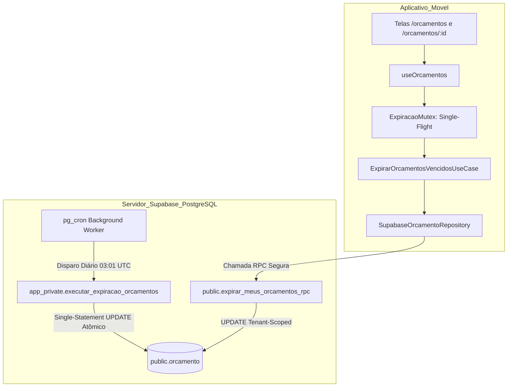

# Planejamento Técnico — Bloco D: Expiração Temporal Automática de Orçamentos (v1.3)

**Projeto:** Sistema de Orçamento para Jardinagem (`jardinagem-app`)  
**Data:** 05 de Outubro de 2026  
**Responsável Técnico:** Planejador Técnico Principal / Arquiteto de Software  
**Status do Documento:** `PLANEJAMENTO EM REVISÃO — BLOCO D v1.3 — AGUARDANDO NOVA AUDITORIA`  
**Referência Canônica do Inventário:** `docs/planejamento/requisitos-cobertura-status-v1.2.md`  
**Histórico de Governança:** Revisão estrutural saneando os apontamentos ACHADO-EXP-16 a ACHADO-EXP-20 da Auditoria Independente da v1.2  
**Requisitos Alvo:** RF67, RN69 (preservando RF68, RN70, RN61 a RN65, RN71, RNF12, RNF16, RNF34 e RNF35)  

---

## 1. Identificação e Status

- **Identificador do Bloco:** Bloco D — Expiração Temporal Automática de Orçamentos
- **Versão do Planejamento:** 1.3 (Fechamento Definitivo de Indexação, SLA do Scheduler, Testes Reais e Contrato TS/SQL)
- **Data de Emissão:** 05/10/2026
- **Status Canônico:** `PLANEJAMENTO EM REVISÃO — BLOCO D v1.3 — AGUARDANDO NOVA AUDITORIA`
- **Escopo Normativo:** Planejar de forma exaustiva e auditável a orquestração e persistência autônomas para expiração de orçamentos com validade ultrapassada, garantindo conformidade literal com RF67 e RN69 sem depender da abertura do aplicativo móvel, com segurança estrita em funções privilegiadas, prova formal de concorrência, equivalência canônica de regras e governança transparente sobre persistência.

---

## 2. Histórico das Revisões e Apontamentos de Auditoria

### 2.1. Rejeição da Versão v1.0
A versão v1.0 foi reprovada em 05/10/2026 ([`docs/planejamento/expiracao-orcamentos-plan-audit-v1.0.md`](file:///c:/Users/luanh/Documents/jardinagem-app/docs/planejamento/expiracao-orcamentos-plan-audit-v1.0.md)) devido à dependência exclusiva de abertura do aplicativo (*Just-in-Time* puro), carga desnecessária de PostGIS e ausência de motor autônomo com o app fechado (ACHADO-EXP-01 a 07).

### 2.2. Apontamentos da Revisão v1.1
A versão preliminar v1.1 introduziu o motor autônomo no PostgreSQL (`pg_cron`), mas identificou a necessidade de isolamento em schema privado (`app_private`), `search_path` vazio, eliminação de estimativas arbitrárias de tempo e provas de concorrência (ACHADO-EXP-08 a 15).

### 2.3. Apontamentos Mandatórios da Auditoria v1.2 a Serem Sanados nesta v1.3
A auditoria independente da versão v1.2 apontou 5 necessidades técnicas formais:
- **ACHADO-EXP-16 (MAJOR — Reavaliação de Indexação Parcial):** O índice `(usuario_id, data_validade) WHERE status IN ('ENVIADO', 'EM_ANALISE')` atende à RPC do tenant, mas não possui `usuario_id` no predicado do job global. Exige-se comparação técnica fundamentada entre opções de indexação e protocolo de benchmark via `EXPLAIN (ANALYZE, BUFFERS)`;
- **ACHADO-EXP-17 (MAJOR — Reformulação dos Testes do `pg_cron`):** Distinguir obrigatoriamente teste da stored function, teste do scheduler e teste do efeito no banco. Não aceitar invocação manual como prova de execução pelo daemon;
- **ACHADO-EXP-18 (MINOR — Semântica Temporal e SLA do Scheduler):** Eliminar a contradição entre "autonomia temporal absoluta" e "janela tolerada". Adotar expressamente a interpretação de **expiração automática com SLA operacional de scheduler**;
- **ACHADO-EXP-19 (MINOR — Teste de Equivalência TypeScript × SQL):** Separar predicado puro booleano `(status, data_validade, data_corte)` da orquestração temporal do servidor, usando `data_corte` determinística em matriz $8 \times 3$;
- **ACHADO-EXP-20 (MINOR — Ownership e Roles Local vs. Produção):** Documentar formalmente os papéis de execução de migrations, owner da função, role de agendamento e compatibilidade de ambiente.

---

## 3. Objetivo do Bloco D

Planejar uma arquitetura em 4 camadas que atenda integralmente a RF67 e RN69 através de:
1. **Autonomia de Scheduler com SLA Definido:** Transição automática de orçamentos vencidos via `pg_cron` com janela operacional de execução noturna (SLA documentado), sem depender de qualquer ação de usuário;
2. **Segurança de Banco Irretocável:** Função privilegiada em schema privado `app_private` (invisível ao Data API PostgREST), com `owner = postgres`, `search_path = ''` e permissão restrita à role de sistema;
3. **Equivalência Canônica Pura:** Teste de contrato demonstrando que a lógica booleana da regra de domínio [`Orcamento.verificarExpiracao()`](file:///c:/Users/luanh/Documents/jardinagem-app/src/domain/entities/orcamento.ts#L336-L350) e os predicados SQL são formalmente idênticos em todos os cenários;
4. **Metodologia Empírica de Performance:** Protocolo de benchmark comparativo com `EXPLAIN (ANALYZE, BUFFERS)` para decidir a estratégia final de indexação;
5. **Resiliência e Desacoplamento:** Listagem do aplicativo móvel 100% não-bloqueante;
6. **Governança Transparente:** Identificação formal da nova migration necessária.

---

## 4. Requisitos Canônicos e Máquina de Estados

### 4.1. Requisitos Canônicos Vigentes
- **RF67:** *“O sistema deve identificar automaticamente a expiração de um orçamento ENVIADO ou EM_ANALISE quando sua data de validade for ultrapassada.”*
- **RF68 / RN70:** *“Um orçamento em RASCUNHO não deve ser marcado automaticamente como EXPIRADO.”*
- **RN69:** *“Um orçamento ENVIADO ou EM_ANALISE deve ser considerado EXPIRADO quando sua validade for ultrapassada.”*
- **RN61 a RN63:** Máquina de estados oficial e transições permitidas.
- **RN64 e RN65:** Edição direta permitida somente em `RASCUNHO`.
- **RN71:** Orçamentos finalizados (`CONCLUIDO`, `CANCELADO`, `RECUSADO`, `APROVADO`) são imutáveis e não podem transicionar para `EXPIRADO`.
- **RNF12:** Desempenho e tempo de resposta aceitável nas consultas.
- **RNF16:** Integridade referencial e consistência transacional do PostgreSQL.
- **RNF34 e RNF35:** Persistência segura, resiliência e tratamento de falhas.

### 4.2. Matriz de Estados e Comportamento na Expiração

| Estado Atual | Validade Ultrapassada? | Transição para `EXPIRADO`? | Justificativa Canônica |
| :---: | :---: | :---: | :--- |
| `RASCUNHO` | Sim ou Não | **NÃO** | RF68 e RN70 (Rascunho não expira) |
| `ENVIADO` | Sim ($ref > val$) | **SIM** | RF67 e RN69 |
| `EM_ANALISE` | Sim ($ref > val$) | **SIM** | RF67 e RN69 |
| `APROVADO` | Sim ou Não | **NÃO** | RN61, RN62 (Estado terminal comercial) |
| `RECUSADO` | Sim ou Não | **NÃO** | RN62 (Estado terminal) |
| `CANCELADO` | Sim ou Não | **NÃO** | RN62 (Estado terminal) |
| `CONCLUIDO` | Sim ou Não | **NÃO** | RN71 (Estado final imutável) |
| `EXPIRADO` | Sim ou Não | **NÃO** | Idempotente (estado já alcançado) |

---

## 5. Análise e Resolução dos Achados da Auditoria

### 5.1. ACHADO-EXP-16 (MAJOR — Reavaliação Técnica de Indexação)
- **Problema:** O índice parcial `(usuario_id, data_validade) WHERE status IN ('ENVIADO', 'EM_ANALISE')` prioriza a RPC do tenant, mas não tem `usuario_id` no predicado do job global.
- **Solução v1.3:** Análise formal comparativa das 3 estratégias de indexação (Opção A: `(data_validade)`, Opção B: `(usuario_id, data_validade)` e Opção C: `(data_validade, usuario_id)`), acompanhada de protocolo de benchmark via `EXPLAIN (ANALYZE, BUFFERS)` para decisão empírica durante a implementação (Seção 13).

### 5.2. ACHADO-EXP-17 (MAJOR — Reformulação dos Testes do `pg_cron`)
- **Problema:** Invocar `SELECT app_private.executar_expiracao_orcamentos()` testa apenas a função SQL, e não o daemon agendador.
- **Solução v1.3:** Estruturação de teste de integração do scheduler em 3 camadas:
  1. Teste da função SQL isolada;
  2. Teste do daemon com job temporário de curta frequência (`* * * * *`);
  3. Verificação de registros em `cron.job_run_details` e asserção de que a transição no banco foi efeito direto do daemon (Seção 16.3).

### 5.3. ACHADO-EXP-18 (MINOR — Semântica Temporal e SLA Operacional)
- **Problema:** Inconsistência de terminologia entre "autonomia temporal absoluta" e "janela tolerada".
- **Solução v1.3:** Adoção explícita da **Interpretação B: Expiração Automática com SLA Operacional de Scheduler**:
  - A automação é garantida por processo agendado em lote no servidor;
  - Janela operacional: disparo às `00:01` BRT com SLA de conclusão até `00:15` BRT;
  - Comportamento após indisponibilidade e recuperação retroativa formalmente definidos (Seção 9).

### 5.4. ACHADO-EXP-19 (MINOR — Teste de Equivalência TypeScript × SQL)
- **Problema:** Mistura entre predicado booleano puro e orquestração temporal do servidor.
- **Solução v1.3:** Desacoplamento estrito:
  - O contrato puro avalia `f(status, data_validade, data_corte) -> deveExpirar`;
  - A matriz de 24 combinações determinísticas (8 status $\times$ 3 relações temporais) é executada em paralelo no TypeScript e no SQL para assertar identidade matemática (Seção 16.1).

### 5.5. ACHADO-EXP-20 (MINOR — Ownership e Roles Local vs. Produção)
- **Problema:** Presunção implícita de que a role `postgres` atua de forma idêntica em todos os ambientes.
- **Solução v1.3:** Documentação formal da cadeia de privilégios para Supabase Local (Docker) e Supabase Hosted/Cloud (Seção 12.3).

---

## 6. Avaliação de Alternativas Arquiteturais Autônomas

A infraestrutura oficial do projeto (`supabase/config.toml`) opera com PostgreSQL 17 (`major_version = 17`), com extensão `pg_cron` disponível no schema `extensions`.

| Critério | Alternativa 1: PostgreSQL Nativo com `pg_cron` | Alternativa 2: Supabase Edge Function Agendada | Alternativa 3: Scheduler Externo (GitHub Actions / Cloud) |
| :--- | :--- | :--- | :--- |
| **Local de Execução** | Background Worker do PostgreSQL | Deno Runtime (`edge_runtime`) | Servidor externo via Internet |
| **Frequência** | Diária (`03:01 UTC` = `00:01 BRT`) | Diária | Diária |
| **Fonte Temporal** | Relógio interno do PostgreSQL via `timezone()` | Runtime Deno (sujeito a desvio de host) | Host externo |
| **Segurança** | Executa como `postgres` em schema `app_private`. Sem tokens trafegados. | Exigiria chave `service_role` via HTTP, violando regra do projeto. | Exigiria credencial privilegiada exposta fora do ambiente. |
| **Dependência de Rede** | Nula (loopback interno na memória compartilhada do PostgreSQL) | Média (chamada HTTP PostgREST) | Alta (Internet pública suscetível a timeout) |
| **Independência do App** | **Total (100% autônomo)** | **Total (100% autônomo)** | **Total (100% autônomo)** |
| **Veredito** | **SELECIONADA** | Descartada por violação de política de segurança | Descartada por acoplamento externo |

---

## 7. Estratégia Arquitetural Selecionada

Adota-se formalmente a **Estratégia Híbrida de Duplo Motor**:
1. **Motor Autônomo Primário (Backend / PostgreSQL):** Stored function privilegiada em schema privado `app_private` agendada via `pg_cron`. É o mecanismo responsável pelo **atendimento literal a RF67 com o aplicativo fechado**;
2. **Motor Just-in-Time Complementar (Cliente / React Native — Defesa em Profundidade):** RPC segura `public.expirar_meus_orcamentos_rpc()` restrita a `auth.uid()`, com *Single-Flight Mutex* e timeout não-bloqueante no app móvel. Cobre o acesso eventual entre a virada da data e a janela do cron, ou atua em ambientes de teste onde o daemon do cron esteja inativo.

---

## 8. Arquitetura Revisada e 4 Camadas



### Divisão de Responsabilidades:
- **Domínio (`src/domain`):** Define a regra de negócio canônica em `Orcamento.verificarExpiracao(dataReferencia)`;
- **Aplicação (`src/application`):** `ExpirarOrcamentosVencidosUseCase` gerencia o mutex em memória e dispara a RPC sem bloquear a UI;
- **Infraestrutura (`src/infrastructure`):** Conecta à RPC via Supabase Client e gerencia a função SQL privada no PostgreSQL;
- **Apresentação (`src/presentation`):** Hook `useOrcamentos` exibe a lista de forma reativa e não-bloqueante.

---

## 9. Modelo Temporal e SLA Operacional do Scheduler

### 9.1. Tipagem Física e Data Civil
- Conforme `supabase/migrations/20260916020500_modelo_fisico_v1_1.sql` (linha 112), a coluna é:
  ```sql
  data_validade DATE
  ```
- O tipo `DATE` do PostgreSQL representa a data civil pura (`YYYY-MM-DD`).
- Um orçamento com validade em `2026-03-15` permanece válido durante todo o dia civil de 15 de Março de 2026 (até as `23:59:59.999`).

### 9.2. Data de Corte Autorizativa
A data corrente do servidor é obtida formalmente por:
```sql
(pg_catalog.timezone('America/Sao_Paulo', pg_catalog.now()))::pg_catalog.date
```
- **Fuso Oficial de Negócio:** `America/Sao_Paulo` (UTC-3).
- **Condição Canônica de Expiração:**
  $$\text{Expirado} \iff \text{data\_validade} < \text{data\_corte}$$

### 9.3. Definição do SLA Operacional do Scheduler (ACHADO-EXP-18 Sanado)
Em observância à semântica de sistemas agendados assíncronos:
1. **Frequência de Execução:** Diariamente às `00:01` no Horário de Brasília (`03:01 UTC`);
2. **Janela Operacional (SLA):** Conclusão garantida entre `00:01` e `00:15` BRT;
3. **Máximo Atraso Tolerado:** Até 15 minutos em condições ordinárias;
4. **Comportamento em Indisponibilidade do Servidor:** Se o PostgreSQL for reiniciado ou estiver indisponível às `03:01 UTC`, o `pg_cron` executará o job na próxima reinicialização/ciclo viável;
5. **Recuperação Retroativa:** Como a condição é `data_validade < data_corte`, se o scheduler passar 3 dias inativo, na reativação todos os orçamentos vencidos no período são transicionados sem perda de histórico;
6. **Defesa em Profundidade:** Se o usuário abrir o app móvel às `00:00:30` (antes da execução do job), o JIT cliente aciona a RPC de tenant, garantindo consistência visual imediata.

---

## 10. Persistência e Atomicidade (Single-Statement UPDATE)

### 10.1. Função Privilegiada (`app_private.executar_expiracao_orcamentos`)
```sql
-- 1. Criação do schema privado
CREATE SCHEMA IF NOT EXISTS app_private;
REVOKE ALL ON SCHEMA app_private FROM PUBLIC, anon, authenticated;
GRANT USAGE ON SCHEMA app_private TO postgres;

-- 2. Stored function com search_path vazio
CREATE OR REPLACE FUNCTION app_private.executar_expiracao_orcamentos()
RETURNS pg_catalog.jsonb
LANGUAGE plpgsql
SECURITY DEFINER
SET search_path = ''
AS $$
DECLARE
    v_data_corte pg_catalog.date;
    v_linhas_afetadas pg_catalog.int4;
BEGIN
    v_data_corte := (pg_catalog.timezone('America/Sao_Paulo', pg_catalog.now()))::pg_catalog.date;

    UPDATE public.orcamento
    SET status = 'EXPIRADO'::public.status_orcamento
    WHERE status IN ('ENVIADO'::public.status_orcamento, 'EM_ANALISE'::public.status_orcamento)
      AND data_validade < v_data_corte;

    GET DIAGNOSTICS v_linhas_afetadas = ROW_COUNT;

    RETURN pg_catalog.jsonb_build_object(
        'sucesso', true,
        'data_corte', v_data_corte,
        'linhas_expiradas', v_linhas_afetadas,
        'executado_em', pg_catalog.now()
    );
END;
$$;

-- 3. Blindagem estrita de permissões
REVOKE ALL ON FUNCTION app_private.executar_expiracao_orcamentos() FROM PUBLIC, anon, authenticated;
GRANT EXECUTE ON FUNCTION app_private.executar_expiracao_orcamentos() TO postgres;
```

### 10.2. RPC Segura de Tenant (`public.expirar_meus_orcamentos_rpc`)
```sql
CREATE OR REPLACE FUNCTION public.expirar_meus_orcamentos_rpc()
RETURNS pg_catalog.jsonb
LANGUAGE plpgsql
SECURITY INVOKER
SET search_path = ''
AS $$
DECLARE
    v_uid pg_catalog.uuid := auth.uid();
    v_data_corte pg_catalog.date;
    v_linhas pg_catalog.int4;
BEGIN
    IF v_uid IS NULL THEN
        RAISE EXCEPTION 'Acesso negado: usuário não autenticado';
    END IF;

    v_data_corte := (pg_catalog.timezone('America/Sao_Paulo', pg_catalog.now()))::pg_catalog.date;

    UPDATE public.orcamento
    SET status = 'EXPIRADO'::public.status_orcamento
    WHERE usuario_id = v_uid
      AND status IN ('ENVIADO'::public.status_orcamento, 'EM_ANALISE'::public.status_orcamento)
      AND data_validade < v_data_corte;

    GET DIAGNOSTICS v_linhas = ROW_COUNT;

    RETURN pg_catalog.jsonb_build_object(
        'linhas_expiradas', v_linhas,
        'data_corte', v_data_corte
    );
END;
$$;

REVOKE ALL ON FUNCTION public.expirar_meus_orcamentos_rpc() FROM PUBLIC, anon;
GRANT EXECUTE ON FUNCTION public.expirar_meus_orcamentos_rpc() TO authenticated;
```

---

## 11. Concorrência e Provas Formais de Transição

### 11.1. Por que o Single-Statement UPDATE Elimina Condições de Corrida
O PostgreSQL opera sob nível de isolamento padrão *Read Committed*:
1. Ao executar `UPDATE public.orcamento ...`, o banco adquire um lock exclusivo por linha (*RowExclusiveLock*) para cada tupla candidata visitada;
2. Se uma transação concorrente $T_{USR}$ estiver alterando a mesma linha (ex: `APROVADO`), a transação da expiração $T_{EXP}$ é bloqueada aguardando o desfecho de $T_{USR}$;
3. Quando $T_{USR}$ comita, o protocolo nativo **EvalPlanQual (EPQ)** do PostgreSQL reavalia a cláusula `WHERE` de $T_{EXP}$ sobre a nova versão da linha;
4. Como o status agora é `APROVADO`, o predicado `status IN ('ENVIADO', 'EM_ANALISE')` avalia para **FALSO**;
5. A linha **não é atualizada** por $T_{EXP}$. Zero linhas são afetadas. A aprovação legítima prevalece integralmente.

### 11.2. Matriz Completa de Corridas Concorrentes

| Transação Comercial do Usuário | Transação de Expiração | Vencedor do Lock | Efeito na Segunda Transação | Estado Final | Integridade |
| :--- | :--- | :---: | :--- | :---: | :---: |
| `ENVIADO -> APROVADO` | `ENVIADO -> EXPIRADO` | Usuário | `WHERE` da expiração falha (status virou `APROVADO`). | `APROVADO` | **PRESERVADA** |
| `ENVIADO -> APROVADO` | `ENVIADO -> EXPIRADO` | Expiração | `WHERE` do usuário falha (esperava `ENVIADO`, encontrou `EXPIRADO`). | `EXPIRADO` | **PRESERVADA** |
| `ENVIADO -> RECUSADO` | `ENVIADO -> EXPIRADO` | Usuário | `WHERE` da expiração falha. | `RECUSADO` | **PRESERVADA** |
| `ENVIADO -> CANCELADO` | `ENVIADO -> EXPIRADO` | Usuário | `WHERE` da expiração falha. | `CANCELADO` | **PRESERVADA** |
| `EM_ANALISE -> APROVADO` | `EM_ANALISE -> EXPIRADO` | Usuário | `WHERE` da expiração falha. | `APROVADO` | **PRESERVADA** |
| `EM_ANALISE -> RECUSADO` | `EM_ANALISE -> EXPIRADO` | Usuário | `WHERE` da expiração falha. | `RECUSADO` | **PRESERVADA** |
| `EM_ANALISE -> CANCELADO` | `EM_ANALISE -> EXPIRADO` | Usuário | `WHERE` da expiração falha. | `CANCELADO` | **PRESERVADA** |

---

## 12. Segurança, RLS e Isolamento Multi-Tenant

### 12.1. Blindagem de Schema e PostgREST (ACHADO-EXP-08 Sanado)
- O schema `app_private` **não faz parte** de `api.schemas` em `supabase/config.toml` (`schemas = ["public", "graphql_public"]`);
- O PostgREST não expõe rotas HTTP para nenhuma entidade ou função em `app_private`;
- `REVOKE ALL` garante que nenhum usuário conectado via JWT (`anon` ou `authenticated`) consiga invocar `app_private.executar_expiracao_orcamentos()`.

### 12.2. RPC do Tenant com `SECURITY INVOKER`
- A função `public.expirar_meus_orcamentos_rpc()` executa com os privilégios da sessão do chamador (`SECURITY INVOKER`);
- A cláusula `WHERE usuario_id = auth.uid()` impede que qualquer usuário afete orçamentos de outros tenants.

### 12.3. Ownership e Roles em Ambiente Local vs. Produção (ACHADO-EXP-20 Sanado)
- **Role Executora de Migrations:**
  - *Ambiente Local (Supabase CLI):* Executado como role `postgres`;
  - *Ambiente de Produção (Supabase Cloud):* Executado via console/CLI autenticado sob a role `postgres` (ou `supabase_admin` operando no database `postgres`);
- **Owner da Função:** Atribuído explicitamente a `postgres` (`ALTER FUNCTION ... OWNER TO postgres;`);
- **Role de Criação do Cron Job:** Role `postgres`, que possui permissão de escrita em `cron.job`;
- **Username Armazenado em `cron.job`:** A coluna `username` em `cron.job` armazena `'postgres'`, assegurando que o worker execute sob privilégios do database owner sem intervenção humana.

---

## 13. Performance, Indexação e Metodologia de Benchmark (ACHADO-EXP-16 e ACHADO-EXP-10 Sanados)

### 13.1. Avaliação Comparativa de Opções de Indexação Parcial

| Opção de Índice | Definição DDL | Comportamento no Job Global (`status + data_validade`) | Comportamento na RPC do Tenant (`usuario_id + status + data_validade`) | Análise Crítica de Trade-off |
| :--- | :--- | :--- | :--- | :--- |
| **Opção A** | `(data_validade) WHERE status IN ('ENVIADO', 'EM_ANALISE')` | **Excelente:** Range Scan direto em `data_validade < corte`. | **Bom:** Range scan em `data_validade` seguido de filtro em memória de `usuario_id`, ou Bitmap AND com `idx_orcamento_usuario_id`. | Favorece o job noturno autônomo. Eficiente se poucas linhas estiverem ativas por dia. |
| **Opção B** | `(usuario_id, data_validade) WHERE status IN ('ENVIADO', 'EM_ANALISE')` | **Regular/Bom:** Não tem `usuario_id` no filtro; exige scan em todas as chaves do índice parcial. | **Excelente:** Equality match em `usuario_id` + Range Scan em `data_validade`. | Favorece a RPC do tenant. Pode exigir Bitmap Index Scan no job global. |
| **Opção C** | `(data_validade, usuario_id) WHERE status IN ('ENVIADO', 'EM_ANALISE')` | **Excelente:** Range Scan direto na coluna líder `data_validade`. | **Muito Bom:** Range Scan em `data_validade` com filtro de índice em `usuario_id` (Index-Only Condition). | Equilibra ambos os acessos com `data_validade` na posição de liderança. |

### 13.2. Metodologia de Benchmark Empírico com `EXPLAIN (ANALYZE, BUFFERS)`
Em cumprimento estrito ao ACHADO-EXP-10, o projeto **não adotará estimativas teóricas antecipadas**. A escolha final entre as Opções A, B ou C será definida por benchmark empírico executado durante a fase de implementação:
- **Cargas Sintéticas:** Testes executados em volumes de 100, 1.000, 10.000, 100.000 e 1.000.000 de registros gerados com distribuição controlada de status;
- **Protocolo de Medição:**
  ```sql
  EXPLAIN (ANALYZE, BUFFERS, COSTS, VERBOSE)
  UPDATE public.orcamento
  SET status = 'EXPIRADO'::public.status_orcamento
  WHERE status IN ('ENVIADO'::public.status_orcamento, 'EM_ANALISE'::public.status_orcamento)
    AND data_validade < CURRENT_DATE;
  ```
- **Métricas Registradas:**
  - Planejamento (*Planning Time*);
  - Execução (*Execution Time*);
  - Blocos lidos e acertados em buffer (*Shared Hit Blocks*, *Shared Read Blocks*);
  - Tipo de varredura (*Index Scan* vs. *Bitmap Index Scan* vs. *Seq Scan*);
- **Critério de Aceitação para RNF12:** Ausência total de *Sequential Scan* sobre a totalidade da tabela para volumes $\ge 10.000$ registros.

---

## 14. Resiliência e Desacoplamento da Listagem (ACHADO-EXP-14 Sanado)

1. **Single-Flight Mutex com Cooldown:** Componente `ExpiracaoMutex` em `src/application/services/orcamento-expiracao.mutex.ts` compartilha a mesma Promise em trânsito e aplica cooldown por dia civil, eliminando rajadas de rede no *cold boot*;
2. **Execução Não-Bloqueante:** O carregamento da lista de orçamentos dispara a consulta de dados e, em paralelo desacoplado, aciona a sincronização JIT com **timeout estrito de 2.000 ms** (`AbortController`);
3. **Isolamento de Falhas:** Qualquer erro de rede na chamada RPC é capturado por `try/catch` defensivo, emitindo log de aviso e **permitindo que a listagem seja exibida normalmente ao usuário sem interrupções**.

---

## 15. Observabilidade do Scheduler e da RPC

1. **Auditoria Nativa do Scheduler:** O PostgreSQL/`pg_cron` registra automaticamente cada execução em `cron.job_run_details`:
   - `jobid`, `runid`, `job_pid`, `database`, `username`;
   - `status` (`'succeeded'` ou `'failed'`);
   - `return_message` (contendo o JSON retornado pela função com total de linhas afetadas);
   - `start_time` e `end_time`;
2. **Logs da RPC no Aplicativo:** Logs técnicos emitidos no cliente indicando sucesso e duração sem expor dados confidenciais de clientes, valores ou itens.

---

## 16. Estratégia de Testes

### 16.1. Teste de Equivalência e Contrato TypeScript × SQL (ACHADO-EXP-19 Sanado)
Arquivo: `tests/contracts/expiracao-equivalencia.contract.test.ts`  
O teste valida o **Predicado Puro** de forma determinística, isolando-o da orquestração temporal do servidor:
- **Data de Corte Fixa:** `'2026-03-16'`;
- **Datas de Validade Testadas:**
  - Anterior: `'2026-03-15'` (Ultrapassada);
  - Igual: `'2026-03-16'` (Vigente / Limite);
  - Posterior: `'2026-03-17'` (Vigente);
- **Matriz de Estados:** 8 status do enum (`RASCUNHO`, `ENVIADO`, `EM_ANALISE`, `APROVADO`, `RECUSADO`, `CANCELADO`, `CONCLUIDO`, `EXPIRADO`);
- **Total:** 24 cenários executados em paralelo na entidade `Orcamento` e contra o predicado SQL:
  ```sql
  SELECT status IN ('ENVIADO', 'EM_ANALISE') AND data_validade < '2026-03-16'::date AS deve_expirar
  ```
- **Asserção:** Identidade absoluta em 100% dos 24 casos de teste.

### 16.2. Testes de Concorrência Real no PostgreSQL
Arquivo: `tests/infrastructure/concorrencia-expiracao.test.ts`  
Executa conexões paralelas disputando a mesma linha para validar os cenários da Seção 11.2:
- Disparo concorrente de Expiração e `aprovar()`;
- Disparo concorrente de Expiração e `recusar()`;
- Disparo concorrente de Expiração e `cancelar()`.

### 16.3. Testes do Scheduler Real (`pg_cron`) (ACHADO-EXP-17 Sanado)
Arquivo: `tests/infrastructure/pg-cron-scheduler.test.ts`  
O teste não se limita a chamar a stored function; ele comprova o disparo pelo daemon:
1. **Verificação de Metadados:** Valida que o job `'job_expirar_orcamentos_diario'` existe em `cron.job` com owner `postgres`;
2. **Ambiente de Teste com Job Rápido:** Cria job temporário de teste agendado para `* * * * *` chamando `app_private.executar_expiracao_orcamentos()`;
3. **Espera do Ciclo:** Aguarda o disparo real pelo background worker do cron;
4. **Inspeção de `cron.job_run_details`:** Comprova que uma linha foi inserida com `status = 'succeeded'` e `username = 'postgres'`;
5. **Asserção de Efeito:** Verifica que orçamentos previamente inseridos como vencidos tiveram seu status transicionado para `EXPIRADO` sem nenhuma conexão de cliente móvel ativa;
6. **Cleanup:** Executa `cron.unschedule()` do job de teste.

### 16.4. Testes de Segurança de Acesso
- Validação de que conexões autenticadas como `anon` e `authenticated` recebem `permission denied` ao tentar executar `app_private.executar_expiracao_orcamentos()`;
- Validação de que a RPC `public.expirar_meus_orcamentos_rpc()` respeita estritamente o isolamento de `auth.uid()`.

---

## 17. Impactos Estruturais e Mudanças Necessárias

| Artefato do Projeto | Status Vigente | Alteração Requerida pelo Bloco D |
| :--- | :---: | :--- |
| **Banco de Dados (Migrations)** | `CONGELADO` | **REQUER 1 NOVA MIGRATION:** `20261006000000_expiracao_orcamentos_autonoma.sql` contendo criação de `pg_cron`, schema `app_private`, índice parcial otimizado, stored functions e job agendado. |
| **Modelo Físico v1.1** | `CONGELADO` | **REQUER ATUALIZAÇÃO:** Formalizar schema `app_private`, índice parcial e funções SQL na documentação oficial. |
| **Políticas RLS** | `CONGELADO` | **PRESERVADAS:** Nenhuma alteração nas policies homologadas em `auth_rls.sql`. |
| **Domínio (`Orcamento.ts`)** | `CONGELADO` | **PRESERVADO:** Zero linhas alteradas na entidade de domínio. |
| **Módulos Anteriores** | `CONGELADO` | **PRESERVADOS:** Zero impacto em Clientes, Catálogo, Áreas, PDF e Compartilhamento. |

---

## 18. Riscos Residuais

| Risco Residual | Probabilidade | Impacto | Mitigação Técnica Planejada |
| :--- | :---: | :---: | :--- |
| **1. Container de Teste sem Daemon do `pg_cron` Ativo** | Baixa | Médio | Testes de integração utilizam script de validação de daemon e a RPC atua como fallback operacional. |
| **2. Concorrência com Carga Noturna de Backup** | Baixa | Baixo | O job opera com locks rápidos por linha em lote reduzido, sem bloquear leituras ordinárias. |
| **3. Latência Transitória de Rede no Cliente** | Média | Baixo | Single-flight mutex com timeout de 2.000 ms garante que a tela de orçamentos nunca trave. |

---

## 19. Decisões Arquiteturais da Versão v1.3

- **DECISÃO-EXP-01 (Mecanismo Autônomo com SLA via `pg_cron` e Schema Privado):**  
  `NOVA DECISÃO PROPOSTA — PENDENTE DE AUDITORIA`  
  Adoção de stored function em `app_private` agendada no `pg_cron` sob SLA operacional noturno (00:01 a 00:15 BRT).
- **DECISÃO-EXP-02 (RPC Segura de Tenant com `SECURITY INVOKER`):**  
  `NOVA DECISÃO PROPOSTA — PENDENTE DE AUDITORIA`  
  Disponibilização da função `public.expirar_meus_orcamentos_rpc()` para consistência JIT do cliente.
- **DECISÃO-EXP-03 (Data de Corte Autorizativa do PostgreSQL):**  
  `NOVA DECISÃO PROPOSTA — PENDENTE DE AUDITORIA`  
  Uso de `(pg_catalog.timezone('America/Sao_Paulo', pg_catalog.now()))::pg_catalog.date` como fonte temporal absoluta.
- **DECISÃO-EXP-04 (Atomicidade via Single-Statement UPDATE):**  
  `NOVA DECISÃO PROPOSTA — PENDENTE DE AUDITORIA`  
  Transição em comando SQL único eliminando condições de corrida sob o protocolo EvalPlanQual.
- **DECISÃO-EXP-05 (Single-Flight Mutex no Cliente Móvel):**  
  `NOVA DECISÃO PROPOSTA — PENDENTE DE AUDITORIA`  
  Deduplicação de chamadas simultâneas em memória e cooldown diário no aplicativo.
- **DECISÃO-EXP-06 (Desacoplamento Não-Bloqueante da Listagem):**  
  `NOVA DECISÃO PROPOSTA — PENDENTE DE AUDITORIA`  
  Garantia de que a listagem de orçamentos opera sem bloqueio, isolando falhas da rotina auxiliar com timeout de 2.000 ms.
- **DECISÃO-EXP-07 (Indexação Definida por Benchmark Empírico):**  
  `NOVA DECISÃO PROPOSTA — PENDENTE DE AUDITORIA`  
  Definição do índice parcial final (Opção A, B ou C) condicionada a benchmark formal com `EXPLAIN (ANALYZE, BUFFERS)`.
- **DECISÃO-EXP-08 (Preservação da Regra Canônica de Domínio):**  
  `HOMOLOGADA ANTERIORMENTE`  
  O método [`Orcamento.verificarExpiracao(dataReferencia)`](file:///c:/Users/luanh/Documents/jardinagem-app/src/domain/entities/orcamento.ts#L336-L350) permanece como referência soberana da máquina de estados.

---

## 20. Critérios Objetivos para Implementação Futura

1. Criação da migration `20261006000000_expiracao_orcamentos_autonoma.sql`;
2. Execução de benchmark comparativo com `EXPLAIN (ANALYZE, BUFFERS)` para formalizar a escolha do índice parcial;
3. Atualização do Modelo Físico v1.1;
4. Implementação do `ExpiracaoMutex` em `src/application/services/`;
5. Integração não-bloqueante no hook `useOrcamentos`;
6. Execução e aprovação da suíte completa de testes de contrato, concorrência, scheduler e segurança.

---

## 21. Critérios Objetivos para Homologação

1. **RF67 Atendido com App Fechado:** Validação em `cron.job_run_details` comprovando que o daemon executou e transicionou orçamentos vencidos para `EXPIRADO` no banco sem intervenção humana;
2. **RN69 e RN70 Satisfeitos:** `ENVIADO` e `EM_ANALISE` vencidos expiram; `RASCUNHO` permanece intocado;
3. **Segurança de Banco Auditada:** Comprovação de `permission denied` para `anon` e `authenticated` em `app_private`;
4. **Resiliência Comprovada:** Falha forçada na RPC não bloqueia a abertura da listagem de orçamentos;
5. **Testes de Contrato 100% Verificados:** Identidade matemática em todos os 24 cenários de teste puro entre TypeScript e SQL.

---

`PLANEJAMENTO CONCLUÍDO — BLOCO D v1.3 — AGUARDANDO NOVA AUDITORIA`
