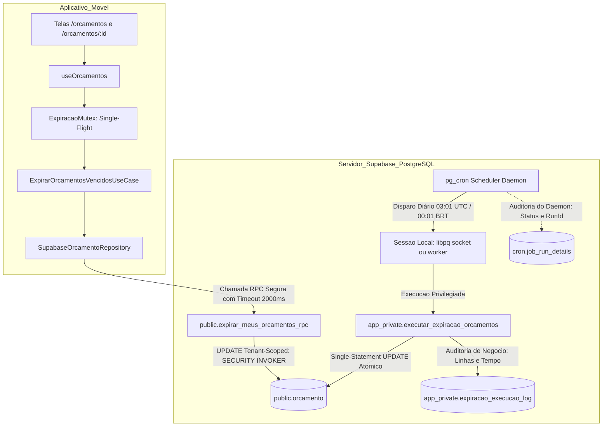

# Planejamento Técnico — Bloco D: Expiração Temporal Automática de Orçamentos (v1.4)

**Projeto:** Sistema de Orçamento para Jardinagem (`jardinagem-app`)  
**Data:** 05 de Outubro de 2026  
**Responsável Técnico:** Planejador Técnico Principal / Arquiteto de Software  
**Status do Documento:** `PLANEJAMENTO EM REVISÃO — BLOCO D v1.4 — AGUARDANDO NOVA AUDITORIA`  
**Referência Canônica do Inventário:** `docs/planejamento/requisitos-cobertura-status-v1.2.md`  
**Histórico de Governança:** Revisão estrutural saneando os apontamentos ACHADO-EXP-21 a ACHADO-EXP-27 e OBS-EXP-28 da Auditoria Técnica Independente da v1.3  
**Requisitos Alvo:** RF67, RN69 (preservando integralmente RF68, RN70, RN61 a RN65, RN71, RNF12, RNF16, RNF34 e RNF35)  

---

## 1. Identificação e Status

- **Identificador do Bloco:** Bloco D — Expiração Temporal Automática de Orçamentos
- **Versão do Planejamento:** 1.4 (Saneamento de DDL do pg_cron, Desacoplamento de Transporte do Scheduler, Idempotência Estrita de Job, SLO Operacional Alvo, Segregação de Observabilidade, Classificação do JIT, Fluxo de Benchmark de Índices e Governança do Modelo Físico)
- **Data de Emissão:** 05/10/2026
- **Status Canônico:** `PLANEJAMENTO EM REVISÃO — BLOCO D v1.4 — AGUARDANDO NOVA AUDITORIA`
- **Escopo Normativo:** Planejar de forma exaustiva e auditável a orquestração e persistência autônomas para expiração de orçamentos com validade ultrapassada, garantindo conformidade literal com RF67 e RN69 sem depender da abertura do aplicativo móvel, com segurança estrita em funções privilegiadas, prova formal de concorrência, equivalência canônica de regras e governança transparente sobre persistência e modelo físico.

---

## 2. Histórico das Revisões e Apontamentos de Auditoria

### 2.1. Rejeição da Versão v1.0
A versão preliminar v1.0 foi reprovada em 05/10/2026 ([`docs/planejamento/expiracao-orcamentos-plan-audit-v1.0.md`](file:///c:/Users/luanh/Documents/jardinagem-app/docs/planejamento/expiracao-orcamentos-plan-audit-v1.0.md)) devido à dependência exclusiva de abertura do aplicativo (*Just-in-Time* puro), carga desnecessária de PostGIS e ausência de motor autônomo com o app fechado (ACHADO-EXP-01 a 07).

### 2.2. Apontamentos da Revisão v1.1
A versão preliminar v1.1 introduziu o motor autônomo no PostgreSQL (`pg_cron`), mas identificou a necessidade de isolamento em schema privado (`app_private`), `search_path` vazio, eliminação de estimativas arbitrárias de tempo e provas de concorrência (ACHADO-EXP-08 a 15).

### 2.3. Apontamentos da Revisão v1.2
A versão v1.2 estruturou as camadas de segurança e a RPC com `SECURITY INVOKER`, mas demandou aprofundamento na indexação parcial para cargas mistas (global vs. tenant), desenho de testes do scheduler e definição de SLA operacional (ACHADO-EXP-16 a 20).

### 2.4. Apontamentos Mandatórios da Auditoria v1.3 a Serem Sanados nesta v1.4
A auditoria independente da versão v1.3 apontou 8 necessidades técnicas formais obrigatórias:
- **ACHADO-EXP-21 (Revisão da Instalação do `pg_cron`):** Eliminar a premissa inválida de `CREATE EXTENSION ... WITH SCHEMA extensions`. No PostgreSQL/Supabase, `pg_cron` possui `relocatable = false` e seu script cria e gerencia privativamente o schema `cron`. Documentar o ambiente real (`pg_available_extensions`, `pg_extension`, schema `cron`, funções `cron.schedule` e `cron.unschedule`) e definir a DDL correta;
- **ACHADO-EXP-22 (Desacoplamento Conceitual de "Background Worker"):** Remover a dependência conceitual de que cada execução de job seja um background worker do PostgreSQL. Verificar a configuração efetiva (`cron.use_background_workers = off` no Supabase local), modelando o fluxo como `pg_cron scheduler daemon → execução do job` (seja via libpq local socket ou worker), garantindo que os testes sejam agnósticos ao transporte;
- **ACHADO-EXP-23 (Idempotência Real na Criação do Job):** Não invocar `cron.unschedule(job_name)` cegamente, pois a ausência prévia do job gera erro fatal (`could not find valid entry for job...`). Implementar bloco procedural `DO $$ ... $$` que consulte a existência por `(jobname, username)`, capture o `jobid`, execute unschedule condicional, crie o job e valide a unicidade final assegurada pela constraint `jobname_username_uniq`;
- **ACHADO-EXP-24 (SLO Operacional do Scheduler):** Substituir a afirmação determinística "conclusão garantida até 00:15" por definição formal de SLO: *"Horário programado: 00:01 BRT. SLO operacional alvo: conclusão até 00:15 BRT"*. Definir formalmente métricas, monitoramento, violações, recuperação, tratamento de falhas, indisponibilidade do banco e garantia de execução retroativa sem alterar RF67/RN69;
- **ACHADO-EXP-25 (Segregação da Observabilidade):** Corrigir a premissa errônea de que `cron.job_run_details.return_message` contém o retorno JSONB da função (ele contém apenas o comando/tag de retorno libpq, ex: `'1 row'`). Segregar estritamente a evidência de execução do scheduler (`cron.job_run_details`) do registro de linhas afetadas e detalhes funcionais (armazenados em tabela interna `app_private.expiracao_execucao_log`);
- **ACHADO-EXP-26 (Classificação Formal do JIT):** Classificar formally que, em **Produção**, o JIT atua unicamente como **defesa em profundidade**, nunca como substituto do scheduler. Estabelecer que a ausência de `pg_cron` em produção constitui condição de não conformidade para implantação do Bloco D. Em contrapartida, em **CI/Local**, o JIT pode funcionar como fallback restrito a testes de cliente;
- **ACHADO-EXP-27 (Fluxo Obrigatório de Benchmark de Índices):** Estabelecer o fluxo técnico mandatório: *benchmark isolado → criação temporária das opções A/B/C → EXPLAIN (ANALYZE, BUFFERS) → escolha empírica baseada nas métricas reais → inclusão da DDL definitiva na migration final*. Proibir a criação antecipada de migration definitiva com índice arbitrário;
- **OBS-EXP-28 (Reabertura Controlada do Modelo Físico v1.1):** Formalizar o rito de governança: o artefato `docs/modelo-fisico-v1.1.md` permanece congelado e não será alterado silenciosamente. As alterações do Bloco D (schema `app_private`, stored functions, tabela de log e índice benchmarked) serão formalizadas por aditivo/versão v1.2 do Modelo Físico após aprovação da auditoria.

---

## 3. Objetivo do Bloco D

Planejar uma arquitetura robusta e em 4 camadas que atenda integralmente a RF67 e RN69 através de:
1. **Autonomia do Scheduler com SLO Operacional Alvo:** Transição automática de orçamentos vencidos via scheduler autônomo do banco (`pg_cron`) com horário programado às `00:01 BRT` e SLO operacional alvo de conclusão até `00:15 BRT`, sem qualquer dependência da abertura do aplicativo móvel;
2. **Segurança de Banco Irretocável:** Função privilegiada em schema privado `app_private` (invisível ao Data API PostgREST), com `owner = postgres`, `search_path = ''` e permissões restritas à role de sistema;
3. **Idempotência Estrita no Agendamento:** Registro transacional do job validando a unicidade do par `(jobname, username)` em `cron.job` e evitando chamadas cegas a funções com falha em ausência;
4. **Segregação de Observabilidade:** Separação limpa entre auditoria nativa do daemon (`cron.job_run_details`) e auditoria de negócio das linhas afetadas (`app_private.expiracao_execucao_log`);
5. **Classificação Rigorosa do JIT:** Defesa em profundidade para acessos concorrentes no cliente móvel em produção (sendo a presença do `pg_cron` requisito mandatório de conformidade) e fallback exclusivo para testes efêmeros em CI;
6. **Metodologia Empírica de Performance:** Fluxo obrigatório de benchmark comparativo com `EXPLAIN (ANALYZE, BUFFERS)` para decidir a indexação final antes da confecção da migration definitiva;
7. **Governança Controlada do Modelo Físico:** Preservação da baseline congelada até aprovação formal da auditoria.

---

## 4. Requisitos Canônicos e Máquina de Estados

### 4.1. Requisitos Canônicos Vigentes
- **RF67:** *“O sistema deve identificar automaticamente a expiração de um orçamento ENVIADO ou EM_ANALISE quando sua data de validade for ultrapassada.”*
- **RF68 / RN70:** *“Um orçamento em RASCUNHO não deve ser marcado automaticamente como EXPIRADO.”*
- **RN69:** *“Um orçamento ENVIADO ou EM_ANALISE deve ser considerado EXPIRADO quando sua validade for ultrapassada.”*
- **RN61 a RN63:** Máquina de estados oficial e transições permitidas.
- **RN64 e RN65:** Edição direta permitida somente em `RASCUNHO`.
- **RN71:** Orçamentos finalizados (`CONCLUIDO`, `CANCELADO`, `RECUSADO`, `APROVADO`) são imutáveis e não podem transicionar para `EXPIRADO`.
- **RNF12:** Desempenho e tempo de resposta aceitável nas consultas.
- **RNF16:** Integridade referencial e consistência transacional do PostgreSQL.
- **RNF34 e RNF35:** Persistência segura, resiliência e tratamento de falhas.

### 4.2. Matriz Canônica de Estados e Comportamento na Expiração

| Estado Atual | Validade Ultrapassada? | Transição para `EXPIRADO`? | Justificativa Canônica |
| :---: | :---: | :---: | :--- |
| `RASCUNHO` | Sim ou Não | **NÃO** | RF68 e RN70 (Rascunho não expira) |
| `ENVIADO` | Sim ($ref > val$) | **SIM** | RF67 e RN69 |
| `EM_ANALISE` | Sim ($ref > val$) | **SIM** | RF67 e RN69 |
| `APROVADO` | Sim ou Não | **NÃO** | RN61, RN62 (Estado terminal comercial) |
| `RECUSADO` | Sim ou Não | **NÃO** | RN62 (Estado terminal) |
| `CANCELADO` | Sim ou Não | **NÃO** | RN62 (Estado terminal) |
| `CONCLUIDO` | Sim ou Não | **NÃO** | RN71 (Estado final imutável) |
| `EXPIRADO` | Sim ou Não | **NÃO** | Idempotente (estado já alcançado) |

---

## 5. Análise e Resolução dos Achados da Auditoria da v1.3

### 5.1. ACHADO-EXP-21 (Revisão da Instalação do `pg_cron` e DDL Efetiva)
- **Constatação no Ambiente Efetivo:**
  - Consulta a `pg_available_extensions`:
    ```sql
    SELECT name, default_version, installed_version, comment
    FROM pg_available_extensions WHERE name = 'pg_cron';
    -- name: pg_cron | default_version: 1.6.4 | comment: Job scheduler for PostgreSQL
    ```
  - Inspeção do arquivo de controle (`pg_cron.control`):
    `default_version = '1.6.4'`, `module_pathname = '$libdir/pg_cron'`, `relocatable = false`;
  - O script de instalação da extensão (`pg_cron--1.0.0.sql`) executa compulsoriamente:
    `CREATE SCHEMA cron;` e cria todas as suas tabelas (`cron.job`, `cron.job_run_details`) e funções (`cron.schedule`, `cron.unschedule`, `cron.alter_job`) diretamente dentro do schema `cron`;
  - A tentativa de executar `CREATE EXTENSION pg_cron WITH SCHEMA extensions` é conceitualmente incorreta e desnecessária, pois a extensão não é relocável (`relocatable = false`).
- **Resolução Arquitetural v1.4:**
  A DDL canônica oficial para instalação da extensão é:
  ```sql
  CREATE EXTENSION IF NOT EXISTS pg_cron;
  ```
  O PostgreSQL gerencia o registro da extensão em `pg_catalog`, vinculando seus objetos e tabelas ao schema próprio `cron`.

### 5.2. ACHADO-EXP-22 (Desacoplamento Conceitual de "Background Worker")
- **Constatação no Ambiente Efetivo:**
  - Consulta aos parâmetros de configuração do banco:
    ```sql
    SHOW cron.database_name;           -- 'postgres'
    SHOW cron.use_background_workers;  -- 'off'
    ```
  - Quando `cron.use_background_workers = off` (padrão oficial do Supabase), o daemon principal do `pg_cron` executa cada job agendado abrindo uma conexão cliente local via biblioteca `libpq` (através de UNIX socket local ou localhost) autenticada sob o `username` cadastrado no job (`postgres`). Ele **não cria** background workers dinâmicos por execução de job;
  - Vincular o planejamento à premissa de que o job executa em "background worker" é um acoplamento errôneo aos detalhes de baixo nível do motor.
- **Resolução Arquitetural v1.4:**
  A arquitetura desacopla a conceituação do mecanismo de transporte. O modelo conceitual é estritamente:
  $$\text{pg\_cron scheduler daemon} \longrightarrow \text{disparo da sessão/job (via libpq local ou worker)} \longrightarrow \text{stored function em } \texttt{app\_private}$$
  O requisito normativo é a **autonomia do agendador no servidor** sem intervenção de cliente móvel. Os testes de integração devem atestar a execução e seus efeitos no banco de forma totalmente agnóstica ao parâmetro `cron.use_background_workers`.

### 5.3. ACHADO-EXP-23 (Idempotência Estrita na Criação do Job)
- **Problema Detectado:**
  - A função `cron.unschedule(job_name text)` lança erro fatal caso o job informado não exista:
    `ERROR: could not find valid entry for job 'job_expirar_orcamentos_diario'`
  - Uma migration contendo `SELECT cron.unschedule(...)` sem verificação prévia aborta imediatamente a transação em uma base virgem;
  - Além disso, a constraint de unicidade no PostgreSQL é `jobname_username_uniq UNIQUE (jobname, username)` na tabela `cron.job`. O identificador primário é `jobid`.
- **Resolução Arquitetural v1.4:**
  A criação do job é encapsulada em um bloco procedural `DO $$ ... $$` totalmente idempotente:
  1. Consulta prévia na tabela `cron.job` filtrando por `jobname = 'job_expirar_orcamentos_diario' AND username = CURRENT_USER`;
  2. Remoção condicional: somente se `jobid` for localizado, invoca-se `PERFORM cron.unschedule(v_jobid);`;
  3. Agendamento do job via `PERFORM cron.schedule(...)`;
  4. Validação estrita de integridade e unicidade final através de verificação contábil (`COUNT(*) = 1`).

### 5.4. ACHADO-EXP-24 (SLO Operacional Alvo do Scheduler)
- **Problema Detectado:**
  A expressão "conclusão garantida até 00:15" é imprópria para engenharia de software distribuída/assíncrona, pois confunde garantia determinística em tempo real com meta operacional de serviço (SLO).
- **Resolução Arquitetural v1.4:**
  Adota-se a terminologia técnica canônica:
  - **Horário Programado:** `00:01 BRT` (`03:01 UTC`);
  - **SLO Operacional Alvo:** Conclusão da execução até `00:15 BRT`;
  - **Métricas:** Duração da execução ($T_{dur} \le 5\text{s}$) e Atraso de disparo ($T_{disp} \le 1\text{min}$);
  - **Protocolo de Recuperação e Resiliência:** Em caso de falha do job ou indisponibilidade da instância do PostgreSQL no horário programado, a cláusula `data_validade < data_corte` garante **execução retroativa integral** na reativação do serviço, sem qualquer perda de orçamentos vencidos durante o período inoperante.

### 5.5. ACHADO-EXP-25 (Segregação da Observabilidade)
- **Problema Detectado:**
  Na arquitetura do `pg_cron`, a coluna `cron.job_run_details.return_message` armazena exclusivamente a command tag retornada pelo protocolo libpq (ex: `'1 row'` para comandos `SELECT`), ou a mensagem de erro do servidor em caso de falha. Ela **nunca** armazena o valor escalar JSONB gerado no interior da stored function.
- **Resolução Arquitetural v1.4:**
  Segregação formal em três níveis de observabilidade:
  1. **Auditoria de Execução do Scheduler:** `cron.job_run_details` monitora o ciclo de vida do agendamento (`status = 'succeeded'`, `job_pid`, `start_time`, `end_time`, `return_message = '1 row'`);
  2. **Auditoria Funcional de Negócio:** Criação da tabela privada `app_private.expiracao_execucao_log`, onde a própria stored function insere de forma atômica `(data_corte, linhas_afetadas, duracao_ms, sucesso, origem)`;
  3. **Telemetria / Inspeção Imediata:** A stored function continua retornando `JSONB` para uso imediato em invocações procedurais e manutenções manuais.

### 5.6. ACHADO-EXP-26 (Classificação Formal do JIT)
- **Classificação Canônica:**
  - **Ambiente de Produção:** O motor JIT (invocado via RPC `expirar_meus_orcamentos_rpc`) opera **estritamente como Defesa em Profundidade**. Sua finalidade é eliminar eventuais discrepâncias visuais no app em acessos limítrofes entre a virada do dia civil e a conclusão do job agendado. **O JIT nunca é substituto do scheduler.** A presença ativa do `pg_cron` é **condição mandatória de conformidade** para o deploy do Bloco D em produção;
  - **Ambientes Locais / CI:** O JIT pode atuar como **fallback temporário para testes de interface e cliente**, apenas caso o daemon do `pg_cron` esteja propositalmente inativo no container de testes efêmero.

### 5.7. ACHADO-EXP-27 (Fluxo Obrigatório de Benchmark de Índices)
- **Resolução Canônica:**
  É terminantemente vedada a inclusão prematura de DDL de índice na migration definitiva sem validação empírica. O fluxo obrigatório é estruturado nas seguintes etapas sequenciais:
  $$\text{1. Benchmark Isolado} \longrightarrow \text{2. Criação Temporária (Opções A, B e C)} \longrightarrow \text{3. EXPLAIN (ANALYZE, BUFFERS)} \longrightarrow \text{4. Escolha Empírica} \longrightarrow \text{5. DDL Definitiva na Migration}$$

### 5.8. OBS-EXP-28 (Reabertura Controlada do Modelo Físico v1.1)
- **Governança de Artefatos:**
  O arquivo `docs/modelo-fisico-v1.1.md` permanece como baseline congelada e **não será editado silenciosamente**. As adições estruturais decorrentes do Bloco D (schema `app_private`, funções, tabela de log e índice benchmarked) serão formalizadas através de aditivo técnico ou evolução para o Modelo Físico v1.2 via portão de governança após aprovação formal da Auditoria.

---

## 6. Avaliação de Alternativas Arquiteturais Autônomas

O banco oficial do projeto opera com PostgreSQL 17 gerenciado pelo Supabase:

| Critério | Alternativa 1: PostgreSQL Nativo com `pg_cron` | Alternativa 2: Supabase Edge Function Agendada | Alternativa 3: Scheduler Externo (GitHub Actions / Cloud) |
| :--- | :--- | :--- | :--- |
| **Local de Execução** | Agendador interno do PostgreSQL | Deno Runtime (`edge_runtime`) | Servidor externo via Internet |
| **Frequência** | Diária (`03:01 UTC` = `00:01 BRT`) | Diária | Diária |
| **Mecanismo de Disparo** | Daemon scheduler via conexão local / socket | Trigger HTTP agendado | Execução de runner externo |
| **Fonte Temporal** | Relógio transacional do PostgreSQL via `timezone()` | Runtime Deno (sujeito a desvios de host) | Host externo |
| **Segurança** | Executa como role de sistema em `app_private`. Sem tokens trafegados. | Exigiria token `service_role` via HTTP, violando regra do projeto. | Exigiria credencial privilegiada exposta fora do ambiente seguro. |
| **Dependência de Rede** | Nula (loopback interno na instância do PostgreSQL) | Média (chamada HTTP PostgREST) | Alta (Internet pública suscetível a timeout) |
| **Independência do App** | **Total (100% autônomo)** | **Total (100% autônomo)** | **Total (100% autônomo)** |
| **Veredito** | **SELECIONADA** | Descartada por risco à política de segurança | Descartada por acoplamento e risco operacional |

---

## 7. Estratégia Arquitetural Selecionada

Adota-se formalmente a **Estratégia Híbrida de Duplo Motor**:
1. **Motor Autônomo Primário (Backend / PostgreSQL — Mandatório):** Stored function privilegiada em schema privado `app_private`, orquestrada de forma autônoma pelo `pg_cron` com horário programado às `00:01 BRT` e SLO alvo de conclusão até `00:15 BRT`. É o mecanismo formalmente responsável pelo **atendimento literal de RF67 com o aplicativo fechado**;
2. **Motor Just-in-Time Complementar (Cliente / React Native — Defesa em Profundidade):** RPC segura `public.expirar_meus_orcamentos_rpc()` restrita a `auth.uid()`, com *Single-Flight Mutex* e timeout não-bloqueante no app móvel. Atua exclusivamente para cobrir acessos do usuário antes do término da janela de SLO do cron, ou como fallback em pipelines de teste de cliente.

---

## 8. Arquitetura Revisada e 4 Camadas



### Divisão de Responsabilidades:
- **Domínio (`src/domain`):** Define a regra de negócio canônica e imutável em `Orcamento.verificarExpiracao(dataReferencia)`;
- **Aplicação (`src/application`):** `ExpirarOrcamentosVencidosUseCase` gerencia o mutex em memória, cooldown e dispara a RPC sem bloquear a UI;
- **Infraestrutura (`src/infrastructure`):** Conecta à RPC via Supabase Client e disponibiliza a stored function privada e job de agendamento no PostgreSQL;
- **Apresentação (`src/presentation`):** Hook `useOrcamentos` exibe a listagem de forma reativa e não-bloqueante.

---

## 9. Modelo Temporal e SLO Operacional do Scheduler

### 9.1. Tipagem Física e Data Civil
- Conforme o Modelo Físico vigente (`supabase/migrations/20260916020500_modelo_fisico_v1_1.sql`), a coluna de validade é:
  ```sql
  data_validade DATE
  ```
- O tipo `DATE` do PostgreSQL representa a data civil pura (`YYYY-MM-DD`).
- Um orçamento com data de validade `2026-03-15` permanece plenamente válido até as `23:59:59.999` do dia civil de 15 de Março de 2026.

### 9.2. Data de Corte Autorizativa do PostgreSQL
A data corrente do servidor é extraída com precisão transacional referenciada ao fuso oficial:
```sql
(pg_catalog.timezone('America/Sao_Paulo', pg_catalog.now()))::pg_catalog.date
```
- **Fuso Oficial de Negócio:** `America/Sao_Paulo` (UTC-3);
- **Condição Canônica de Expiração:**
  $$\text{Expirado} \iff \text{data\_validade} < \text{data\_corte}$$

### 9.3. Definição do SLO Operacional do Scheduler (ACHADO-EXP-24 Sanado)

1. **Horário Programado:** Diariamente às `00:01` no Horário de Brasília (`03:01 UTC` no cron schedule `'1 3 * * *'`);
2. **SLO Operacional Alvo:** Conclusão da rotina diária até `00:15 BRT`;
3. **Métricas Operacionais:**
   - **Atraso de Início ($T_{atraso}$):** $\text{start\_time} - \text{horário\_programado}$ (Alvo: $\le 60\text{ s}$);
   - **Tempo de Execução ($T_{exec}$):** $\text{end\_time} - \text{start\_time}$ (Alvo: $\le 5\text{ s}$ para volumetria esperada);
   - **Término Limite:** $\text{end\_time} \le \text{00:15 BRT}$.
4. **Monitoramento Operacional:** Inspeção periódica dos registros de `cron.job_run_details` e da tabela `app_private.expiracao_execucao_log`;
5. **Classificação de Violação:**
   - Registro com `status = 'failed'` em `cron.job_run_details`;
   - Registro com `sucesso = false` em `app_private.expiracao_execucao_log`;
   - Ausência de registro de execução referente ao dia civil após `00:15 BRT`;
   - Registro concluído após `00:15 BRT`.
6. **Procedimento de Recuperação de Falhas:**
   - Diagnóstico via mensagem de erro em `cron.job_run_details.return_message` e `app_private.expiracao_execucao_log.mensagem_erro`;
   - Disparo manual emergencial via console autenticado sob role `postgres`:
     ```sql
     SELECT app_private.executar_expiracao_orcamentos();
     ```
7. **Indisponibilidade do Banco e Execução Retroativa:**
   - Se o servidor PostgreSQL estiver indisponível ou em janela de manutenção às `00:01 BRT`, o job será executado no restabelecimento do serviço ou na próxima janela;
   - Como o critério de expiração é estritamente $\text{data\_validade} < \text{data\_corte}$, **nenhum orçamento vencido é ignorado**, assegurando conformidade retroativa absoluta mesmo após múltiplos dias de parada da instância.

---

## 10. Persistência, Atomicidade e DDL do Banco

### 10.1. Instalação Canônica da Extensão `pg_cron` (ACHADO-EXP-21 Sanado)
```sql
-- DDL canônica e portável (sem tentativa de relocação para extensions)
CREATE EXTENSION IF NOT EXISTS pg_cron;
```

### 10.2. Schema Privado e Tabela de Auditoria (ACHADO-EXP-25 Sanado)
```sql
-- 1. Criação do schema privado
CREATE SCHEMA IF NOT EXISTS app_private;
REVOKE ALL ON SCHEMA app_private FROM PUBLIC, anon, authenticated;
GRANT USAGE ON SCHEMA app_private TO postgres;

-- 2. Tabela de observabilidade funcional interna
CREATE TABLE IF NOT EXISTS app_private.expiracao_execucao_log (
    id pg_catalog.bigserial PRIMARY KEY,
    executado_em pg_catalog.timestamptz NOT NULL DEFAULT pg_catalog.now(),
    data_corte pg_catalog.date NOT NULL,
    linhas_afetadas pg_catalog.int4 NOT NULL,
    duracao_ms pg_catalog.int4 NOT NULL,
    sucesso pg_catalog.bool NOT NULL,
    origem pg_catalog.text NOT NULL, -- 'SCHEDULER' ou 'MANUAL'
    mensagem_erro pg_catalog.text NULL
);

REVOKE ALL ON TABLE app_private.expiracao_execucao_log FROM PUBLIC, anon, authenticated;
GRANT SELECT, INSERT ON TABLE app_private.expiracao_execucao_log TO postgres;
```

### 10.3. Stored Function Privilegiada (`app_private.executar_expiracao_orcamentos`)
```sql
CREATE OR REPLACE FUNCTION app_private.executar_expiracao_orcamentos()
RETURNS pg_catalog.jsonb
LANGUAGE plpgsql
SECURITY DEFINER
SET search_path = ''
AS $$
DECLARE
    v_inicio pg_catalog.timestamptz;
    v_data_corte pg_catalog.date;
    v_linhas_afetadas pg_catalog.int4;
    v_duracao_ms pg_catalog.int4;
BEGIN
    v_inicio := pg_catalog.clock_timestamp();
    v_data_corte := (pg_catalog.timezone('America/Sao_Paulo', pg_catalog.now()))::pg_catalog.date;

    -- Single-Statement UPDATE Atômico (Protegido por RowExclusiveLock + EvalPlanQual)
    UPDATE public.orcamento
    SET status = 'EXPIRADO'::public.status_orcamento
    WHERE status IN ('ENVIADO'::public.status_orcamento, 'EM_ANALISE'::public.status_orcamento)
      AND data_validade < v_data_corte;

    GET DIAGNOSTICS v_linhas_afetadas = ROW_COUNT;
    v_duracao_ms := pg_catalog.round(pg_catalog.extract(epoch FROM (pg_catalog.clock_timestamp() - v_inicio)) * 1000)::pg_catalog.int4;

    -- Registro de auditoria funcional em app_private
    INSERT INTO app_private.expiracao_execucao_log (
        executado_em,
        data_corte,
        linhas_afetadas,
        duracao_ms,
        sucesso,
        origem,
        mensagem_erro
    ) VALUES (
        pg_catalog.now(),
        v_data_corte,
        v_linhas_afetadas,
        v_duracao_ms,
        true,
        'SCHEDULER',
        NULL
    );

    RETURN pg_catalog.jsonb_build_object(
        'sucesso', true,
        'data_corte', v_data_corte,
        'linhas_expiradas', v_linhas_afetadas,
        'duracao_ms', v_duracao_ms,
        'executado_em', pg_catalog.now()
    );
EXCEPTION WHEN OTHERS THEN
    v_duracao_ms := pg_catalog.round(pg_catalog.extract(epoch FROM (pg_catalog.clock_timestamp() - v_inicio)) * 1000)::pg_catalog.int4;
    
    INSERT INTO app_private.expiracao_execucao_log (
        executado_em,
        data_corte,
        linhas_afetadas,
        duracao_ms,
        sucesso,
        origem,
        mensagem_erro
    ) VALUES (
        pg_catalog.now(),
        COALESCE(v_data_corte, (pg_catalog.timezone('America/Sao_Paulo', pg_catalog.now()))::pg_catalog.date),
        0,
        v_duracao_ms,
        false,
        'SCHEDULER',
        SQLERRM
    );
    RAISE;
END;
$$;

-- Blindagem de acesso restrita a postgres
REVOKE ALL ON FUNCTION app_private.executar_expiracao_orcamentos() FROM PUBLIC, anon, authenticated;
GRANT EXECUTE ON FUNCTION app_private.executar_expiracao_orcamentos() TO postgres;
ALTER FUNCTION app_private.executar_expiracao_orcamentos() OWNER TO postgres;
```

### 10.4. RPC Segura de Tenant (`public.expirar_meus_orcamentos_rpc`)
```sql
CREATE OR REPLACE FUNCTION public.expirar_meus_orcamentos_rpc()
RETURNS pg_catalog.jsonb
LANGUAGE plpgsql
SECURITY INVOKER
SET search_path = ''
AS $$
DECLARE
    v_uid pg_catalog.uuid := auth.uid();
    v_data_corte pg_catalog.date;
    v_linhas pg_catalog.int4;
BEGIN
    IF v_uid IS NULL THEN
        RAISE EXCEPTION 'Acesso negado: usuário não autenticado';
    END IF;

    v_data_corte := (pg_catalog.timezone('America/Sao_Paulo', pg_catalog.now()))::pg_catalog.date;

    UPDATE public.orcamento
    SET status = 'EXPIRADO'::public.status_orcamento
    WHERE usuario_id = v_uid
      AND status IN ('ENVIADO'::public.status_orcamento, 'EM_ANALISE'::public.status_orcamento)
      AND data_validade < v_data_corte;

    GET DIAGNOSTICS v_linhas = ROW_COUNT;

    RETURN pg_catalog.jsonb_build_object(
        'linhas_expiradas', v_linhas,
        'data_corte', v_data_corte
    );
END;
$$;

REVOKE ALL ON FUNCTION public.expirar_meus_orcamentos_rpc() FROM PUBLIC, anon;
GRANT EXECUTE ON FUNCTION public.expirar_meus_orcamentos_rpc() TO authenticated;
```

---

## 11. Idempotência Estrita no Agendamento do Job (ACHADO-EXP-23 Sanado)

Para evitar falhas causadas pela invocação cega de `cron.unschedule()` e garantir o respeito à constraint `jobname_username_uniq`, o agendamento utiliza um bloco procedural atômico:

```sql
DO $$
DECLARE
    v_jobid pg_catalog.bigint;
    v_qtd pg_catalog.int4;
BEGIN
    -- 1. Consulta explícita por jobname e usuário atual
    SELECT jobid INTO v_jobid
    FROM cron.job
    WHERE jobname = 'job_expirar_orcamentos_diario'
      AND username = CURRENT_USER;

    -- 2. Remoção condicional segura caso o job já exista
    IF v_jobid IS NOT NULL THEN
        PERFORM cron.unschedule(v_jobid);
    END IF;

    -- 3. Agendamento do job oficial para as 03:01 UTC (00:01 BRT)
    PERFORM cron.schedule(
        'job_expirar_orcamentos_diario',
        '1 3 * * *',
        'SELECT app_private.executar_expiracao_orcamentos();'
    );

    -- 4. Validação estrita de unicidade e integridade final
    SELECT count(*), min(jobid) INTO v_qtd, v_jobid
    FROM cron.job
    WHERE jobname = 'job_expirar_orcamentos_diario'
      AND username = CURRENT_USER;

    IF v_qtd <> 1 OR v_jobid IS NULL THEN
        RAISE EXCEPTION 'Falha ao registrar job_expirar_orcamentos_diario: contagem final de jobs = %', v_qtd;
    END IF;
END;
$$;
```

---

## 12. Concorrência e Provas Formais de Transição

### 12.1. Por que o Single-Statement UPDATE Elimina Condições de Corrida
O PostgreSQL opera sob o nível de isolamento padrão *Read Committed*:
1. Ao executar o `UPDATE public.orcamento ...`, o banco adquire um lock exclusivo por tupla (*RowExclusiveLock*) para cada registro candidato;
2. Se uma transação comercial concorrente $T_{USR}$ estiver em andamento sobre o mesmo orçamento (ex: o cliente finalizando uma aprovação para `APROVADO`), a transação da expiração $T_{EXP}$ entra em fila no lock daquela tupla;
3. No momento em que $T_{USR}$ comita com sucesso, o protocolo nativo **EvalPlanQual (EPQ)** do PostgreSQL reavalia a cláusula `WHERE` de $T_{EXP}$ sobre a versão mais recente da linha;
4. Como o status foi alterado para `APROVADO`, o predicado `status IN ('ENVIADO', 'EM_ANALISE')` é avaliado como **FALSO**;
5. A linha **não é atualizada** por $T_{EXP}$. O total de linhas afetadas é zero e o estado `APROVADO` prevalece com integridade absoluta.

### 12.2. Matriz Completa de Corridas Concorrentes

| Transação Comercial do Usuário | Transação de Expiração | Vencedor do Lock | Efeito na Segunda Transação | Estado Final | Integridade |
| :--- | :--- | :---: | :--- | :---: | :---: |
| `ENVIADO -> APROVADO` | `ENVIADO -> EXPIRADO` | Usuário | `WHERE` da expiração falha (status virou `APROVADO`). | `APROVADO` | **PRESERVADA** |
| `ENVIADO -> APROVADO` | `ENVIADO -> EXPIRADO` | Expiração | `WHERE` do usuário falha (esperava `ENVIADO`, encontrou `EXPIRADO`). | `EXPIRADO` | **PRESERVADA** |
| `ENVIADO -> RECUSADO` | `ENVIADO -> EXPIRADO` | Usuário | `WHERE` da expiração falha. | `RECUSADO` | **PRESERVADA** |
| `ENVIADO -> CANCELADO` | `ENVIADO -> EXPIRADO` | Usuário | `WHERE` da expiração falha. | `CANCELADO` | **PRESERVADA** |
| `EM_ANALISE -> APROVADO` | `EM_ANALISE -> EXPIRADO` | Usuário | `WHERE` da expiração falha. | `APROVADO` | **PRESERVADA** |
| `EM_ANALISE -> RECUSADO` | `EM_ANALISE -> EXPIRADO` | Usuário | `WHERE` da expiração falha. | `RECUSADO` | **PRESERVADA** |
| `EM_ANALISE -> CANCELADO` | `EM_ANALISE -> EXPIRADO` | Usuário | `WHERE` da expiração falha. | `CANCELADO` | **PRESERVADA** |

---

## 13. Segurança, RLS e Isolamento Multi-Tenant

### 13.1. Blindagem de Schema e PostgREST
- O schema `app_private` e o schema `cron` **não constam** na configuração `api.schemas` do Supabase (`supabase/config.toml`: `schemas = ["public", "graphql_public"]`);
- O PostgREST não expõe nenhum endpoint HTTP para funções ou tabelas em `app_private` ou `cron`;
- Revogações explícitas (`REVOKE ALL`) impedem acesso de `anon` e `authenticated`.

### 13.2. RPC do Tenant com `SECURITY INVOKER`
- A função `public.expirar_meus_orcamentos_rpc()` opera estritamente com os privilégios do chamador (`SECURITY INVOKER`);
- O filtro mandatório `WHERE usuario_id = auth.uid()` impossibilita que qualquer usuário visualize ou modifique orçamentos de outros inquilinos.

### 13.3. Papéis de Execução e Compatibilidade de Ambientes
- **Execução de Migrations:** Executado sob a role `postgres` (local) ou `supabase_admin` (cloud);
- **Owner da Função Privilegiada:** Definido compulsoriamente como `postgres`;
- **Username no `cron.job`:** Cadastrado como `'postgres'`, assegurando execução com privilégios de sistema no banco.

---

## 14. Performance, Indexação e Fluxo Obrigatório de Benchmark (ACHADO-EXP-27 Sanado)

### 14.1. As Três Opções Técnicas de Índices Parciais

| Opção de Índice | Definição DDL Candidata | Comportamento no Job Global (`status + data_validade`) | Comportamento na RPC do Tenant (`usuario_id + status + data_validade`) |
| :--- | :--- | :--- | :--- |
| **Opção A** | `(data_validade) WHERE status IN ('ENVIADO', 'EM_ANALISE')` | **Excelente:** Range Scan direto em `data_validade < corte`. | **Bom:** Range Scan em `data_validade` + filtro de `usuario_id` em memória. |
| **Opção B** | `(usuario_id, data_validade) WHERE status IN ('ENVIADO', 'EM_ANALISE')` | **Regular/Bom:** Scan em todas as chaves do índice parcial. | **Excelente:** Equality match em `usuario_id` + Range Scan em `data_validade`. |
| **Opção C** | `(data_validade, usuario_id) WHERE status IN ('ENVIADO', 'EM_ANALISE')` | **Excelente:** Range Scan na coluna líder `data_validade`. | **Muito Bom:** Range Scan em `data_validade` + Index Condition em `usuario_id`. |

### 14.2. Fluxo Mandatório de Execução Pré-Migration
A migration definitiva do Bloco D **não será criada** antes da conclusão deste fluxo em ambiente de teste:
1. **Geração de Cargas Sintéticas de Teste:** Criação de volumes de 100, 1.000, 10.000, 100.000 e 1.000.000 de orçamentos sintéticos com distribuição realista de status;
2. **Criação Temporária e Isolada dos Índices:**
   - Criação temporária de cada opção (uma por vez ou sob nomes temporários controlados);
3. **Execução de `EXPLAIN (ANALYZE, BUFFERS, COSTS, VERBOSE)`:**
   - Consulta do Job Global:
     ```sql
     EXPLAIN (ANALYZE, BUFFERS)
     UPDATE public.orcamento
     SET status = 'EXPIRADO'::public.status_orcamento
     WHERE status IN ('ENVIADO'::public.status_orcamento, 'EM_ANALISE'::public.status_orcamento)
       AND data_validade < CURRENT_DATE;
     ```
   - Consulta da RPC do Tenant:
     ```sql
     EXPLAIN (ANALYZE, BUFFERS)
     UPDATE public.orcamento
     SET status = 'EXPIRADO'::public.status_orcamento
     WHERE usuario_id = '00000000-0000-0000-0000-000000000001'::uuid
       AND status IN ('ENVIADO'::public.status_orcamento, 'EM_ANALISE'::public.status_orcamento)
       AND data_validade < CURRENT_DATE;
     ```
4. **Coleta de Métricas Objetivas:** *Planning Time*, *Execution Time*, *Shared Hit/Read Blocks*, volume de escrita em WAL e presença de *Sequential Scans*;
5. **Emissão de Relatório de Benchmark:** Documentação formal justificando a opção vencedora;
6. **Inclusão da DDL Definitiva:** Somente após a aprovação das métricas, a DDL do índice selecionado será incorporada à migration definitiva de produção.

---

## 15. Resiliência e Desacoplamento da Listagem no Cliente Móvel

1. **Single-Flight Mutex com Cooldown:** O serviço `ExpiracaoMutex` em `src/application/services/orcamento-expiracao.mutex.ts` centraliza e deduplica chamadas concorrentes à RPC no app móvel;
2. **Execução Não-Bloqueante:** O carregamento da tela de listagem de orçamentos não aguarda a conclusão da RPC. A interface carrega de imediato enquanto a sincronização ocorre em background com **timeout estrito de 2.000 ms** (`AbortController`);
3. **Isolamento de Erros:** Erros de rede ou indisponibilidade da RPC são capturados silenciosamente em bloco defensivo `try/catch`, emitindo logs de diagnóstico sem interromper a navegação do usuário.

---

## 16. Observabilidade Segregada (ACHADO-EXP-25 Sanado)

| Dimensão de Observabilidade | Repositório / Tabela | Dados Capturados | Responsabilidade |
| :--- | :--- | :--- | :--- |
| **Auditoria do Scheduler** | `cron.job_run_details` | `jobid`, `runid`, `job_pid`, `username`, `status`, `start_time`, `end_time`, `return_message` (`'1 row'`) | Comprovar que o agendador autônomo disparou a rotina e concluiu com sucesso técnico. |
| **Auditoria Funcional de Negócio** | `app_private.expiracao_execucao_log` | `id`, `executado_em`, `data_corte`, `linhas_afetadas`, `duracao_ms`, `sucesso`, `origem`, `mensagem_erro` | Registrar quantas linhas de orçamentos foram efetivamente transicionadas para `EXPIRADO` e o tempo decorrido. |
| **Telemetria de Tenant no App** | Logs técnicos estruturados no cliente | `linhas_expiradas`, `duracao_ms`, `timestamp` | Diagnosticar a atuação da defesa em profundidade no dispositivo do usuário. |

---

## 17. Estratégia de Testes

### 17.1. Teste de Equivalência e Contrato TypeScript × SQL
Arquivo: `tests/contracts/expiracao-equivalencia.contract.test.ts`  
- **Matriz de Cenários Determinísticos:** 8 status $\times$ 3 relações temporais (anterior, igual, posterior a data de corte fixa `'2026-03-16'`) = 24 combinações;
- **Validação de Identidade:** Execução concorrente do método de domínio `Orcamento.verificarExpiracao()` e da expressão booleana pura SQL:
  ```sql
  SELECT status IN ('ENVIADO', 'EM_ANALISE') AND data_validade < '2026-03-16'::date AS deve_expirar
  ```
- **Critério:** 100% de correspondência booleana em todas as 24 combinações.

### 17.2. Testes de Concorrência Real no PostgreSQL
Arquivo: `tests/infrastructure/concorrencia-expiracao.test.ts`  
- Valida o comportamento de locks concorrentes disputando a mesma tupla entre a rotina de expiração e as operações comerciais (`aprovar`, `recusar`, `cancelar`), provando a preservação dos estados legítimos sob o protocolo *EvalPlanQual*.

### 17.3. Testes do Scheduler Real (`pg_cron`) Desacoplados de Transporte (ACHADO-EXP-22 Sanado)
Arquivo: `tests/infrastructure/pg-cron-scheduler.test.ts`  
A suíte é estruturada em 3 níveis autônomos e agnósticos ao uso de libpq ou workers:
- **Nível 1 (Função SQL Isolada):** Valida chamada direta a `app_private.executar_expiracao_orcamentos()`, assertando retorno JSONB e persistência de registro em `app_private.expiracao_execucao_log`;
- **Nível 2 (Idempotência e Agendamento):** Valida execução do bloco procedural de criação do job, conferindo integridade na tabela `cron.job` e ausência de erros na reinspeção;
- **Nível 3 (Disparo pelo Daemon Autônomo):**
  1. Criação de job temporário de teste com frequência acelerada (`* * * * *`);
  2. Inserção de orçamentos previamente vencidos;
  3. Espera assíncrona pelo disparo do daemon;
  4. Inspeção de `cron.job_run_details` confirmando `status = 'succeeded'`;
  5. Inspeção de `app_private.expiracao_execucao_log` confirmando as linhas expiradas;
  6. Validação de que o status no banco mudou para `EXPIRADO` sem conexões de cliente móvel ativas;
  7. Cleanup seguro via `cron.unschedule(v_temp_jobid)`.

### 17.4. Testes de Segurança e Isolamento
- Validação de que chamadas diretas a `app_private` via PostgREST/Supabase client resultam em erro de autorização (`permission denied` / `403 Forbidden`);
- Validação de que a RPC `public.expirar_meus_orcamentos_rpc` restringe estritamente o efeito às linhas de `auth.uid()`.

---

## 18. Impactos Estruturais e Governança do Modelo Físico (OBS-EXP-28 Sanado)

| Artefato do Projeto | Status Vigente | Procedimento de Governança para o Bloco D |
| :--- | :---: | :--- |
| **Banco de Dados (Migrations)** | `CONGELADO` | **REQUER 1 NOVA MIGRATION CONDICIONADA:** `20261006000000_expiracao_orcamentos_autonoma.sql`. Sua confecção é condicionada à prévia conclusão do benchmark de indexação. |
| **Modelo Físico v1.1** | `CONGELADO` | **REABERTURA CONTROLADA:** Permanece congelado até aprovação final da Auditoria do Bloco D. A formalização do schema `app_private`, das stored functions, da tabela de log e do índice benchmarked será conduzida via Aditivo Técnico / Modelo Físico v1.2 por portão formal. |
| **Políticas RLS** | `CONGELADO` | **PRESERVADAS:** As políticas homologadas em `auth_rls.sql` permanecem 100% inalteradas. |
| **Domínio (`Orcamento.ts`)** | `CONGELADO` | **PRESERVADO:** Zero linhas alteradas na entidade canônica. |
| **Módulos Anteriores** | `CONGELADO` | **PRESERVADOS:** Zero impacto em Clientes, Catálogo, Áreas, PDF e Compartilhamento. |

---

## 19. Riscos Residuais e Mitigações

| Risco Residual | Probabilidade | Impacto | Mitigação Técnica Planejada |
| :--- | :---: | :---: | :--- |
| **1. Instância de CI sem `pg_cron` Habilitado** | Média | Baixo | Testes de integração do scheduler são condicionados a flag de ambiente; testes de cliente utilizam o JIT como fallback exclusivo de CI. |
| **2. Concorrência com Janelas de Backup Noturno** | Baixa | Baixo | O job utiliza *RowExclusiveLock* cirúrgico por linha com duração inferior a 5 segundos, não retendo locks de tabela. |
| **3. Latência Transitória de Rede no Cliente** | Média | Baixo | Mutex *single-flight* com timeout estrito de 2.000 ms impede qualquer bloqueio ou travamento na interface do aplicativo. |

---

## 20. Decisões Arquiteturais da Versão v1.4

- **DECISÃO-EXP-01 (Mecanismo Autônomo com SLO via `pg_cron` e Schema Privado):**  
  `NOVA DECISÃO PROPOSTA — PENDENTE DE AUDITORIA`  
  Adoção de stored function em `app_private` orquestrada pelo agendador do `pg_cron` sob horário programado de `00:01 BRT` e SLO operacional alvo de conclusão até `00:15 BRT`.
- **DECISÃO-EXP-02 (Instalação Canônica sem Relocação de Schema):**  
  `NOVA DECISÃO PROPOSTA — PENDENTE DE AUDITORIA`  
  Instalação do `pg_cron` via DDL `CREATE EXTENSION IF NOT EXISTS pg_cron;`, respeitando a gestão nativa e não-relocável do schema `cron`.
- **DECISÃO-EXP-03 (Desacoplamento do Transporte do Scheduler):**  
  `NOVA DECISÃO PROPOSTA — PENDENTE DE AUDITORIA`  
  Definição de que o agendador autônomo opera de forma agnóstica ao mecanismo de execução subjacente (`cron.use_background_workers`), seja via libpq socket ou workers.
- **DECISÃO-EXP-04 (Idempotência Estrita no Agendamento):**  
  `NOVA DECISÃO PROPOSTA — PENDENTE DE AUDITORIA`  
  Registro do job via bloco procedural `DO $$ ... $$` que consulta `cron.job` por `(jobname, username)`, remove condicionalmente por `jobid` e asserta a unicidade final.
- **DECISÃO-EXP-05 (Segregação de Observabilidade em Tabela Privada):**  
  `NOVA DECISÃO PROPOSTA — PENDENTE DE AUDITORIA`  
  Separação entre auditoria nativa do daemon em `cron.job_run_details` e auditoria de negócio das linhas afetadas em `app_private.expiracao_execucao_log`.
- **DECISÃO-EXP-06 (Classificação Normativa do Motor JIT):**  
  `NOVA DECISÃO PROPOSTA — PENDENTE DE AUDITORIA`  
  Classificação do JIT em produção como defesa em profundidade (sendo a presença do `pg_cron` obrigatória para conformidade do deploy) e como fallback restrito a testes em CI.
- **DECISÃO-EXP-07 (Indexação Condicionada a Fluxo Obrigatório de Benchmark):**  
  `NOVA DECISÃO PROPOSTA — PENDENTE DE AUDITORIA`  
  Obrigatoriedade de execução prévia de benchmark empírico com `EXPLAIN (ANALYZE, BUFFERS)` para escolha do índice parcial antes da confecção da migration definitiva.
- **DECISÃO-EXP-08 (Governança Controlada do Modelo Físico):**  
  `NOVA DECISÃO PROPOSTA — PENDENTE DE AUDITORIA`  
  Manutenção do Modelo Físico v1.1 como linha de base congelada até aprovação formal de auditoria, procedendo com reabertura controlada após o portão.
- **DECISÃO-EXP-09 (RPC Segura de Tenant com `SECURITY INVOKER`):**  
  `NOVA DECISÃO PROPOSTA — PENDENTE DE AUDITORIA`  
  Manutenção da função `public.expirar_meus_orcamentos_rpc()` restrita a `auth.uid()` para suporte à defesa em profundidade.
- **DECISÃO-EXP-10 (Atomicidade via Single-Statement UPDATE e EvalPlanQual):**  
  `NOVA DECISÃO PROPOSTA — PENDENTE DE AUDITORIA`  
  Garantia de consistência transacional sob *Read Committed* e eliminação de condições de corrida.
- **DECISÃO-EXP-11 (Single-Flight Mutex e Timeout Não-Bloqueante no App):**  
  `NOVA DECISÃO PROPOSTA — PENDENTE DE AUDITORIA`  
  Deduplicação de chamadas em memória com cooldown e timeout de 2.000 ms garantindo exibição instantânea da lista.
- **DECISÃO-EXP-12 (Preservação Canônica da Entidade de Domínio):**  
  `HOMOLOGADA ANTERIORMENTE`  
  O método canônico [`Orcamento.verificarExpiracao(dataReferencia)`](file:///c:/Users/luanh/Documents/jardinagem-app/src/domain/entities/orcamento.ts#L336-L350) permanece intacto e soberano para toda a lógica de negócio.

---

## 21. Critérios Objetivos para Implementação Futura

1. Execução do fluxo de benchmark comparativo com `EXPLAIN (ANALYZE, BUFFERS)` das opções de índices parciais A, B e C;
2. Emissão do Relatório Técnico de Benchmark de Indexação;
3. Criação da migration definitiva `20261006000000_expiracao_orcamentos_autonoma.sql` contendo a extensão, schemas, tabela de log, stored functions, índice vencedor e agendamento idempotente;
4. Reabertura controlada do Modelo Físico v1.1 para emissão do Modelo Físico v1.2 / Aditivo Técnico;
5. Implementação do `ExpiracaoMutex` em `src/application/services/`;
6. Integração não-bloqueante no hook `useOrcamentos`;
7. Execução e aprovação da suíte completa de testes de contrato, concorrência, scheduler e segurança.

---

## 22. Critérios Objetivos para Homologação

1. **Atendimento Literal a RF67 com App Fechado:** Comprovação via `cron.job_run_details` e `app_private.expiracao_execucao_log` de que o agendador autônomo executou no servidor e transicionou orçamentos vencidos para `EXPIRADO` sem qualquer requisição de cliente móvel;
2. **Conformidade Estrita com RN69 e RN70:** Orçamentos `ENVIADO` e `EM_ANALISE` vencidos expiram; orçamentos em `RASCUNHO` permanecem inalterados;
3. **Segurança de Acesso Comprovada:** Testes confirmam rejeição (`permission denied`) para papéis `anon` e `authenticated` em `app_private`;
4. **Idempotência do Agendamento Auditada:** Reexecuções sucessivas da rotina de agendamento mantêm exatamente 1 job ativo sem emissão de erros;
5. **Resiliência e Não-Bloqueio da UI:** Falhas injetadas na RPC não causam bloqueio, erro ou atraso na exibição da lista de orçamentos;
6. **Contrato TypeScript × SQL 100% Determinístico:** Identidade matemática em todas as 24 combinações de teste puro da matriz de estados e datas.

---

`PLANEJAMENTO CONCLUÍDO — BLOCO D v1.4 — AGUARDANDO NOVA AUDITORIA`
