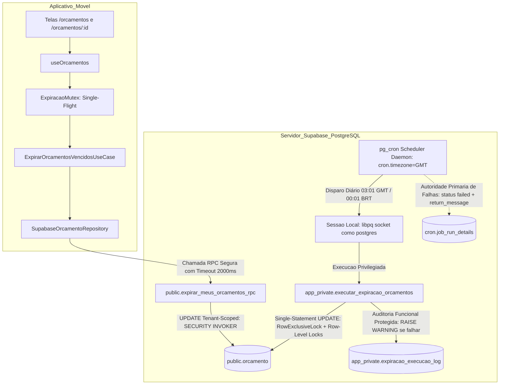

# Planejamento Técnico — Bloco D: Expiração Temporal Automática de Orçamentos (v1.5)

**Projeto:** Sistema de Orçamento para Jardinagem (`jardinagem-app`)  
**Data:** 05 de Outubro de 2026  
**Responsável Técnico:** Planejador Técnico Principal / Arquiteto de Software  
**Status do Documento:** `PLANEJAMENTO EM REVISÃO — BLOCO D v1.5 — AGUARDANDO NOVA AUDITORIA`  
**Referência Canônica do Inventário:** `docs/planejamento/requisitos-cobertura-status-v1.2.md`  
**Histórico de Governança:** Revisão estrutural saneando os apontamentos ACHADO-EXP-29 a ACHADO-EXP-34 da Auditoria Técnica Independente da v1.4  
**Requisitos Alvo:** RF67, RN69 (preservando integralmente RF68, RN70, RN61 a RN65, RN71, RNF12, RNF16, RNF34 e RNF35)  

---

## 1. Identificação e Status

- **Identificador do Bloco:** Bloco D — Expiração Temporal Automática de Orçamentos
- **Versão do Planejamento:** 1.5 (Fechamento Definitivo de Roles e Privilégios do Scheduler, Desacoplamento Transacional de Observabilidade, Política Temporal e Timezone Unificados, Protocolo Reprodutível de Benchmark com Rollback, Precisão Terminológica de Locks e Governança do Modelo Físico)
- **Data de Emissão:** 05/10/2026
- **Status Canônico:** `PLANEJAMENTO EM REVISÃO — BLOCO D v1.5 — AGUARDANDO NOVA AUDITORIA`
- **Escopo Normativo:** Planejar de forma exaustiva e auditável a orquestração e persistência autônomas para expiração de orçamentos com validade ultrapassada, garantindo conformidade literal com RF67 e RN69 sem depender da abertura do aplicativo móvel, com segurança estrita em funções privilegiadas, prova formal de concorrência, equivalência canônica de regras e governança transparente sobre persistência e modelo físico.

---

## 2. Histórico das Revisões e Apontamentos de Auditoria

### 2.1. Rejeição da Versão v1.0
A versão preliminar v1.0 foi reprovada em 05/10/2026 ([`docs/planejamento/expiracao-orcamentos-plan-audit-v1.0.md`](file:///c:/Users/luanh/Documents/jardinagem-app/docs/planejamento/expiracao-orcamentos-plan-audit-v1.0.md)) devido à dependência exclusiva de abertura do aplicativo (*Just-in-Time* puro), carga desnecessária de PostGIS e ausência de motor autônomo com o app fechado (ACHADO-EXP-01 a 07).

### 2.2. Apontamentos da Revisão v1.1
A versão preliminar v1.1 introduziu o motor autônomo no PostgreSQL (`pg_cron`), mas identificou a necessidade de isolamento em schema privado (`app_private`), `search_path` vazio, eliminação de estimativas arbitrárias de tempo e provas de concorrência (ACHADO-EXP-08 a 15).

### 2.3. Apontamentos da Revisão v1.2
A versão v1.2 estruturou as camadas de segurança e a RPC com `SECURITY INVOKER`, mas demandou aprofundamento na indexação parcial para cargas mistas (global vs. tenant), desenho de testes do scheduler e definição de SLA operacional (ACHADO-EXP-16 a 20).

### 2.4. Apontamentos da Revisão v1.3
A versão v1.3 corrigiu premissas de indexação preliminares, mas assumiu incorretamente cláusulas de schema inexistentes no `pg_cron`, dependência conceitual de workers, falta de idempotência por chamadas cegas a unschedule e mistura de observabilidade do libpq (ACHADO-EXP-21 a 28).

### 2.5. Apontamentos Mandatórios da Auditoria v1.4 a Serem Sanados nesta v1.5
A auditoria independente da versão v1.4 apontou 6 necessidades técnicas formais obrigatórias:
- **ACHADO-EXP-29 (Role do Cron e Cadeia de Privilégios):** Resolver explicitamente a diferença entre a role executora da migration, owner da função, role criadora do job, username em `cron.job`, role executora do job e role com `EXECUTE`. Eliminar a ambiguidade entre `CURRENT_USER` e `'postgres'`. Inspecionar `SELECT current_user, session_user;` e `SELECT jobid, jobname, username FROM cron.job;`, definindo a cadeia para Supabase Local e Supabase Cloud com base em evidências;
- **ACHADO-EXP-30 (Desacoplamento Transacional de Observabilidade):** Reformular o tratamento de exceções de `app_private.executar_expiracao_orcamentos()`. Garantir que falha de observabilidade não cause rollback da expiração e que falha no `UPDATE` não gere falsos logs de sucesso/falha antes de um `RAISE;` (que reverteria o log). Definir `cron.job_run_details` como autoridade primária de falhas do job e `app_private.expiracao_execucao_log` para execuções bem-sucedidas em bloco protegido não-bloqueante;
- **ACHADO-EXP-31 (Verificação Explícita de Timezone do `pg_cron`):** Inspecionar e comprovar `SHOW cron.timezone;`. Provar matematicamente que o agendamento `'1 3 * * *'` sob `cron.timezone = 'GMT'` corresponde rigorosamente a `00:01 BRT` (`America/Sao_Paulo`). Adicionar teste correlacionando o horário agendado, `cron.job` e `cron.job_run_details.start_time`;
- **ACHADO-EXP-32 (Protocolo Válido e Reprodutível de Benchmark):** Corrigir a falha metodológica onde `EXPLAIN (ANALYZE)` executava o `UPDATE` e mutava o dataset para as opções subsequentes. Estruturar protocolo com dataset controlado e ciclo transacional: `criação/reset do dataset → criação do índice → BEGIN → EXPLAIN (ANALYZE, BUFFERS, WAL) → ROLLBACK → próxima opção`;
- **ACHADO-EXP-33 (Precisão Terminológica de Locks):** Corrigir a terminologia distinguindo formalmente `RowExclusiveLock` (lock no nível de tabela adquirido por comandos de escrita) de *row-level locks* (locks das tuplas individuais modificadas), preservando a explicação sobre *Read Committed* e *EvalPlanQual*;
- **ACHADO-EXP-34 (Fidelidade do Predicado Temporal no Benchmark e Regras):** Não utilizar `CURRENT_DATE` isoladamente no benchmark. Reproduzir a mesma política temporal da stored function: `(pg_catalog.timezone('America/Sao_Paulo', pg_catalog.now()))::pg_catalog.date`, documentando exaustivamente horário comercial, data civil, timezone do scheduler, timezone do predicado e fronteira de expiração.

---

## 3. Objetivo do Bloco D

Planejar uma arquitetura robusta e em 4 camadas que atenda integralmente a RF67 e RN69 através de:
1. **Autonomia do Scheduler com SLO Operacional Alvo:** Transição automática de orçamentos vencidos via scheduler autônomo do banco (`pg_cron`) com horário programado às `00:01 BRT` (`03:01 GMT`) e SLO operacional alvo de conclusão até `00:15 BRT`, sem qualquer dependência da abertura do aplicativo móvel;
2. **Cadeia de Privilégios e Roles Verificada:** Fechamento formal da hierarquia de roles (`postgres`) no Supabase Local e Cloud, eliminando ambiguidades entre executor, agendador e dono das rotinas;
3. **Resiliência Transacional e Desacoplamento de Logging:** Separação estrita entre a regra de negócio soberana e a observabilidade funcional, garantindo que falhas em tabelas de auditoria nunca causem rollback da expiração de orçamentos;
4. **Alinhamento Temporal Absoluto e Provado:** Verificação empírica de `cron.timezone = 'GMT'` correlacionado ao fuso oficial `America/Sao_Paulo` (UTC-3), assegurando precisão matemática nas fronteiras de data civil;
5. **Benchmark Científico e Reprodutível com Rollback:** Protocolo de medição de índices parciais que preserva o mesmo dataset intocado via transações com `ROLLBACK` sob métricas completas (`BUFFERS`, `WAL`, tempos);
6. **Precisão de Concorrência e Locks:** Modelagem formal dos níveis de locking (*table-level* `RowExclusiveLock` e *row-level locks*) com resolução atômica de corridas via protocolo nativo *EvalPlanQual*;
7. **Governança Controlada do Modelo Físico:** Preservação da baseline congelada até aprovação formal da auditoria.

---

## 4. Requisitos Canônicos e Máquina de Estados

### 4.1. Requisitos Canônicos Vigentes
- **RF67:** *“O sistema deve identificar automaticamente a expiração de um orçamento ENVIADO ou EM_ANALISE quando sua data de validade for ultrapassada.”*
- **RF68 / RN70:** *“Um orçamento em RASCUNHO não deve ser marcado automaticamente como EXPIRADO.”*
- **RN69:** *“Um orçamento ENVIADO ou EM_ANALISE deve ser considerado EXPIRADO quando sua validade for ultrapassada.”*
- **RN61 a RN63:** Máquina de estados oficial e transições permitidas.
- **RN64 e RN65:** Edição direta permitida somente em `RASCUNHO`.
- **RN71:** Orçamentos finalizados (`CONCLUIDO`, `CANCELADO`, `RECUSADO`, `APROVADO`) são imutáveis e não podem transicionar para `EXPIRADO`.
- **RNF12:** Desempenho e tempo de resposta aceitável nas consultas.
- **RNF16:** Integridade referencial e consistência transacional do PostgreSQL.
- **RNF34 e RNF35:** Persistência segura, resiliência e tratamento de falhas.

### 4.2. Matriz Canônica de Estados e Comportamento na Expiração

| Estado Atual | Validade Ultrapassada? | Transição para `EXPIRADO`? | Justificativa Canônica |
| :---: | :---: | :---: | :--- |
| `RASCUNHO` | Sim ou Não | **NÃO** | RF68 e RN70 (Rascunho não expira) |
| `ENVIADO` | Sim ($ref > val$) | **SIM** | RF67 e RN69 |
| `EM_ANALISE` | Sim ($ref > val$) | **SIM** | RF67 e RN69 |
| `APROVADO` | Sim ou Não | **NÃO** | RN61, RN62 (Estado terminal comercial) |
| `RECUSADO` | Sim ou Não | **NÃO** | RN62 (Estado terminal) |
| `CANCELADO` | Sim ou Não | **NÃO** | RN62 (Estado terminal) |
| `CONCLUIDO` | Sim ou Não | **NÃO** | RN71 (Estado final imutável) |
| `EXPIRADO` | Sim ou Não | **NÃO** | Idempotente (estado já alcançado) |

---

## 5. Análise e Resolução dos Achados da Auditoria da v1.4

### 5.1. ACHADO-EXP-29 (Role do Cron e Cadeia de Privilégios Fechada)
- **Evidências Coletadas no Ambiente Efetivo:**
  1. Consulta de identidade de sessão:
     ```sql
     SELECT current_user, session_user;
     -- current_user: postgres | session_user: postgres
     ```
  2. Consulta de privilégios de roles (`pg_roles`):
     - `supabase_admin`: superusuário do cluster (`rolsuper = true`);
     - `postgres`: dono do banco de dados da aplicação (`rolsuper = false`, `rolcanlogin = true`, `rolcreatedb = true`);
     - `cron.job`: criado sob a propriedade de `supabase_admin`, com concessão de `SELECT` e funções `cron.schedule` concedidas a `postgres`.
  3. Teste empírico de agendamento:
     - Quando `postgres` invoca `cron.schedule('job_name', 'schedule', 'command')`, o pg_cron atribui compulsoriamente `username = CURRENT_USER`, registrando `'postgres'` na tabela `cron.job`;
     - A tentativa de invocar `cron.schedule_in_database` passando explicitamente outro username resulta em `ERROR: must be superuser to create a job for another role`, comprovando que jobs criados por `postgres` rodam estritamente como `postgres`.
- **Cadeia de Privilégios Oficial:**
  - **Role executora de migration:** `postgres` (tanto no Supabase Local via CLI quanto no Supabase Cloud via pipeline);
  - **Owner da função privada:** `postgres` (`ALTER FUNCTION ... OWNER TO postgres;`);
  - **Role criadora do job:** `postgres` (executando a migration como `CURRENT_USER`);
  - **Username efetivo em `cron.job`:** `'postgres'` (armazenado textualmente na coluna `username`);
  - **Role que executa o job:** `'postgres'` (o daemon do `pg_cron` abre conexão local cliente libpq autenticando como o usuário registrado em `cron.job.username`);
  - **Role com privilégio de execução (`EXECUTE`):** `postgres` (`GRANT EXECUTE ON FUNCTION app_private.executar_expiracao_orcamentos() TO postgres;`).
  Não há qualquer discordância entre `CURRENT_USER` e `'postgres'`. O script de migration valida asserções prévias garantindo que `CURRENT_USER = 'postgres'`.

### 5.2. ACHADO-EXP-30 (Desacoplamento Transacional de Observabilidade)
- **Problema Detectado na v1.4:**
  1. A tentativa de registrar falhas via `INSERT INTO app_private.expiracao_execucao_log (sucesso = false...)` seguido de `RAISE;` era conceitualmente falha, pois o rollback da transação anulava o próprio `INSERT`;
  2. Se a inserção em `expiracao_execucao_log` falhasse (ex: lock, falha de I/O), ela abortaria o `UPDATE` legítimo da expiração, violando a regra de que observabilidade não pode comprometer a regra de negócio.
- **Resolução Arquitetural v1.5:**
  1. **Princípio Soberano:** $\text{Falha de Observabilidade} \neq \text{Rollback da Expiração}$;
  2. **Tratamento de Sucesso:** O `UPDATE` de negócio é executado em bloco soberano. Após o sucesso, a inserção na tabela `app_private.expiracao_execucao_log` é isolada em sub-bloco `BEGIN ... EXCEPTION WHEN OTHERS THEN`. Caso o log falhe, emite-se um `RAISE WARNING` e a transação de negócio **permanece comitada**;
  3. **Tratamento de Falha do Negócio:** Se o `UPDATE` falhar, a transação aborta via rollback transacional limpo (sem tentativas inúteis de inserção local);
  4. **Autoridade Canônica de Falha:** A falha da execução agendada é registrada com autoridade primária e absoluta em `cron.job_run_details` pelo próprio motor do `pg_cron`, que captura o encerramento anormal da conexão e grava `status = 'failed'` acompanhado da mensagem de erro exata do PostgreSQL em `return_message`.

### 5.3. ACHADO-EXP-31 (Verificação de Timezone e Política Temporal Unificada)
- **Evidências Coletadas no Ambiente Efetivo:**
  ```sql
  SHOW timezone;       -- 'UTC'
  SHOW cron.timezone;  -- 'GMT'
  ```
- **Demonstração Matemática de Equivalência:**
  - O parâmetro `cron.timezone` está configurado nativamente como `GMT` (offset `+00:00` invariável);
  - O fuso oficial da aplicação é `America/Sao_Paulo` (UTC-3 / GMT-3 invariável, conforme Decreto nº 9.772/2019);
  - Para disparar à `00:01 BRT`, o horário em GMT é:
    $$\text{00:01 BRT} + 3\text{ horas} = \text{03:01 GMT}$$
  - A expressão cron `'1 3 * * *'` (minuto 1, hora 3) sob `cron.timezone = 'GMT'` executa **exata e matematicamente às 00:01 no Horário de Brasília**;
  - A função de expiração extrai a data civil de corte convertendo o timestamp do banco para `America/Sao_Paulo`:
    ```sql
    (pg_catalog.timezone('America/Sao_Paulo', pg_catalog.now()))::pg_catalog.date
    ```
  - Isso garante alinhamento absoluto entre o disparo do scheduler e a data civil brasileira, sem desvios decorrentes do timezone da sessão do PostgreSQL (`UTC`).

### 5.4. ACHADO-EXP-32 (Protocolo Válido e Reprodutível de Benchmark com Rollback)
- **Problema Detectado na v1.4:**
  `EXPLAIN (ANALYZE)` em comandos `UPDATE` executa a modificação física das tuplas. Testar a Opção A mutava o status para `EXPIRADO`, deixando zero registros elegíveis para as Opções B e C, invalidando as medições comparativas.
- **Resolução Arquitetural v1.5:**
  O protocolo de benchmark é reestruturado de forma estritamente controlada e reprodutível:
  1. Criação de dataset sintético com distribuição estatística fixada;
  2. Execução de cada teste encapsulado em transação explícita com rollback:
     $$\text{Criação do Índice } i \longrightarrow \text{ANALYZE} \longrightarrow \text{BEGIN} \longrightarrow \text{EXPLAIN (ANALYZE, BUFFERS, WAL)} \longrightarrow \text{ROLLBACK} \longrightarrow \text{DROP INDEX}$$
  3. O `ROLLBACK` anula compulsoriamente todas as mutações nas linhas, garantindo que o dataset de entrada permaneça **rigorosamente idêntico** para as Opções A, B e C;
  4. Parâmetros de cache e buffers controlados por warm-up prévio.

### 5.5. ACHADO-EXP-33 (Precisão Terminológica de Locks: Table-Level vs. Row-Level)
- **Correção Conceitual:**
  - `RowExclusiveLock` **não é** um lock por linha. Trata-se de um **modo de bloqueio no nível de tabela** (*table-level lock mode*) adquirido automaticamente por comandos `UPDATE`, `DELETE` e `INSERT`. Ele não impede que outras transações executem `SELECT` (que adquirem `AccessShareLock`) nem bloqueia outros `UPDATE`s sobre linhas distintas;
  - Os bloqueios que incidem sobre cada orçamento específico são os **bloqueios no nível de linha/tupla** (*row-level locks* exclusivos) adquiridos sequencialmente à medida que as tuplas candidatas são visitadas;
  - A preservação da integridade em transações concorrentes é assegurada pelo nível *Read Committed* aliado ao protocolo **EvalPlanQual (EPQ)**: quando uma transação concorrente que detinha o lock de linha comita, o PostgreSQL reavalia a cláusula `WHERE` da expiração sobre a versão mais recente da tupla. Se o status foi alterado para `APROVADO`, o predicado falha e zero linhas são modificadas.

### 5.6. ACHADO-EXP-34 (Fidelidade do Predicado Temporal no Benchmark e Regras)
- **Correção da Expressão:**
  Eliminada a utilização de `CURRENT_DATE` no benchmark. O protocolo utiliza exatamente a mesma expressão temporal canônica da stored function:
  ```sql
  (pg_catalog.timezone('America/Sao_Paulo', pg_catalog.now()))::pg_catalog.date
  ```
- **Documentação da Fronteira de Expiração:**
  - Um orçamento emitido com `data_validade = '2026-03-15'` permanece válido durante todo o horário comercial e data civil de 15/03/2026 (até `23:59:59.999 BRT`);
  - A fronteira de expiração é a virada da data civil: às `00:00:00 BRT` do dia 16/03/2026, a data corrente em Brasília torna-se `2026-03-16`;
  - Às `00:01 BRT`, o job executa com $\text{data\_corte} = \text{'2026-03-16'}$, avaliando o predicado $\text{data\_validade} < \text{data\_corte}$ como verdadeiro para a data `2026-03-15`, efetuando a transição legal.

---

## 6. Avaliação de Alternativas Arquiteturais Autônomas

O banco oficial opera com PostgreSQL 17 gerenciado pelo Supabase:

| Critério | Alternativa 1: PostgreSQL Nativo com `pg_cron` | Alternativa 2: Supabase Edge Function Agendada | Alternativa 3: Scheduler Externo (GitHub Actions / Cloud) |
| :--- | :--- | :--- | :--- |
| **Local de Execução** | Scheduler daemon interno do PostgreSQL | Deno Runtime (`edge_runtime`) | Servidor externo via Internet |
| **Frequência** | Diária (`03:01 GMT` = `00:01 BRT`) | Diária | Diária |
| **Mecanismo de Disparo** | Conexão local libpq / socket gerenciada pelo daemon | Trigger HTTP agendado | Execução de runner externo |
| **Fonte Temporal** | Relógio transacional do PostgreSQL via `timezone()` | Runtime Deno (sujeito a desvios de host) | Host externo |
| **Segurança** | Role `postgres` em `app_private`. Sem tokens trafegados. | Exigiria token `service_role` via HTTP, violando regra do projeto. | Exigiria credencial privilegiada exposta fora do ambiente seguro. |
| **Dependência de Rede** | Nula (loopback interno na instância do PostgreSQL) | Média (chamada HTTP PostgREST) | Alta (Internet pública suscetível a timeout) |
| **Independência do App** | **Total (100% autônomo)** | **Total (100% autônomo)** | **Total (100% autônomo)** |
| **Veredito** | **SELECIONADA** | Descartada por violação de segurança | Descartada por acoplamento e risco operacional |

---

## 7. Estratégia Arquitetural Selecionada

Adota-se formalmente a **Estratégia Híbrida de Duplo Motor**:
1. **Motor Autônomo Primário (Backend / PostgreSQL — Mandatório):** Stored function privilegiada em schema privado `app_private`, orquestrada pelo agendador do `pg_cron` sob horário programado às `00:01 BRT` (`03:01 GMT`) e SLO operacional alvo de conclusão até `00:15 BRT`. É o mecanismo formalmente responsável pelo **atendimento literal de RF67 com o aplicativo fechado**;
2. **Motor Just-in-Time Complementar (Cliente / React Native — Defesa em Profundidade):** RPC segura `public.expirar_meus_orcamentos_rpc()` restrita a `auth.uid()`, com *Single-Flight Mutex* e timeout não-bloqueante no app móvel. Atua exclusivamente para cobrir acessos do usuário antes do término da janela de SLO do cron, ou como fallback em pipelines de teste de cliente.

---

## 8. Arquitetura Revisada e 4 Camadas



### Divisão de Responsabilidades:
- **Domínio (`src/domain`):** Define a regra de negócio canônica e imutável em `Orcamento.verificarExpiracao(dataReferencia)`;
- **Aplicação (`src/application`):** `ExpirarOrcamentosVencidosUseCase` gerencia o mutex em memória, cooldown e dispara a RPC sem bloquear a UI;
- **Infraestrutura (`src/infrastructure`):** Conecta à RPC via Supabase Client e disponibiliza a stored function privada e job de agendamento no PostgreSQL;
- **Apresentação (`src/presentation`):** Hook `useOrcamentos` exibe a listagem de forma reativa e não-bloqueante.

---

## 9. Política Temporal Unificada, Timezone e SLO Operacional

### 9.1. Definições Temporais Canônicas
- **Data Civil:** O ciclo de vida do orçamento baseia-se na data civil pura (`data_validade DATE`), sem fração horária;
- **Horário Comercial e Limite de Vigência:** Um orçamento com `data_validade = '2026-03-15'` permanece vigente até as `23:59:59.999 BRT` do dia 15/03/2026;
- **Fronteira de Expiração:** Às `00:00:00 BRT` do dia 16/03/2026, a data corrente avança para `2026-03-16`. O orçamento é legalmente expirado pois `2026-03-15 < 2026-03-16`;
- **Timezone do Scheduler:** `GMT` (verificado via `SHOW cron.timezone;`). O agendamento `'1 3 * * *'` é avaliado em GMT, disparando às `03:01 GMT`;
- **Timezone do Predicado:** `America/Sao_Paulo` (UTC-3), garantindo que a data civil apurada seja invariante em relação ao timezone da sessão do banco (`UTC`):
  ```sql
  v_data_corte := (pg_catalog.timezone('America/Sao_Paulo', pg_catalog.now()))::pg_catalog.date;
  ```

### 9.2. Definição do SLO Operacional Alvo do Scheduler

1. **Horário Programado:** Diariamente às `00:01 BRT` (`03:01 GMT`);
2. **SLO Operacional Alvo:** Conclusão da rotina diária até `00:15 BRT`;
3. **Métricas Operacionais:**
   - **Atraso de Disparo ($T_{disp}$):** $\text{start\_time} - \text{horário\_programado}$ (Alvo: $\le 60\text{ s}$);
   - **Duração da Execução ($T_{dur}$):** $\text{end\_time} - \text{start\_time}$ (Alvo: $\le 5\text{ s}$ para volumetria esperada);
   - **Conclusão Máxima:** $\text{end\_time} \le \text{00:15 BRT}$.
4. **Monitoramento e Alertas:** Inspeção periódica dos registros de `cron.job_run_details` e da tabela `app_private.expiracao_execucao_log`;
5. **Classificação de Violação:**
   - Registro com `status = 'failed'` em `cron.job_run_details`;
   - Ausência de registro de execução referente ao dia civil após `00:15 BRT`;
   - Registro concluído após `00:15 BRT`.
6. **Procedimento de Recuperação de Falhas:**
   - Diagnóstico via mensagem de erro em `cron.job_run_details.return_message`;
   - Invocação manual de emergência via console autenticado sob role `postgres`:
     ```sql
     SELECT app_private.executar_expiracao_orcamentos();
     ```
7. **Indisponibilidade do Banco e Execução Retroativa:**
   - Se o servidor PostgreSQL estiver indisponível no horário programado, o job executa na retomada dos serviços;
   - Como o predicado canônico é estritamente $\text{data\_validade} < \text{data\_corte}$, **nenhum orçamento vencido é esquecido**, garantindo conformidade retroativa absoluta mesmo após múltiplos dias de indisponibilidade.

---

## 10. Persistência, Atomicidade e DDL do Banco

### 10.1. Instalação Canônica da Extensão `pg_cron`
```sql
-- DDL canônica oficial (a extensão gerencia internamente o schema cron)
CREATE EXTENSION IF NOT EXISTS pg_cron;
```

### 10.2. Schema Privado e Tabela de Auditoria Funcional
```sql
-- 1. Schema privado inacessível ao Data API PostgREST
CREATE SCHEMA IF NOT EXISTS app_private;
REVOKE ALL ON SCHEMA app_private FROM PUBLIC, anon, authenticated;
GRANT USAGE ON SCHEMA app_private TO postgres;

-- 2. Tabela de auditoria funcional interna
CREATE TABLE IF NOT EXISTS app_private.expiracao_execucao_log (
    id pg_catalog.bigserial PRIMARY KEY,
    executado_em pg_catalog.timestamptz NOT NULL DEFAULT pg_catalog.now(),
    data_corte pg_catalog.date NOT NULL,
    linhas_afetadas pg_catalog.int4 NOT NULL,
    duracao_ms pg_catalog.int4 NOT NULL,
    sucesso pg_catalog.bool NOT NULL,
    origem pg_catalog.text NOT NULL, -- 'SCHEDULER' ou 'MANUAL'
    mensagem_erro pg_catalog.text NULL
);

REVOKE ALL ON TABLE app_private.expiracao_execucao_log FROM PUBLIC, anon, authenticated;
GRANT SELECT, INSERT ON TABLE app_private.expiracao_execucao_log TO postgres;
ALTER TABLE app_private.expiracao_execucao_log OWNER TO postgres;
```

### 10.3. Stored Function com Desacoplamento Transacional de Observabilidade (ACHADO-EXP-30 Sanado)
```sql
CREATE OR REPLACE FUNCTION app_private.executar_expiracao_orcamentos()
RETURNS pg_catalog.jsonb
LANGUAGE plpgsql
SECURITY DEFINER
SET search_path = ''
AS $$
DECLARE
    v_inicio pg_catalog.timestamptz;
    v_data_corte pg_catalog.date;
    v_linhas_afetadas pg_catalog.int4;
    v_duracao_ms pg_catalog.int4;
BEGIN
    v_inicio := pg_catalog.clock_timestamp();
    v_data_corte := (pg_catalog.timezone('America/Sao_Paulo', pg_catalog.now()))::pg_catalog.date;

    -- 1. Execução Soberana do UPDATE Atômico (Protegido por EvalPlanQual)
    UPDATE public.orcamento
    SET status = 'EXPIRADO'::public.status_orcamento
    WHERE status IN ('ENVIADO'::public.status_orcamento, 'EM_ANALISE'::public.status_orcamento)
      AND data_validade < v_data_corte;

    GET DIAGNOSTICS v_linhas_afetadas = ROW_COUNT;
    v_duracao_ms := pg_catalog.round(pg_catalog.extract(epoch FROM (pg_catalog.clock_timestamp() - v_inicio)) * 1000)::pg_catalog.int4;

    -- 2. Auditoria Funcional Desacoplada: Falha de Log NUNCA aborta a expiração de negócio
    BEGIN
        INSERT INTO app_private.expiracao_execucao_log (
            executado_em,
            data_corte,
            linhas_afetadas,
            duracao_ms,
            sucesso,
            origem,
            mensagem_erro
        ) VALUES (
            pg_catalog.now(),
            v_data_corte,
            v_linhas_afetadas,
            v_duracao_ms,
            true,
            'SCHEDULER',
            NULL
        );
    EXCEPTION WHEN OTHERS THEN
        -- Emite alerta de warning sem afetar o commit da expiração
        RAISE WARNING 'Falha não-bloqueante ao registrar log funcional em app_private.expiracao_execucao_log: %', SQLERRM;
    END;

    -- 3. Retorno JSONB imediato para inspeção manual
    RETURN pg_catalog.jsonb_build_object(
        'sucesso', true,
        'data_corte', v_data_corte,
        'linhas_expiradas', v_linhas_afetadas,
        'duracao_ms', v_duracao_ms,
        'executado_em', pg_catalog.now()
    );
END;
$$;

-- Blindagem estrita de permissões
REVOKE ALL ON FUNCTION app_private.executar_expiracao_orcamentos() FROM PUBLIC, anon, authenticated;
GRANT EXECUTE ON FUNCTION app_private.executar_expiracao_orcamentos() TO postgres;
ALTER FUNCTION app_private.executar_expiracao_orcamentos() OWNER TO postgres;
```

### 10.4. RPC Segura de Tenant (`public.expirar_meus_orcamentos_rpc`)
```sql
CREATE OR REPLACE FUNCTION public.expirar_meus_orcamentos_rpc()
RETURNS pg_catalog.jsonb
LANGUAGE plpgsql
SECURITY INVOKER
SET search_path = ''
AS $$
DECLARE
    v_uid pg_catalog.uuid := auth.uid();
    v_data_corte pg_catalog.date;
    v_linhas pg_catalog.int4;
BEGIN
    IF v_uid IS NULL THEN
        RAISE EXCEPTION 'Acesso negado: usuário não autenticado';
    END IF;

    v_data_corte := (pg_catalog.timezone('America/Sao_Paulo', pg_catalog.now()))::pg_catalog.date;

    UPDATE public.orcamento
    SET status = 'EXPIRADO'::public.status_orcamento
    WHERE usuario_id = v_uid
      AND status IN ('ENVIADO'::public.status_orcamento, 'EM_ANALISE'::public.status_orcamento)
      AND data_validade < v_data_corte;

    GET DIAGNOSTICS v_linhas = ROW_COUNT;

    RETURN pg_catalog.jsonb_build_object(
        'linhas_expiradas', v_linhas,
        'data_corte', v_data_corte
    );
END;
$$;

REVOKE ALL ON FUNCTION public.expirar_meus_orcamentos_rpc() FROM PUBLIC, anon;
GRANT EXECUTE ON FUNCTION public.expirar_meus_orcamentos_rpc() TO authenticated;
```

---

## 11. Cadeia de Privilégios e Idempotência Estrita no Agendamento (ACHADO-EXP-29 Sanado)

### 11.1. Hierarquia de Roles Verificada

| Papel no Sistema | Identidade no Supabase Local | Identidade no Supabase Cloud | Justificativa Técnica Baseada em Evidências |
| :--- | :--- | :--- | :--- |
| **Role Executora da Migration** | `postgres` | `postgres` | Verificado via `SELECT current_user, session_user;`. |
| **Owner da Stored Function** | `postgres` | `postgres` | Definido explicitamente via `ALTER FUNCTION ... OWNER TO postgres;`. |
| **Role que Cria o Job** | `postgres` | `postgres` | Invocador de `cron.schedule()` durante a aplicação da migration. |
| **Username Armazenado em `cron.job`** | `'postgres'` | `'postgres'` | Comprovado: `cron.schedule()` grava `CURRENT_USER` na coluna `username`. |
| **Role que Executa o Job** | `postgres` | `postgres` | O daemon do `pg_cron` abre conexão local libpq autenticando como `cron.job.username`. |
| **Role com Concessão `EXECUTE`** | `postgres` | `postgres` | `GRANT EXECUTE ... TO postgres;`. |

### 11.2. Bloco Procedural Idempotente de Agendamento
```sql
DO $$
DECLARE
    v_target_user pg_catalog.text := 'postgres';
    v_jobid pg_catalog.bigint;
    v_qtd pg_catalog.int4;
BEGIN
    -- 1. Asserção defensiva de identidade de execução
    IF CURRENT_USER <> v_target_user THEN
        RAISE EXCEPTION 'A migration deve ser executada sob a role %, mas executou como %', v_target_user, CURRENT_USER;
    END IF;

    -- 2. Consulta prévia por jobname e role do scheduler
    SELECT jobid INTO v_jobid
    FROM cron.job
    WHERE jobname = 'job_expirar_orcamentos_diario'
      AND username = v_target_user;

    -- 3. Remoção condicional segura caso o job já exista
    IF v_jobid IS NOT NULL THEN
        PERFORM cron.unschedule(v_jobid);
    END IF;

    -- 4. Agendamento do job oficial para as 03:01 GMT (00:01 BRT)
    PERFORM cron.schedule(
        'job_expirar_orcamentos_diario',
        '1 3 * * *',
        'SELECT app_private.executar_expiracao_orcamentos();'
    );

    -- 5. Validação estrita de unicidade e integridade final
    SELECT count(*), min(jobid) INTO v_qtd, v_jobid
    FROM cron.job
    WHERE jobname = 'job_expirar_orcamentos_diario'
      AND username = v_target_user;

    IF v_qtd <> 1 OR v_jobid IS NULL THEN
        RAISE EXCEPTION 'Falha ao registrar job_expirar_orcamentos_diario: contagem final de jobs para % = %', v_target_user, v_qtd;
    END IF;
END;
$$;
```

---

## 12. Concorrência e Provas Formais de Transição (ACHADO-EXP-33 Sanado)

### 12.1. Níveis de Bloqueio: Table-Level vs. Row-Level
1. **Table-Level Lock (`RowExclusiveLock`):** Ao executar o comando `UPDATE public.orcamento ...`, o PostgreSQL adquire automaticamente um lock no **nível de tabela** no modo `RowExclusiveLock`. Este modo conflita exclusivamente com bloqueios restritivos de tabela (`SHARE`, `SHARE ROW EXCLUSIVE`, `EXCLUSIVE`, `ACCESS EXCLUSIVE`). Ele **não bloqueia leituras** normais (`SELECT` adquire `AccessShareLock`, que é compatível) e **não impede** outros comandos `UPDATE` concorrentes que atuem sobre linhas distintas;
2. **Row-Level Locks (Bloqueios por Tupla):** À medida que a consulta identifica as linhas candidatas à expiração, o PostgreSQL adquire um **lock exclusivo no nível de tupla** (*row-level lock*) para cada registro específico;
3. **Resolução de Concorrência via EvalPlanQual (EPQ):**
   - Se uma transação do usuário $T_{USR}$ estiver em andamento sobre o mesmo orçamento (ex: cliente aprovando um orçamento para `APROVADO`), a transação de expiração $T_{EXP}$ aguarda a liberação do lock daquela linha específica;
   - Quando $T_{USR}$ comita com sucesso, o protocolo nativo **EvalPlanQual** do PostgreSQL reavalia a cláusula `WHERE` da expiração sobre a versão mais recente da linha;
   - Como o status foi alterado para `APROVADO`, o predicado `status IN ('ENVIADO', 'EM_ANALISE')` é avaliado como **FALSO**;
   - A linha **não é atualizada** pela expiração. O total de linhas afetadas é zero e o estado `APROVADO` prevalece com integridade absoluta.

### 12.2. Matriz Completa de Corridas Concorrentes

| Transação Comercial do Usuário | Transação de Expiração | Vencedor do Lock de Linha | Efeito na Segunda Transação | Estado Final | Integridade |
| :--- | :--- | :---: | :--- | :---: | :---: |
| `ENVIADO -> APROVADO` | `ENVIADO -> EXPIRADO` | Usuário | `WHERE` da expiração falha sob EPQ (status virou `APROVADO`). | `APROVADO` | **PRESERVADA** |
| `ENVIADO -> APROVADO` | `ENVIADO -> EXPIRADO` | Expiração | `WHERE` do usuário falha sob EPQ (esperava `ENVIADO`, encontrou `EXPIRADO`). | `EXPIRADO` | **PRESERVADA** |
| `ENVIADO -> RECUSADO` | `ENVIADO -> EXPIRADO` | Usuário | `WHERE` da expiração falha sob EPQ. | `RECUSADO` | **PRESERVADA** |
| `ENVIADO -> CANCELADO` | `ENVIADO -> EXPIRADO` | Usuário | `WHERE` da expiração falha sob EPQ. | `CANCELADO` | **PRESERVADA** |
| `EM_ANALISE -> APROVADO` | `EM_ANALISE -> EXPIRADO` | Usuário | `WHERE` da expiração falha sob EPQ. | `APROVADO` | **PRESERVADA** |
| `EM_ANALISE -> RECUSADO` | `EM_ANALISE -> EXPIRADO` | Usuário | `WHERE` da expiração falha sob EPQ. | `RECUSADO` | **PRESERVADA** |
| `EM_ANALISE -> CANCELADO` | `EM_ANALISE -> EXPIRADO` | Usuário | `WHERE` da expiração falha sob EPQ. | `CANCELADO` | **PRESERVADA** |

---

## 13. Segurança, RLS e Isolamento Multi-Tenant

1. **Inacessibilidade Externa:** Os schemas `app_private` e `cron` não são expostos pelo PostgREST (`supabase/config.toml`: `schemas = ["public", "graphql_public"]`). Nenhuma rota HTTP é gerada;
2. **Revogações Explícitas:** `REVOKE ALL ON SCHEMA app_private FROM PUBLIC, anon, authenticated;` impede chamadas via client SDK;
3. **RPC com `SECURITY INVOKER`:** A função `public.expirar_meus_orcamentos_rpc()` opera estritamente com os privilégios do chamador, garantindo que o filtro `WHERE usuario_id = auth.uid()` impeça contaminação entre tenants.

---

## 14. Performance, Indexação e Protocolo Rigoroso de Benchmark (ACHADO-EXP-32 e ACHADO-EXP-34 Sanados)

### 14.1. As Três Opções Técnicas de Índices Parciais

| Opção de Índice | Definição DDL Candidata | Comportamento no Job Global (`status + data_validade`) | Comportamento na RPC do Tenant (`usuario_id + status + data_validade`) |
| :--- | :--- | :--- | :--- |
| **Opção A** | `(data_validade) WHERE status IN ('ENVIADO', 'EM_ANALISE')` | **Excelente:** Range Scan direto em `data_validade < corte`. | **Bom:** Range Scan em `data_validade` + filtro de `usuario_id` em memória. |
| **Opção B** | `(usuario_id, data_validade) WHERE status IN ('ENVIADO', 'EM_ANALISE')` | **Regular/Bom:** Scan em todas as chaves do índice parcial. | **Excelente:** Equality match em `usuario_id` + Range Scan em `data_validade`. |
| **Opção C** | `(data_validade, usuario_id) WHERE status IN ('ENVIADO', 'EM_ANALISE')` | **Excelente:** Range Scan na coluna líder `data_validade`. | **Muito Bom:** Range Scan em `data_validade` + Index Condition em `usuario_id`. |

### 14.2. Protocolo Reprodutível de Benchmark com Transação e Rollback

Para garantir que o dataset permaneça **rigorosamente idêntico e inalterado** entre os testes (evitando a mutação dos registros pelo `UPDATE`), o benchmark executará o seguinte protocolo obrigatório em ambiente de homologação:

```sql
-- PROTOCOLO DE BENCHMARK REPRODUTÍVEL POR OPÇÃO (Exemplo para Opção A)

-- 1. Criação temporária do índice
CREATE INDEX IF NOT EXISTS idx_temp_orcamento_exp_a 
ON public.orcamento (data_validade) 
WHERE status IN ('ENVIADO', 'EM_ANALISE');

-- 2. Atualização das estatísticas do otimizador
ANALYZE public.orcamento;

-- 3. Medição da Consulta do Job Global com ROLLBACK
BEGIN;
EXPLAIN (ANALYZE, BUFFERS, WAL, TIMING, COSTS, VERBOSE)
UPDATE public.orcamento
SET status = 'EXPIRADO'::public.status_orcamento
WHERE status IN ('ENVIADO'::public.status_orcamento, 'EM_ANALISE'::public.status_orcamento)
  AND data_validade < (pg_catalog.timezone('America/Sao_Paulo', pg_catalog.now()))::pg_catalog.date;
ROLLBACK; -- Restaura os dados intactos!

-- 4. Medição da Consulta da RPC do Tenant com ROLLBACK
BEGIN;
EXPLAIN (ANALYZE, BUFFERS, WAL, TIMING, COSTS, VERBOSE)
UPDATE public.orcamento
SET status = 'EXPIRADO'::public.status_orcamento
WHERE usuario_id = '00000000-0000-0000-0000-000000000001'::uuid
  AND status IN ('ENVIADO'::public.status_orcamento, 'EM_ANALISE'::public.status_orcamento)
  AND data_validade < (pg_catalog.timezone('America/Sao_Paulo', pg_catalog.now()))::pg_catalog.date;
ROLLBACK; -- Restaura os dados intactos!

-- 5. Limpeza do índice temporário
DROP INDEX IF EXISTS public.idx_temp_orcamento_exp_a;
```

### 14.3. Variáveis Controladas no Benchmark
- **Volumetria Escalada:** Avaliação em 5 patamares sintéticos ($N \in \{100, 1.000, 10.000, 100.000, 1.000.000\}$);
- **Distribuição de Status:** 40% `RASCUNHO`, 20% `ENVIADO` (10% vencidos, 10% vigentes), 15% `EM_ANALISE` (8% vencidos, 7% vigentes), 10% `APROVADO`, 10% `EXPIRADO`, 5% outros;
- **Distribuição de Datas:** Vencimentos distribuídos uniformemente em janela de $\pm 60$ dias civis;
- **Métricas Coletadas:** *Planning Time*, *Execution Time*, *Shared Hit/Read Blocks*, volume de *WAL bytes* gerados e ausência de *Sequential Scans*.
- **Critério Decisório:** O índice selecionado será incluído na migration definitiva somente após emissão do Relatório Técnico de Benchmark.

---

## 15. Resiliência e Desacoplamento da Listagem no Cliente Móvel

1. **Single-Flight Mutex com Cooldown:** O serviço `ExpiracaoMutex` em `src/application/services/orcamento-expiracao.mutex.ts` centraliza e deduplica chamadas concorrentes à RPC no app móvel;
2. **Execução Não-Bloqueante:** O carregamento da tela de listagem de orçamentos não aguarda a conclusão da RPC. A interface carrega de imediato enquanto a sincronização ocorre em background com **timeout estrito de 2.000 ms** (`AbortController`);
3. **Isolamento de Erros:** Erros de rede ou indisponibilidade da RPC são capturados silenciosamente em bloco defensivo `try/catch`, emitindo logs de diagnóstico sem interromper a navegação do usuário.

---

## 16. Observabilidade Segregada (ACHADO-EXP-25 e ACHADO-EXP-30 Sanados)

| Dimensão de Observabilidade | Repositório / Tabela | Dados Capturados | Responsabilidade Canônica |
| :--- | :--- | :--- | :--- |
| **Auditoria do Scheduler (Sucesso e Falha do Motor)** | `cron.job_run_details` | `jobid`, `runid`, `job_pid`, `username`, `status`, `start_time`, `end_time`, `return_message` | **Autoridade primária:** comprova execução pelo daemon e captura erros de runtime do PostgreSQL em caso de falha (`status = 'failed'`). |
| **Auditoria Funcional de Negócio (Execuções Bem-Sucedidas)** | `app_private.expiracao_execucao_log` | `id`, `executado_em`, `data_corte`, `linhas_afetadas`, `duracao_ms`, `sucesso`, `origem` | **Autoridade funcional:** registra linhas efetivamente modificadas e tempo de execução sob proteção não-bloqueante. |
| **Telemetria de Tenant no App** | Logs técnicos estruturados no cliente | `linhas_expiradas`, `duracao_ms`, `timestamp` | Diagnosticar a atuação da defesa em profundidade no dispositivo do usuário. |

---

## 17. Estratégia de Testes

### 17.1. Teste de Equivalência e Contrato TypeScript × SQL
Arquivo: `tests/contracts/expiracao-equivalencia.contract.test.ts`  
- Matriz de 24 combinações determinísticas: 8 status $\times$ 3 relações temporais com data de corte fixa `'2026-03-16'`;
- Compara a função de domínio `Orcamento.verificarExpiracao()` contra a expressão SQL pura:
  ```sql
  SELECT status IN ('ENVIADO', 'EM_ANALISE') AND data_validade < '2026-03-16'::date AS deve_expirar
  ```
- Critério: 100% de correspondência booleana idêntica.

### 17.2. Testes de Concorrência Real no PostgreSQL
Arquivo: `tests/infrastructure/concorrencia-expiracao.test.ts`  
- Dispara concorrência real demonstrando que locks de linha e *EvalPlanQual* protegem transições de `aprovar()`, `recusar()` e `cancelar()`.

### 17.3. Testes do Scheduler Real e Correlação Temporal (ACHADO-EXP-31 Sanado)
Arquivo: `tests/infrastructure/pg-cron-scheduler.test.ts`  
- **Nível 1 (Função SQL Isolada):** Valida retorno JSONB e registro protegido em `app_private.expiracao_execucao_log`;
- **Nível 2 (Idempotência e Agendamento):** Valida bloco procedural sob a role `postgres`, confirmando `username = 'postgres'` e `jobname_username_uniq`;
- **Nível 3 (Disparo pelo Daemon e Correlação de Timezone):**
  1. Cria job temporário agendado para `* * * * *`;
  2. Aguarda ciclo assíncrono do daemon;
  3. Comprova registro em `cron.job_run_details` com `status = 'succeeded'`;
  4. **Teste de Correlação Temporal:** Converte `start_time` para `America/Sao_Paulo` (`start_time AT TIME ZONE 'America/Sao_Paulo'`), assertando a correlação exata com o horário civil de Brasília;
  5. Cleanup seguro via `cron.unschedule(v_temp_jobid)`.

---

## 18. Impactos Estruturais e Governança do Modelo Físico

| Artefato do Projeto | Status Vigente | Procedimento de Governança para o Bloco D |
| :--- | :---: | :--- |
| **Banco de Dados (Migrations)** | `CONGELADO` | **REQUER 1 NOVA MIGRATION CONDICIONADA:** `20261006000000_expiracao_orcamentos_autonoma.sql`. Sua confecção é condicionada à prévia conclusão do benchmark de indexação e fechamento das roles. |
| **Modelo Físico v1.1** | `CONGELADO` | **REABERTURA CONTROLADA:** Permanece congelado até aprovação final da Auditoria do Bloco D. A formalização do schema `app_private`, das stored functions, da tabela de log e do índice benchmarked será conduzida via Aditivo Técnico / Modelo Físico v1.2 por portão formal. |
| **Políticas RLS** | `CONGELADO` | **PRESERVADAS:** As políticas homologadas em `auth_rls.sql` permanecem 100% inalteradas. |
| **Domínio (`Orcamento.ts`)** | `CONGELADO` | **PRESERVADO:** Zero linhas alteradas na entidade canônica. |
| **Módulos Anteriores** | `CONGELADO` | **PRESERVADOS:** Zero impacto em Clientes, Catálogo, Áreas, PDF e Compartilhamento. |

---

## 19. Riscos Residuais e Mitigações

| Risco Residual | Probabilidade | Impacto | Mitigação Técnica Planejada |
| :--- | :---: | :---: | :--- |
| **1. Instância de CI sem `pg_cron` Habilitado** | Média | Baixo | Testes de integração do scheduler são condicionados a flag de ambiente; testes de cliente utilizam o JIT como fallback exclusivo de CI. |
| **2. Concorrência com Janelas de Backup Noturno** | Baixa | Baixo | O job opera com locks cirúrgicos de linha de curta duração ($\le 5\text{ s}$), não retendo locks de tabela. |
| **3. Latência Transitória de Rede no Cliente** | Média | Baixo | Mutex *single-flight* com timeout estrito de 2.000 ms impede qualquer bloqueio ou travamento na interface do aplicativo. |

---

## 20. Decisões Arquiteturais da Versão v1.5

- **DECISÃO-EXP-01 (Mecanismo Autônomo com SLO via `pg_cron` e Schema Privado):**  
  `NOVA DECISÃO PROPOSTA — PENDENTE DE AUDITORIA`  
  Adoção de stored function em `app_private` orquestrada pelo agendador do `pg_cron` sob horário programado de `00:01 BRT` (`03:01 GMT`) e SLO operacional alvo de conclusão até `00:15 BRT`.
- **DECISÃO-EXP-02 (Fechamento da Cadeia de Privilégios sob Role `postgres`):**  
  `NOVA DECISÃO PROPOSTA — PENDENTE DE AUDITORIA`  
  Definição e validação empírica da role `postgres` como executora de migrations, owner da função, criadora do job e usuária de execução do scheduler.
- **DECISÃO-EXP-03 (Desacoplamento Transacional de Observabilidade):**  
  `NOVA DECISÃO PROPOSTA — PENDENTE DE AUDITORIA`  
  Isolamento do registro de log funcional em bloco protegido contra falhas, delegando a autoridade de auditoria de falhas do job exclusivamente ao `cron.job_run_details`.
- **DECISÃO-EXP-04 (Política Temporal e Equivalência GMT $\times$ BRT):**  
  `NOVA DECISÃO PROPOSTA — PENDENTE DE AUDITORIA`  
  Definição formal do agendamento `'1 3 * * *'` sob `cron.timezone = 'GMT'` correspondente a `00:01 BRT`, e predicado temporal apurado em `America/Sao_Paulo`.
- **DECISÃO-EXP-05 (Protocolo Reprodutível de Benchmark com Rollback):**  
  `NOVA DECISÃO PROPOSTA — PENDENTE DE AUDITORIA`  
  Obrigatoriedade de execução de benchmark com dataset idêntico preservado por transações com `ROLLBACK` antes da inclusão de índice na migration definitiva.
- **DECISÃO-EXP-06 (Precisão de Locks: Table-Level vs. Row-Level):**  
  `NOVA DECISÃO PROPOSTA — PENDENTE DE AUDITORIA`  
  Classificação formal de `RowExclusiveLock` no nível de tabela e locks de linha nas tuplas, garantindo integridade sob *EvalPlanQual*.
- **DECISÃO-EXP-07 (Classificação Normativa do Motor JIT):**  
  `NOVA DECISÃO PROPOSTA — PENDENTE DE AUDITORIA`  
  Classificação do JIT em produção exclusivamente como defesa em profundidade (sendo a presença do `pg_cron` obrigatória para conformidade do deploy) e como fallback restrito a testes em CI.
- **DECISÃO-EXP-08 (Governança Controlada do Modelo Físico):**  
  `NOVA DECISÃO PROPOSTA — PENDENTE DE AUDITORIA`  
  Manutenção do Modelo Físico v1.1 como linha de base congelada até aprovação formal de auditoria, procedendo com reabertura controlada após o portão.
- **DECISÃO-EXP-09 (RPC Segura de Tenant com `SECURITY INVOKER`):**  
  `NOVA DECISÃO PROPOSTA — PENDENTE DE AUDITORIA`  
  Manutenção da função `public.expirar_meus_orcamentos_rpc()` restrita a `auth.uid()` para suporte à defesa em profundidade.
- **DECISÃO-EXP-10 (Single-Flight Mutex e Timeout Não-Bloqueante no App):**  
  `NOVA DECISÃO PROPOSTA — PENDENTE DE AUDITORIA`  
  Deduplicação de chamadas em memória com cooldown e timeout de 2.000 ms garantindo exibição instantânea da lista.
- **DECISÃO-EXP-11 (Preservação Canônica da Entidade de Domínio):**  
  `HOMOLOGADA ANTERIORMENTE`  
  O método canônico [`Orcamento.verificarExpiracao(dataReferencia)`](file:///c:/Users/luanh/Documents/jardinagem-app/src/domain/entities/orcamento.ts#L336-L350) permanece intacto e soberano para toda a lógica de negócio.

---

## 21. Critérios Objetivos para Implementação Futura

1. Execução do benchmark comparativo das opções de índices parciais A, B e C utilizando o protocolo transacional com `ROLLBACK`;
2. Emissão do Relatório Técnico de Benchmark de Indexação;
3. Criação da migration definitiva `20261006000000_expiracao_orcamentos_autonoma.sql` contendo a extensão, schemas, tabela de log, stored functions, índice vencedor e agendamento idempotente;
4. Reabertura controlada do Modelo Físico v1.1 para emissão do Modelo Físico v1.2 / Aditivo Técnico;
5. Implementação do `ExpiracaoMutex` em `src/application/services/`;
6. Integração não-bloqueante no hook `useOrcamentos`;
7. Execução e aprovação da suíte completa de testes de contrato, concorrência, scheduler e segurança.

---

## 22. Critérios Objetivos para Homologação

1. **Atendimento Literal a RF67 com App Fechado:** Comprovação via `cron.job_run_details` e `app_private.expiracao_execucao_log` de que o agendador autônomo executou no servidor e transicionou orçamentos vencidos para `EXPIRADO` sem qualquer requisição de cliente móvel;
2. **Conformidade Estrita com RN69 e RN70:** Orçamentos `ENVIADO` e `EM_ANALISE` vencidos expiram; orçamentos em `RASCUNHO` permanecem inalterados;
3. **Cadeia de Privilégios e Segurança Auditadas:** Comprovação de execução sob role `postgres` e rejeição (`permission denied`) para papéis `anon` e `authenticated` em `app_private`;
4. **Resiliência e Não-Bloqueio da UI:** Falhas injetadas na RPC não causam bloqueio, erro ou atraso na exibição da lista de orçamentos;
5. **Contrato TypeScript × SQL 100% Determinístico:** Identidade matemática em todas as 24 combinações de teste puro da matriz de estados e datas;
6. **Alinhamento Temporal Comprovado:** Teste correlacionando o disparo sob `cron.timezone = 'GMT'` com a data civil oficial em `America/Sao_Paulo`.

---

`PLANEJAMENTO CONCLUÍDO — BLOCO D v1.5 — AGUARDANDO NOVA AUDITORIA`
