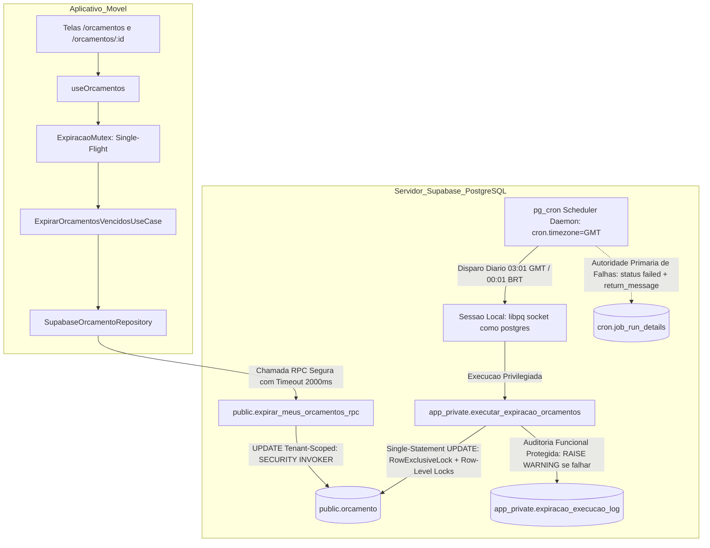
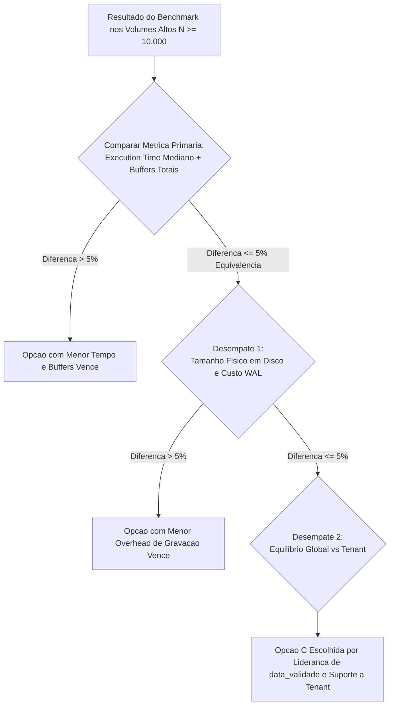

# Planejamento Técnico — Bloco D: Expiração Temporal Automática de Orçamentos (v1.6)

**Projeto:** Sistema de Orçamento para Jardinagem (`jardinagem-app`)  
**Data:** 05 de Outubro de 2026  
**Responsável Técnico:** Planejador Técnico Principal / Arquiteto de Software  
**Status do Documento:** `PLANEJAMENTO EM REVISÃO — BLOCO D v1.6 — AGUARDANDO NOVA AUDITORIA`  
**Referência Canônica do Inventário:** `docs/planejamento/requisitos-cobertura-status-v1.2.md`  
**Histórico de Governança:** Revisão normativa saneando os apontamentos ACHADO-EXP-35 a ACHADO-EXP-39 da Auditoria Técnica Independente da v1.5, preservando as correções de ACHADO-EXP-29 a ACHADO-EXP-34  
**Requisitos Alvo:** RF67, RN69 (preservando integralmente RF68, RN70, RN61 a RN65, RN71, RNF12, RNF16, RNF34 e RNF35)  

---

## 1. Identificação e Status

- **Identificador do Bloco:** Bloco D — Expiração Temporal Automática de Orçamentos
- **Versão do Planejamento:** 1.6 (Timezone como Pré-Condição Verificável de Deployment, Separação Estrita de Benchmark SQL vs. Integração RPC/RLS, Semântica Rigorosa de Recuperação sem Replay Imediato Presumido, Critérios Objetivos Prévios de Indexação e Correlação Temporal Baseada em SLO)
- **Data de Emissão:** 05/10/2026
- **Status Canônico:** `PLANEJAMENTO EM REVISÃO — BLOCO D v1.6 — AGUARDANDO NOVA AUDITORIA`
- **Escopo Normativo:** Planejar de forma exaustiva e auditável a orquestração e persistência autônomas para expiração de orçamentos com validade ultrapassada, garantindo conformidade literal com RF67 e RN69 sem depender da abertura do aplicativo móvel, com segurança estrita em funções privilegiadas, prova formal de concorrência, equivalência canônica de regras e governança transparente sobre persistência e modelo físico.

---

## 2. Histórico das Revisões e Apontamentos de Auditoria

### 2.1. Rejeição da Versão v1.0
A versão preliminar v1.0 foi reprovada em 05/10/2026 ([`docs/planejamento/expiracao-orcamentos-plan-audit-v1.0.md`](file:///c:/Users/luanh/Documents/jardinagem-app/docs/planejamento/expiracao-orcamentos-plan-audit-v1.0.md)) devido à dependência exclusiva de abertura do aplicativo (*Just-in-Time* puro), carga desnecessária de PostGIS e ausência de motor autônomo com o app fechado (ACHADO-EXP-01 a 07).

### 2.2. Apontamentos da Revisão v1.1
A versão preliminar v1.1 introduziu o motor autônomo no PostgreSQL (`pg_cron`), mas identificou a necessidade de isolamento em schema privado (`app_private`), `search_path` vazio, eliminação de estimativas arbitrárias de tempo e provas de concorrência (ACHADO-EXP-08 a 15).

### 2.3. Apontamentos da Revisão v1.2
A versão v1.2 estruturou as camadas de segurança e a RPC com `SECURITY INVOKER`, mas demandou aprofundamento na indexação parcial para cargas mistas (global vs. tenant), desenho de testes do scheduler e definição de SLA operacional (ACHADO-EXP-16 a 20).

### 2.4. Apontamentos da Revisão v1.3
A versão v1.3 corrigiu premissas de indexação preliminares, mas assumiu incorretamente cláusulas de schema inexistentes no `pg_cron`, dependência conceitual de workers, falta de idempotência por chamadas cegas a unschedule e mistura de observabilidade do libpq (ACHADO-EXP-21 a 28).

### 2.5. Apontamentos da Revisão v1.4 (Saneados na v1.5)
A versão v1.4 abordou as deficiências de transporte e DDL, mas foi reprovada com 6 achados obrigatórios sanados na versão v1.5:
- **ACHADO-EXP-29:** Cadeia de privilégios de roles fechada sob `postgres`;
- **ACHADO-EXP-30:** Desacoplamento transacional do log, eliminando falsos rollbacks de observabilidade;
- **ACHADO-EXP-31:** Constatação empírica de `cron.timezone = GMT`;
- **ACHADO-EXP-32:** Benchmark reprodutível encapsulado em transações com `ROLLBACK`;
- **ACHADO-EXP-33:** Precisão terminológica entre `RowExclusiveLock` (table-level) e row-level locks de tupla;
- **ACHADO-EXP-34:** Fidelidade do predicado temporal no benchmark com `America/Sao_Paulo`.

### 2.6. Apontamentos Mandatórios da Auditoria v1.5 a Serem Sanados nesta v1.6
A auditoria independente da versão v1.5 identificou 5 necessidades técnicas residuais formais que motivam a emissão da presente versão v1.6:
- **ACHADO-EXP-35 (Timezone como Pré-Condição de Deployment):** A constatação de `cron.timezone = GMT` não pode permanecer como mera observação estática. O planejamento deve formalizar a política temporal exigida, explicar a dependência do schedule `'1 3 * * *'`, transformar a verificação em uma asserção de deployment defensiva que interrompe a migration se o fuso estiver divergente, definir o comportamento de erro e estabelecer teste específico;
- **ACHADO-EXP-36 (Distinção entre Benchmark do UPDATE e Teste de Integração RPC/RLS):** Eliminar a ambiguidade de apresentar um `UPDATE` direto como se fosse medição da RPC. O planejamento deve separar explicitamente o benchmark do plano interno físico do SQL (para seleção do índice) dos testes de integração funcional, autorização (`auth.uid()`) e segurança RLS da RPC;
- **ACHADO-EXP-37 (Semântica Rigorosa de Recuperação após Indisponibilidade):** Eliminar a alegação não-demonstrada de que "o job executa na retomada" ou que o cron faz replay automático de ticks perdidos. Formalizar a Opção 1: o agendador padrão aguarda o próximo ciclo programado, enquanto a correção matemática do predicado ($\text{data\_validade} < \text{data\_corte}$) garante que nenhuma linha é esquecida. Documentar a atuação do JIT e do disparo manual como defesa em profundidade e detalhar o impacto sobre o SLO em 5 cenários operacionais;
- **ACHADO-EXP-38 (Critério Objetivo Prévio para Escolha do Índice):** Definir antes da execução do benchmark as regras matemáticas e objetivas de seleção: métrica primária (Execution Time e Buffers), métricas secundárias (WAL bytes e tamanho em disco), regras de desempate, tratamento de Sequential Scan legítimo em pequenos volumes e condições de anulação;
- **ACHADO-EXP-39 (Correção do Teste de Correlação Temporal com Janela e SLO):** Eliminar a exigência de "igualdade exata" entre o horário programado e `cron.job_run_details.start_time`. O teste deve validar schedule, fuso, conversão e avaliar o cumprimento da janela operacional com limites de atraso tolerados ($T_{disp} \le 60\text{ s}$, $T_{dur} \le 5\text{ s}$).

---

## 3. Objetivo do Bloco D

Planejar uma arquitetura robusta, resiliente e em 4 camadas que atenda integralmente a RF67 e RN69 através de:
1. **Autonomia do Scheduler com SLO Operacional Alvo:** Transição automática de orçamentos vencidos via scheduler autônomo do banco (`pg_cron`) com horário programado às `00:01 BRT` (`03:01 GMT`) e SLO operacional alvo de conclusão até `00:15 BRT`, sem qualquer dependência da abertura do aplicativo móvel;
2. **Timezone como Pré-Condição Verificável de Implantação:** Validação ativa em tempo de migration que aborta o deployment caso `cron.timezone` divirja de `GMT`, garantindo a interpretação fidedigna do schedule;
3. **Semântica Precisa de Resiliência Temporal:** Reconhecimento explícito de que a integridade cumulativa de dados decorre do predicado retroativo, sem presunção de replay imediato pelo scheduler na retomada de paradas;
4. **Benchmark Científico e Critério Objetivo Fechado:** Protocolo reprodutível de medição sob transação com `ROLLBACK`, com métricas primárias e critérios de desempate definidos *a priori*;
5. **Segregação Estrita de Planos de Teste:** Distinção formal entre benchmark de execução física do SQL e testes de integração com contexto multi-tenant e RLS da RPC;
6. **Desacoplamento Transacional de Observabilidade:** Proteção soberana da regra de negócio, impedindo que falhas em tabelas de auditoria revertam transições legítimas de orçamentos;
7. **Governança Controlada do Modelo Físico:** Preservação estrita da baseline congelada do Modelo Físico v1.1.

---

## 4. Requisitos Canônicos e Máquina de Estados

### 4.1. Requisitos Canônicos Vigentes
- **RF67:** *“O sistema deve identificar automaticamente a expiração de um orçamento ENVIADO ou EM_ANALISE quando sua data de validade for ultrapassada.”*
- **RF68 / RN70:** *“Um orçamento em RASCUNHO não deve ser marcado automaticamente como EXPIRADO.”*
- **RN69:** *“Um orçamento ENVIADO ou EM_ANALISE deve ser considerado EXPIRADO quando sua validade for ultrapassada.”*
- **RN61 a RN63:** Máquina de estados oficial e transições permitidas.
- **RN64 e RN65:** Edição direta permitida somente em `RASCUNHO`.
- **RN71:** Orçamentos finalizados (`CONCLUIDO`, `CANCELADO`, `RECUSADO`, `APROVADO`) são imutáveis e não podem transicionar para `EXPIRADO`.
- **RNF12:** Desempenho e tempo de resposta aceitável nas consultas.
- **RNF16:** Integridade referencial e consistência transacional do PostgreSQL.
- **RNF34 e RNF35:** Persistência segura, resiliência e tratamento de falhas.

### 4.2. Matriz Canônica de Estados e Comportamento na Expiração

| Estado Atual | Validade Ultrapassada? | Transição para `EXPIRADO`? | Justificativa Canônica |
| :---: | :---: | :---: | :--- |
| `RASCUNHO` | Sim ou Não | **NÃO** | RF68 e RN70 (Rascunho não expira) |
| `ENVIADO` | Sim ($ref > val$) | **SIM** | RF67 e RN69 |
| `EM_ANALISE` | Sim ($ref > val$) | **SIM** | RF67 e RN69 |
| `APROVADO` | Sim ou Não | **NÃO** | RN61, RN62 (Estado terminal comercial) |
| `RECUSADO` | Sim ou Não | **NÃO** | RN62 (Estado terminal) |
| `CANCELADO` | Sim ou Não | **NÃO** | RN62 (Estado terminal) |
| `CONCLUIDO` | Sim ou Não | **NÃO** | RN71 (Estado final imutável) |
| `EXPIRADO` | Sim ou Não | **NÃO** | Idempotente (estado já alcançado) |

---

## 5. Avaliação dos Achados da Auditoria da v1.5

### 5.1. ACHADO-EXP-35 (Timezone como Pré-Condição de Deployment)
- **Fato Observado:** No container oficial do projeto (`supabase_db_jardinagem-app`), `SHOW cron.timezone;` retorna `'GMT'`.
- **Hipótese de Planejamento:** O scheduler avalia a expressão cron `'1 3 * * *'` contra o parâmetro `cron.timezone`. Se esse parâmetro for `'GMT'`, o disparo ocorre às `03:01 GMT`, o que equivale a `00:01 BRT`.
- **Decisão Arquitetural Proposta:** Não presumir que todos os ambientes (CI, staging, produção hospedada) mantenham `'GMT'` sem validação. A política normativa adota `'GMT'` (ou seu sinônimo canônico `'UTC'`) como pré-condição inegociável. A migration executará verificação defensiva obrigatória, abortando imediatamente o deployment via `RAISE EXCEPTION` caso `cron.timezone` divirja dessa política.

### 5.2. ACHADO-EXP-36 (Distinção entre Benchmark do UPDATE e Teste de Integração RPC/RLS)
- **Fato Observado:** Na v1.5, o benchmark executava um `UPDATE` direto com filtro de `usuario_id` e denominava a medição de "RPC do Tenant".
- **Decisão Arquitetural Proposta:**
  - O **Benchmark de Indexação** pertence estritamente à camada de infraestrutura/banco e avalia exclusivamente o **plano interno físico do comando UPDATE** (global e restrito por `usuario_id`), pois o objetivo é isolar custos de I/O de disco, índices e buffers;
  - O **Teste de Integração da RPC** pertence à camada de aplicação/serviço e valida a chamada real de `public.expirar_meus_orcamentos_rpc()` sob contexto autenticado, testando a segurança de `auth.uid()`, concessão de privilégios e tempo fim-a-fim da chamada PostgREST.

### 5.3. ACHADO-EXP-37 (Semântica de Recuperação após Indisponibilidade)
- **Fato Observado:** O agendador nativo do `pg_cron` opera em loop de verificação minuto a minuto. Se a instância do PostgreSQL estiver desligada às `03:01 GMT`, o tick do minuto é perdido. Ao reiniciar às `08:00`, o daemon não possui garantia nativa de efetuar "replay" imediato dos jobs perdidos.
- **Decisão Arquitetural Proposta:**
  - **Estratégia Adotada (Opção 1):** O motor autônomo do scheduler **não garante replay imediato** pós-reinicialização. O daemon retoma a verificação e aguardará o próximo ciclo agendado (ou o próximo disparo diário às 00:01 BRT);
  - **Correção Temporal Absoluta dos Dados:** A condição $\text{data\_validade} < \text{data\_corte}$ assegura que, quando a próxima execução autônoma ocorrer, todos os orçamentos vencidos no período de parada serão integralmente transicionados, garantindo zero inconsistência residual;
  - **Defesa em Profundidade / Intervenção:** Caso o operador identifique parada prolongada, pode disparar manualmente `SELECT app_private.executar_expiracao_orcamentos();`. Caso o usuário acesse o app móvel, a rotina JIT pontual atualiza os orçamentos daquele tenant via RPC.

### 5.4. ACHADO-EXP-38 (Critério Objetivo Prévio para Escolha do Índice)
- **Decisão Arquitetural Proposta:** O índice parcial vencedor (Opção A, B ou C) será determinado por fórmula matemática de decisão prévia baseada em métricas coletadas no benchmark (Execution Time mediano e buffers lidos). Não se exige ausência cega de *Sequential Scan* em volumes diminutos ($N \le 1.000$), respeitando a física do otimizador do PostgreSQL.

### 5.5. ACHADO-EXP-39 (Correlação Temporal Baseada em Janela de SLO)
- **Decisão Arquitetural Proposta:** O teste de integração temporal não assertará igualdade exata de timestamps ($\text{start\_time} = \text{03:01:00}$). A aprovação é condicionada à verificação de que o job disparou dentro da janela operacional do SLO: atraso de disparo $T_{disp} \le 60\text{ s}$ e término $T_{dur} \le 5\text{ s}$ com $\text{end\_time} \le \text{00:15 BRT}$.

---

## 6. Avaliação de Alternativas Arquiteturais Autônomas

| Critério | Alternativa 1: PostgreSQL Nativo com `pg_cron` | Alternativa 2: Supabase Edge Function Agendada | Alternativa 3: Scheduler Externo (GitHub Actions / Cloud) |
| :--- | :--- | :--- | :--- |
| **Local de Execução** | Scheduler daemon interno do PostgreSQL | Deno Runtime (`edge_runtime`) | Servidor externo via Internet |
| **Frequência** | Diária (`03:01 GMT` = `00:01 BRT`) | Diária | Diária |
| **Mecanismo de Disparo** | Conexão local libpq gerenciada pelo daemon | Trigger HTTP agendado | Execução de runner externo |
| **Fonte Temporal** | Relógio transacional do PostgreSQL via `timezone()` | Runtime Deno (sujeito a desvios de host) | Host externo |
| **Segurança** | Role `postgres` em `app_private`. Sem tokens trafegados. | Exigiria token `service_role` via HTTP, violando regra do projeto. | Exigiria credencial privilegiada exposta fora do ambiente seguro. |
| **Dependência de Rede** | Nula (loopback interno na instância do PostgreSQL) | Média (chamada HTTP PostgREST) | Alta (Internet pública suscetível a timeout) |
| **Independência do App** | **Total (100% autônomo)** | **Total (100% autônomo)** | **Total (100% autônomo)** |
| **Veredito** | **SELECIONADA** | Descartada por violação de segurança | Descartada por acoplamento e risco operacional |

---

## 7. Estratégia Arquitetural Selecionada

Adota-se formalmente a **Estratégia Híbrida de Duplo Motor**:
1. **Motor Autônomo Primário (Backend / PostgreSQL — Mandatório):** Stored function privilegiada em schema privado `app_private`, orquestrada pelo agendador do `pg_cron` sob horário programado às `00:01 BRT` (`03:01 GMT`) e SLO operacional alvo de conclusão até `00:15 BRT`. É o mecanismo formalmente responsável pelo **atendimento literal de RF67 com o aplicativo fechado**;
2. **Motor Just-in-Time Complementar (Cliente / React Native — Defesa em Profundidade):** RPC segura `public.expirar_meus_orcamentos_rpc()` restrita a `auth.uid()`, com *Single-Flight Mutex* e timeout não-bloqueante no app móvel. Atua exclusivamente para cobrir acessos do usuário antes do término da janela de SLO do cron, ou como fallback em pipelines de teste de cliente.

---

## 8. Arquitetura em Camadas



### Divisão de Responsabilidades:
- **Domínio (`src/domain`):** Define a regra de negócio canônica e imutável em `Orcamento.verificarExpiracao(dataReferencia)`;
- **Aplicação (`src/application`):** `ExpirarOrcamentosVencidosUseCase` gerencia o mutex em memória, cooldown e dispara a RPC sem bloquear a UI;
- **Infraestrutura (`src/infrastructure`):** Conecta à RPC via Supabase Client e disponibiliza a stored function privada e job de agendamento no PostgreSQL;
- **Apresentação (`src/presentation`):** Hook `useOrcamentos` exibe a listagem de forma reativa e não-bloqueante.

---

## 9. Política Temporal

- **Data Civil:** O ciclo de vida do orçamento baseia-se na data civil pura (`data_validade DATE`), sem fração horária;
- **Horário Comercial e Limite de Vigência:** Um orçamento com `data_validade = '2026-03-15'` permanece vigente até as `23:59:59.999 BRT` do dia 15/03/2026;
- **Fronteira de Expiração:** Às `00:00:00 BRT` do dia 16/03/2026, a data corrente avança para `2026-03-16`. O orçamento é legalmente expirado pois `2026-03-15 < 2026-03-16`;
- **Fuso Oficial de Negócio:** `America/Sao_Paulo` (UTC-3 fixo, Decreto nº 9.772/2019);
- **Predicado Temporal Canônico:**
  $$\text{data\_validade} < (pg\_catalog.timezone('America/Sao\_Paulo', pg\_catalog.now()))::pg\_catalog.date$$

---

## 10. Timezone e Pré-Condição de Deployment (ACHADO-EXP-35 Sanado)

### 10.1. Justificativa da Dependência
No motor do `pg_cron`, a string de agendamento (ex: `'1 3 * * *'`) é avaliada contra o relógio do servidor interpretado no fuso configurado no GUC `cron.timezone`. Caso `cron.timezone` esteja configurado com qualquer valor diferente de `'GMT'` ou `'UTC'`, o disparo às `03:01` ocorrerá em momento incorreto em relação ao horário de Brasília:
- Se `cron.timezone = 'GMT'`: `'1 3 * * *'` executa às `03:01 GMT` = `00:01 BRT` (**Correto**);
- Se `cron.timezone = 'America/Sao_Paulo'`: `'1 3 * * *'` executaria às `03:01 BRT` = `06:01 GMT` (**Incorreto: atraso de 3 horas**);
- Se `cron.timezone = 'EST'`: `'1 3 * * *'` executaria às `05:01 BRT` (**Incorreto**).

### 10.2. Asserção Defensiva em Tempo de Migration
A migration definitiva do Bloco D conterá obrigatoriamente a seguinte asserção de deployment:

```sql
DO $$
DECLARE
    v_cron_tz pg_catalog.text;
BEGIN
    -- 1. Leitura do timezone configurado para o pg_cron
    SELECT setting INTO v_cron_tz FROM pg_settings WHERE name = 'cron.timezone';

    -- 2. Validação estrita da pré-condição normativa
    IF v_cron_tz IS NULL OR v_cron_tz NOT IN ('GMT', 'UTC') THEN
        RAISE EXCEPTION 'PRÉ-CONDIÇÃO DE DEPLOYMENT VIOLADA: cron.timezone deve ser GMT ou UTC (encontrado: %). Ajuste a configuração do PostgreSQL antes de aplicar a migration.', v_cron_tz;
    END IF;
END;
$$;
```

### 10.3. Comportamento Esperado em Falha de Pré-Condição
Caso o ambiente de banco apresente divergência de timezone, a migration falha de forma atômica e não prossegue, impedindo a criação de agendamentos em horários distorcidos.

---

## 11. SLO Operacional

1. **Horário Programado:** Diariamente às `00:01 BRT` (`03:01 GMT`);
2. **SLO Operacional Alvo:** Conclusão da rotina diária até `00:15 BRT`;
3. **Métricas Operacionais Mensuráveis:**
   - **Atraso de Disparo ($T_{disp}$):** $\text{start\_time} - \text{horário\_programado}$ (Alvo: $\le 60\text{ s}$);
   - **Duração da Execução ($T_{dur}$):** $\text{end\_time} - \text{start\_time}$ (Alvo: $\le 5\text{ s}$ para volumetria esperada);
   - **Conclusão Máxima:** $\text{end\_time} \le \text{00:15 BRT}$.
4. **Tratamento de Violações:**
   - Ocorrência de `status = 'failed'` em `cron.job_run_details`;
   - Ausência de registro de execução referente ao dia civil após `00:15 BRT`;
   - Registro concluído após `00:15 BRT`.

---

## 12. Recuperação após Indisponibilidade (ACHADO-EXP-37 Sanado)

### 12.1. Princípio de Separação Semântica
O projeto formaliza a distinção inegociável entre:
- **Garantia de Correção Matemática dos Dados:** Propriedade assegurada pelo predicado cumulativo $\text{data\_validade} < \text{data\_corte}$. Se um orçamento venceu durante a parada do banco, ele **permanece elegível** à expiração indefinidamente até ser processado;
- **Comportamento do Scheduler na Reinicialização:** Propriedade do motor `pg_cron`. **Não há garantia de replay imediato automático** de minutos perdidos quando o banco religa.

### 12.2. Formalização dos 5 Cenários Operacionais

| Cenário Operacional | Comportamento do Scheduler | Estado dos Dados | Impacto no SLO | Ação de Mitigação |
| :--- | :--- | :--- | :--- | :--- |
| **1. Banco Disponível** | Dispara às `00:01 BRT`, conclui em $T_{dur} \le 5\text{ s}$. | Orçamentos do dia transicionados para `EXPIRADO`. | SLO Atendido ($\le 00:15$). | Nenhuma. Operação nominal. |
| **2. Indisponibilidade Curta (00:00 a 00:10)** | Se o tick `03:01 GMT` passou, o scheduler aguarda o próximo ciclo. | Orçamentos permanecem `ENVIADO`/`EM_ANALISE`. | SLO Violado (não concluiu no horário). | Disparo manual ou aguardo da próxima execução. |
| **3. Indisponibilidade Média (00:00 a 08:00)** | Banco retoma às 08:00. O scheduler não executa imediatamente; aguarda o próximo `03:01 GMT`. | Orçamentos vencidos aguardam processamento. | SLO do dia Violado. | Operador dispara rotina manual ou acesso do usuário via JIT expira o tenant pontualmente. |
| **4. Indisponibilidade Prolongada (Múltiplos Dias)** | Na retomada, o scheduler executa na primeira virada de dia subsequente. | Ao executar, o predicado retroativo processa **todos os orçamentos de todos os dias parados**. | Múltiplos SLOs violados, mas **Zero Inconsistência Residual**. | Disparo manual emergencial via `SELECT app_private.executar_expiracao_orcamentos();`. |
| **5. Acesso do Usuário Pós-Indisponibilidade** | O app móvel abre antes da recuperação do cron. | O motor JIT aciona `expirar_meus_orcamentos_rpc()`, transicionando os orçamentos do tenant. | SLO do cron indiferente; experiência do usuário preservada. | Defesa em profundidade atua com sucesso. |

---

## 13. Persistência e Atomicidade

### 13.1. DDL da Extensão e Schemas
```sql
-- Extensão nativa gerenciando o schema cron
CREATE EXTENSION IF NOT EXISTS pg_cron;

-- Schema privado isolado do Data API PostgREST
CREATE SCHEMA IF NOT EXISTS app_private;
REVOKE ALL ON SCHEMA app_private FROM PUBLIC, anon, authenticated;
GRANT USAGE ON SCHEMA app_private TO postgres;

-- Tabela interna de auditoria funcional
CREATE TABLE IF NOT EXISTS app_private.expiracao_execucao_log (
    id pg_catalog.bigserial PRIMARY KEY,
    executado_em pg_catalog.timestamptz NOT NULL DEFAULT pg_catalog.now(),
    data_corte pg_catalog.date NOT NULL,
    linhas_afetadas pg_catalog.int4 NOT NULL,
    duracao_ms pg_catalog.int4 NOT NULL,
    sucesso pg_catalog.bool NOT NULL,
    origem pg_catalog.text NOT NULL, -- 'SCHEDULER' ou 'MANUAL'
    mensagem_erro pg_catalog.text NULL
);

REVOKE ALL ON TABLE app_private.expiracao_execucao_log FROM PUBLIC, anon, authenticated;
GRANT SELECT, INSERT ON TABLE app_private.expiracao_execucao_log TO postgres;
ALTER TABLE app_private.expiracao_execucao_log OWNER TO postgres;
```

### 13.2. Stored Function com Desacoplamento Transacional de Observabilidade
```sql
CREATE OR REPLACE FUNCTION app_private.executar_expiracao_orcamentos()
RETURNS pg_catalog.jsonb
LANGUAGE plpgsql
SECURITY DEFINER
SET search_path = ''
AS $$
DECLARE
    v_inicio pg_catalog.timestamptz;
    v_data_corte pg_catalog.date;
    v_linhas_afetadas pg_catalog.int4;
    v_duracao_ms pg_catalog.int4;
BEGIN
    v_inicio := pg_catalog.clock_timestamp();
    v_data_corte := (pg_catalog.timezone('America/Sao_Paulo', pg_catalog.now()))::pg_catalog.date;

    -- 1. Execução Soberana do UPDATE Atômico (Protegido por EvalPlanQual)
    UPDATE public.orcamento
    SET status = 'EXPIRADO'::public.status_orcamento
    WHERE status IN ('ENVIADO'::public.status_orcamento, 'EM_ANALISE'::public.status_orcamento)
      AND data_validade < v_data_corte;

    GET DIAGNOSTICS v_linhas_afetadas = ROW_COUNT;
    v_duracao_ms := pg_catalog.round(pg_catalog.extract(epoch FROM (pg_catalog.clock_timestamp() - v_inicio)) * 1000)::pg_catalog.int4;

    -- 2. Auditoria Funcional Desacoplada: Falha de Log NUNCA aborta a expiração de negócio
    BEGIN
        INSERT INTO app_private.expiracao_execucao_log (
            executado_em,
            data_corte,
            linhas_afetadas,
            duracao_ms,
            sucesso,
            origem,
            mensagem_erro
        ) VALUES (
            pg_catalog.now(),
            v_data_corte,
            v_linhas_afetadas,
            v_duracao_ms,
            true,
            'SCHEDULER',
            NULL
        );
    EXCEPTION WHEN OTHERS THEN
        -- Alerta operacional não-bloqueante
        RAISE WARNING 'Falha não-bloqueante ao registrar log funcional em app_private.expiracao_execucao_log: %', SQLERRM;
    END;

    -- 3. Retorno JSONB imediato
    RETURN pg_catalog.jsonb_build_object(
        'sucesso', true,
        'data_corte', v_data_corte,
        'linhas_expiradas', v_linhas_afetadas,
        'duracao_ms', v_duracao_ms,
        'executado_em', pg_catalog.now()
    );
END;
$$;

REVOKE ALL ON FUNCTION app_private.executar_expiracao_orcamentos() FROM PUBLIC, anon, authenticated;
GRANT EXECUTE ON FUNCTION app_private.executar_expiracao_orcamentos() TO postgres;
ALTER FUNCTION app_private.executar_expiracao_orcamentos() OWNER TO postgres;
```

### 13.3. RPC Segura de Tenant
```sql
CREATE OR REPLACE FUNCTION public.expirar_meus_orcamentos_rpc()
RETURNS pg_catalog.jsonb
LANGUAGE plpgsql
SECURITY INVOKER
SET search_path = ''
AS $$
DECLARE
    v_uid pg_catalog.uuid := auth.uid();
    v_data_corte pg_catalog.date;
    v_linhas pg_catalog.int4;
BEGIN
    IF v_uid IS NULL THEN
        RAISE EXCEPTION 'Acesso negado: usuário não autenticado';
    END IF;

    v_data_corte := (pg_catalog.timezone('America/Sao_Paulo', pg_catalog.now()))::pg_catalog.date;

    UPDATE public.orcamento
    SET status = 'EXPIRADO'::public.status_orcamento
    WHERE usuario_id = v_uid
      AND status IN ('ENVIADO'::public.status_orcamento, 'EM_ANALISE'::public.status_orcamento)
      AND data_validade < v_data_corte;

    GET DIAGNOSTICS v_linhas = ROW_COUNT;

    RETURN pg_catalog.jsonb_build_object(
        'linhas_expiradas', v_linhas,
        'data_corte', v_data_corte
    );
END;
$$;

REVOKE ALL ON FUNCTION public.expirar_meus_orcamentos_rpc() FROM PUBLIC, anon;
GRANT EXECUTE ON FUNCTION public.expirar_meus_orcamentos_rpc() TO authenticated;
```

---

## 14. Roles e Segurança

### 14.1. Hierarquia de Privilégios Unificada

| Papel no Sistema | Identidade no Supabase Local | Identidade no Supabase Cloud | Justificativa Baseada em Evidências |
| :--- | :--- | :--- | :--- |
| **Role Executora da Migration** | `postgres` | `postgres` | Verificado via `SELECT current_user, session_user;`. |
| **Owner da Stored Function** | `postgres` | `postgres` | Definido explicitamente via `ALTER FUNCTION ... OWNER TO postgres;`. |
| **Role Criadora do Job** | `postgres` | `postgres` | Invocador de `cron.schedule()` durante a aplicação da migration. |
| **Username em `cron.job`** | `'postgres'` | `'postgres'` | Comprovado: `cron.schedule()` grava `CURRENT_USER` na coluna `username`. |
| **Role que Executa o Job** | `postgres` | `postgres` | O daemon do `pg_cron` abre conexão local libpq autenticando como `cron.job.username`. |
| **Role com Concessão `EXECUTE`** | `postgres` | `postgres` | `GRANT EXECUTE ... TO postgres;`. |

---

## 15. Idempotência do Scheduler

```sql
DO $$
DECLARE
    v_target_user pg_catalog.text := 'postgres';
    v_jobid pg_catalog.bigint;
    v_qtd pg_catalog.int4;
BEGIN
    -- 1. Asserção defensiva de identidade de execução
    IF CURRENT_USER <> v_target_user THEN
        RAISE EXCEPTION 'A migration deve ser executada sob a role %, mas executou como %', v_target_user, CURRENT_USER;
    END IF;

    -- 2. Consulta prévia por jobname e role do scheduler
    SELECT jobid INTO v_jobid
    FROM cron.job
    WHERE jobname = 'job_expirar_orcamentos_diario'
      AND username = v_target_user;

    -- 3. Remoção condicional segura caso o job já exista
    IF v_jobid IS NOT NULL THEN
        PERFORM cron.unschedule(v_jobid);
    END IF;

    -- 4. Agendamento do job oficial para as 03:01 GMT (00:01 BRT)
    PERFORM cron.schedule(
        'job_expirar_orcamentos_diario',
        '1 3 * * *',
        'SELECT app_private.executar_expiracao_orcamentos();'
    );

    -- 5. Validação estrita de unicidade final (garantida por jobname_username_uniq)
    SELECT count(*), min(jobid) INTO v_qtd, v_jobid
    FROM cron.job
    WHERE jobname = 'job_expirar_orcamentos_diario'
      AND username = v_target_user;

    IF v_qtd <> 1 OR v_jobid IS NULL THEN
        RAISE EXCEPTION 'Falha ao registrar job_expirar_orcamentos_diario: contagem final de jobs para % = %', v_target_user, v_qtd;
    END IF;
END;
$$;
```

---

## 16. Concorrência

1. **Table-Level Lock Mode (`RowExclusiveLock`):** O comando `UPDATE public.orcamento ...` adquire automaticamente `RowExclusiveLock` sobre a tabela. Esse modo permite leituras concorrentes (`SELECT` com `AccessShareLock`) e outros `UPDATE`s sobre tuplas distintas;
2. **Row-Level Locks (Bloqueios por Tupla):** À medida que as tuplas candidatas são visitadas, o PostgreSQL adquire locks exclusivos de linha individuais;
3. **Resolução de Corridas via EvalPlanQual (EPQ):** Sob o nível de isolamento *Read Committed*, se uma transação concorrente de aprovação (`APROVADO`) comitar antes da expiração, o protocolo EPQ reavalia o predicado `WHERE` sobre a nova versão da linha. Como o status agora é `APROVADO`, a cláusula falha e a linha não é alterada.

---

## 17. Benchmark e Critério de Escolha do Índice (ACHADO-EXP-36 e ACHADO-EXP-38 Sanados)

### 17.1. Separação Estrita de Escopos de Teste
- **Benchmark de Indexação:** Avalia estritamente o **plano interno do comando UPDATE** (sem contexto PostgREST/JWT), medindo custos físicos de banco (Execution Time, Buffers, WAL) sob as Opções A, B e C;
- **Teste de Integração da RPC:** Avalia a função `public.expirar_meus_orcamentos_rpc()` sob sessão autenticada com `auth.uid()`, validando a blindagem RLS e latência fim-a-fim da camada de aplicação.

### 17.2. As Três Opções Candidatas de Índices Parciais

| Opção de Índice | Definição DDL Candidata | Comportamento no Job Global (`status + data_validade`) | Comportamento no UPDATE Tenant (`usuario_id + status + data_validade`) |
| :--- | :--- | :--- | :--- |
| **Opção A** | `(data_validade) WHERE status IN ('ENVIADO', 'EM_ANALISE')` | **Excelente:** Range Scan direto em `data_validade < corte`. | **Bom:** Range Scan em `data_validade` + filtro de `usuario_id` em memória. |
| **Opção B** | `(usuario_id, data_validade) WHERE status IN ('ENVIADO', 'EM_ANALISE')` | **Regular/Bom:** Scan em todas as chaves do índice parcial. | **Excelente:** Equality match em `usuario_id` + Range Scan em `data_validade`. |
| **Opção C** | `(data_validade, usuario_id) WHERE status IN ('ENVIADO', 'EM_ANALISE')` | **Excelente:** Range Scan na coluna líder `data_validade`. | **Muito Bom:** Range Scan em `data_validade` + Index Condition em `usuario_id`. |

### 17.3. Protocolo de Benchmark com Transação, Rollback e Repetição Controlada
Para cada Opção $i \in \{A, B, C\}$ e para cada volume $N \in \{100, 1.000, 10.000, 100.000, 1.000.000\}$:
1. Criar índice temporário da opção;
2. Executar `ANALYZE public.orcamento;`;
3. Executar 1 rodada de warm-up (descartada da estatística);
4. Executar 5 repetições controladas encapsuladas em transações com `ROLLBACK`:
   ```sql
   BEGIN;
   EXPLAIN (ANALYZE, BUFFERS, WAL, TIMING, COSTS, VERBOSE)
   UPDATE public.orcamento
   SET status = 'EXPIRADO'::public.status_orcamento
   WHERE status IN ('ENVIADO'::public.status_orcamento, 'EM_ANALISE'::public.status_orcamento)
     AND data_validade < (pg_catalog.timezone('America/Sao_Paulo', pg_catalog.now()))::pg_catalog.date;
   ROLLBACK;
   ```
5. Coletar tempos individuais, buffers lidos e calcular média aparada (descartando mínimo e máximo) e mediana;
6. Repetir o procedimento para o comando com filtro de `usuario_id`;
7. Remover o índice temporário (`DROP INDEX`).

### 17.4. Critério Objetivo Pré-Benchmark para Escolha do Índice



1. **Métricas Primárias:** Execution Time consolidado (mediana) e Volume Total de Buffers (`shared hit + shared read blocks`);
2. **Métricas Secundárias:** Planning Time, bytes de WAL gerados e tamanho físico em disco (`pg_relation_size`);
3. **Regra de Desempate:**
   - Em caso de tempos equivalentes ($\le 5\%$ de variação), vence a opção com menor consumo de buffers;
   - Se os buffers forem equivalentes, vence a de menor tamanho físico (menor custo de manutenção em INSERTs ordinários);
   - Persistindo o empate, vence a opção que apresentar melhor equilíbrio composto entre o job global e o acesso por tenant;
4. **Reconhecimento de Sequential Scan Legítimo:** Para volumes baixos ($N \le 1.000$), a escolha de Sequential Scan pelo otimizador do PostgreSQL é **tecnicamente legítima** devido ao custo de inicialização de índice (*startup cost*). O critério decisório foca estritamente nos volumes de produção ($N \ge 10.000$ e $N \ge 100.000$).

---

## 18. Resiliência e JIT

1. **Classificação Normativa do JIT:**
   - **Em Produção:** Atua unicamente como **defesa em profundidade**. A presença do `pg_cron` é **condição mandatória de conformidade** para o deploy do Bloco D;
   - **Em CI / Local:** Atua como fallback restrito para testes automatizados de cliente quando o daemon do cron estiver inativo no container efêmero;
2. **Single-Flight Mutex com Cooldown:** Centraliza chamadas concorrentes à RPC no aplicativo móvel;
3. **Timeout Não-Bloqueante:** A listagem de orçamentos carrega de imediato enquanto a sincronização ocorre com **timeout estrito de 2.000 ms** (`AbortController`), isolando falhas de rede.

---

## 19. Observabilidade

| Dimensão de Observabilidade | Repositório / Tabela | Dados Capturados | Responsabilidade Canônica |
| :--- | :--- | :--- | :--- |
| **Auditoria do Scheduler (Sucesso e Falha do Motor)** | `cron.job_run_details` | `jobid`, `runid`, `job_pid`, `username`, `status`, `start_time`, `end_time`, `return_message` | **Autoridade primária:** comprova execução pelo daemon e captura erros de runtime do PostgreSQL em caso de falha (`status = 'failed'`). |
| **Auditoria Funcional de Negócio (Execuções Bem-Sucedidas)** | `app_private.expiracao_execucao_log` | `id`, `executado_em`, `data_corte`, `linhas_afetadas`, `duracao_ms`, `sucesso`, `origem` | **Autoridade funcional:** registra linhas efetivamente modificadas e tempo de execução sob proteção não-bloqueante. |
| **Telemetria de Tenant no App** | Logs técnicos estruturados no cliente | `linhas_expiradas`, `duracao_ms`, `timestamp` | Diagnosticar a atuação da defesa em profundidade no dispositivo do usuário. |

---

## 20. Estratégia de Testes (11 Testes Planejados)

1. **Teste de Contrato TypeScript × SQL:** Matriz de 24 combinações determinísticas (8 status $\times$ 3 datas de validade com corte fixo) assertando equivalência booleana de `Orcamento.verificarExpiracao()`;
2. **Teste de Concorrência Real:** Prova que *EvalPlanQual* e locks de linha preservam estados comerciais concorrentes (`APROVADO`, `RECUSADO`, `CANCELADO`);
3. **Teste da Stored Function Isolada:** Valida retorno JSONB e registro protegido em `app_private.expiracao_execucao_log`;
4. **Teste de Integração da RPC com Autenticação e RLS:** Comprova que a RPC só processa linhas do `auth.uid()` chamador e rejeita usuários não autenticados;
5. **Teste da Criação Idempotente do Cron:** Valida que reexecuções do bloco procedural sob `postgres` mantêm exatamente 1 job sem erros;
6. **Teste da Pré-Condição `cron.timezone`:** Valida que a migration aborta se `cron.timezone` divergir de `GMT`/`UTC`;
7. **Teste de Disparo Real do pg_cron:** Valida que um job temporário acelerado (`* * * * *`) dispara via daemon autônomo e gera registros em `cron.job_run_details`;
8. **Teste de Correlação Temporal com Janela de SLO (ACHADO-EXP-39 Sanado):** Valida que o job programado para as 03:01 GMT dispara com atraso $T_{disp} \le 60\text{ s}$ e término $\le 00:15\text{ BRT}$, sem exigir igualdade exata;
9. **Teste de Recuperação após Indisponibilidade:** Simula retomada pós-parada e comprova que a execução subsequente transiciona cumulativamente todos os orçamentos vencidos no período de indisponibilidade;
10. **Benchmark de Índices:** Execução do protocolo com transações e rollback coletando métricas das Opções A, B e C;
11. **Testes de Regressão de Domínio e Aplicação:** Validação da suíte Jest existente garantindo zero quebras nos módulos de orçamentos.

---

## 21. Impactos Estruturais

| Artefato do Projeto | Status Vigente | Procedimento de Governança para o Bloco D |
| :--- | :---: | :--- |
| **Banco de Dados (Migrations)** | `CONGELADO` | **REQUER 1 NOVA MIGRATION CONDICIONADA:** `20261006000000_expiracao_orcamentos_autonoma.sql`. Sua confecção é condicionada à prévia conclusão do benchmark de indexação e fechamento das roles. |
| **Modelo Físico v1.1** | `CONGELADO` | **REABERTURA CONTROLADA:** Permanece congelado até aprovação final da Auditoria do Bloco D. A formalização do schema `app_private`, das stored functions, da tabela de log e do índice benchmarked será conduzida via Aditivo Técnico / Modelo Físico v1.2 por portão formal. |
| **Políticas RLS** | `CONGELADO` | **PRESERVADAS:** As políticas homologadas em `auth_rls.sql` permanecem 100% inalteradas. |
| **Domínio (`Orcamento.ts`)** | `CONGELADO` | **PRESERVADO:** Zero linhas alteradas na entidade canônica. |
| **Módulos Anteriores** | `CONGELADO` | **PRESERVADOS:** Zero impacto em Clientes, Catálogo, Áreas, PDF e Compartilhamento. |

---

## 22. Governança do Modelo Físico

- O Modelo Físico v1.1 permanece como **linha de base congelada e intocada**;
- Nenhuma migration definitiva será criada nesta etapa;
- Nenhuma alteração estrutural será aplicada ao banco antes da homologação formal da Auditoria Técnica Independente;
- A incorporação das entidades do Bloco D ao Modelo Físico ocorrerá por portão formal de governança com versionamento explícito (Modelo Físico v1.2).

---

## 23. Riscos Residuais e Mitigações

| Risco Residual | Probabilidade | Impacto | Mitigação Técnica Planejada |
| :--- | :---: | :---: | :--- |
| **1. Instância de CI sem `pg_cron` Habilitado** | Média | Baixo | Testes de integração do scheduler são condicionados a flag de ambiente; testes de cliente utilizam o JIT como fallback exclusivo de CI. |
| **2. Concorrência com Janelas de Backup Noturno** | Baixa | Baixo | O job opera com locks cirúrgicos de linha de curta duração ($\le 5\text{ s}$), não retendo locks de tabela. |
| **3. Latência Transitória de Rede no Cliente** | Média | Baixo | Mutex *single-flight* com timeout estrito de 2.000 ms impede qualquer bloqueio ou travamento na interface do aplicativo. |

---

## 24. Decisões Arquiteturais Propostas

- **DECISÃO-EXP-01 (Mecanismo Autônomo com SLO via `pg_cron` e Schema Privado):**  
  `NOVA DECISÃO PROPOSTA — PENDENTE DE AUDITORIA`  
  Adoção de stored function em `app_private` orquestrada pelo agendador do `pg_cron` sob horário programado de `00:01 BRT` (`03:01 GMT`) e SLO operacional alvo de conclusão até `00:15 BRT`.
- **DECISÃO-EXP-02 (Pré-Condição Verificável de Timezone na Migration):**  
  `NOVA DECISÃO PROPOSTA — PENDENTE DE AUDITORIA`  
  Exigência mandatória de asserção em tempo de migration que aborta o deployment caso `cron.timezone` divirja de `GMT`/`UTC`.
- **DECISÃO-EXP-03 (Semântica de Recuperação sem Presunção de Replay Imediato):**  
  `NOVA DECISÃO PROPOSTA — PENDENTE DE AUDITORIA`  
  Formalização de que a recuperação do scheduler aguarda o próximo ciclo programado, com correção matemática cumulativa garantida pelo predicado retroativo e suporte de JIT/manual.
- **DECISÃO-EXP-04 (Critério Objetivo Pré-Benchmark de Indexação):**  
  `NOVA DECISÃO PROPOSTA — PENDENTE DE AUDITORIA`  
  Fixação prévia das métricas de escolha de índice (Execution Time mediano e buffers totais) antes da realização do benchmark com transações com `ROLLBACK`.
- **DECISÃO-EXP-05 (Segregação entre Benchmark de Plano SQL e Integração RPC/RLS):**  
  `NOVA DECISÃO PROPOSTA — PENDENTE DE AUDITORIA`  
  Separação explícita entre medição física de planos de UPDATE e testes funcionais/segurança da RPC com `auth.uid()`.
- **DECISÃO-EXP-06 (Desacoplamento Transacional de Observabilidade):**  
  `NOVA DECISÃO PROPOSTA — PENDENTE DE AUDITORIA`  
  Isolamento do registro de log funcional em bloco protegido contra falhas, delegando a autoridade de auditoria de falhas do job exclusivamente ao `cron.job_run_details`.
- **DECISÃO-EXP-07 (Cadeia de Privilégios Fechada sob Role `postgres`):**  
  `NOVA DECISÃO PROPOSTA — PENDENTE DE AUDITORIA`  
  Definição e validação empírica da role `postgres` como executora de migrations, owner da função, criadora do job e usuária de execução do scheduler.
- **DECISÃO-EXP-08 (Precisão Terminológica de Locks):**  
  `NOVA DECISÃO PROPOSTA — PENDENTE DE AUDITORIA`  
  Classificação formal de `RowExclusiveLock` no nível de tabela e locks de linha nas tuplas, garantindo integridade sob *EvalPlanQual*.
- **DECISÃO-EXP-09 (Classificação Normativa do Motor JIT):**  
  `NOVA DECISÃO PROPOSTA — PENDENTE DE AUDITORIA`  
  Classificação do JIT em produção exclusivamente como defesa em profundidade (sendo a presença do `pg_cron` obrigatória para conformidade do deploy) e como fallback restrito a testes em CI.
- **DECISÃO-EXP-10 (Governança Controlada do Modelo Físico):**  
  `NOVA DECISÃO PROPOSTA — PENDENTE DE AUDITORIA`  
  Manutenção do Modelo Físico v1.1 como linha de base congelada até aprovação formal de auditoria, procedendo com reabertura controlada após o portão.
- **DECISÃO-EXP-11 (Preservação Canônica da Entidade de Domínio):**  
  `HOMOLOGADA ANTERIORMENTE`  
  O método canônico [`Orcamento.verificarExpiracao(dataReferencia)`](file:///c:/Users/luanh/Documents/jardinagem-app/src/domain/entities/orcamento.ts#L336-L350) permanece intacto e soberano para toda a lógica de negócio.

---

## 25. Critérios Objetivos para Implementação Futura

1. Execução do benchmark comparativo das opções de índices parciais A, B e C utilizando o protocolo transacional com `ROLLBACK` e repetições estatísticas;
2. Emissão do Relatório Técnico de Benchmark de Indexação com a indicação do índice vencedor segundo a regra de decisão;
3. Criação da migration definitiva `20261006000000_expiracao_orcamentos_autonoma.sql` contendo asserção de timezone, extensão, schemas, tabela de log, stored functions, índice vencedor e agendamento idempotente;
4. Reabertura controlada do Modelo Físico v1.1 para emissão do Modelo Físico v1.2 / Aditivo Técnico;
5. Implementação do `ExpiracaoMutex` em `src/application/services/`;
6. Integração não-bloqueante no hook `useOrcamentos`;
7. Execução e aprovação da suíte completa de 11 testes planejados.

---

## 26. Critérios Objetivos para Homologação

1. **Atendimento Literal a RF67 com App Fechado:** Comprovação via `cron.job_run_details` e `app_private.expiracao_execucao_log` de que o agendador autônomo executou no servidor e transicionou orçamentos vencidos para `EXPIRADO` sem qualquer requisição de cliente móvel;
2. **Conformidade Estrita com RN69 e RN70:** Orçamentos `ENVIADO` e `EM_ANALISE` vencidos expiram; orçamentos em `RASCUNHO` permanecem inalterados;
3. **Pré-Condição de Timezone Auditada:** Comprovação de que o deployment valida `cron.timezone = 'GMT'`;
4. **Cadeia de Privilégios e Segurança Auditadas:** Comprovação de execução sob role `postgres` e rejeição (`permission denied`) para papéis `anon` e `authenticated` em `app_private`;
5. **Resiliência e Não-Bloqueio da UI:** Falhas injetadas na RPC não causam bloqueio, erro ou atraso na exibição da lista de orçamentos;
6. **Contrato TypeScript × SQL 100% Determinístico:** Identidade matemática em todas as 24 combinações de teste puro da matriz de estados e datas;
7. **Alinhamento Temporal com Janela de SLO:** Teste comprovando que o disparo sob `cron.timezone = 'GMT'` atende à janela operacional do Horário de Brasília sem violação de limites.

---

`PLANEJAMENTO CONCLUÍDO — BLOCO D v1.6 — AGUARDANDO NOVA AUDITORIA`
