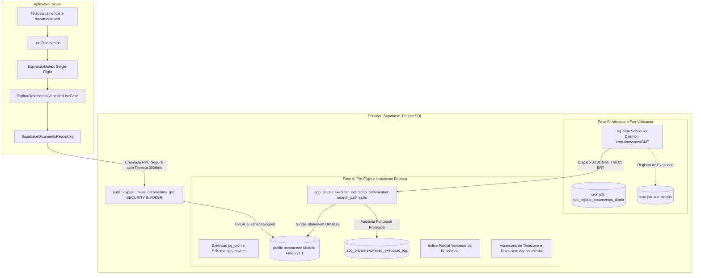
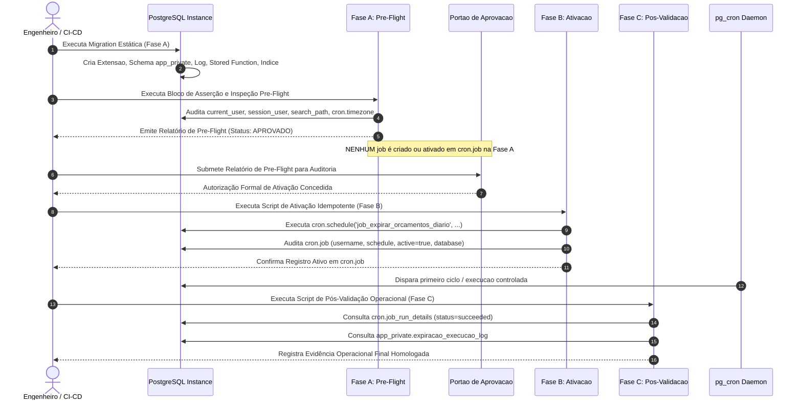

# Planejamento Técnico — Bloco D: Expiração Temporal Automática de Orçamentos (v1.8)

**Projeto:** Sistema de Orçamento para Jardinagem (`jardinagem-app`)  
**Data:** 05 de Outubro de 2026  
**Responsável Técnico:** Planejador Técnico Principal / Arquiteto de Software  
**Status do Documento:** `PLANEJAMENTO EM REVISÃO — BLOCO D v1.8 — AGUARDANDO NOVA AUDITORIA`  
**Referência Canônica do Inventário:** `docs/planejamento/requisitos-cobertura-status-v1.2.md`  
**Histórico de Governança:** Revisão normativa saneando cirurgicamente os apontamentos ACHADO-EXP-44 a ACHADO-EXP-48 da Auditoria Técnica Independente da v1.7, preservando integralmente todas as correções e homologações anteriores (ACHADO-EXP-29 a ACHADO-EXP-43)  
**Requisitos Alvo:** RF67, RN69 (preservando integralmente RF68, RN70, RN61 a RN65, RN71, RNF12, RNF16, RNF34 e RNF35)  

---

## 1. Identificação e Status

- **Identificador do Bloco:** Bloco D — Expiração Temporal Automática de Orçamentos
- **Versão do Planejamento:** 1.8 (Árvore Decisória Determinística por Eliminação Global Comum, Deployment Não-Circular em Três Fases Sequenciais, Harmonização Normativa GMT/UTC, Checksum Canônico Escalável em Duas Etapas e Enquadramento Formal de SLOs como Metas e Limites de Aceitação)
- **Data de Emissão:** 05/10/2026
- **Status Canônico:** `PLANEJAMENTO EM REVISÃO — BLOCO D v1.8 — AGUARDANDO NOVA AUDITORIA`
- **Escopo Normativo:** Planejar de forma exaustiva e auditável a orquestração e persistência autônomas para expiração de orçamentos com validade ultrapassada, garantindo conformidade literal com RF67 e RN69 sem depender da abertura do aplicativo móvel, com segurança estrita em funções privilegiadas, prova formal de concorrência, equivalência canônica de regras e governança transparente sobre persistência e modelo físico.

---

## 2. Histórico das Revisões e Apontamentos de Auditoria

### 2.1. Rejeição da Versão v1.0
A versão preliminar v1.0 foi reprovada em 05/10/2026 ([`docs/planejamento/expiracao-orcamentos-plan-audit-v1.0.md`](file:///c:/Users/luanh/Documents/jardinagem-app/docs/planejamento/expiracao-orcamentos-plan-audit-v1.0.md)) devido à dependência exclusiva de abertura do aplicativo (*Just-in-Time* puro), carga desnecessária de PostGIS e ausência de motor autônomo com o app fechado (ACHADO-EXP-01 a 07).

### 2.2. Apontamentos da Revisão v1.1
A versão preliminar v1.1 introduziu o motor autônomo no PostgreSQL (`pg_cron`), mas identificou a necessidade de isolamento em schema privado (`app_private`), `search_path` vazio, eliminação de estimativas arbitrárias de tempo e provas de concorrência (ACHADO-EXP-08 a 15).

### 2.3. Apontamentos da Revisão v1.2
A versão v1.2 estruturou as camadas de segurança e a RPC com `SECURITY INVOKER`, mas demandou aprofundamento na indexação parcial para cargas mistas (global vs. tenant), desenho de testes do scheduler e definição de SLA operacional (ACHADO-EXP-16 a 20).

### 2.4. Apontamentos da Revisão v1.3
A versão v1.3 corrigiu premissas de indexação preliminares, mas assumiu incorretamente cláusulas de schema inexistentes no `pg_cron`, dependência conceitual de workers, falta de idempotência por chamadas cegas a unschedule e mistura de observabilidade do libpq (ACHADO-EXP-21 a 28).

### 2.5. Apontamentos da Revisão v1.4 (Saneados na v1.5)
A versão v1.4 abordou transporte e DDL, e foi saneada na v1.5 em 6 achados formais:
- **ACHADO-EXP-29:** Cadeia de privilégios de roles fechada sob `postgres`;
- **ACHADO-EXP-30:** Desacoplamento transacional do log, eliminando falsos rollbacks de observabilidade;
- **ACHADO-EXP-31:** Constatação empírica de `cron.timezone = GMT`;
- **ACHADO-EXP-32:** Benchmark reprodutível encapsulado em transações com `ROLLBACK`;
- **ACHADO-EXP-33:** Precisão terminológica entre `RowExclusiveLock` (table-level) e row-level locks de tupla;
- **ACHADO-EXP-34:** Fidelidade do predicado temporal no benchmark com `America/Sao_Paulo`.

### 2.6. Apontamentos da Revisão v1.5 (Saneados na v1.6)
A versão v1.5 foi aprofundada na v1.6 em 5 pontos normativos:
- **ACHADO-EXP-35:** `cron.timezone` transformado em pré-condição formal de deployment com asserção procedural;
- **ACHADO-EXP-36:** Separação estrita entre benchmark de plano SQL interno e testes de integração da RPC/RLS;
- **ACHADO-EXP-37:** Semântica rigorosa de recuperação após indisponibilidade (Opção 1 adotada, sem presunção de replay);
- **ACHADO-EXP-38:** Critério objetivo prévio de escolha do índice;
- **ACHADO-EXP-39:** Teste de correlação temporal formulado sob janela de tolerância de SLO, sem igualdade exata.

### 2.7. Apontamentos da Auditoria v1.6 (Saneados na v1.7)
A auditoria independente da versão v1.6 apontou 4 necessidades técnicas e de governança formais:
- **ACHADO-EXP-40:** Ordem de benchmark formalizada com tolerâncias explícitas ($\le 5\%$);
- **ACHADO-EXP-41:** Governança segregando fato observado local vs. hipótese Cloud sob pré-condição de deployment;
- **ACHADO-EXP-42:** Hierarquia normativa fixando `GMT` como canônico e `UTC` como alias funcional tolerado;
- **ACHADO-EXP-43:** Reprodutibilidade estatística com seed e checksum de integridade.

### 2.8. Apontamentos Mandatórios da Auditoria v1.7 Saneados nesta v1.8
A auditoria técnica independente da versão v1.7 identificou 5 novos achados formais que são estritamente corrigidos na presente versão v1.8:
- **ACHADO-EXP-44 (MAJOR — Eliminação da Intransitividade na Árvore Decisória de Benchmark):** A v1.7 aplicava uma tolerância de $\le 5\%$ par a par, o que gerava intransitividade matemática ($A \sim B$ e $B \sim C$, mas $A \not\sim C$), tornando o vencedor dependente da ordem de comparação textual. A v1.8 substitui a regra par a par por um algoritmo determinístico de **eliminação por referência global comum** baseado no melhor valor absoluto ($M_{min}$) de cada nível ($M \le M_{min} \times 1.05$);
- **ACHADO-EXP-45 (MAJOR — Governança de Deployment Não-Circular em Três Fases Sequenciais):** A v1.7 continha circularidade ao prever validação pré-ativação dentro da mesma migration que já executava `cron.schedule()`. A v1.8 formaliza a sequência não-circular obrigatória: **Fase A (Pre-Flight / Pré-Ativação)** $\rightarrow$ **Portão de Aprovação Formal** $\rightarrow$ **Fase B (Ativação Idempotente)** $\rightarrow$ **Fase C (Pós-Validação Operacional)**;
- **ACHADO-EXP-46 (MINOR — Harmonização Terminológica Estrita GMT Canônico vs. UTC Alias):** Eliminação de qualquer ambiguidade residual no documento entre "GMT obrigatório" e "GMT ou UTC", estabelecendo uma regra normativa única: `GMT` é o valor canônico oficial, `UTC` é o alias funcional tolerado (mesmo deslocamento zero `+00:00`, sem horário de verão), e qualquer outro valor aborta o deployment;
- **ACHADO-EXP-47 (MINOR — Especificação Formal do Checksum e Escalabilidade de Memória):** A v1.7 mencionava "hash MD5 das tuplas" de forma abstrata. A v1.8 especifica formalmente as 6 colunas canônicas, conversões explícitas com `to_char`, tratamento de NULLs via `COALESCE`, separador delimitador (`|`), ordenação por `id ASC` e arquitetura de agregação em duas etapas (`md5` por tupla $\rightarrow$ `string_agg` dos hashes $\rightarrow$ `md5` final), consumindo apenas ~32MB de RAM para 1.000.000 de registros;
- **ACHADO-EXP-48 (MINOR — Enquadramento Rigoroso de SLOs como Metas e Limites de Aceitação):** Revisão de linguagem eliminando termos assertivos ("garantido", "demonstrado", "comprovado"), reclassificando durações ($T_{dur} \le 5\text{ s}$) e retenção de locks estritamente como metas operacionais alvo, limites de aceitação de homologação e hipóteses a serem medidas no benchmark.

---

## 3. Objetivo do Bloco D

Planejar uma arquitetura robusta, matematicamente verificável e em 4 camadas que atenda integralmente a RF67 e RN69 através de:
1. **Autonomia do Scheduler com Metas Operacionais de SLO:** Transição automática de orçamentos vencidos via scheduler autônomo do banco (`pg_cron`) com horário programado às `00:01 BRT` (`03:01 GMT`), tendo como meta operacional alvo a conclusão até `00:15 BRT`, sem qualquer dependência da abertura do aplicativo móvel;
2. **Timezone Canônico com Pré-Condição Verificável:** Definição canônica estrita de `cron.timezone = 'GMT'` (com `'UTC'` como alias funcional tolerado) e asserção defensiva na migration que interrompe o deployment caso o fuso divirja;
3. **Árvore Decisória Determinística por Eliminação Global Comum:** Regra matemática livre de dependência de ordem, que elimina candidatos $> 5\%$ piores que o melhor valor global do nível e resolve empates de forma lexicográfica rigorosa;
4. **Governança de Deployment Não-Circular em Três Fases:** Segregação estrita entre Fase A (Pre-Flight / instalação estática sem agendamento), Fase B (Ativação condicionada à aprovação formal) e Fase C (Pós-validação operacional de execução);
5. **Reprodutibilidade Estrita e Checksum Canônico Escalável:** Protocolo sintético governado por seed de sessão e cálculo formal de integridade em duas etapas para até 1.000.000 de linhas;
6. **Desacoplamento Transacional de Observabilidade:** Proteção soberana da regra de negócio, impedindo que falhas em tabelas de auditoria revertam transições legítimas de orçamentos;
7. **Governança Controlada do Modelo Físico:** Preservação estrita da baseline congelada do Modelo Físico v1.1.

---

## 4. Requisitos Canônicos e Máquina de Estados

### 4.1. Requisitos Canônicos Vigentes
- **RF67:** *“O sistema deve identificar automaticamente a expiração de um orçamento ENVIADO ou EM_ANALISE quando sua data de validade for ultrapassada.”*
- **RF68 / RN70:** *“Um orçamento em RASCUNHO não deve ser marcado automaticamente como EXPIRADO.”*
- **RN69:** *“Um orçamento ENVIADO ou EM_ANALISE deve ser considerado EXPIRADO quando sua validade for ultrapassada.”*
- **RN61 a RN63:** Máquina de estados oficial e transições permitidas.
- **RN64 e RN65:** Edição direta permitida somente em `RASCUNHO`.
- **RN71:** Orçamentos finalizados (`CONCLUIDO`, `CANCELADO`, `RECUSADO`, `APROVADO`) são imutáveis e não podem transicionar para `EXPIRADO`.
- **RNF12:** Desempenho e tempo de resposta aceitável nas consultas.
- **RNF16:** Integridade referencial e consistência transacional do PostgreSQL.
- **RNF34 e RNF35:** Persistência segura, resiliência e tratamento de falhas.

### 4.2. Matriz Canônica de Estados e Comportamento na Expiração

| Estado Atual | Validade Ultrapassada? | Transição para `EXPIRADO`? | Justificativa Canônica |
| :---: | :---: | :---: | :--- |
| `RASCUNHO` | Sim ou Não | **NÃO** | RF68 e RN70 (Rascunho não expira) |
| `ENVIADO` | Sim ($ref > val$) | **SIM** | RF67 e RN69 |
| `EM_ANALISE` | Sim ($ref > val$) | **SIM** | RF67 e RN69 |
| `APROVADO` | Sim ou Não | **NÃO** | RN61, RN62 (Estado terminal comercial) |
| `RECUSADO` | Sim ou Não | **NÃO** | RN62 (Estado terminal) |
| `CANCELADO` | Sim ou Não | **NÃO** | RN62 (Estado terminal) |
| `CONCLUIDO` | Sim ou Não | **NÃO** | RN71 (Estado final imutável) |
| `EXPIRADO` | Sim ou Não | **NÃO** | Idempotente (estado já alcançado) |

---

## 5. Avaliação Exaustiva dos Novos Achados da Auditoria da v1.7 (ACHADO-EXP-44 a EXP-48)

### 5.1. ACHADO-EXP-44 (Eliminação da Intransitividade na Árvore Decisória de Benchmark)
- **Problema Identificado na v1.7:** A v1.7 formulou uma comparação par a par com tolerância de $5\%$ ($|V_1 - V_2| / \min(V_1, V_2) \le 0.05$). Em matemática, a relação de tolerância relativa binária **não é transitiva**.  
  *Exemplo Numérico de Falha:* Considere três candidatos $A = 100$, $B = 105$, $C = 110$.  
  - $A$ e $B$ são considerados equivalentes ($105 \le 100 \times 1.05 = 105$);  
  - $B$ e $C$ são considerados equivalentes ($110 \le 105 \times 1.05 = 110.25$);  
  - Porém $A$ e $C$ **não são equivalentes** ($110 > 100 \times 1.05 = 105$).  
  Se a comparação ocorresse par a par sequencialmente, a eliminação dependeria da ordem: comparando $B$ contra $C$, $C$ não seria eliminado por $B$. Mas comparando $A$ contra $C$, $C$ seria eliminado de imediato. A regra anterior era ambígua e dependente da ordenação textual da entrada.
- **Solução Arquitetural Implementada na v1.8:** Substitui-se a comparação par a par por uma **estratégia formal de eliminação determinística por referência global comum**:  
  Para o conjunto de candidatos ativos $S_{k-1}$ no nível $k$:
  1. Determina-se o melhor valor absoluto global entre os candidatos vivos:
     $$M_{min} = \min_{i \in S_{k-1}} M_i$$
  2. Calcula-se o limite de tolerância global comum a partir desse melhor valor:
     $$M_{tol} = M_{min} \times 1.05$$
  3. Define-se o conjunto sobrevivente $S_k$:
     $$S_k = \{ i \in S_{k-1} \mid M_i \le M_{min} \times 1.05 \}$$
     (isto é, são eliminados exclusivamente os candidatos com $M_i > M_{tol}$);
  4. Se $|S_k| = 1$, esse candidato é o vencedor imediato do nível;
  5. Se $|S_k| > 1$, todos os sobreviventes avançam conjuntamente para o nível seguinte;
  6. Nunca se compara $A$ contra $B$, depois $B$ contra $C$.
- **Demonstração Matemática de Independência de Ordem:** No exemplo numérico acima, $M_{min} = \min(100, 105, 110) = 100$. O limiar é $100 \times 1.05 = 105$. Logo, avaliando o conjunto: $A$ sobrevive ($100 \le 105$), $B$ sobrevive ($105 \le 105$) e $C$ é eliminado ($110 > 105$), resultando em $S_1 = \{A, B\}$. Como a operação $\min$ sobre um conjunto finito é comutativa e associativa, o resultado é rigorosamente idêntico em qualquer permutação dos candidatos ($\{A, B, C\}$, $\{C, B, A\}$, $\{B, A, C\}$, etc.).

### 5.2. ACHADO-EXP-45 (Governança de Deployment Não-Circular em Três Fases)
- **Problema Identificado na v1.7:** A migration única proposta continha a chamada `cron.schedule()`. A governança de segurança exigia validar as roles antes da ativação do job. Todavia, como a migration executava `cron.schedule()`, a ativação ocorria concomitantemente ao deploy estático, gerando uma dependência circular.
- **Solução Arquitetural Implementada na v1.8:** Estruturação formal do deployment em uma sequência de três etapas desacopladas:
  - **Fase A — Pre-Flight / Pré-Ativação:** Execução do DDL estático (criação de extensão, schema `app_private`, tabela de log, stored functions, RPC e índice vencedor). Execução de bloco de asserção e inspeção pré-flight que audita `current_user`, `session_user`, owner de objetos, privilégios `EXECUTE`, `search_path`, disponibilidade de `pg_cron` e `cron.timezone`. **Esta fase NÃO cria nem ativa nenhum job em `cron.job`**, emitindo o Relatório de Pre-Flight;
  - **Portão de Transição:** O Relatório de Pre-Flight é formalmente aprovado pelo Arquiteto / Auditor;
  - **Fase B — Ativação:** Execução de script dedicado que chama `cron.schedule()`, inspeciona o registro criado em `cron.job` (`username = 'postgres'`, `schedule = '1 3 * * *'`, `active = true`, database e função alvo);
  - **Fase C — Pós-Validação:** Acompanhamento da primeira execução do scheduler, auditoria em `cron.job_run_details` (`status = 'succeeded'`) e confirmação do log de negócio em `app_private.expiracao_execucao_log`.

### 5.3. ACHADO-EXP-46 (Harmonização Terminológica Estrita GMT Canônico vs. UTC Alias)
- **Problema Identificado na v1.7:** Conflito aparente entre trechos citando "GMT obrigatório" e outros citando "GMT ou UTC".
- **Solução Arquitetural Implementada na v1.8:** Harmonização sob uma única regra normativa invariante em todo o documento:
  - **Valor Canônico Oficial:** `'GMT'` (representação normativa formal exigida nas especificações);
  - **Alias Funcional Tolerado:** `'UTC'` (representação operacional aceita por compartilhar deslocamento idêntico de zero hora `+00:00` sem horário de verão);
  - **Regra de Validação:** A asserção procedural aceita `v_cron_tz IN ('GMT', 'UTC')`. Qualquer outro valor viola a pré-condição e aborta o deployment.

### 5.4. ACHADO-EXP-47 (Especificação Formal do Checksum e Escalabilidade de Memória)
- **Problema Identificado na v1.7:** A menção a "hash MD5 das tuplas" carecia de definição formal sobre colunas, formatação, nulos, separador e tratamento de memória para 1 milhão de tuplas.
- **Solução Arquitetural Implementada na v1.8:** Especificação formal do algoritmo em duas etapas:
  1. **Tupla Canônica:** 6 colunas delimitadas por pipe (`|`), com datas e valores numéricos formatados explicitamente (`to_char`) e nulos tratados via `COALESCE(col, '<NULL>')`:
     `id | usuario_id | numero | status | data_validade | valor_total`;
  2. **Hash Individual por Tupla:** Aplicação de `md5()` em cada tupla gerando string hexadecimal de exatamente 32 caracteres;
  3. **Agregação e Checksum Final:** Concatenação ordenada por chave primária (`ORDER BY id ASC`) dos hashes de tupla e cálculo do `md5()` final sobre a cadeia agregada. Para 1.000.000 de tuplas, a agregação consome apenas ~32MB de memória, perfeitamente suportada pelo PostgreSQL.

### 5.5. ACHADO-EXP-48 (Enquadramento Rigoroso de SLOs como Metas e Limites de Aceitação)
- **Problema Identificado na v1.7:** Ocorrência de redações como "conclui em $T_{dur} \le 5\text{ s}$" e "locks de curta duração ($\le 5\text{ s}$)", que poderiam soar como propriedades já demonstradas empiricamente antes do benchmark.
- **Solução Arquitetural Implementada na v1.8:** Reclassificação conceitual rigorosa:
  - Duração de execução ($T_{dur} \le 5\text{ s}$) e retenção de locks constituem **metas operacionais alvo**, **limites de aceitação de homologação** e **hipóteses arquiteturais a serem verificadas no benchmark**;
  - Separação formal entre *Requisito*, *SLO Alvo*, *Hipótese Operacional*, *Evidência Pendente* e *Resultado Medido*.

---

## 6. Avaliação de Alternativas Arquiteturais Autônomas

| Critério | Alternativa 1: PostgreSQL Nativo com `pg_cron` | Alternativa 2: Supabase Edge Function Agendada | Alternativa 3: Scheduler Externo (GitHub Actions / Cloud) |
| :--- | :--- | :--- | :--- |
| **Local de Execução** | Scheduler daemon interno do PostgreSQL | Deno Runtime (`edge_runtime`) | Servidor externo via Internet |
| **Frequência** | Diária (`03:01 GMT` = `00:01 BRT`) | Diária | Diária |
| **Mecanismo de Disparo** | Conexão local libpq gerenciada pelo daemon | Trigger HTTP agendado | Execução de runner externo |
| **Fonte Temporal** | Relógio transacional do PostgreSQL via `timezone()` | Runtime Deno (sujeito a desvios de host) | Host externo |
| **Segurança** | Role `postgres` em `app_private`. Sem tokens trafegados. | Exigiria token `service_role` via HTTP, violando regra do projeto. | Exigiria credencial privilegiada exposta fora do ambiente seguro. |
| **Dependência de Rede** | Nula (loopback interno na instância do PostgreSQL) | Média (chamada HTTP PostgREST) | Alta (Internet pública suscetível a timeout) |
| **Independência do App** | **Total (100% autônomo)** | **Total (100% autônomo)** | **Total (100% autônomo)** |
| **Veredito** | **SELECIONADA** | Descartada por violação de segurança | Descartada por acoplamento e risco operacional |

---

## 7. Estratégia Arquitetural Selecionada

Adota-se formalmente a **Estratégia Híbrida de Duplo Motor**:
1. **Motor Autônomo Primário (Backend / PostgreSQL — Mandatório):** Stored function privilegiada em schema privado `app_private`, orquestrada pelo agendador do `pg_cron` sob horário programado às `00:01 BRT` (`03:01 GMT`), tendo como meta operacional alvo a conclusão até `00:15 BRT`. É o mecanismo formalmente responsável pelo **atendimento literal de RF67 com o aplicativo fechado**;
2. **Motor Just-in-Time Complementar (Cliente / React Native — Defesa em Profundidade):** RPC segura `public.expirar_meus_orcamentos_rpc()` restrita a `auth.uid()`, com *Single-Flight Mutex* e timeout não-bloqueante no app móvel. Atua exclusivamente para cobrir acessos do usuário antes do término da janela de SLO do cron, ou como fallback em pipelines de teste de cliente.

---

## 8. Arquitetura em Camadas e Desacoplamento de Deployment



### Divisão de Responsabilidades:
- **Domínio (`src/domain`):** Define a regra de negócio canônica e imutável em `Orcamento.verificarExpiracao(dataReferencia)`;
- **Aplicação (`src/application`):** `ExpirarOrcamentosVencidosUseCase` gerencia o mutex em memória, cooldown e dispara a RPC sem bloquear a UI;
- **Infraestrutura (`src/infrastructure`):** Conecta à RPC via Supabase Client e disponibiliza a stored function privada e job de agendamento no PostgreSQL;
- **Apresentação (`src/presentation`):** Hook `useOrcamentos` exibe a listagem de forma reativa e não-bloqueante.

---

## 9. Política Temporal e Harmonização Normativa GMT/UTC (ACHADO-EXP-46 Sanado)

### 9.1. Definições Canônicas
- **Data Civil:** O ciclo de vida do orçamento baseia-se na data civil pura (`data_validade DATE`), sem fração horária;
- **Horário Comercial e Limite de Vigência:** Um orçamento com `data_validade = '2026-03-15'` permanece vigente até as `23:59:59.999 BRT` do dia 15/03/2026;
- **Fronteira de Expiração:** Às `00:00:00 BRT` do dia 16/03/2026, a data corrente avança para `2026-03-16`. O orçamento é legalmente expirado pois `2026-03-15 < 2026-03-16`;
- **Fuso Oficial de Negócio:** `America/Sao_Paulo` (UTC-3 fixo, Decreto nº 9.772/2019);
- **Timezone Canônico do Scheduler:** `'GMT'` (**Valor Canônico Oficial** na especificação formal);
- **Alias Funcional Tolerado:** `'UTC'` (**Alias Operacional Aceito**). Ambos compartilham deslocamento zero idêntico (`+00:00`) sem horário de verão. O agendamento cron `'1 3 * * *'` (03:01 GMT / 03:01 UTC) equivale estritamente às `00:01 BRT`.

### 9.2. Regra de Conformidade Normativa vs. Aceitação Operacional
- **Conformidade Normativa:** A configuração canônica exigida nas especificações é `cron.timezone = 'GMT'`;
- **Aceitação Operacional:** Instâncias onde o PostgreSQL expõe `cron.timezone = 'UTC'` são aceitas operacionalmente por identidade exata de offset;
- **Falha Crítica:** Qualquer outro valor retornado por `pg_settings` (como fusos regionais com horário de verão ou offsets variáveis) é considerado violação mandatória de pré-condição, abortando a instalação.

---

## 10. Timezone e Pré-Condição de Deployment (Fase A)

```sql
DO $$
DECLARE
    v_cron_tz pg_catalog.text;
BEGIN
    SELECT setting INTO v_cron_tz FROM pg_settings WHERE name = 'cron.timezone';

    -- Regra Normativa Harmonizada: GMT canônico obrigatório ou UTC alias tolerado
    IF v_cron_tz IS NULL OR v_cron_tz NOT IN ('GMT', 'UTC') THEN
        RAISE EXCEPTION 'PRÉ-CONDIÇÃO DE DEPLOYMENT VIOLADA: cron.timezone deve ser GMT (canônico) ou UTC (alias tolerado). Encontrado: %. Deployment abortado.', v_cron_tz;
    END IF;
END;
$$;
```

---

## 11. SLO Operacional e Enquadramento Formal de Metas (ACHADO-EXP-48 Sanado)

Para erradicar ambiguidades conceituais, fixam-se as seguintes distinções:
- **Requisito Normativo:** Obrigatoriedade de expiração automática (RF67/RN69) e não-expiração de rascunhos (RF68/RN70);
- **SLO Operacional Alvo:** Metas de engenharia estabelecidas para o comportamento do sistema em regime nominal;
- **Hipótese Operacional:** Comportamento esperado sob análise teórica, sujeito a verificação empírica;
- **Evidência Empírica Medida:** Resultados concretos apurados no benchmark e na operação real.

### 11.1. Metas Operacionais de SLO
1. **Horário Programado de Disparo:** Diariamente às `00:01 BRT` (`03:01 GMT`);
2. **Janela Operacional Máxima Alvo:** Conclusão da rotina diária até `00:15 BRT`;
3. **Metas Quantitativas Alvo (Critérios de Homologação):**
   - **Atraso de Disparo Alvo ($T_{disp}$):** $\text{start\_time} - \text{horário\_programado} \le 60\text{ s}$;
   - **Duração de Execução Alvo ($T_{dur}$):** $\text{end\_time} - \text{start\_time} \le 5\text{ s}$ para volumetria projetada;
   - **Conclusão Máxima Alvo:** $\text{end\_time} \le \text{00:15 BRT}$.
4. **Classificação de Violações de SLO:**
   - Registro de `status = 'failed'` em `cron.job_run_details`;
   - Ausência de registro de execução referente ao dia civil até `00:15 BRT`;
   - Execução cuja conclusão ultrapasse `00:15 BRT`.

---

## 12. Recuperação após Indisponibilidade

O projeto formaliza a distinção inegociável entre:
- **Garantia de Correção Matemática dos Dados:** Propriedade assegurada pelo predicado cumulativo $\text{data\_validade} < \text{data\_corte}$;
- **Comportamento do Scheduler na Reinicialização:** Propriedade do motor `pg_cron`. **Não há garantia de replay imediato automático** de ticks perdidos quando o banco religa.

### Formalização dos 5 Cenários Operacionais

| Cenário Operacional | Comportamento do Scheduler | Estado dos Dados | Impacto no SLO | Ação de Mitigação |
| :--- | :--- | :--- | :--- | :--- |
| **1. Banco Disponível** | Dispara às `00:01 BRT`, com meta de $T_{dur} \le 5\text{ s}$. | Orçamentos do dia transicionados para `EXPIRADO`. | SLO Atendido ($\le 00:15$). | Nenhuma. Operação nominal. |
| **2. Indisponibilidade Curta (00:00 a 00:10)** | Se o tick `03:01 GMT` passou, o scheduler aguarda o próximo ciclo diário. | Orçamentos permanecem `ENVIADO`/`EM_ANALISE`. | SLO Violado (não concluiu no horário). | Disparo manual emergencial ou aguardo do ciclo seguinte. |
| **3. Indisponibilidade Média (00:00 a 08:00)** | Banco retoma às 08:00. O scheduler não executa de imediato; aguarda o próximo `03:01 GMT`. | Orçamentos vencidos aguardam processamento. | SLO do dia Violado. | Operador dispara rotina manual ou acesso do usuário via JIT expira o tenant pontualmente. |
| **4. Indisponibilidade Prolongada (Múltiplos Dias)** | Na retomada, o scheduler executa na primeira virada de dia subsequente. | Ao executar, o predicado retroativo processa **todos os orçamentos de todos os dias parados**. | Múltiplos SLOs violados, mas **Zero Inconsistência Residual**. | Disparo manual emergencial via `SELECT app_private.executar_expiracao_orcamentos();`. |
| **5. Acesso do Usuário Pós-Indisponibilidade** | O app móvel abre antes da recuperação do cron. | O motor JIT aciona `expirar_meus_orcamentos_rpc()`, transicionando os orçamentos do tenant. | SLO do cron indiferente; experiência do usuário preservada. | Defesa em profundidade atua com sucesso. |

---

## 13. Persistência e Atomicidade (Fase A — DDL e Stored Functions)

### 13.1. DDL da Extensão e Schemas
```sql
CREATE EXTENSION IF NOT EXISTS pg_cron;

CREATE SCHEMA IF NOT EXISTS app_private;
REVOKE ALL ON SCHEMA app_private FROM PUBLIC, anon, authenticated;
GRANT USAGE ON SCHEMA app_private TO postgres;

CREATE TABLE IF NOT EXISTS app_private.expiracao_execucao_log (
    id pg_catalog.bigserial PRIMARY KEY,
    executado_em pg_catalog.timestamptz NOT NULL DEFAULT pg_catalog.now(),
    data_corte pg_catalog.date NOT NULL,
    linhas_afetadas pg_catalog.int4 NOT NULL,
    duracao_ms pg_catalog.int4 NOT NULL,
    sucesso pg_catalog.bool NOT NULL,
    origem pg_catalog.text NOT NULL,
    mensagem_erro pg_catalog.text NULL
);

REVOKE ALL ON TABLE app_private.expiracao_execucao_log FROM PUBLIC, anon, authenticated;
GRANT SELECT, INSERT ON TABLE app_private.expiracao_execucao_log TO postgres;
ALTER TABLE app_private.expiracao_execucao_log OWNER TO postgres;
```

### 13.2. Stored Function com Desacoplamento Transacional de Observabilidade
```sql
CREATE OR REPLACE FUNCTION app_private.executar_expiracao_orcamentos()
RETURNS pg_catalog.jsonb
LANGUAGE plpgsql
SECURITY DEFINER
SET search_path = ''
AS $$
DECLARE
    v_inicio pg_catalog.timestamptz;
    v_data_corte pg_catalog.date;
    v_linhas_afetadas pg_catalog.int4;
    v_duracao_ms pg_catalog.int4;
BEGIN
    v_inicio := pg_catalog.clock_timestamp();
    v_data_corte := (pg_catalog.timezone('America/Sao_Paulo', pg_catalog.now()))::pg_catalog.date;

    UPDATE public.orcamento
    SET status = 'EXPIRADO'::public.status_orcamento
    WHERE status IN ('ENVIADO'::public.status_orcamento, 'EM_ANALISE'::public.status_orcamento)
      AND data_validade < v_data_corte;

    GET DIAGNOSTICS v_linhas_afetadas = ROW_COUNT;
    v_duracao_ms := pg_catalog.round(pg_catalog.extract(epoch FROM (pg_catalog.clock_timestamp() - v_inicio)) * 1000)::pg_catalog.int4;

    BEGIN
        INSERT INTO app_private.expiracao_execucao_log (
            executado_em,
            data_corte,
            linhas_afetadas,
            duracao_ms,
            sucesso,
            origem,
            mensagem_erro
        ) VALUES (
            pg_catalog.now(),
            v_data_corte,
            v_linhas_afetadas,
            v_duracao_ms,
            true,
            'SCHEDULER',
            NULL
        );
    EXCEPTION WHEN OTHERS THEN
        RAISE WARNING 'Falha não-bloqueante ao registrar log funcional em app_private.expiracao_execucao_log: %', SQLERRM;
    END;

    RETURN pg_catalog.jsonb_build_object(
        'sucesso', true,
        'data_corte', v_data_corte,
        'linhas_expiradas', v_linhas_afetadas,
        'duracao_ms', v_duracao_ms,
        'executado_em', pg_catalog.now()
    );
END;
$$;

REVOKE ALL ON FUNCTION app_private.executar_expiracao_orcamentos() FROM PUBLIC, anon, authenticated;
GRANT EXECUTE ON FUNCTION app_private.executar_expiracao_orcamentos() TO postgres;
ALTER FUNCTION app_private.executar_expiracao_orcamentos() OWNER TO postgres;
```

### 13.3. RPC Segura de Tenant
```sql
CREATE OR REPLACE FUNCTION public.expirar_meus_orcamentos_rpc()
RETURNS pg_catalog.jsonb
LANGUAGE plpgsql
SECURITY INVOKER
SET search_path = ''
AS $$
DECLARE
    v_uid pg_catalog.uuid := auth.uid();
    v_data_corte pg_catalog.date;
    v_linhas pg_catalog.int4;
BEGIN
    IF v_uid IS NULL THEN
        RAISE EXCEPTION 'Acesso negado: usuário não autenticado';
    END IF;

    v_data_corte := (pg_catalog.timezone('America/Sao_Paulo', pg_catalog.now()))::pg_catalog.date;

    UPDATE public.orcamento
    SET status = 'EXPIRADO'::public.status_orcamento
    WHERE usuario_id = v_uid
      AND status IN ('ENVIADO'::public.status_orcamento, 'EM_ANALISE'::public.status_orcamento)
      AND data_validade < v_data_corte;

    GET DIAGNOSTICS v_linhas = ROW_COUNT;

    RETURN pg_catalog.jsonb_build_object(
        'linhas_expiradas', v_linhas,
        'data_corte', v_data_corte
    );
END;
$$;

REVOKE ALL ON FUNCTION public.expirar_meus_orcamentos_rpc() FROM PUBLIC, anon;
GRANT EXECUTE ON FUNCTION public.expirar_meus_orcamentos_rpc() TO authenticated;
```

---

## 14. Governança de Roles: Fato Local vs. Hipótese Cloud

### 14.1. Matriz de Governança e Rastreabilidade de Privilégios

| Dimensão de Segurança | Fato Observado (Ambiente Local) | Hipótese de Deployment (Supabase Cloud) | Ação Obrigatória de Validação |
| :--- | :--- | :--- | :--- |
| **Role Executora da Migration** | `postgres` (comprovado via `SELECT current_user, session_user;`) | `postgres` (esperado via Supabase CLI `db push`) | Inspecionar `current_user` e `session_user` durante a Fase A (Pre-Flight). |
| **Owner da Stored Function** | `postgres` (comprovado via `ALTER FUNCTION ... OWNER TO postgres;`) | `postgres` | Auditar catálogo `pg_proc` no Cloud pós-Fase A. |
| **Role Criadora do Job** | `postgres` (comprovado durante execução local) | `postgres` | Confirmar role ativa antes de chamar `cron.schedule()` na Fase B. |
| **Username Persistido em `cron.job`** | `'postgres'` (comprovado: `cron.schedule()` grava `CURRENT_USER`) | `'postgres'` | Auditar coluna `username` em `cron.job` na Fase B. |
| **Role que Executa o Job** | `'postgres'` (o daemon abre conexão autenticando como `cron.job.username`) | `'postgres'` | Confirmar execução técnica em `cron.job_run_details.username` na Fase C. |
| **Role com Concessão `EXECUTE`** | `postgres` (`GRANT EXECUTE ... TO postgres;`) | `postgres` | Auditar `information_schema.routine_privileges` na Fase A. |

---

## 15. Deployment Não-Circular em Três Fases Sequenciais (ACHADO-EXP-45 Sanado)

Para erradicar qualquer circularidade, o deployment do Bloco D obedece à sequência normativa:
$$\text{PRE-FLIGHT (Fase A)} \longrightarrow \text{APROVAÇÃO FORMAL} \longrightarrow \text{ATIVAÇÃO (Fase B)} \longrightarrow \text{PÓS-VALIDAÇÃO (Fase C)}$$



### 15.1. FASE A — PRE-FLIGHT / PRÉ-ATIVAÇÃO (SEM Criação de Job)
A Fase A aplica a infraestrutura física estática e valida as pré-condições. **Esta fase NÃO cria nem ativa o job em `cron.job`**:

```sql
DO $$
DECLARE
    v_current pg_catalog.text := CURRENT_USER;
    v_session pg_catalog.text := SESSION_USER;
    v_cron_tz pg_catalog.text;
    v_ext_version pg_catalog.text;
BEGIN
    -- 1. Asserção de Identidade da Sessão de Migration
    IF v_current <> 'postgres' THEN
        RAISE EXCEPTION 'PRE-FLIGHT FALHOU: Role executora deve ser postgres, mas é %', v_current;
    END IF;

    -- 2. Asserção de Disponibilidade e Timezone do pg_cron
    SELECT setting INTO v_cron_tz FROM pg_settings WHERE name = 'cron.timezone';
    IF v_cron_tz IS NULL OR v_cron_tz NOT IN ('GMT', 'UTC') THEN
        RAISE EXCEPTION 'PRE-FLIGHT FALHOU: cron.timezone inválido (esperado GMT canônico ou UTC alias): %', v_cron_tz;
    END IF;

    SELECT extversion INTO v_ext_version FROM pg_extension WHERE extname = 'pg_cron';
    IF v_ext_version IS NULL THEN
        RAISE EXCEPTION 'PRE-FLIGHT FALHOU: Extensão pg_cron não instalada.';
    END IF;

    -- 3. Asserção de Permissões sobre a Função Privada
    IF NOT pg_catalog.has_function_privilege('postgres', 'app_private.executar_expiracao_orcamentos()', 'EXECUTE') THEN
        RAISE EXCEPTION 'PRE-FLIGHT FALHOU: Role postgres não possui EXECUTE em app_private.executar_expiracao_orcamentos().';
    END IF;

    RAISE NOTICE 'PRE-FLIGHT FASE A CONCLUÍDO COM SUCESSO: current_user=%, session_user=%, cron.tz=%, pg_cron=%. Pronto para homologação pré-ativação.',
        v_current, v_session, v_cron_tz, v_ext_version;
END;
$$;
```

### 15.2. PORTÃO DE APROVAÇÃO FORMAL
Somente após a emissão do Relatório de Pre-Flight sem inconformidades, a liderança técnica e a auditoria emitem a autorização formal para prosseguir com a Fase B.

### 15.3. FASE B — ATIVAÇÃO IDEMPOTENTE DO JOB
A Fase B é executada exclusivamente após a aprovação formal do pre-flight:

```sql
DO $$
DECLARE
    v_target_user pg_catalog.text := 'postgres';
    v_jobid pg_catalog.bigint;
    v_qtd pg_catalog.int4;
    v_active pg_catalog.bool;
    v_sched pg_catalog.text;
    v_cmd pg_catalog.text;
BEGIN
    -- Asserção estrita de segurança na ativação
    IF CURRENT_USER <> v_target_user THEN
        RAISE EXCEPTION 'Fase B deve executar sob a role %, mas executou como %', v_target_user, CURRENT_USER;
    END IF;

    -- Idempotência: remove job pré-existente do mesmo nome se houver
    SELECT jobid INTO v_jobid
    FROM cron.job
    WHERE jobname = 'job_expirar_orcamentos_diario'
      AND username = v_target_user;

    IF v_jobid IS NOT NULL THEN
        PERFORM cron.unschedule(v_jobid);
    END IF;

    -- Criação formal do agendamento
    PERFORM cron.schedule(
        'job_expirar_orcamentos_diario',
        '1 3 * * *',
        'SELECT app_private.executar_expiracao_orcamentos();'
    );

    -- Pós-validação imediata do registro em cron.job
    SELECT count(*), min(jobid), bool_and(active), min(schedule), min(command)
    INTO v_qtd, v_jobid, v_active, v_sched, v_cmd
    FROM cron.job
    WHERE jobname = 'job_expirar_orcamentos_diario'
      AND username = v_target_user;

    IF v_qtd <> 1 OR v_jobid IS NULL OR v_active IS NOT TRUE OR v_sched <> '1 3 * * *' THEN
        RAISE EXCEPTION 'Fase B falhou ao validar registro em cron.job: qtd=%, jobid=%, active=%, schedule=%',
            v_qtd, v_jobid, v_active, v_sched;
    END IF;

    RAISE NOTICE 'FASE B CONCLUÍDA COM SUCESSO: jobid=% registrado para username=% com active=true.', v_jobid, v_target_user;
END;
$$;
```

### 15.4. FASE C — PÓS-VALIDAÇÃO OPERACIONAL
Após a ativação e primeiro ciclo de disparo:
1. Consultar `cron.job_run_details` confirmando `status = 'succeeded'`, `username = 'postgres'` e tempo de execução;
2. Consultar `app_private.expiracao_execucao_log` confirmando contagem de linhas modificadas e duração em milissegundos;
3. Arquivar as evidências no relatório de implantação.

---

## 16. Concorrência e Precisão de Locks

1. **Table-Level Lock Mode (`RowExclusiveLock`):** O comando `UPDATE public.orcamento ...` adquire automaticamente `RowExclusiveLock` sobre a tabela. Não bloqueia leituras (`SELECT` com `AccessShareLock`) e não bloqueia updates concorrentes em tuplas distintas;
2. **Row-Level Locks (Bloqueios por Tupla):** Locks exclusivos adquiridos individualmente à medida que as tuplas candidatas são visitadas;
3. **Resolução de Corridas via EvalPlanQual (EPQ):** Sob *Read Committed*, se uma transação concorrente de aprovação comitar antes da expiração, o protocolo EPQ reavalia o `WHERE` sobre a nova versão da linha. Como o status agora é `APROVADO`, o predicado falha e zero linhas são modificadas;
4. **Enquadramento de Duração de Lock:** A retenção de locks em tempo diminuto ($\le 5\text{ s}$) constitui meta operacional e hipótese a ser medida no benchmark físico.

---

## 17. Benchmark e Árvore Decisória Determinística por Eliminação Global Comum (ACHADO-EXP-44 e ACHADO-EXP-47 Sanados)

### 17.1. Separação Estrita de Escopos de Teste
- **Benchmark de Indexação:** Avalia estritamente o **plano interno físico do comando UPDATE** (global e com predicado de `usuario_id`), medindo custos físicos de banco (Execution Time, Buffers, WAL) sob as Opções A, B e C;
- **Teste de Integração da RPC:** Avalia a função `public.expirar_meus_orcamentos_rpc()` sob sessão autenticada com `auth.uid()`, validando a blindagem RLS e latência fim-a-fim da chamada PostgREST.

### 17.2. As Três Opções Candidatas de Índices Parciais

| Opção de Índice | Definição DDL Candidata | Comportamento no Job Global (`status + data_validade`) | Comportamento no UPDATE Tenant (`usuario_id + status + data_validade`) |
| :--- | :--- | :--- | :--- |
| **Opção A** | `(data_validade) WHERE status IN ('ENVIADO', 'EM_ANALISE')` | **Excelente:** Range Scan direto em `data_validade < corte`. | **Bom:** Range Scan em `data_validade` + filtro de `usuario_id` em memória. |
| **Opção B** | `(usuario_id, data_validade) WHERE status IN ('ENVIADO', 'EM_ANALISE')` | **Regular/Bom:** Scan em todas as chaves do índice parcial. | **Excelente:** Equality match em `usuario_id` + Range Scan em `data_validade`. |
| **Opção C** | `(data_validade, usuario_id) WHERE status IN ('ENVIADO', 'EM_ANALISE')` | **Excelente:** Range Scan na coluna líder `data_validade`. | **Muito Bom:** Range Scan em `data_validade` + Index Condition em `usuario_id`. |

### 17.3. Reprodutibilidade Determinística e Especificação Formal do Checksum (ACHADO-EXP-47 Sanado)

Para assegurar que qualquer repetição do benchmark avalie rigorosamente o mesmo universo de dados:
1. **Semente Pseudoaleatória de Sessão:** Fixação estrita via `SELECT pg_catalog.setseed(0.20261005);` imediatamente antes da carga;
2. **Geração Parametrizada por `generate_series`:** A geração deve derivar sua variabilidade exclusivamente de funções determinísticas sobre a semente e o índice da série, mantendo as proporções de status: 40% `RASCUNHO`, 20% `ENVIADO` (10% vencidos, 10% vigentes), 15% `EM_ANALISE` (8% vencidos, 7% vigentes), 10% `APROVADO`, 10% `EXPIRADO`, 5% outros;
3. **Especificação Formal do Algoritmo de Checksum (Duas Etapas Escaláveis):**
   - **Colunas Canônicas (6 colunas):** `id`, `usuario_id`, `numero`, `status`, `data_validade`, `valor_total`;
   - **Transformação e Cast:**
     - `id`: `id::text`
     - `usuario_id`: `usuario_id::text`
     - `numero`: `numero::text`
     - `status`: `status::text`
     - `data_validade`: `to_char(data_validade, 'YYYY-MM-DD')`
     - `valor_total`: `to_char(valor_total, 'FM999999990.00')`
   - **Tratamento de Nulos:** `COALESCE(campo, '<NULL>')` em todas as colunas;
   - **Separador Canônico:** Pipe literal `'|'`;
   - **Representação Canônica da Tupla:**
     ```sql
     COALESCE(id::text, '<NULL>') || '|' ||
     COALESCE(usuario_id::text, '<NULL>') || '|' ||
     COALESCE(numero::text, '<NULL>') || '|' ||
     COALESCE(status::text, '<NULL>') || '|' ||
     COALESCE(to_char(data_validade, 'YYYY-MM-DD'), '<NULL>') || '|' ||
     COALESCE(to_char(valor_total, 'FM999999990.00'), '<NULL>')
     ```
   - **Etapa 1 (Hash Individual por Tupla):**  
     `v_hash_tupla = md5(representacao_canonica)` (gera exatamente 32 caracteres hexadecimais por tupla);
   - **Etapa 2 (Checksum Final Agregado):**  
     `v_dataset_checksum = md5(string_agg(v_hash_tupla, '' ORDER BY id ASC))`
   - **Escalabilidade de Memória:** Para $N = 1.000.000$ de tuplas, concatenar 32 bytes por tupla resulta em uma cadeia de 32MB na memória do PostgreSQL, perfeitamente suportada dentro dos limites padrão de `work_mem` e eliminando o risco de estouro de memória;
   - **Verificação de Integridade:** Duas cargas sucessivas com a mesma seed e parâmetros devem gerar checksums hexadecimais idênticos de 32 caracteres. Qualquer discrepância em um único dígito acusa perda de reprodutibilidade e invalida o teste.

### 17.4. Protocolo de Benchmark com Transação e Rollback
Para cada Opção $i \in \{A, B, C\}$ e para cada volume $N \in \{100, 1.000, 10.000, 100.000, 1.000.000\}$:
1. Criar índice temporário da opção;
2. Executar `ANALYZE public.orcamento;`;
3. Executar 1 rodada de warm-up (descartada da estatística);
4. Executar 5 repetições controladas encapsuladas em transações com `ROLLBACK`:
   ```sql
   BEGIN;
   EXPLAIN (ANALYZE, BUFFERS, WAL, TIMING, COSTS, VERBOSE)
   UPDATE public.orcamento
   SET status = 'EXPIRADO'::public.status_orcamento
   WHERE status IN ('ENVIADO'::public.status_orcamento, 'EM_ANALISE'::public.status_orcamento)
     AND data_validade < (pg_catalog.timezone('America/Sao_Paulo', pg_catalog.now()))::pg_catalog.date;
   ROLLBACK;
   ```
5. Coletar tempos individuais, buffers lidos e calcular mediana e média aparada;
6. Repetir o procedimento para o comando com filtro de `usuario_id`;
7. Remover o índice temporário (`DROP INDEX`).

### 17.5. Árvore Decisória Determinística por Eliminação Global Comum (ACHADO-EXP-44 Sanado)

A decisão para cada volume $N$ opera sobre o conjunto de candidatos vivos, iniciando em $S_0 = \{A, B, C\}$. A cada nível $k$, a eliminação baseia-se exclusivamente no **melhor valor absoluto global** entre os candidatos vivos ($M_{min}$), erradicando qualquer dependência da ordem textual de comparação.

```mermaid
graph TD
    Start[Conjunto Inicial S0 = {A, B, C} para Volume N] --> N1[Nível 1: Execution Time Mediano<br/>Mmin = min Ti em S0<br/>Elimina candidatos com Ti > Mmin * 1.05]
    N1 --> Check1{|S1| == 1?}
    Check1 -->|Sim| Win1[Candidato Único em S1 Vence]
    Check1 -->|Não: |S1| > 1| N2[Nível 2: Total Buffers Btot<br/>Mmin = min Bi em S1<br/>Elimina candidatos com Bi > Mmin * 1.05]
    
    N2 --> Check2{|S2| == 1?}
    Check2 -->|Sim| Win2[Candidato Único em S2 Vence]
    Check2 -->|Não: |S2| > 1| N3[Nível 3: pg_relation_size<br/>Mmin = min Si em S2<br/>Elimina candidatos com Si > Mmin * 1.05]
    
    N3 --> Check3{|S3| == 1?}
    Check3 -->|Sim| Win3[Candidato Único em S3 Vence]
    Check3 -->|Não: |S3| > 1| N4[Nível 4: WAL Bytes Gerados<br/>Mmin = min Wi em S3<br/>Elimina candidatos com Wi > Mmin * 1.05]
    
    N4 --> Check4{|S4| == 1?}
    Check4 -->|Sim| Win4[Candidato Único em S4 Vence]
    Check4 -->|Não: |S4| > 1| N5[Nível 5: Query de Tenant<br/>Mmin = min Tti em S4<br/>Elimina candidatos com Tti > Mmin * 1.05]
    
    N5 --> Check5{|S5| == 1?}
    Check5 -->|Sim| Win5[Candidato Único em S5 Vence]
    Check5 -->|Não: Empate Estrito em S5| FinalTie[Desempate Final Normativo:<br/>Opção C Vence por Liderança de data_validade]
```

#### Regras da Árvore Decisória:
1. **Nível 1 (Execution Time Mediano Global — $T_{med}$):**
   - $M_{min} = \min_{i \in S_0} T_{med}(i)$;
   - $S_1 = \{ i \in S_0 \mid T_{med}(i) \le M_{min} \times 1.05 \}$;
   - Se $|S_1| = 1$, o candidato sobrevivente vence. Se $|S_1| > 1$, avançam todos para o Nível 2;
2. **Nível 2 (Total Buffers — $B_{tot} = \text{shared hit} + \text{shared read}$):**
   - $M_{min} = \min_{i \in S_1} B_{tot}(i)$;
   - $S_2 = \{ i \in S_1 \mid B_{tot}(i) \le M_{min} \times 1.05 \}$;
   - Se $|S_2| = 1$, vence. Se $|S_2| > 1$, avançam para o Nível 3;
3. **Nível 3 (Footprint em Disco — `pg_relation_size`):**
   - $M_{min} = \min_{i \in S_2} \text{Size}(i)$;
   - $S_3 = \{ i \in S_2 \mid \text{Size}(i) \le M_{min} \times 1.05 \}$;
   - Se $|S_3| = 1$, vence. Se $|S_3| > 1$, avançam para o Nível 4;
4. **Nível 4 (Volume de WAL — Bytes Gerados):**
   - $M_{min} = \min_{i \in S_3} \text{WAL}(i)$;
   - $S_4 = \{ i \in S_3 \mid \text{WAL}(i) \le M_{min} \times 1.05 \}$;
   - Se $|S_4| = 1$, vence. Se $|S_4| > 1$, avançam para o Nível 5;
5. **Nível 5 (Desempenho na Query de Tenant — $T_{tenant}$):**
   - $M_{min} = \min_{i \in S_4} T_{tenant}(i)$;
   - $S_5 = \{ i \in S_4 \mid T_{tenant}(i) \le M_{min} \times 1.05 \}$;
   - Se $|S_5| = 1$, vence;
6. **Desempate Final Absoluto (Empate Estrito Persistente após os 5 Níveis):**
   - Caso $|S_5| > 1$ (ou seja, dois ou três candidatos permanecerem rigorosamente equivalentes em todos os critérios físicos), a **Opção C** é declarada vencedora por definição normativa;
   - *Justificativa Arquitetural Normativa:* A Opção C possui a coluna líder `data_validade`, ideal para o range scan do job autônomo global, mantendo `usuario_id` indexado para acelerar o acesso por tenant;
   - *Regra de Bloqueio Prematuro:* A Opção C **não vence prematuramente**; ela só é selecionada pelo desempate se nenhuma métrica física anterior eliminar os demais candidatos.

### 17.6. Demonstração Numérica de Independência de Ordem e Eliminação de Ambiguidade

#### Caso Clássico de Intransitividade sob Regra Par a Par (Regra Antiga da v1.7):
Considere 3 candidatos com tempos de execução medianos:
$$T_A = 100\text{ ms}, \quad T_B = 105\text{ ms}, \quad T_C = 110\text{ ms}$$
- **Comparação Par a Par ($A$ vs $B$):** $|105 - 100| / 100 = 0.05 \le 0.05 \implies A \text{ e } B \text{ equivalentes}$;
- **Comparação Par a Par ($B$ vs $C$):** $|110 - 105| / 105 = 0.0476 \le 0.05 \implies B \text{ e } C \text{ equivalentes}$;
- **Comparação Par a Par ($A$ vs $C$):** $|110 - 100| / 100 = 0.10 > 0.05 \implies A \text{ elimina } C$.
- *Ambiguidade de Ordem:*
  - Se a avaliação textual comparar primeiro $B$ com $C$, $C$ sobrevive porque é equivalente a $B$. Em seguida, compara-se $B$ com $A$, ambos sobrevivem, e poder-se-ia levar os 3 adiante;
  - Se a avaliação textual comparar $A$ com $C$, $C$ é eliminado de imediato.
  - A transitividade falhava: $A \sim B \land B \sim C \not\implies A \sim C$.

#### Resolução Determinística sob a Nova Regra Global (v1.8):
Aplicando o algoritmo da v1.8 sobre o mesmo conjunto $S_0 = \{A, B, C\}$:
1. Identifica-se o melhor valor global:
   $$M_{min} = \min(100, 105, 110) = 100\text{ ms}$$
2. Calcula-se o limite de tolerância global comum:
   $$M_{tol} = 100 \times 1.05 = 105\text{ ms}$$
3. Avalia-se cada elemento contra o limiar comum:
   - Para $A$: $100 \le 105 \implies \text{Sobrevive}$;
   - Para $B$: $105 \le 105 \implies \text{Sobrevive}$;
   - Para $C$: $110 > 105 \implies \text{Eliminado}$.
4. Conjunto sobrevivente resultante:
   $$S_1 = \{A, B\}$$
5. *Independência da Ordem:* A operação $\min(S)$ e o predicado $M_i \le M_{tol}$ são matematicamente comutativos e associativos. Qualquer permutação de entrada ($\{C, B, A\}$, $\{B, A, C\}$, etc.) produz **exatamente o mesmo $M_{min} = 100$, o mesmo $M_{tol} = 105$ e o mesmo conjunto sobrevivente $S_1 = \{A, B\}$**. A ambiguidade é 100% eliminada.

### 17.7. Regra de Consolidação Ponderada entre Volumes

1. **Volumes de Pequeno Porte ($N \le 1.000$):** Mantidos para observação de inicialização (*startup cost*). O uso de *Sequential Scan* nesses volumes possui **peso zero na decisão final**;
2. **Volumes de Escala ($N \ge 10.000$):** Pontuação ponderada proporcional à escala:
   - Volume $N = 10.000$: **Peso 1**;
   - Volume $N = 100.000$: **Peso 2**;
   - Volume $N = 1.000.000$: **Peso 3**.
3. **Pontuação Consolidada:** O vencedor de cada volume recebe os pontos correspondentes ao seu peso. A opção com a maior soma acumulada de pontos é declarada o **Índice Vencedor Consolidado**;
4. **Desempate Consolidado:** Em caso de empate na pontuação consolidada, prevalece o vencedor do volume de maior escala ($N = 1.000.000$). Não há soma ponderada de grandezas heterogêneas (ms com buffers).

---

## 18. Resiliência e JIT

1. **Classificação Normativa do JIT:**
   - **Em Produção:** Atua unicamente como **defesa em profundidade**. A presença do `pg_cron` é **condição mandatória de conformidade** para o deploy do Bloco D;
   - **Em CI / Local:** Atua como fallback restrito para testes automatizados de cliente quando o daemon do cron estiver inativo no container efêmero;
2. **Single-Flight Mutex com Cooldown:** Centraliza chamadas concorrentes à RPC no aplicativo móvel;
3. **Timeout Não-Bloqueante:** A listagem de orçamentos carrega de imediato enquanto a sincronização ocorre com **timeout estrito de 2.000 ms** (`AbortController`), isolando falhas de rede.

---

## 19. Observabilidade Segregada

| Dimensão de Observabilidade | Repositório / Tabela | Dados Capturados | Responsabilidade Canônica |
| :--- | :--- | :--- | :--- |
| **Auditoria do Scheduler (Sucesso e Falha do Motor)** | `cron.job_run_details` | `jobid`, `runid`, `job_pid`, `username`, `status`, `start_time`, `end_time`, `return_message` | **Autoridade primária:** comprova execução pelo daemon e captura erros de runtime do PostgreSQL em caso de falha (`status = 'failed'`). |
| **Auditoria Funcional de Negócio (Execuções Bem-Sucedidas)** | `app_private.expiracao_execucao_log` | `id`, `executado_em`, `data_corte`, `linhas_afetadas`, `duracao_ms`, `sucesso`, `origem` | **Autoridade funcional:** registra linhas efetivamente modificadas e tempo de execução sob proteção não-bloqueante. |
| **Telemetria de Tenant no App** | Logs técnicos estruturados no cliente | `linhas_expiradas`, `duracao_ms`, `timestamp` | Diagnosticar a atuação da defesa em profundidade no dispositivo do usuário. |

---

## 20. Estratégia de Testes Atualizada (Testes Canônicos e Validações de Auditoria)

### 20.1. Suíte Canônica de Testes Planejados (12 Testes Base)
1. **Teste de Contrato TypeScript × SQL:** Matriz de 24 combinações determinísticas (8 status $\times$ 3 datas de validade com corte fixo) assertando equivalência booleana de `Orcamento.verificarExpiracao()`;
2. **Teste de Concorrência Real:** Prova que *EvalPlanQual* e locks de linha preservam estados comerciais concorrentes (`APROVADO`, `RECUSADO`, `CANCELADO`);
3. **Teste da Stored Function Isolada:** Valida retorno JSONB e registro protegido em `app_private.expiracao_execucao_log`;
4. **Teste de Integração da RPC com Autenticação e RLS:** Comprova que a RPC só processa linhas do `auth.uid()` chamador e rejeita usuários não autenticados;
5. **Teste da Criação Idempotente do Cron:** Valida que reexecuções do bloco procedural sob `postgres` mantêm exatamente 1 job sem erros;
6. **Teste da Pré-Condição `cron.timezone`:** Valida que a migration aborta se `cron.timezone` divergir de `GMT` (canônico) ou `UTC` (alias);
7. **Teste de Disparo Real do pg_cron:** Valida que um job temporário acelerado (`* * * * *`) dispara via daemon autônomo e gera registros em `cron.job_run_details`;
8. **Teste de Correlação Temporal com Janela de SLO:** Valida que o job programado para as 03:01 GMT dispara com atraso $T_{disp} \le 60\text{ s}$ e término $\le 00:15\text{ BRT}$, sem exigir igualdade exata;
9. **Teste de Recuperação após Indisponibilidade:** Simula retomada pós-parada e comprova que a execução subsequente transiciona cumulativamente todos os orçamentos vencidos no período de indisponibilidade;
10. **Benchmark de Índices:** Execução do protocolo com transações com `ROLLBACK` e aplicação da árvore decisória total das Opções A, B e C;
11. **Teste de Reprodutibilidade da Massa Sintética:** Validação de que a geração pseudoaleatória com seed e checksum produz datasets logicamente idênticos em execuções repetidas;
12. **Auditoria da Cadeia de Roles Cloud:** Procedimento formal de verificação na Fase A do primeiro deployment remoto.

### 20.2. Novos Testes Mandatórios de Auditoria (EXP-44 a EXP-48)
- **EXP-44-A (Independência de Ordem na Decisão do Benchmark):**  
  *Objetivo:* Executar a árvore decisória sobre os conjuntos $\{A, B, C\}$, $\{C, B, A\}$, $\{B, A, C\}$ e $\{C, A, B\}$ com dados numéricos idênticos.  
  *Critério de Aceitação:* O conjunto sobrevivente $S_k$ e o índice vencedor final devem ser rigorosamente idênticos em todas as permutações.
- **EXP-44-B (Eliminação de Ambiguidade de Intransitividade):**  
  *Objetivo:* Simular a situação $V_A = 100$, $V_B = 105$, $V_C = 110$.  
  *Critério de Aceitação:* Comprovar que a nova regra elimina $C$ diretamente no Nível 1 ($S_1 = \{A, B\}$) com base no melhor valor global ($100 \times 1.05 = 105$), provando matematicamente o encerramento da ambiguidade par a par.
- **EXP-45-A (Validação de Pre-Flight sem Ativação na Fase A):**  
  *Objetivo:* Executar o script da Fase A em ambiente isolado.  
  *Critério de Aceitação:* Confirmar que objetos estáticos foram criados, asserções foram validadas e `SELECT count(*) FROM cron.job WHERE jobname = 'job_expirar_orcamentos_diario'` retorna estritamente 0.
- **EXP-45-B (Ativação Condicionada à Aprovação na Fase B):**  
  *Objetivo:* Executar o script da Fase B somente após simulação de aprovação formal do pre-flight.  
  *Critério de Aceitação:* Confirmar que a chamada `cron.schedule()` só é invocada com autorização do portão de aprovação.
- **EXP-45-C (Validação de `cron.job` após Ativação na Fase B):**  
  *Objetivo:* Auditar o catálogo `cron.job` após execução da Fase B.  
  *Critério de Aceitação:* Confirmar registro de exatamente 1 job com `username = 'postgres'`, `schedule = '1 3 * * *'`, `database` correto e `active = true`.
- **EXP-45-D (Validação de `cron.job_run_details` após Execução na Fase C):**  
  *Objetivo:* Monitorar a execução técnica acionada pelo daemon.  
  *Critério de Aceitação:* Comprovar registro em `cron.job_run_details` com `status = 'succeeded'` e username idêntico ao cadastrado.
- **EXP-46 (Conformidade Normativa GMT Canônico vs. UTC Alias):**  
  *Objetivo:* Testar a asserção procedural configurando temporariamente fusos distintos no banco.  
  *Critério de Aceitação:* Sucesso imediato sob `'GMT'` (canônico) e `'UTC'` (alias); falha com `RAISE EXCEPTION` e aborto imediato sob qualquer outro fuso (ex: `'America/Sao_Paulo'`, `'EST'`).
- **EXP-47-A (Determinismo e Checksum Idêntico em Duas Gerações):**  
  *Objetivo:* Gerar o dataset de $N = 10.000$ e $N = 100.000$ duas vezes a partir da seed `0.20261005` e do script canônico.  
  *Critério de Aceitação:* O hash MD5 final agregado em duas etapas deve ser 100% idêntico entre ambas as execuções.
- **EXP-47-B (Sensibilidade do Checksum a Mutações Mínimas):**  
  *Objetivo:* Gerar o dataset, alterar o `status` ou a `data_validade` de exatamente 1 tupla entre 100.000 e recalcular o checksum.  
  *Critério de Aceitação:* O hash MD5 gerado deve divergir completamente do hash canônico original.
- **EXP-47-C (Determinismo da Ordenação e Representação das Tuplas):**  
  *Objetivo:* Validar que a representação canônica textual (`id | usuario_id | ...`) e a cláusula `ORDER BY id ASC` produzem strings unívocas e livres de dependência de collation ou ordem de varredura do disco.  
  *Critério de Aceitação:* Paridade absoluta independente do plano de execução empregado pelo PostgreSQL para a agregação.
- **EXP-48 (Auditoria Documental de SLOs como Metas e Limites):**  
  *Objetivo:* Revisão cruzada de texto em todo o documento de planejamento.  
  *Critério de Aceitação:* Ausência total de declarações de métricas de tempo de execução ou locks como fatos empíricos já demonstrados, assegurando enquadramento unívoco como metas operacionais alvo e hipóteses a serem medidas.

---

## 21. Impactos Estruturais

| Artefato do Projeto | Status Vigente | Procedimento de Governança para o Bloco D |
| :--- | :---: | :--- |
| **Banco de Dados (Migrations)** | `CONGELADO` | **REQUER 1 NOVA MIGRATION CONDICIONADA:** `20261006000000_expiracao_orcamentos_autonoma.sql`. Sua confecção é condicionada à prévia conclusão do benchmark de indexação e fechamento das roles. O deployment seguirá estritamente a sequência Fase A $\rightarrow$ Aprovação $\rightarrow$ Fase B $\rightarrow$ Fase C. |
| **Modelo Físico v1.1** | `CONGELADO` | **REABERTURA CONTROLADA:** Permanece congelado até aprovação final da Auditoria do Bloco D. A formalização do schema `app_private`, das stored functions, da tabela de log e do índice benchmarked será conduzida via Aditivo Técnico / Modelo Físico v1.2 por portão formal. |
| **Políticas RLS** | `CONGELADO` | **PRESERVADAS:** As políticas homologadas em `auth_rls.sql` permanecem 100% inalteradas. |
| **Domínio (`Orcamento.ts`)** | `CONGELADO` | **PRESERVADO:** Zero linhas alteradas na entidade canônica. |
| **Módulos Anteriores** | `CONGELADO` | **PRESERVADOS:** Zero impacto em Clientes, Catálogo, Áreas, PDF e Compartilhamento. |

---

## 22. Governança do Modelo Físico

- O Modelo Físico v1.1 permanece como **linha de base congelada e intocada**;
- Nenhuma migration definitiva será criada nesta etapa;
- Nenhuma alteração estrutural será aplicada ao banco antes da homologação formal da Auditoria Técnica Independente;
- A incorporação das entidades do Bloco D ao Modelo Físico ocorrerá por portão formal de governança com versionamento explícito (Modelo Físico v1.2).

---

## 23. Riscos Residuais e Mitigações

| Risco Residual | Probabilidade | Impacto | Mitigação Técnica Planejada |
| :--- | :---: | :---: | :--- |
| **1. Instância de CI sem `pg_cron` Habilitado** | Média | Baixo | Testes de integração do scheduler são condicionados a flag de ambiente; testes de cliente utilizam o JIT como fallback exclusivo de CI. |
| **2. Concorrência com Janelas de Backup Noturno** | Baixa | Baixo | O job opera com locks cirúrgicos de linha com meta de curta duração ($\le 5\text{ s}$), não retendo locks de tabela. |
| **3. Latência Transitória de Rede no Cliente** | Média | Baixo | Mutex *single-flight* com timeout estrito de 2.000 ms impede qualquer bloqueio ou travamento na interface do aplicativo. |

---

## 24. Decisões Arquiteturais Propostas

- **DECISÃO-EXP-01 (Mecanismo Autônomo com Metas Operacionais de SLO via `pg_cron` e Schema Privado):**  
  `NOVA DECISÃO PROPOSTA — PENDENTE DE AUDITORIA`  
  Adoção de stored function em `app_private` orquestrada pelo agendador do `pg_cron` sob horário programado de `00:01 BRT` (`03:01 GMT`) e meta operacional alvo de conclusão até `00:15 BRT`.
- **DECISÃO-EXP-02 (Hierarquia Normativa de Timezone GMT Canônico e UTC Alias Tolerado):**  
  `NOVA DECISÃO PROPOSTA — PENDENTE DE AUDITORIA`  
  Definição formal de `cron.timezone = 'GMT'` como valor canônico oficial e `'UTC'` como alias funcional tolerado com aborto defensivo na migration caso o fuso divirja.
- **DECISÃO-EXP-03 (Semântica de Recuperação sem Presunção de Replay Imediato):**  
  `NOVA DECISÃO PROPOSTA — PENDENTE DE AUDITORIA`  
  Formalização de que a recuperação do scheduler aguarda o próximo ciclo programado, com correção matemática cumulativa garantida pelo predicado retroativo e suporte de JIT/manual.
- **DECISÃO-EXP-04 (Árvore Decisória Determinística por Eliminação Global Comum):**  
  `NOVA DECISÃO PROPOSTA — PENDENTE DE AUDITORIA`  
  Adoção de algoritmo lexicográfico determinístico baseado no melhor valor global de cada nível ($M_{min} \times 1.05$) eliminando qualquer intransitividade par a par, com consolidação ponderada por volume e Opção C como desempate final normativo estrito.
- **DECISÃO-EXP-05 (Governança de Deployment Não-Circular em Três Fases):**  
  `NOVA DECISÃO PROPOSTA — PENDENTE DE AUDITORIA`  
  Desacoplamento do deployment na sequência Fase A (Pre-Flight estático sem agendamento) $\rightarrow$ Aprovação Formal $\rightarrow$ Fase B (Ativação idempotente em `cron.job`) $\rightarrow$ Fase C (Pós-validação operacional em `cron.job_run_details`).
- **DECISÃO-EXP-06 (Reprodutibilidade Determinística e Checksum Canônico Escalável em Duas Etapas):**  
  `NOVA DECISÃO PROPOSTA — PENDENTE DE AUDITORIA`  
  Obrigatoriedade de semente pseudoaleatória fixada (`setseed`), geração por `generate_series` e validação por hash MD5 em duas etapas (hash por tupla canônica e agregação ordenada por chave primária) com consumo seguro de memória de ~32MB para 1 milhão de linhas.
- **DECISÃO-EXP-07 (Segregação entre Benchmark de Plano SQL e Integração RPC/RLS):**  
  `NOVA DECISÃO PROPOSTA — PENDENTE DE AUDITORIA`  
  Separação explícita entre medição física de planos de UPDATE e testes funcionais/segurança da RPC com `auth.uid()`.
- **DECISÃO-EXP-08 (Desacoplamento Transacional de Observabilidade):**  
  `NOVA DECISÃO PROPOSTA — PENDENTE DE AUDITORIA`  
  Isolamento do registro de log funcional em bloco protegido contra falhas, delegando a autoridade de auditoria de falhas do job exclusivamente ao `cron.job_run_details`.
- **DECISÃO-EXP-09 (Precisão Terminológica de Locks e Hipótese de Duração):**  
  `NOVA DECISÃO PROPOSTA — PENDENTE DE AUDITORIA`  
  Classificação formal de `RowExclusiveLock` no nível de tabela e locks de linha nas tuplas, enquadrando a duração reduzida de lock ($\le 5\text{ s}$) como meta operacional e hipótese física a ser validada no benchmark.
- **DECISÃO-EXP-10 (Classificação Normativa do Motor JIT):**  
  `NOVA DECISÃO PROPOSTA — PENDENTE DE AUDITORIA`  
  Classificação do JIT em produção exclusivamente como defesa em profundidade (sendo a presença do `pg_cron` obrigatória para conformidade do deploy) e como fallback restrito a testes em CI.
- **DECISÃO-EXP-11 (Governança Controlada do Modelo Físico):**  
  `NOVA DECISÃO PROPOSTA — PENDENTE DE AUDITORIA`  
  Manutenção do Modelo Físico v1.1 como linha de base congelada até aprovação formal de auditoria, procedendo com reabertura controlada após o portão.
- **DECISÃO-EXP-12 (Preservação Canônica da Entidade de Domínio):**  
  `HOMOLOGADA ANTERIORMENTE`  
  O método canônico [`Orcamento.verificarExpiracao(dataReferencia)`](file:///c:/Users/luanh/Documents/jardinagem-app/src/domain/entities/orcamento.ts#L336-L350) permanece intacto e soberano para toda a lógica de negócio.

---

## 25. Critérios Objetivos para Implementação Futura

1. Execução do benchmark comparativo das opções de índices parciais A, B e C utilizando o protocolo transacional com `ROLLBACK`, repetições estatísticas, semente determinística e checksum escalável;
2. Emissão do Relatório Técnico de Benchmark de Indexação com a indicação do índice vencedor segundo a árvore decisória por eliminação global comum;
3. Execução e aprovação formal do checklist de Pre-Flight (Fase A) no primeiro deployment Cloud conforme estabelecido;
4. Criação da migration definitiva `20261006000000_expiracao_orcamentos_autonoma.sql` contendo a infraestrutura estática da Fase A;
5. Execução do script de ativação da Fase B em produção;
6. Execução da pós-validação operacional da Fase C em produção;
7. Reabertura controlada do Modelo Físico v1.1 para emissão do Modelo Físico v1.2 / Aditivo Técnico;
8. Implementação do `ExpiracaoMutex` em `src/application/services/`;
9. Integração não-bloqueante no hook `useOrcamentos`;
10. Execução e aprovação da suíte completa de testes planejados (12 canônicos + 11 de auditoria EXP-44 a EXP-48).

---

## 26. Critérios Objetivos para Homologação

1. **Atendimento Literal a RF67 com App Fechado:** Comprovação via `cron.job_run_details` e `app_private.expiracao_execucao_log` de que o agendador autônomo executou no servidor e transicionou orçamentos vencidos para `EXPIRADO` sem qualquer requisição de cliente móvel;
2. **Conformidade Estrita com RN69 e RN70:** Orçamentos `ENVIADO` e `EM_ANALISE` vencidos expiram; orçamentos em `RASCUNHO` permanecem inalterados;
3. **Pré-Condição de Timezone Auditada:** Comprovação de que o deployment valida `cron.timezone = 'GMT'` (ou `'UTC'` alias tolerado);
4. **Cadeia de Privilégios e Segurança Auditadas:** Comprovação de execução sob role `postgres` e rejeição (`permission denied`) para papéis `anon` e `authenticated` em `app_private`;
5. **Deployment Não-Circular Auditado:** Comprovação de que o pre-flight (Fase A) foi formalmente aprovado antes da execução da ativação (Fase B) e validação posterior (Fase C);
6. **Resiliência e Não-Bloqueio da UI:** Falhas injetadas na RPC não causam bloqueio, erro ou atraso na exibição da lista de orçamentos;
7. **Contrato TypeScript × SQL 100% Determinístico:** Identidade matemática em todas as 24 combinações de teste puro da matriz de estados e datas;
8. **Alinhamento Temporal com Janela de SLO:** Teste comprovando que o disparo sob `cron.timezone = 'GMT'` atende à janela operacional do Horário de Brasília sem violação de limites;
9. **Índice Vencedor Demonstrado por Benchmark Determinístico:** Comprovação empírica de aplicação da árvore decisória por eliminação global comum livre de dependência de ordem.

---

`PLANEJAMENTO EM REVISÃO — BLOCO D v1.8 — AGUARDANDO NOVA AUDITORIA`
