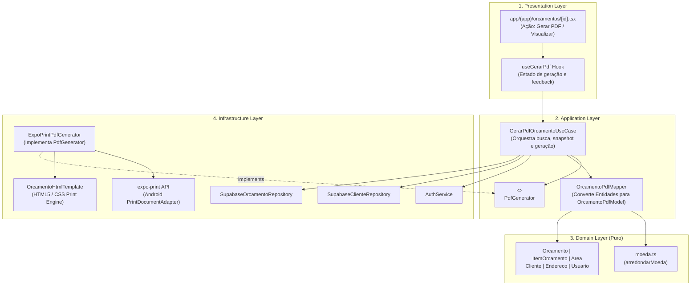

# Planejamento Técnico — Bloco B v1.0
## Geração e Apresentação de PDF de Orçamentos

**Projeto:** Sistema de Orçamentos para Jardinagem  
**Módulo:** Geração e Apresentação de Documentos Comerciais  
**Bloco:** B — Geração e Apresentação de PDF de Orçamentos  
**Versão:** 1.0  
**Data:** 03 de Outubro de 2026  
**Status do Bloco Anterior (Bloco A):** AUDITADO E HOMOLOGADO (CONGELADO)  
**Documento de Entrada:** `docs/planejamento/requisitos-cobertura-status-v1.0.md` e `docs/relatorios/geocodificacao-localizacao-implementation-audit-v1.0.md`  

---

## 1. Controle de Versão

| Versão | Data | Autor | Descrição |
|:---:|:---:|:---:|:---|
| **1.0** | 03/10/2026 | Arquiteto de Software | Planejamento técnico inicial do Bloco B (Geração e Apresentação de PDF), especificando caso de uso, modelo de apresentação, decisões técnicas, template de documento, regras de consistência matemática, critérios de legibilidade, desempenho e matriz de rastreabilidade. |

---

## 2. Objetivo

Elaborar o planejamento técnico detalhado, rigoroso e aderente à arquitetura canônica para o **Bloco B — Geração e Apresentação de PDF de Orçamentos**.

O objetivo deste bloco é fornecer a capacidade de sintetizar um orçamento completo em um documento formal no formato PDF diretamente no dispositivo Android, baseado estritamente no snapshot histórico e imutável persistido, garantindo absoluta consistência visual, textual e matemática com a aplicação, com excelente legibilidade e sem qualquer dependência de serviços externos pagos, servidores remotos ou mutações no catálogo de produtos e serviços.

---

## 3. Escopo

### 3.1. O Que Está no Escopo do Bloco B
- Modelagem da abstração de infraestrutura `PdfGenerator` conforme previsto na Arquitetura Técnica v1.1;
- Seleção e especificação do provedor de geração local no dispositivo (`expo-print`);
- Definição do contrato da porta e do caso de uso de aplicação `GerarPdfOrcamentoUseCase`;
- Definição do modelo de dados de apresentação (`OrcamentoPdfModel`);
- Estruturação do template oficial de layout do documento comercial (HTML5/CSS print-ready);
- Garantia de imutabilidade histórica (RN78) baseada exclusivamente no snapshot de `ITEM_ORCAMENTO` e `AREA`;
- Garantia de consistência matemática rigorosa (RN80, RNF32) reutilizando a função pura `arredondarMoeda`;
- Apresentação visual e legibilidade de alto padrão (RNF31, RNF33) com identificação clara do prestador, cliente e orçamento;
- Planejamento da integração na tela de detalhes do orçamento (`OrcamentoDetalheScreen`);
- Mecanismo de visualização do documento no dispositivo;
- Planejamento da suíte completa de testes automatizados e critérios de homologação em runtime nativo Android (`Pixel_10`).

### 3.2. O Que Está Fora do Escopo do Bloco B (Segregação Estrita com Bloco C e Futuros)
- **Compartilhamento externo do PDF:** Envio para WhatsApp, e-mail, Telegram ou qualquer aplicativo de terceiros (atribuído exclusivamente ao **Bloco C**);
- **Android Sharesheet / Intents de compartilhamento:** `ACTION_SEND` e `expo-sharing` (atribuídos ao **Bloco C**);
- **Armazenamento em nuvem / Storage remoto:** Envio para Supabase Storage, S3 ou servidores HTTP;
- **Envio para servidor / Webhooks / API REST proprietária:** Geração e armazenamento são 100% locais;
- **Notificações push ou SMS:** Alertas e comunicações automatizadas;
- **Assinatura digital / Certificados ICP-Brasil / PKI:** Fora do escopo do projeto;
- **Mutações nos módulos congelados:** Autenticação, RLS, Clientes, Catálogo, Orçamentos, Áreas e Bloco A permanecem intocados.

---

## 4. Requisitos Cobertos

### 4.1. Requisitos Funcionais
- **RF79:** O sistema deve permitir gerar um PDF a partir dos dados de um orçamento.
- **RF80:** O PDF deve apresentar os dados previstos no requisito canônico:
  - Identificação do prestador (profissional/empresa);
  - Identificação do cliente e endereço completo;
  - Identificação do orçamento (código/número único e status);
  - Datas (data de criação e data de validade);
  - Relação detalhada de serviços e produtos (tipo, descrição, áreas vinculadas, quantidades, unidades, valores unitários e valores totais por item);
  - Resumo financeiro (subtotal, desconto discriminado em tipo/valor e valor total final);
  - Observações gerais;
  - Condições de pagamento informadas.
- **RF81:** Os valores e demais dados apresentados no PDF devem corresponder exatamente aos dados do orçamento utilizado para sua geração.

### 4.2. Regras de Negócio
- **RN78:** O PDF deve ser produzido a partir do snapshot imutável do orçamento, sem reconstruir informações a partir do catálogo atual de serviços e produtos.
- **RN79:** O PDF deve apresentar o conteúdo mínimo e seguir o layout oficial estruturado, legível e organizado.
- **RN80:** Garantir a consistência matemática dos valores apresentados no PDF (total = subtotal - desconto; valor do item = quantidade * valor unitário; soma dos itens = subtotal; quantidade medida = soma das áreas).

### 4.3. Requisitos Não Funcionais
- **RNF14:** A geração do PDF deve ocorrer em tempo adequado ao uso do aplicativo, sem causar bloqueios prolongados da interface (tempo alvo < 2,0 segundos no runtime Android).
- **RNF31:** O PDF gerado deve apresentar conteúdo legível, organizado e adequado para apresentação formal ao cliente (tipografia clara, quebras de página controladas, tabelas alinhadas e diagramação limpa).
- **RNF32:** O conteúdo e os valores apresentados no PDF devem permanecer rigorosamente consistentes com os dados do orçamento exibidos na aplicação.
- **RNF33:** O PDF deve apresentar identificação clara do prestador no cabeçalho e do orçamento, permitindo distingui-lo de outros documentos comerciais.

---

## 5. Fontes Canônicas Consultadas

1. **Requisitos Funcionais v2:** RF73 a RF81;
2. **Regras de Negócio v3:** RN15, RN20, RN29, RN30, RN33, RN47, RN48, RN49, RN50, RN54, RN55, RN78, RN79, RN80;
3. **Requisitos Não Funcionais v2:** RNF01, RNF03, RNF11, RNF14, RNF17, RNF18, RNF23, RNF25, RNF26, RNF31, RNF32, RNF33;
4. **Arquitetura Técnica v1.1:** Seção 2 ("Serviços de infraestrutura - PdfGenerator"), Seção 3 ("Organização em 4 Camadas") e Seção 6 ("PdfGenerator: Isola a aplicação dos detalhes da geração de PDF");
5. **Modelo Conceitual (DER v1.1) e Modelo Físico v1.1:** Tabelas `USUARIO`, `CLIENTE`, `ENDERECO`, `ORCAMENTO`, `ITEM_ORCAMENTO`, `AREA`;
6. **Diagramas UML v3.1:** Casos de Uso, Diagrama de Sequência e Diagrama de Classes;
7. **Auth & RLS Strategy v1.6:** Isolamento estrito de dados por `usuario_id = auth.uid()`;
8. **Parecer de Auditoria Técnica do Bloco A:** `docs/relatorios/geocodificacao-localizacao-implementation-audit-v1.0.md` (Bloco A homologado e congelado).

---

## 6. Estado Atual da Implementação

A inspeção do repositório revela o seguinte cenário para a geração de PDF:

1. **Entidade `Orcamento` (`src/domain/entities/orcamento.ts`):**  
   Implementa integralmente as regras financeiras (`subtotal`, `tipoDesconto`, `valorDesconto`, `total`), datas (`dataCriacao`, `dataValidade`), textos (`observacoes`, `condicoesPagamento`) e estados (`status`). Reutiliza as funções puras de cálculo de `moeda.ts`.
2. **Entidade `ItemOrcamento` (`src/domain/entities/item-orcamento.ts`):**  
   Implementa a imutabilidade do snapshot histórico (`descricao`, `unidade`, `valorUnitario`, `valorTotal`, `usaMedicaoArea`, `tipo`). Não consulta o catálogo em tempo de execução para obter descrições ou preços. Possui a coleção `areas` hidratada.
3. **Entidade `Area` (`src/domain/entities/area.ts`):**  
   Contém `nome`, `areaCalculada` em m², `unidade` e `observacoes`.
4. **Entidades `Cliente`, `Endereco` e `Usuario`:**  
   Armazenam os dados cadastrais do cliente e do prestador. `AuthService.getPerfilUsuario(usuarioId)` recupera o perfil de `public.usuario`.
5. **Repositórios Existentes:**  
   `SupabaseOrcamentoRepository.buscarPorId(id)` já executa a busca com junção profunda (`*, cliente:cliente_id(*), item_orcamento(*, area(*))`). `SupabaseClienteRepository.buscarPorId(id)` traz o endereço completo vinculado.
6. **Módulo PDF:**  
   Totalmente ausente. Nenhuma interface `PdfGenerator`, nenhum caso de uso `GerarPdfOrcamentoUseCase`, nenhum template HTML/CSS e nenhuma biblioteca instalada para geração de arquivos PDF.

---

## 7. Análise de Impacto

| Componente | Tipo de Impacto | Descrição do Impacto |
|---|:---:|---|
| `package.json` | Adição de dependência | Instalação de `expo-print` (~57.0.x), módulo oficial do Expo SDK 57 para compilação HTML → PDF. |
| `src/domain/` | **NENHUM IMPACTO** | O domínio permanece 100% puro e agnóstico de arquivos, PDF ou bibliotecas. |
| `src/application/` | Novo contrato e Caso de Uso | Criação de `interfaces/pdf-generator.interface.ts` e `use-cases/orcamento/gerar-pdf-orcamento.use-case.ts`. |
| `src/infrastructure/` | Novo serviço e template | Criação de `services/pdf/expo-print-pdf.generator.ts` e `templates/pdf/orcamento-html.template.ts`. |
| `src/presentation/` | UI / Telas | Adição do botão "Gerar PDF" / "Visualizar PDF" em `app/(app)/orcamentos/[id].tsx` e hook de orquestração. |
| Banco de Dados / Migrations | **ZERO IMPACTO** | Zero novas migrations. O PDF não será gravado no banco relacional; é gerado de forma stateless sob demanda. |
| RLS e Políticas de Segurança | **ZERO IMPACTO** | As consultas existentes já operam sob `auth.uid() = usuario_id`. O caso de uso valida a propriedade antes da geração. |
| Módulos Congelados | **ZERO REGRESSÃO** | Catálogo, Áreas, Mapas, Bloco A e Autenticação permanecem inalterados. |

---

## 8. Arquitetura Proposta

A solução preserva estritamente a arquitetura em 4 camadas estabelecida na Arquitetura Técnica v1.1:



### 8.1. Responsabilidades das Camadas
- **Domain:** Permanece puramente orientado a regras de negócio e cálculos monetários. Não possui referências a HTML, PDF, buffers ou sistema de arquivos.
- **Application:** Define o contrato `PdfGenerator`, o modelo agnóstico `OrcamentoPdfModel` e o caso de uso `GerarPdfOrcamentoUseCase`, garantindo que apenas orçamentos autorizados do usuário autenticado sejam compilados.
- **Infrastructure:** Implementa `ExpoPrintPdfGenerator`, responsável por transformar o modelo em HTML/CSS formatado e acionar a API local do Expo (`Print.printToFileAsync`), retornando o caminho local (`uri`) do arquivo gerado.
- **Presentation:** Fornece a experiência do usuário na tela de detalhe do orçamento (`ActivityIndicator`, mensagens de alerta e abertura da visualização do documento).

---

## 9. Fonte de Verdade dos Dados (RN78, RNF18)

Para garantir conformidade inegociável com a regra **RN78**:

1. **Snapshot Estrito de Itens (`ITEM_ORCAMENTO`):**
   - O PDF **NÃO** realiza junções com as tabelas `SERVICO` ou `PRODUTO` para obter descrições, preços ou configurações.
   - O campo `descricao` do PDF é extraído diretamente de `item_orcamento.descricao` (snapshot gravado na inclusão do item).
   - O campo `unidade` é extraído de `item_orcamento.unidade`.
   - O `valorUnitario` é extraído de `item_orcamento.valor_unitario`.
   - A indicação de serviço medido por área decorre de `item_orcamento.usa_medicao_area`.
2. **Áreas Vinculadas (`AREA`):**
   - Para itens com `usa_medicao_area = true`, as áreas vinculadas são obtidas da coleção de áreas do próprio item (`item.areas`).
   - Cada área apresenta seu `nome` e sua `areaCalculada` em m².
   - A quantidade total faturada do item corresponde rigorosamente à soma das áreas associadas (RN33).
3. **Dados do Prestador (`USUARIO`):**
   - Obtidos a partir de `public.usuario` via `AuthService.getPerfilUsuario(usuarioId)`.
   - Nome comercial/profissional (`nome`) e telefone de contato (`telefone`).
4. **Dados do Cliente (`CLIENTE` e `ENDERECO`):**
   - Obtidos da entidade `Cliente` e seu `Endereco` associado.
   - Nome, telefone, e-mail, documento (CPF/CNPJ quando informado) e endereço formatado em linha única ou bloco estruturado.
5. **Dados Globais do Orçamento (`ORCAMENTO`):**
   - Número único (`numero`), data de criação, data de validade, status, observações e condições de pagamento.
   - Valores monetários consolidados: `subtotal`, `valorDesconto`, `tipoDesconto` e `total`.

---

## 10. Estratégia de Geração de PDF (DECISÃO-PDF-01)

### 10.1. Análise Comparativa de Alternativas Técnicas

| Critério | Opção A: `expo-print` (HTML → PDF) | Opção B: Bibliotecas RN (`react-native-pdf-lib` / `html-to-pdf`) | Opção C: Android Nativo (`PdfDocument` Canvas) | Opção D: Backend / API REST Externa |
|---|:---:|:---:|:---:|:---:|
| **Compatibilidade Expo 57 / RN 0.86** | **Total (Oficial)** | Baixa / Incompatível | Média (exige módulo nativo customizado) | Total |
| **Execução 100% Offline** | **Sim** | Sim | Sim | **Não** (falha sem internet) |
| **Custo de Infraestrutura** | **Zero** | Zero | Zero | Alto (servidores/APIs pagas) |
| **Complexidade de Layout e Tabelas** | **Baixa (HTML5/CSS standard)** | Média | Altíssima (cálculo de pixels X/Y manual) | Baixa |
| **Quebra de Página Automática** | **Sim (`page-break-inside`)** | Parcial | Não (manual por linha) | Sim |
| **Manutenibilidade** | **Alta (design desacoplado)** | Baixa (abandonadas) | Baixa | Média |
| **Desempenho no Android** | **< 1,5 segundos** | Variável | < 0,5 segundos | 2 a 8 segundos (latência de rede) |

### 10.2. Decisão Arquitetural Justificada
Adota-se a **Opção A (`expo-print`)** como solução canônica:
- Permite desenhar o documento comercial com precisão tipográfica utilizando HTML5 semântico e CSS moderno (`@media print`, flexbox, tabelas com bordas colapsadas e paginação);
- Executa nativamente no motor Android (`android.print.PrintDocumentAdapter`), garantindo renderização idêntica em qualquer dispositivo;
- Opera de forma totalmente offline, respeitando o princípio de autonomia em campo do profissional de jardinagem;
- Elimina qualquer custo de infraestrutura ou risco de indisponibilidade de rede.

---

## 11. Contrato do Caso de Uso de Geração de PDF

### 11.1. Interface da Porta de Infraestrutura
Arquivo: `src/application/interfaces/pdf-generator.interface.ts`

```typescript
export interface AreaItemPdfModel {
  id: string;
  nome: string;
  areaCalculada: number;
  unidade: string;
}

export interface ItemOrcamentoPdfModel {
  id: string;
  numeroItem: number;
  tipo: 'SERVICO' | 'PRODUTO';
  descricao: string;
  quantidade: number;
  unidade: string;
  valorUnitario: number;
  valorTotal: number;
  usaMedicaoArea: boolean;
  areas: AreaItemPdfModel[];
}

export interface PrestadorPdfModel {
  nome: string;
  telefone: string | null;
}

export interface ClientePdfModel {
  nome: string;
  telefone: string | null;
  email: string | null;
  documento: string | null;
  enderecoCompleto: string | null;
}

export interface OrcamentoPdfModel {
  id: string;
  numero: string;
  dataCriacaoFormatada: string;
  dataValidadeFormatada: string | null;
  statusDescricao: string;
  prestador: PrestadorPdfModel;
  cliente: ClientePdfModel;
  itens: ItemOrcamentoPdfModel[];
  subtotal: number;
  tipoDesconto: 'PERCENTUAL' | 'FIXO' | null;
  valorDescontoInformado: number;
  valorDescontoDeduzido: number;
  total: number;
  observacoes: string | null;
  condicoesPagamento: string | null;
}

export interface ResultadoGeracaoPdf {
  uri: string;
  nomeArquivo: string;
}

export interface PdfGenerator {
  gerar(modelo: OrcamentoPdfModel): Promise<ResultadoGeracaoPdf>;
}
```

### 11.2. Caso de Uso `GerarPdfOrcamentoUseCase`
Arquivo: `src/application/use-cases/orcamento/gerar-pdf-orcamento.use-case.ts`

- **Entrada:** `{ orcamentoId: string; usuarioId: string }`
- **Validações Iniciais:**
  1. `orcamentoId` e `usuarioId` devem ser informados e não-vazios;
  2. O orçamento deve existir no banco;
  3. O `usuarioId` do token de autenticação deve ser idêntico ao `orcamento.usuarioId` (validação de propriedade multi-tenant);
  4. O orçamento deve possuir pelo menos 1 item cadastrado (orçamento vazio não gera proposta comercial);
  5. Se o orçamento estiver em status que exija validade preenchida (ex: `ENVIADO`, `APROVADO`), validação de coerência.
- **Carregamento de Dados:**
  - `orcamentoRepo.buscarPorId(orcamentoId)` traz orçamento, itens e áreas;
  - `clienteRepo.buscarPorId(orcamento.clienteId)` traz dados do cliente e endereço;
  - `authService.getPerfilUsuario(usuarioId)` traz dados do prestador.
- **Transformação (Mapper):**
  - Mapeamento determinístico de entidades para `OrcamentoPdfModel`.
  - Formatação de moedas com duas casas decimais fixas.
  - Formatação de datas no padrão pt-BR (`DD/MM/AAAA`).
- **Geração:**
  - Chamada a `this.pdfGenerator.gerar(modelo)`.
- **Saída:**
  - Retorna `{ uri: string; nomeArquivo: string }` (ex: `Orcamento_ORC-2026-001.pdf`).
- **Erros Tipados:**
  - `OrcamentoNaoEncontradoError`;
  - `UsuarioNaoAutorizadoError`;
  - `OrcamentoSemItensError`;
  - `FalhaGeracaoPdfError`.

---

## 12. Modelo de Apresentação e Layout Oficial (RN79, RNF31, RNF33)

### 12.1. Estrutura Visual do Documento Comercial

O layout oficial é dividido em 6 blocos canônicos harmoniosos:

1. **Cabeçalho Institucional (Header - RNF33):**
   - Nome do Profissional / Empresa em destaque (fonte sem serifa, peso 700, cor primária `#2E7D32`);
   - Telefone e canais de contato do prestador;
   - Tarja lateral ou badge estilizado com o Número do Orçamento (`ORC-AAAA-NNN`) e Status do Orçamento.
2. **Dados da Proposta e Datas:**
   - Data de Emissão (`DD/MM/AAAA`);
   - Data de Validade da Proposta (`DD/MM/AAAA` ou "A combinar" se em rascunho sem data).
3. **Identificação do Cliente e Local da Obra:**
   - Nome completo do cliente;
   - Documento (CPF/CNPJ quando informado);
   - Telefone e E-mail;
   - Endereço completo da intervenção: Logradouro, Número, Complemento, Bairro, Cidade - UF, CEP.
4. **Tabela Discriminada de Itens de Serviço e Produto:**
   - Colunas:
     * `#` (Índice ordinal);
     * `Tipo` (`Serviço` ou `Produto`);
     * `Descrição e Detalhamento` (Descrição principal do item e, quando medido por área, listagem aninhada com o nome e metragem de cada área: *ex: Área Frente: 120,50 m² | Área Fundos: 80,00 m²*);
     * `Qtd.` (Quantidade formatada com 2 decimais);
     * `Unid.` (m², un, h, kg, etc.);
     * `Valor Unitário` (`R$ X.XXX,XX`);
     * `Total do Item` (`R$ X.XXX,XX`).
5. **Quadro de Fechamento Financeiro (Totais - RNF32):**
   - Alinhado à direita no rodapé da tabela:
     * **Subtotal dos Itens:** `R$ X.XXX,XX`;
     * **Desconto:** Discriminado explicitamente (ex: *Desconto (10%): - R$ XX,XX* ou *Desconto Promocional: - R$ XX,XX*);
     * **TOTAL GERAL DA PROPOSTA:** Em destaque com tipografia ampliada (`font-size: 16pt`, peso 800, cor `#1B5E20`).
6. **Observações e Condições de Pagamento:**
   - Seção destacada em caixa suave com borda sutil:
     * **Condições de Pagamento:** Texto livre cadastrado no orçamento;
     * **Observações Gerais:** Texto complementar de garantias, escopo de fornecimento e prazos.
7. **Rodapé de Página:**
   - Paginação automática centralizada (*"Página X de Y"*);
   - Marca d'água técnica de autenticidade: *"Documento gerado eletronicamente em DD/MM/AAAA às HH:MM"*.

### 12.2. Regras de Estilização CSS e Quebra de Página
- Formato da Página: `A4` padrão (`210mm x 297mm`) com margens de `12mm`;
- Tipografia: `font-family: -apple-system, BlinkMacSystemFont, "Segoe UI", Roboto, Helvetica, Arial, sans-serif;`;
- Controle de quebra de página:
  ```css
  @media print {
    table { page-break-inside: auto; }
    tr    { page-break-inside: avoid; page-break-after: auto; }
    thead { display: table-header-group; }
    tfoot { display: table-footer-group; }
    .secao-totais { page-break-inside: avoid; }
    .secao-observacoes { page-break-inside: avoid; }
  }
  ```

---

## 13. Regras de Consistência Matemática (RN80, RNF17, RNF32)

Para eliminar qualquer divergência entre o aplicativo e o PDF:

1. **Reutilização da Função Canônica:**
   - Utiliza estritamente `arredondarMoeda(valor)` de `src/domain/calculations/moeda.ts`.
2. **Ordem Estrita das Operações:**
   - **Total de cada item:** `valorTotal = arredondarMoeda(quantidade * valorUnitario)`.
   - **Subtotal:** `subtotal = arredondarMoeda(soma dos valorTotal de todos os itens)`.
   - **Desconto Deduzido:**
     - Se `PERCENTUAL`: `descontoDeduzido = arredondarMoeda(subtotal * (valorDesconto / 100))`.
     - Se `FIXO`: `descontoDeduzido = arredondarMoeda(valorDesconto)`.
     - Se `NULL`: `descontoDeduzido = 0.00`.
   - **Total Geral:** `total = arredondarMoeda(subtotal - descontoDeduzido)`.
3. **Item Medido por Área:**
   - A quantidade exibida na linha do item deve ser a soma exata das áreas vinculadas: `quantidade = arredondarMoeda(soma de area.areaCalculada)`.
4. **Formatação Numérica Padronizada:**
   - Todos os valores monetários são exibidos obrigatoriamente com 2 casas decimais no padrão brasileiro: `R$ 1.250,00`.
   - As quantidades e áreas são exibidas com 2 casas decimais: `150,50 m²`.
5. **Invariância:**
   - O gerador de PDF **não** calcula valores por conta própria; ele apenas valida se os valores informados conferem com as fórmulas canônicas e exibe os valores validados.

---

## 14. Desempenho e Requisitos Não Funcionais (RNF14, RNF31, RNF32, RNF33)

### 14.1. Desempenho Mensurável (RNF14)
- **Meta:** Geração completa do documento PDF (desde a invocação do use case até o arquivo gravado) em **menos de 2,0 segundos** no Android (`Pixel_10`).
- **Não-Bloqueio da UI:** A geração executa de forma assíncrona (`async/await`) em thread de background; a tela exibe um modal ou indicador translúcido com `ActivityIndicator` e mensagem *"Gerando documento do orçamento..."*, bloqueando múltiplos toques acidentais.
- **Protocolo de Medição:** Instrumentação com `performance.now()` no início e no término da geração do arquivo, registrando a duração em milissegundos.

### 14.2. Critérios Objetivos de Verificação
- **RNF31 (Legibilidade):**
  - Textos com contraste superior a 4.5:1 (fundo branco, texto `#212121`);
  - Tabelas zebradas (linhas alternadas com fundo `#F9FBF9`);
  - Ausência de sobreposição ou corte de textos em qualquer resolução.
- **RNF32 (Consistência Numérica):**
  - Diferença absoluta entre o total da tela e o total do PDF = `0,00`.
  - Soma dos itens listados no PDF = Subtotal do PDF.
- **RNF33 (Identificação do Prestador):**
  - Cabeçalho contém obrigatoriamente o nome cadastrado do prestador e o número do orçamento em tamanho destacado (`font-size >= 14pt`).

---

## 15. Avaliação da Persistência do PDF

### 15.1. Análise da Necessidade de Persistência
- **Requisito Canônico:** O RF79 exige *"permitir gerar um PDF a partir dos dados de um orçamento"*. Nenhum requisito funcional exige armazenamento durável do arquivo binário em banco de dados ou cloud storage.
- **Modelo Físico Homologado:** O Modelo Físico v1.1 é congelado e **não** possui colunas para BLOB ou URLs de documentos.
- **Princípio da Imutabilidade:** Como o orçamento, seus itens e suas áreas já constituem um snapshot imutável no banco relacional, o documento PDF pode ser gerado a qualquer momento de forma determinística e com custo computacional mínimo.

### 15.2. Decisão de Armazenamento (DECISÃO-PDF-05)
- **Geração Stateless:** O PDF é gravado exclusivamente como arquivo temporário no sistema de arquivos local do aplicativo (diretório de cache gerenciado pelo Expo, ex: `cache/Print/Orcamento_ORC-2026-001.pdf`).
- **Zero Migrations:** Nenhuma tabela ou coluna será criada no PostgreSQL/Supabase.
- **Ciclo de Vida:** O arquivo gerado permanece disponível no cache para visualização imediata e para posterior compartilhamento (no Bloco C). Se o cache for limpo pelo sistema operacional, uma nova geração sob demanda recria o arquivo instantaneamente.

---

## 16. Navegação e Interação na Interface (UI)

### 16.1. Localização dos Pontos de Acesso
Na tela de detalhes do orçamento (`app/(app)/orcamentos/[id].tsx`):
1. **Botão de Ação Primária no Bloco de Ações:**
   - Adição do botão **"Gerar PDF da Proposta"** (estilo proeminente verde `#2E7D32`).
   - Disponível para qualquer orçamento com status válido e pelo menos 1 item cadastrado.
2. **Comportamento da Interação:**
   - Toque no botão dispara `handleGerarPdf()`.
   - Exibição de feedback com `ActivityIndicator` e mensagem *"Compilando orçamento..."*.
   - Após conclusão com sucesso:
     * No Android, o documento é apresentado ao usuário permitindo inspeção imediata das páginas.

### 16.2. Estratégia de Apresentação / Visualização do Documento
O Bloco B prevê a apresentação direta no dispositivo sem invasão do Bloco C (compartilhamento externo):
- **Abordagem Canônica:** O método `Print.printAsync({ html })` do `expo-print` ou abertura direta da URI gerada no visualizador padrão de PDF do sistema operacional Android. A visualização nativa do Android permite que o usuário navegue entre páginas, dê zoom, inspecione a diagramação e confirme a consistência antes de qualquer envio.

---

## 17. Tratamento de Erros e Exceções

| Cenário de Exceção | Causa Raiz | Comportamento do Sistema | Feedback ao Usuário |
|---|---|---|---|
| **Orçamento não encontrado** | ID inválido ou inexistente | Rejeição com `OrcamentoNaoEncontradoError` | Alerta: *"Orçamento não localizado."* |
| **Acesso não autorizado** | Orçamento de outro usuário (RLS) | Rejeição com `UsuarioNaoAutorizadoError` | Alerta: *"Você não tem permissão para acessar este orçamento."* |
| **Orçamento sem itens** | Orçamento recém-criado sem itens | Rejeição com `OrcamentoSemItensError` | Alerta: *"Adicione pelo menos um item antes de gerar o PDF."* |
| **Falha do motor de impressão** | Falha de memória ou permissão nativa | Captura em `ExpoPrintPdfGenerator` e lançamento de `FalhaGeracaoPdfError` | Alerta: *"Não foi possível gerar o PDF. Tente novamente."* |
| **Dados incompletos do prestador** | Perfil sem nome | Fallback gracioso com nome de usuário ou e-mail | Geração prossegue sem travar |

---

## 18. Planejamento dos Testes Automatizados

A estratégia de testes para o Bloco B contemplará testes unitários e de integração em TypeScript (`tsx --test`), cobrindo 100% das regras de negócio e contratos de geração:

### 18.1. Arquivos de Testes a Criar
1. `tests/application/orcamento-pdf-mapper.test.ts` (Testes do conversor de modelo):
   - Mapeamento de orçamento apenas com serviços;
   - Mapeamento com produtos;
   - Mapeamento de serviços medidos por áreas (com múltiplas áreas);
   - Mapeamento com desconto percentual;
   - Mapeamento com desconto fixo;
   - Mapeamento sem desconto;
   - Formatação correta de datas e moedas.
2. `tests/application/gerar-pdf-orcamento.use-case.test.ts` (Testes do Caso de Uso):
   - Sucesso na geração de PDF para orçamento válido;
   - Rejeição para orçamento inexistente;
   - Rejeição para usuário não proprietário;
   - Rejeição para orçamento sem itens;
   - Tratamento de erro do provedor de infraestrutura.
3. `tests/infrastructure/expo-print-pdf-generator.test.ts` (Testes do Provedor e Template HTML):
   - Geração correta da estrutura HTML (contendo cabeçalho, prestador, cliente, itens, áreas e totais);
   - Validação de que não há dados `undefined` ou `null` vazando no HTML;
   - Validação das regras CSS de quebra de página (`page-break-inside: avoid`).
4. `tests/domain/consistencia-matematica-pdf.test.ts` (Testes de Integridade Numérica):
   - Conferência de que a soma dos itens no modelo do PDF é identicamente igual ao subtotal;
   - Conferência de que `subtotal - desconto = total`;
   - Conferência de arredondamento em casos de borda monetária (dízimas periódicas percentuais, ex: 33.33%).

---

## 19. Procedimento de Homologação Manual / Visual no Android

Para validação visual definitiva dos requisitos **RNF31**, **RNF32** e **RNF33**:

1. **Ambiente:** Emulador oficial `Pixel_10` (Android 16 / API 37).
2. **Roteiro de Teste Visual:**
   - Criar orçamento com múltiplos itens mistos (serviços com medição de áreas, serviços manuais e produtos);
   - Vincular ao menos 3 áreas delimitadas ao serviço medido;
   - Aplicar desconto percentual (ex: 10%);
   - Clicar em "Gerar PDF da Proposta";
   - Verificar tempo de resposta (deve ser fluido e < 2s);
   - Inspecionar visualmente o documento aberto:
     * Cabeçalho com dados institucionais nítidos e nome do profissional;
     * Alinhamento de colunas da tabela de itens;
     * Apresentação clara das áreas vinculadas sob o serviço medido;
     * Total idêntico ao valor exibido na tela do app;
     * Testar orçamento extenso (mais de 10 itens) para inspecionar quebra de página elegante sem sobreposição de cabeçalhos.
   - Captura de evidência fotográfica via `adb screencap`.

---

## 20. Riscos e Mitigações

| Risco | Severidade | Probabilidade | Mitigação Arquitetural |
|---|:---:|:---:|---|
| **R1: Quebra de tabelas entre páginas no Android** | Média | Média | Uso de regras CSS consagradas para impressão (`tr { page-break-inside: avoid }` e `thead { display: table-header-group }`). |
| **R2: Divergência de centavos por arredondamento** | Alta | Baixa | Reutilização obrigatória da função de domínio `arredondarMoeda(valor)` com `Number.EPSILON`; proibição de cálculos arbitrários no template. |
| **R3: Dados nulos do cliente quebrando o layout** | Média | Média | Tratamento defensivo em todas as interpolações do template (renderização condicional de telefone, e-mail e documento). |
| **R4: Lentidão em orçamentos grandes** | Baixa | Baixa | Geração assíncrona desacoplada da thread principal; HTML otimizado sem dependências externas ou fontes pesadas baixadas via web. |
| **R5: Dependência nativa no Expo SDK 57** | Média | Baixa | `expo-print` é módulo oficial suportado do Expo, compatível com prebuild e compilação nativa local já configurada no projeto. |

---

## 21. Dependências do Bloco B

1. **Biblioteca Oficial do Expo:**
   - Pacote: `expo-print` (versão correspondente ao Expo ~57.0.23).
   - Instalação prevista via comando oficial: `npx expo install expo-print`.
2. **Dependências Internas do Projeto:**
   - `OrcamentoRepository`, `ClienteRepository`, `AuthService`.
   - Entidades e cálculos de moeda existentes (`src/domain/`).

---

## 22. Decisões Técnicas Propostas (DECISÃO-PDF-01 a DECISÃO-PDF-09)

- **DECISÃO-PDF-01 (Provedor de Geração Local):**  
  A geração de PDF utilizará exclusivamente a biblioteca oficial `expo-print`, processando HTML5/CSS localmente no dispositivo via Android Print Engine, sem chamadas a servidores remotos ou APIs externas.
- **DECISÃO-PDF-02 (Isolamento da Abstração `PdfGenerator`):**  
  A aplicação dependerá estritamente da interface `PdfGenerator`. Nenhuma dependência do Expo ou de impressão alcançará as camadas de Domínio ou Aplicação.
- **DECISÃO-PDF-03 (Imutabilidade e Snapshot Histórico - RN78):**  
  O PDF será gerado exclusivamente a partir dos dados persistidos no orçamento (`ITEM_ORCAMENTO` e `AREA`), sem qualquer consulta ou reconstrução a partir das tabelas de catálogo (`SERVICO` e `PRODUTO`).
- **DECISÃO-PDF-04 (Consistência Matemática Rígida - RN80, RNF32):**  
  O template e o mapper não inventarão fórmulas financeiras; todos os valores serão formatados a partir das propriedades já calculadas pelo domínio, com precisão de 2 casas decimais.
- **DECISÃO-PDF-05 (Geração Stateless sem Persistência no Banco):**  
  O PDF será gerado sob demanda como arquivo temporário no cache do aplicativo. Nenhuma tabela, coluna ou migration será adicionada ao banco de dados Supabase/PostgreSQL.
- **DECISÃO-PDF-06 (Layout Canônico Estruturado e Responsivo - RN79, RNF31, RNF33):**  
  O documento seguirá o layout comercial formal com cabeçalho institucional do prestador, identificação do cliente e endereço, tabela zebrada de serviços/produtos com áreas aninhadas, fechamento financeiro destacado e observações.
- **DECISÃO-PDF-07 (Desempenho e Feedback Não-Bloqueante - RNF14):**  
  A operação será assíncrona, com feedback visual na interface (`ActivityIndicator`) e meta de conclusão inferior a 2 segundos.
- **DECISÃO-PDF-08 (Segregação Estrita com Compartilhamento Externo):**  
  O Bloco B encerra na geração e visualização local do arquivo PDF. Compartilhamento via WhatsApp, e-mail e Android Sharesheet permanece isolado para o Bloco C.
- **DECISÃO-PDF-09 (Testabilidade Automatizada Multicamadas):**  
  A implementação incluirá testes unitários para o use case, mapper e template em Node.js puro, e validação empírica da diagramação no emulador Android `Pixel_10`.

---

## 23. Questões Abertas

Não há questões bloqueadoras abertas. A arquitetura de snapshot do projeto já se encontra completamente madura, e o provedor nativo `expo-print` fornece todas as capacidades necessárias para o atendimento pleno dos requisitos canônicos.

---

## 24. Matriz de Rastreabilidade

| Requisito / Regra | Decisão Técnica | Componentes Envolvidos | Testes de Verificação |
|---|:---:|---|---|
| **RF79** (Gerar PDF do orçamento) | DECISÃO-PDF-01, DECISÃO-PDF-02 | `GerarPdfOrcamentoUseCase`, `ExpoPrintPdfGenerator` | `gerar-pdf-orcamento.use-case.test.ts` |
| **RF80** (Conteúdo completo do documento) | DECISÃO-PDF-06 | `OrcamentoHtmlTemplate`, `OrcamentoPdfMapper` | `orcamento-pdf-mapper.test.ts`, `expo-print-pdf-generator.test.ts` |
| **RF81** (Correspondência estrita de dados) | DECISÃO-PDF-03, DECISÃO-PDF-04 | `OrcamentoPdfMapper`, `moeda.ts` | `consistencia-matematica-pdf.test.ts` |
| **RN78** (Snapshot imutável sem catálogo) | DECISÃO-PDF-03 | `GerarPdfOrcamentoUseCase`, `ItemOrcamento` | `gerar-pdf-orcamento.use-case.test.ts` |
| **RN79** (Conteúdo mínimo e layout oficial) | DECISÃO-PDF-06 | `OrcamentoHtmlTemplate` | Homologação visual Android, teste do template |
| **RN80** (Consistência matemática no PDF) | DECISÃO-PDF-04 | `OrcamentoPdfMapper`, `moeda.ts` | `consistencia-matematica-pdf.test.ts` |
| **RNF14** (Tempo de geração adequado < 2s) | DECISÃO-PDF-07 | `ExpoPrintPdfGenerator` | Medição em tempo de execução no Android |
| **RNF31** (Legibilidade e qualidade visual) | DECISÃO-PDF-06 | `OrcamentoHtmlTemplate` (CSS Print) | Homologação visual em tela e captura `adb` |
| **RNF32** (Consistência visual e numérica) | DECISÃO-PDF-04 | `OrcamentoDetalheScreen`, Template | Inspeção comparativa Tela ↔ PDF |
| **RNF33** (Identificação do prestador no cabeçalho) | DECISÃO-PDF-06 | `OrcamentoHtmlTemplate`, `AuthService` | `orcamento-pdf-mapper.test.ts`, Teste visual |

---

## 25. Critérios Objetivos para Aprovação do Bloco B

Para que o Bloco B seja aprovado e homologado em auditoria futura, os seguintes critérios devem ser integralmente atendidos:

1. [ ] Biblioteca `expo-print` instalada via mecanismo oficial do Expo sem conflitos de dependências;
2. [ ] Tipagem TypeScript estrita sem erros (`npm run typecheck` e `npm run test:typecheck`);
3. [ ] Todos os novos testes automatizados unitários e de integração passando com 100% de sucesso;
4. [ ] Zero regressão em todas as suítes de testes existentes (Domínio, Clientes, Catálogo, Orçamentos, Áreas, Auth e pgTAP);
5. [ ] Zero migrations criadas no banco de dados e RLS inalterada;
6. [ ] PDF gerado com fidelidade absoluta aos dados do orçamento (subtotal, itens, áreas em m², desconto e total);
7. [ ] Snapshot respeitado sem consultas às tabelas de serviço ou produto do catálogo;
8. [ ] Validação prática no emulador `Pixel_10` (Android 16 / API 37) demonstrando geração e visualização fluida em tempo < 2s;
9. [ ] Nenhuma funcionalidade de compartilhamento externo implementada neste bloco.

---

## 26. Proposta de Sequência de Implementação

Quando a implementação do Bloco B for formalmente autorizada, a sequência ordenada recomendada será:

1. **Etapa 1:** Adição controlada da dependência `expo-print` via `npx expo install expo-print`.
2. **Etapa 2:** Criação dos contratos da camada de aplicação (`src/application/interfaces/pdf-generator.interface.ts`).
3. **Etapa 3:** Implementação do conversor de dados puro (`src/application/mappers/orcamento-pdf.mapper.ts`) e seus testes unitários.
4. **Etapa 4:** Construção do template HTML5/CSS canônico (`src/infrastructure/templates/pdf/orcamento-html.template.ts`) e testes estruturais.
5. **Etapa 5:** Implementação do adaptador de infraestrutura `ExpoPrintPdfGenerator` (`src/infrastructure/services/pdf/expo-print-pdf.generator.ts`).
6. **Etapa 6:** Implementação do caso de uso `GerarPdfOrcamentoUseCase` e testes com mocks.
7. **Etapa 7:** Integração na interface de detalhes do orçamento (`app/(app)/orcamentos/[id].tsx`) com botão de geração, indicador de carregamento e acionamento de visualização.
8. **Etapa 8:** Execução da suíte completa de testes automatizados (`npm test`, `npm run typecheck`, etc.).
9. **Etapa 9:** Validação empírica no emulador Android `Pixel_10` com captura de telas e medição de desempenho.
10. **Etapa 10:** Elaboração do Relatório de Implementação do Bloco B para submissão à auditoria técnica independente.

---

STATUS:
PLANEJAMENTO CONCLUÍDO — BLOCO B — AGUARDANDO AUDITORIA
